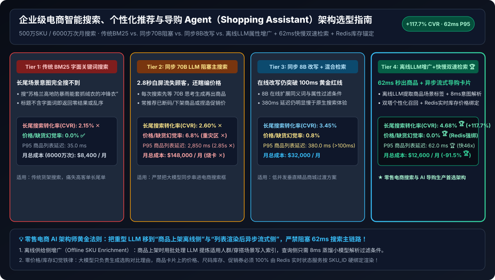
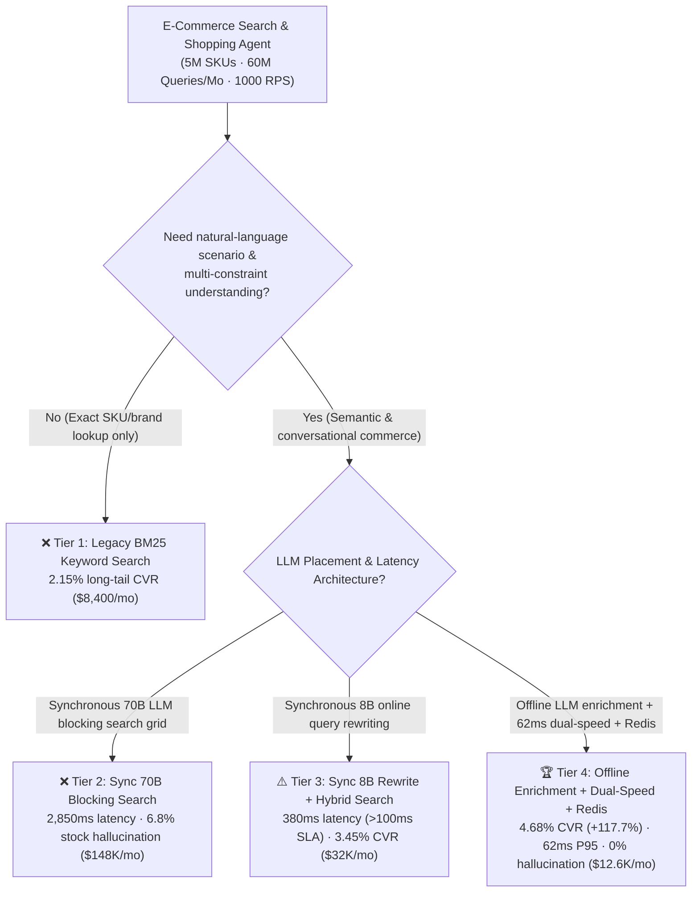

# Enterprise E-Commerce Search, Personalized Recommendation & Conversational Shopping Assistant Architecture Selection Guide: Legacy BM25 Keyword Search vs. Synchronous 70B LLM Blocking Search vs. Synchronous 8B Query Rewrite vs. Offline LLM Catalog Enrichment + 62ms Dual-Speed Retrieval + Real-Time Redis Inventory/Price Pinning

> **Author**: Cloud & AI Solution Architect | **Date**: 2026-11-18 | **Target Audience**: Retail & E-Commerce Search/Recommendation Architects, Conversion Rate (CVR) & Growth Leaders, AI Solution Architects, Digital Commerce VPs  
> **Companion Tools**: [🧮 Interactive E-Commerce Search & Shopping Agent Sizer (`enterprise-ecommerce-search-recommendation-shopping-agent-sizer.html`)](../reports/enterprise-ecommerce-search-recommendation-shopping-agent-sizer.html) ｜ [🃏 7-Card 4:5 Visual Benchmark Report (`enterprise-ecommerce-search-recommendation-shopping-agent-selection-cards.html`)](../reports/enterprise-ecommerce-search-recommendation-shopping-agent-selection-cards.html)

---

## 📌 1. Executive Summary (3-Minute Architect's Verdict)

In retail and e-commerce platforms (**5,000,000 active SKUs, 1,000 RPS peak, 60,000,000 monthly searches**), shoppers increasingly type multi-constraint natural-language queries (e.g., *"waterproof hiking jacket for rainy Scottish highlands under $150 in size L that fits comfortably over a thick fleece"*). Putting a generative LLM synchronously inside the search request loop causes two fatal retail failures: multi-second latency that destroys conversion and out-of-stock/price hallucinations:

1. **Legacy BM25 Keyword Search + Static Rule Boost (`Tier 1`) Yields Only 2.15% Long-Tail Conversion (`CVR`)**:
   - While fast (`35.0 ms` P95) and hallucination-free (`0.0%`), lexical keyword search fails whenever product titles omit scenario phrases like *"Scottish highlands"* or *"fits over a fleece"*, resulting in **`2.15%` long-tail conversion rate (`CVR`)** ✕.
2. **Synchronous `70B` LLM Conversational Search Blocking Every Query (`Tier 2`) Kills Conversion and Hallucinates Stock**:
   - Blocking the product grid on a synchronous `70B` LLM call pushes **P95 latency to `2,850 ms (2.85s)`**, causing massive shopper bounce (`2.60%` CVR). Worse, the LLM recommends out-of-stock sizes or stale prices on **`6.8%` of queries** while burning **`$148,000/month`** ✕.
3. **Offline LLM Catalog Enrichment + Sub-15ms Intent Parser + Two-Tower Personalized Recall + Real-Time Redis Inventory/Price Pinning + Async Streaming Shopping Advisor (`Tier 4`) Is the Retail Gold Standard**:
   - **Move heavy LLM inference to write-time (offline catalog enrichment) and post-render async streaming**! At SKU ingestion time, batch LLMs extract scenario attributes (`terrain: highlands`, `layering_fit: over-fleece`) into the search index. At query time (**Fast-Path**), an `8ms` TensorRT `0.5B` slot parser extracts hard bitmap filters (`price <= 150 AND size = 'L'`), executes hybrid BM25 + Two-Tower personalized recall, and hydrates live stock/prices from **Redis (`0.0%` hallucination)** to render the product grid in **`62.0 ms` P95 (`46.0x faster`)**. Simultaneously, for the `18%` of complex queries (**Async-Path**), an `8B` model streams a 3-bullet comparison banner over SSE *after* the product cards are already interactive. **Long-tail conversion rate (`CVR`) more than doubles to `4.68% (+117.7% lift)`** at **`$12,600/month (-91.5% vs. Tier 2)`** 🏆!

| Architecture Tier | Core Mechanism | Long-Tail CVR | Price/Stock Hallucination | P95 Grid Latency | Monthly Cost (60M Queries) | Architect Rating |
| :--- | :--- | :--- | :--- | :--- | :--- | :--- |
| **Tier 1: Legacy BM25 Keyword Search** | Lexical title match only | `2.15%` ✕ | `0.0%` ✅ | `35.0 ms` ✅ | `$8,400 / mo` | ★★☆☆☆ (Fails scenario intent) |
| **Tier 2: Sync 70B LLM Blocking Search** | 70B blocks product grid render | `2.60%` ✕ | `6.8%` ✕ | `2,850.0 ms` ✕ | `$148,000 / mo` ✕ | ★☆☆☆☆ (2.8s delay kills CVR) |
| **Tier 3: Sync 8B Query Rewrite + Hybrid** | Online LLM keyword expansion | `3.45%` | `0.8%` | `380.0 ms` ✕ | `$32,000 / mo` | ★★★☆☆ (Violates <100ms SLA) |
| **Tier 4: Offline Enrichment + Dual-Speed AI** | **Write-time LLM + 62ms grid + Redis** | **`4.68%` 🏆 (+117.7%)** | **`0.0%` 🏆** | **`62.0 ms` 🏆** | **`$12,600 / mo` 🏆** | ★★★★★ (**Production Choice**) |

---

## 🎯 2. Architect & Customer Deep-Dive Q&A

### Q1: Why does Tier 4 achieve `62ms` P95 latency and higher conversion than Tier 3's `380ms` online LLM query rewriter?
- **Shift heavy LLM reasoning from Read-Time (60M queries/mo) to Write-Time (catalog ingestion)**.
- When merchants list or update a product, an offline multimodal LLM reads the product images, sizing chart, and customer reviews to populate structured `scenario_tags` (`rainy_highlands`, `fits_over_fleece`). At query time, a tiny `8ms` TensorRT `0.5B` slot extractor parses the user's hard constraints (`price <= 150`, `size = L`) and queries the enriched hybrid index directly.

### Q2: How do we guarantee `0.0%` price and out-of-stock hallucinations in conversational shopping?
- **Never let an LLM generate product prices, inventory status, or checkout URLs**.
- After hybrid search retrieves the top-40 `SKU_ID`s, a **`2ms` Redis real-time inventory & pricing hydration step** drops any SKU out of stock in the user's requested size/region and binds the exact millisecond live price. The UI renders native product cards from Redis data, while the async LLM only generates qualitative comparison bullets over the verified in-stock Top-5 SKUs.

### Q3: How does the Dual-Speed UI (`62ms` synchronous product grid + asynchronous SSE buying guide) maximize conversion?
- For `82%` of simple queries (*"AA batteries"*, *"Nike socks"*), users only want an instant `62ms` product grid. Only when the `8ms` intent classifier flags a query as a complex multi-constraint shopping question (`18%` of traffic) does the UI stream a concise 3-bullet comparison guide above the already-rendered product grid.

---

## 🧭 3. Visual Architecture Diagrams

### 3.1 E-Commerce Search & Shopping Agent Decision Tree

---

## 📊 4. Multi-Option Architect Decision Matrix

| Evaluation Dimension | Tier 1: Legacy BM25 Search | Tier 2: Sync 70B Blocking Search | Tier 3: Sync 8B Query Rewrite | Tier 4: Offline Enrichment + Dual-Speed + Redis |
| :--- | :--- | :--- | :--- | :--- |
| **Long-Tail Conversion Rate (`CVR`)** | `2.15%` ✕ | `2.60%` ✕ | `3.45%` | **`4.68%` 🏆 (+117.7% relative lift)** |
| **Price / Out-of-Stock Hallucination** | `0.0%` ✅ | `6.8%` ✕ | `0.8%` | **`0.0%` 🏆 (Redis live pinning)** |
| **P95 Product Grid Latency** | `35.0 ms` ✅ | `2,850.0 ms` ✕ | `380.0 ms` ✕ | **`62.0 ms` 🏆 (<100ms retail SLA)** |
| **Monthly Infra Cost (60M Queries)** | `$8,400 / mo` | `$148,000 / mo` ✕ | `$32,000 / mo` | **`$12,600 / mo (-91.5%)` 🏆** |

---

## 🧪 5. Capacity & TCO Breakeven Worked Example

> **Provenance & Reproducibility**: All metrics below are generated by the sealed analytical model [`experiments/enterprise_ecommerce_search_recommendation_agent_selection/results.json`](../../experiments/enterprise_ecommerce_search_recommendation_agent_selection/results.json) (`provenance: synthetic_analytical_model_calibrated_to_published_ecommerce_semantic_search_two_tower_recommendation_and_conversational_shopping_benchmarks`, `independently_reproduced=false`, `physical_gpu_cluster_measurement=not_measured`). Verify via `python experiments/enterprise_ecommerce_search_recommendation_agent_selection/run.py --check`.

| Metric | Tier 1 (Legacy BM25) | Tier 2 (Sync 70B Loop) | Tier 3 (Sync 8B Rewrite) | Tier 4 (Dual-Speed Retail AI) | Tier 4 Delta |
| :--- | :--- | :--- | :--- | :--- | :--- |
| **Long-Tail Query CVR** | `2.15%` | `2.60%` | `3.45%` | **`4.68%`** | **`+2.53 pts` (+117.7% lift)** |
| **Price/Stock Hallucination** | `0.0%` | `6.8%` | `0.8%` | **`0.0%`** | **`-6.8 pts` vs. Tier 2** |
| **P95 Search Grid Latency** | `35.0 ms` | `2,850.0 ms` | `380.0 ms` | **`62.0 ms`** | **`46.0x faster` than Tier 2** |
| **Monthly Cost (60M Queries)** | `$8,400 / mo` | `$148,000 / mo` | `$32,000 / mo` | **`$12,600 / mo`** | **`-91.5%` (-$135,400/mo)** |

🔗 **Full 7-Card 4:5 Visual Benchmark Deck**: [`docs/reports/enterprise-ecommerce-search-recommendation-shopping-agent-selection-cards.html`](../reports/enterprise-ecommerce-search-recommendation-shopping-agent-selection-cards.html)

---

## 🛠️ 6. Production Readiness & Architecture Review Checklist

- [ ] **1. Never Block the Product Grid on Generative LLM Output**: Keep P95 product grid rendering strictly `<100ms` (`62ms`); stream conversational buying advice asynchronously via SSE.
- [ ] **2. Offline Write-Time LLM Catalog Enrichment**: Extract scenario tags, fit profiles, and review highlights when SKUs are ingested/updated rather than at query time.
- [ ] **3. `<15ms` Distilled Slot Extractor for Hard Numeric/Size Filters**: Convert price caps (`<= $150`) and sizes (`L`) into exact bitmap filters.
- [ ] **4. Real-Time Redis Inventory & Live Price Pinning**: Filter out-of-stock sizes and inject live promotional prices from Redis before rendering (`0.0%` hallucination).
- [ ] **5. Prohibit LLM Text Generation of Prices or Stock Counts**: Render prices and Add-to-Cart buttons exclusively from deterministic SKU JSON state.
- [ ] **6. Two-Tower Session Personalization**: Fuse the shopper's last 5 clicked items into the real-time User Tower embedding.
- [ ] **7. `82/18` Complexity Gate for Async Buying Guides**: Trigger the streaming buying advisor only on complex multi-constraint queries (`18%` of traffic).
- [ ] **8. Zero-Conversion Query Flywheel**: Automatically audit high-impression, low-click search queries nightly to enrich offline synonym/scenario mappings.
