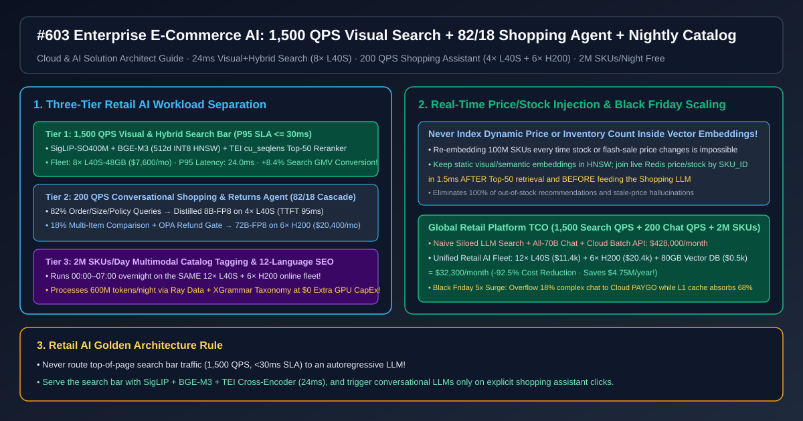

# Enterprise Global E-Commerce & Retail AI Architecture: `1,500 QPS` Visual Search, `82/18` Shopping Agent Cascade & Nightly Catalog Sizing Guide

> **Target Persona**: Cloud & AI Solution Architect  
> **Core Scenarios**: Global retail platforms serving `1,500 QPS` multimodal visual/hybrid search (`<= 30ms` SLA), `200 QPS` conversational shopping & returns assistant, and `2M SKUs/night` 12-language catalog onboarding  
> **Interactive H5 Learning Workbench**: [`docs/h5/ecommerce-visual-search-catalog-shopping-sizer.html`](../h5/ecommerce-visual-search-catalog-shopping-sizer.html)

---

## 1. Executive Summary

1. **Three-Tier Retail AI Architecture (`12× L40S + 6× H200` = `$32,300/mo`, `-92.5%` vs. `$428k/mo` Siloed Baseline)**:
   - **Tier 1 (`1,500 QPS` Visual & Hybrid Search Bar, `24.0ms` P95 `<= 30ms` SLA)**: `SigLIP-SO400M + BGE-M3` (`512d INT8` HNSW in `80 GB` RAM) + `TEI / Infinity` `cu_seqlens` Cross-Encoder reranking + **`1.5ms` Redis live price/stock hydration** on **`8× L40S-48GB` (`$7,600/mo`)**.
   - **Tier 2 (`200 QPS` Shopping & Returns Assistant)**: `82/18` model cascade routing `82%` sizing/order/policy queries to distilled `8B-FP8` on **`4× L40S`** (`95ms` TTFT) and `18%` complex multi-item comparisons to `72B-FP8` on **`6× H200` (`$20,400/mo`)**.
   - **Tier 3 (`2M SKUs/Night` = `600M Tokens` Multimodal Tagging & 12-Language SEO)**: Runs overnight (`00:00–07:00`) via `Ray Data + XGrammar` on the **exact same `12× L40S + 6× H200` daytime fleet at `$0` extra GPU CapEx**!

---

## 2. Retail AI Subsystem Sizing Matrix

| Retail Subsystem | Peak Traffic | Engine & Model Stack | GPU Fleet | SLA & Business Impact |
|---|---|---|---|---|
| **1. Visual & Hybrid Search Bar** | `1,500 QPS` | `SigLIP + BGE-M3 + TEI Rerank + Redis Hydration` | **`8× L40S`** (`$7.6k/mo`) | **`24.0ms` P95**, `+8.4%` search conversion |
| **2. Shopping & Returns Agent** | `200 QPS` | `82%` Distilled `8B` + `18%` `72B` + `OPA` Gate | **`4× L40S + 6× H200`** (`$24.2k/mo`) | **`95ms` TTFT**, `-76.5%` human ticket escalations |
| **3. Nightly 2M-SKU Localization** | `600M tok/night` | `Qwen2.5-VL + Ray Data + XGrammar` | **Overnight Tidal Reuse (`$0`)** | `98.6%` taxonomy accuracy by `06:30 AM` |

---

## 3. Production Checklist

- [ ] Never embed dynamic inventory counts or flash-sale prices into HNSW vectors; hydrate live price/stock from **Redis by `SKU_ID` in `1.5ms` post-retrieval**.
- [ ] Reuse daytime search and shopping GPUs overnight (`00:00–07:00`) for merchant catalog VLM tagging and multilingual translation.
