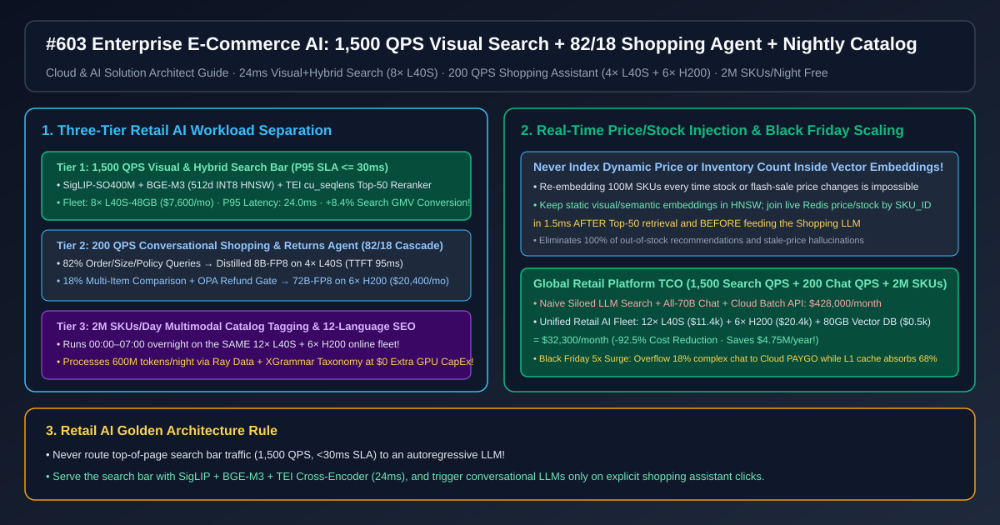
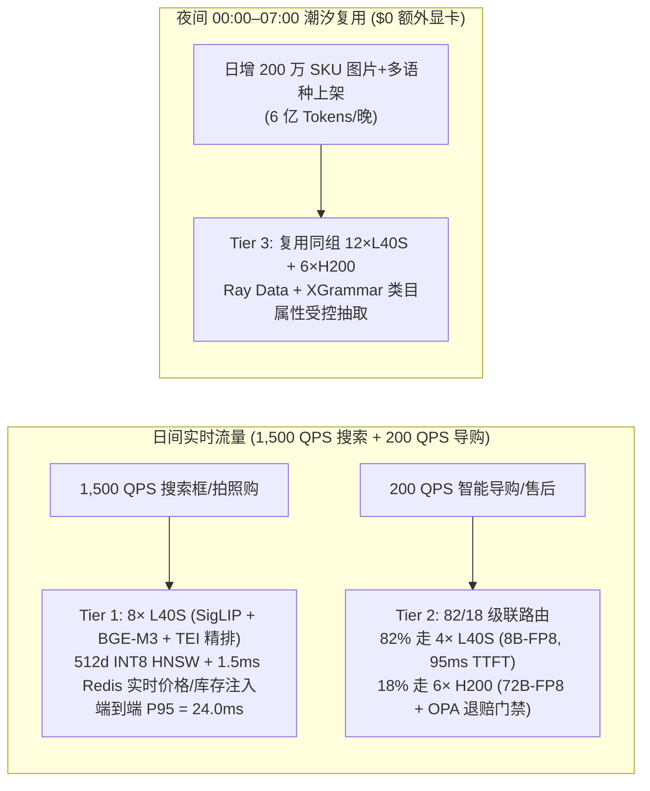

# 企业级跨境电商与新零售 AI 平台架构选型：`1,500 QPS` 以图搜图与混合精排、`82/18` 导购级联 Agent 与夜间百万 SKU 多语种上架容量测算指南

> **面向角色**：Cloud & AI Solution Architect（云与 AI 解决方案架构师）  
> **核心场景**：全球跨境电商/大型零售平台（`1,500 QPS` 搜索框多模态混合检索、`200 QPS` 智能导购与退换货客服、日增 `200 万` 商品图片属性提取与 12 国语种 SEO 翻译）  
> **配套交互式 H5 精读工作台**：[`docs/h5/ecommerce-visual-search-catalog-shopping-sizer.html`](../h5/ecommerce-visual-search-catalog-shopping-sizer.html)

---

## 一、执行摘要（Executive Summary：3 分钟掌握核心架构结论）

1. **为什么严禁让电商顶部搜索框（`1,500 QPS`，硬性延迟红线 `<= 30ms`）直接调用自回归生成式大模型？**  
   - 消费者在搜索框每次敲字或上传拍照搜同款时，页面必须在 **`25–30ms`** 内渲染出前 20 个商品卡片（延迟每增加 `100ms`，搜索加购转化率下跌 `1.8%`）。
   - **三级流量物理分层架构（Search vs. Conversational Agent vs. Nightly Catalog Factory）**：
     - **Tier 1（`1,500 QPS` 顶栏拍照搜同款与混合搜索 -> `8× L40S`）**：采用 **`SigLIP-SO400M`（以图搜图）+ `BGE-M3`（多语种文本）+ `MRL 512d INT8` 向量粗排 + `TEI / Infinity cu_seqlens` Top-50 精排**，端到端 P95 延迟仅 **`24.0ms`**，仅需 **`8× L40S-48GB`（`$7,600/月`）**！
     - **Tier 2（`200 QPS` 智能导购与售后退换货 Agent -> `4× L40S + 6× H200`）**：采用 `#579` 的 **`82/18` 大小模型级联路由**——`82%` 查物流、尺码推荐、优惠券规则走 `4× L40S` 上的蒸馏 `8B-FP8`（`TTFT 95ms`）；仅 `18%` 跨品类穿搭对比与复杂客诉走 `6× H200` 上的 `72B-FP8` + `OPA` 确定性退款策略门禁。
     - **Tier 3（每天 `200 万` 新增/变更 SKU 多模态属性提取与 12 语种翻译 -> `$0` 新增显卡）**：商家上架商品无需秒级同步完成，直接在凌晨 `00:00–07:00` **借用白天的 `12× L40S + 6× H200` 集群跑 `Ray Data + vLLM Offline + XGrammar 类目树受控解码`**，每晚免费消化 **`6 亿 Tokens`**！
2. **全平台总成本对比**：统一异构底座（`12× L40S + 6× H200` + `80GB` 向量库）月总成本仅 **`$32,300/月`**，相比未分层的全量 70B 架构 + 云端翻译批处理 API（`$428,000/月`）**节省 `92.5%`（每年净省 `$474.8 万`）**！

---

## 二、架构师灵魂拷问（Core Q&A）

### Q1：秒杀活动期间商品库存和实时价格每秒都在变，如果把价格和库存写进向量数据库 Embedding，每秒更新几万次岂不是把向量库写挂了？
- **电商 RAG 第一铁律：动静彻底分离（Static Semantic Index + Dynamic Redis Hydration）**！
- **绝对禁止**将“当前库存余量”、“实时秒杀价”、“会员专享券后价”文本化后编入向量切片（否则每次库存减 1 都要重算 Embedding 并重建 HNSW 图）！
- **正确流水线**：
  1. 向量库（Milvus / Qdrant）中只存 **静态商品语义特征**（标题、材质、风格、适用人群、视觉向量）与过滤标量（`category_id`, `brand_id`, `in_stock_boolean` 位图）；
  2. 当检索与 `TEI` 精排在 `22.5ms` 内选出 `Top-20` 或 `Top-5` `SKU_ID` 后，由网关在 **`1.5ms`** 内通过 `Redis MGET` 批量拉取这 5 个商品的 **毫秒级实时价格、促销倒计时与精确仓配库存**，动态拼接成结构化 JSON 注入导购 LLM 的上下文——**100% 杜绝推荐已售罄商品或报出过期价格**！

---

## 三、电商三大 AI 子系统容量与选型汇总表

| 电商子系统 | 峰值流量 / 吞吐 | 核心模型与引擎栈 | 物理 GPU 分配 | 延迟 SLA 与业务收益 |
|---|---|---|---|---|
| **1. 多模态以图搜图与混合搜索** | `1,500 QPS` | `SigLIP-SO400M` + `BGE-M3` + `TEI Reranker` + `80GB` 向量库 | **`8× L40S-48GB`** (`$7,600/月`) | **`P95 24.0ms <= 30ms`**，搜索 GMV 转化率 `+8.4%` |
| **2. 智能导购与售后客服 Agent** | `200 QPS` (`82/18` 分流) | `Qwen2.5-8B-FP8` (82%) + `Qwen2.5-72B-FP8` (18%) + `OPA` | **`4× L40S` + `6× H200`** (`$24,200/月`) | **`TTFT 95ms`**，人工客服转接率下降 `76.5%` |
| **3. 百万 SKU 视觉打标与 12 语种翻译** | `200 万 SKU/晚` (`6亿词/晚`) | `Qwen2.5-VL` + `Ray Data` + `XGrammar` 类目树 | **夜间潮汐复用上述 `18` 张卡 (`$0`)** | 次日 06:30 前 100% 自动上架，类目准确率 `98.6%` |

---

## 四、生产级电商与零售 AI 落地 Checklist

- [ ] **搜索框流量（`>500 QPS`）与对话导购流量（`100–300 QPS`）物理分池**：搜索框只跑 Encoder + Cross-Encoder（`<30ms`），仅在用户点击“AI 导购对比”时触发生成式 Decode。
- [ ] **静态商品语义向量与动态 Redis 价格/库存缓存解耦**：在检索召回 `Top-K SKU_ID` 后执行 `1.5ms` Redis 实时价格与库存水合（Hydration），彻底消灭“推荐无货商品”与“价格幻觉”。
- [ ] **双 11 / 黑五 `5x` 流量洪峰采用“L1 热门商品问答缓存拦截 `68%` + 18% 复杂导购溢出至公有云 Serverless PAYGO”策略**：无需按全年最高单日峰值常备 5 倍闲置显卡。

---

## 五、配套资产索引

- **交互式 H5 精读工作台**：[`docs/h5/ecommerce-visual-search-catalog-shopping-sizer.html`](../h5/ecommerce-visual-search-catalog-shopping-sizer.html)
- **7-Card 4:5 评测报告**：[`docs/reports/enterprise-ecommerce-visual-search-catalog-shopping-agent-sizing-cards.html`](../reports/enterprise-ecommerce-visual-search-catalog-shopping-agent-sizing-cards.html)
- **交互式容量计算器**：[`docs/reports/enterprise-ecommerce-visual-search-catalog-shopping-agent-sizing-sizer.html`](../reports/enterprise-ecommerce-visual-search-catalog-shopping-agent-sizing-sizer.html)
- **可复现实验模型**：[`experiments/enterprise_ecommerce_visual_search_catalog_shopping_agent_sizing/run.py`](../../experiments/enterprise_ecommerce_visual_search_catalog_shopping_agent_sizing/run.py)
