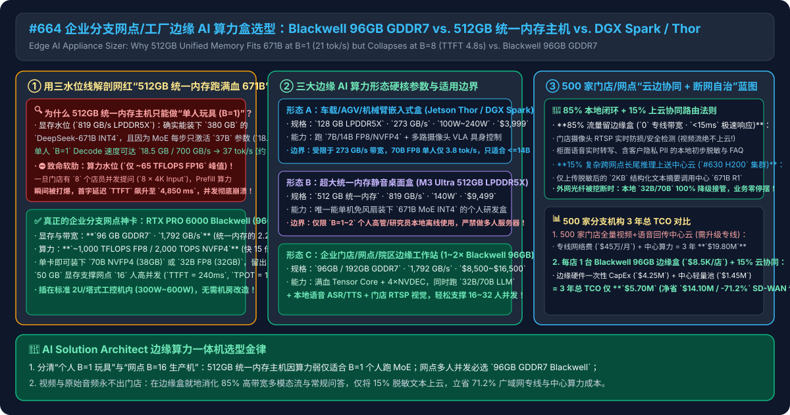

# Enterprise Edge AI Appliance Sizer (`RTX PRO 6000 Blackwell 96GB GDDR7` vs. `512GB Unified Memory` vs. `DGX Spark / Thor`): Three-Watermark Bandwidth Math, Concurrency Wall & Cloud-Edge Split

> **Language / 语言**: [简体中文](./enterprise-edge-ai-appliance-blackwell-96gb-vs-unified-memory-sizer-faq.md) | **English** · [📱 Open Interactive H5 Study Lab](../h5/edge-ai-appliance-blackwell-96gb-vs-unified-memory-sizer-lab.html) · [🧮 Open Interactive Sizer](../reports/enterprise-edge-ai-appliance-blackwell-96gb-vs-unified-memory-sizer.html) · [🃏 View 7-Card 4:5 Benchmark Deck](../reports/enterprise-edge-ai-appliance-blackwell-96gb-vs-unified-memory-sizer-cards.html)

---

## 0. 3-Minute Executive Summary

When sizing an **Edge AI Appliance** for `500` bank branches, retail stores, clinics, or factory floors (`8–16` concurrent staff per site), Cloud & AI Solution Architects must use the **Three-Watermark Formula** to separate **single-user (`B=1`) desktop appliances** from **multi-user (`B=16`) branch servers**:
1. **Why a `512 GB` Unified-Memory Desktop (`819 GB/s`) Excels at `B=1` (`21.4 tok/s` on `671B MoE`) but Collapses at `B=8–16` (`4,850 ms` `TTFT`)**:
   - At `B=1`, `DeepSeek-671B INT4` (`380 GB` total weights) activates only `37B` parameters (`18.5 GB`) per token, so `819 GB/s` unified memory streams `21.4 tok/s` effortlessly;
   - However, because its FP16 compute watermark is only **`~65 TFLOPS`**, `8–16` concurrent branch staff submitting `4K`-token RAG prompts saturate compute and spike `P95 TTFT` to **`4,850 ms`** while activated MoE experts balloon from `37B` to `145B`!
2. **Why `RTX PRO 6000 Blackwell` (`96 GB GDDR7 · 1,792 GB/s · ~1,000 TFLOPS FP8 / 2,000 TOPS NVFP4`) Wins Branch Multi-User Serving**:
   - Delivers **`2.19×` higher memory bandwidth (`1,792 GB/s`)** and **`15×` higher Tensor Core compute** than unified-memory desktops in a standard `300–600W` workstation form factor (`$8,500`), serving `70B NVFP4` or `32B FP8` + local voice/vision to `16` concurrent staff at **`240 ms` `P95 TTFT` (`20.2×` faster) and `68.0 tok/s`**.
3. **`85% Local Edge + 15% Central Cloud` Split Saves `71.2%` (`$14.10M` over 3 Years Across `500` Branches)**:
   - Processing RTSP cameras, voice transcription, and `85%` of routine tasks locally on the branch appliance (with `100%` offline fallback if WAN drops) eliminates `$450K/mo` in wide-area video backhaul bandwidth, cutting 3-year `500`-branch TCO from `$19.80M` to **`$5.70M` (`-71.2%`)**.

---

## 1. Quantitative Edge AI Appliance Matrix

| Edge Appliance Tier | Memory Capacity & Bandwidth | Compute Watermark | Single-User `B=1` `671B MoE` | Branch `B=16` (`4K` Prompt `TTFT` / `TPS`) | Price & SA Verdict |
| :--- | :--- | :--- | :--- | :--- | :--- |
| **1. `DGX Spark / Jetson Thor` (`128GB`)** | `128 GB` / `273 GB/s` | `~500 TOPS FP8` | Does not fit | `1,120 ms` / `18.0 tok/s` (`14B`) | `$3,999` · ✅ **Best for robotics & `<=14B`** |
| **2. `512GB Unified Memory` (`M3 Ultra`)** | **`512 GB`** / `819 GB/s` | `~65 TFLOPS FP16` | **`21.4 tok/s`** | **`4,850 ms` (Prefill compute stall)** | `$9,499` · ⚠️ **Single-user `B=1` R&D only** |
| **3. `RTX PRO 6000 Blackwell` (`96GB GDDR7`)** | `96 GB` / **`1,792 GB/s`** | **`~1,000 TFLOPS FP8 / 2,000 NVFP4`** | `70B NVFP4` (`46 tok/s`) | **`240 ms` (`-95.1%`) / `68.0 tok/s`** | **`$8,500` · 🏆 Branch `B=16` Golden Standard** |
