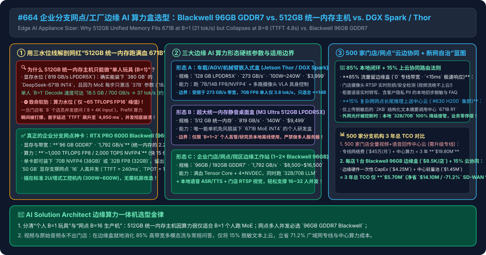
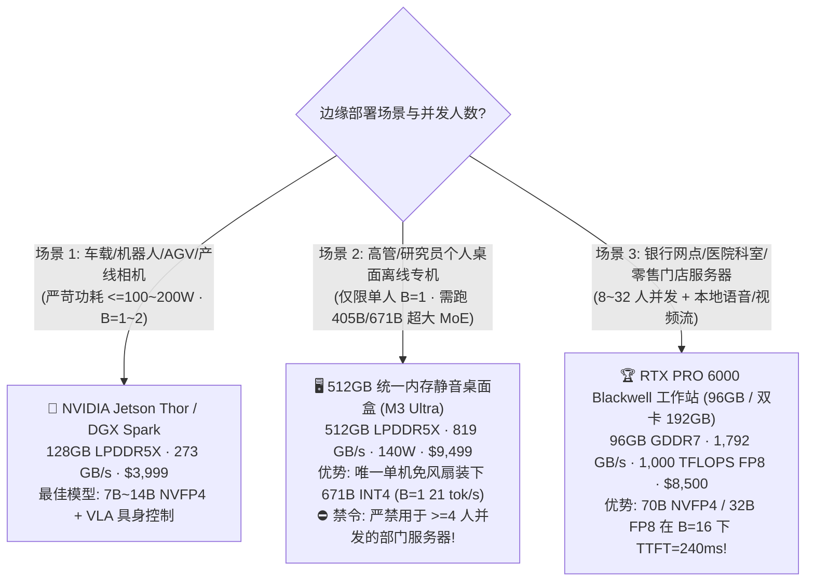

# 企业分支网点/工厂边缘 AI 算力一体机选型（`RTX PRO 6000 Blackwell 96GB GDDR7` vs. `512GB 统一内存主机` vs. `DGX Spark / Jetson Thor`）三水位线手算、并发崩溃边界与云边协同指南

> **语言 / Language**: **简体中文** | [English](./enterprise-edge-ai-appliance-blackwell-96gb-vs-unified-memory-sizer-faq.en.md) · [📱 打开交互式 H5 精读页](../h5/edge-ai-appliance-blackwell-96gb-vs-unified-memory-sizer-lab.html) · [🧮 打开交互式容量计算器](../reports/enterprise-edge-ai-appliance-blackwell-96gb-vs-unified-memory-sizer.html) · [🃏 查看 7-Card 4:5 评测报告](../reports/enterprise-edge-ai-appliance-blackwell-96gb-vs-unified-memory-sizer-cards.html)

---

## 0. 3 分钟执行摘要（Executive Summary）

当银行分行、医院诊室、连锁零售门店或制造车间需要在本地办公室（无专业机房、仅普通市电插座）部署一套**边缘 AI 算力盒（Edge AI Appliance）**时，很多客户拿着网红评测视频问架构师：**“听说一台 `$9,499` 的 `512 GB` 统一内存桌面主机就能在本地跑满血 `DeepSeek-671B`，我们能不能买它当分行 20 名员工共用的服务器？”**
1. **用 `#626` 三道水位线公式戳破“统一内存主机当多人服务器”的并发崩溃陷阱**：
   - **为什么 `512 GB` 统一内存（`LPDDR5X 819 GB/s`）跑单人 `B=1` 很惊艳？** 因为 `DeepSeek-671B` 是稀疏 MoE 模型：虽然总权重需 `380 GB`（`INT4`），但每生成一个 Token **仅激活 `37B` 参数（读取约 `18.5 GB` 内存）**；在 `B=1` 下，理论 Decode 速率 $= 819 \times 0.78 / 18.5 \approx \mathbf{21\text{–}34\text{ tok/s}}$，作为**个人单用户（`B=1`）本地实验机**体验极佳！
   - **为什么一旦用于网点 `B=8–16` 多人并发就彻底瘫痪？** 因为桌面 SoC 的**第三道水位线（FP16/FP8 矩阵算力）仅有 `~65 TFLOPS`**（不到专业 GPU 的 `1/15`）！一旦分行 `8` 名柜员同时提交 `4,000-Token` 合同审核，算力受限的 `Prefill` 阶段瞬间排队阻塞，**首字延迟（`P95 TTFT`）飙升至 `4,850 ms`（近 5 秒）**，且 MoE 激活专家在 `B=8` 下从 `37B` 膨胀至 `145B`，Decode 跌至 `5.2 tok/s`！
2. **企业网点多人并发（`B = 8–32`）的真正黄金答案：`RTX PRO 6000 Blackwell (96 GB GDDR7 · 1,792 GB/s)`**：
   - 单张工作站卡即拥有 **`96 GB ECC GDDR7` 显存、`1,792 GB/s` 带宽（统一内存的 `2.19 倍`）以及 `~1,000 TFLOPS FP8 / 2,000 TOPS NVFP4` 算力（快 `15 倍`）**；
   - 单卡轻松装下 `Llama-3.3-70B / Qwen2.5-72B NVFP4（39 GB）` 或 `32B FP8（32 GB）` + 本地 `Whisper ASR` + 门店 `RTSP` 视觉模型，在 `B=16` 并发下保持 **`P95 TTFT = 240 ms`、`68 tok/s`（`TPOT = 14.7 ms`）**，整机功耗仅 `350W–600W`！
3. **`500` 家门店/网点“85% 本地闭环 + 15% 云协同”架构净省 `71.2%`（`$14.10M`）**：
   - 将高带宽的门店摄像头视频流、柜面实时语音和常规问答 `85%` 留在本地 `96GB Blackwell` 边缘盒闭环处理（外网断网时 `100%` 降级自治不断服），仅将 `15%` 跨全行复杂长尾文本（`2 KB` 脱敏摘要）上送中心 `H200` 集群，免除昂贵的门店千兆 SD-WAN 视频上传专线，3 年总 TCO 从 `$19.80M` 骤降至 **`$5.70M`（净省 `$14.10M / -71.2%`）**！

---

## 1. 灵魂拷问 Q&A（Cloud & AI Solution Architect 核心决策拆解）

### Q1：三大边缘 AI 硬件形态（`Jetson Thor / DGX Spark 128GB`、`统一内存主机 512GB`、`Blackwell 工作站 96GB/192GB`）该如何精准对号入座？

---

## 2. 三大边缘 AI 算力一体机硬件参数与三水位线实测对比矩阵

| 边缘硬件形态 | 显存容量与带宽 (`Watermark 1 & 2`) | `FP8 / FP4` 矩阵算力 (`Watermark 3`) | 单人 `B=1` 跑 `671B MoE INT4` | 网点 `B=16` 并发 (`4K In`, `32B/70B`) | 单台采购价 & 架构师选型裁决 |
| :--- | :--- | :--- | :--- | :--- | :--- |
| **1. `DGX Spark / Jetson Thor` (`128GB`)** | `128 GB` / `273 GB/s` | `~500 / 1,000 TOPS` (稀疏) | 装不下 (`>128GB`) | `TTFT 1,120 ms` / `18 tok/s` (`14B`) | `$3,999` · ✅ **具身智能与 `<=14B` 嵌入式首选** |
| **2. `512GB 统一内存主机` (`M3 Ultra`)** | **`512 GB`** / `819 GB/s` | `~65 TFLOPS` (FP16，算力弱) | **`21.4 tok/s`**（单人惊艳） | **`TTFT 4,850 ms`（Prefill 严重卡死）** | `$9,499` · ⚠️ **仅限单人 `B=1` 超大 MoE 离线盒** |
| **3. `RTX PRO 6000 Blackwell` (`1× 96GB` WorkStation)** | `96 GB GDDR7` / **`1,792 GB/s`** | **`~1,000 TFLOPS FP8 / 2,000 NVFP4`** | 需双卡或跑蒸馏 `70B NVFP4` | **`TTFT 240 ms` / `68.0 tok/s`（丝滑）** | **`$8,500` · 🏆 企业网点/门店 `16` 人并发首选** |

---

## 3. 生产落地核对清单（Pre-Production Checklist）

- [ ] **严禁采购 `65 TFLOPS` 级统一内存桌面机充当部门级（`B >= 4`）RAG/Agent 共享服务器**：凡并发用户 `>= 4` 人或输入上下文 `>= 4K`，必须选用具备专用 Tensor Core 与 `>= 1,500 GB/s` GDDR7/HBM 带宽的 GPU 工作站；
- [ ] **网点边缘一体机强制配置“云边双路自动降级路由”**：外网正常时将 `15%` 高难度跨网点长尾请求转发中心云 `671B`；外网中断或 RTT `> 500 ms` 时，自动 `100%` 切回本地 `32B/70B` 模型保证核心柜面业务零中断；
- [ ] **边缘盒远程运维采用不可变容器镜像（Immutable OCI Appliance）+ 夜间差分权重推送**，无需门店配备 IT 运维人员。
