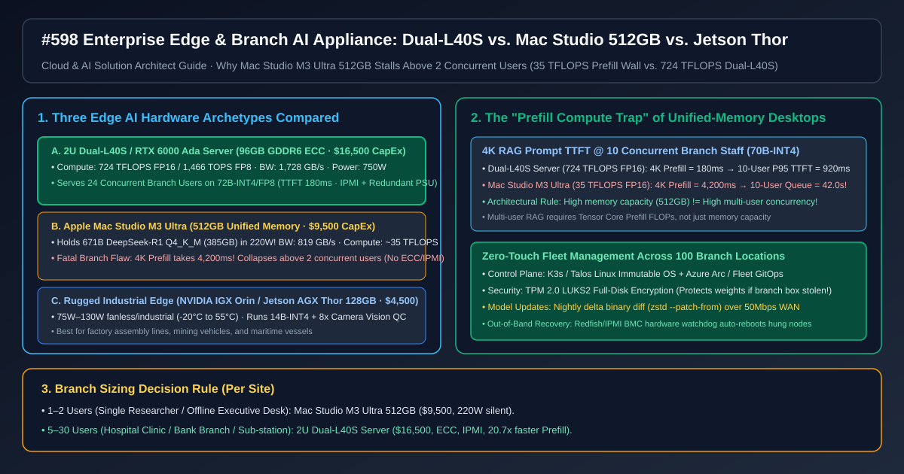

# Enterprise Edge & Branch AI Appliance Sizing: `2U Dual-L40S / RTX 6000 Ada vs. Mac Studio M3 Ultra 512GB vs. Jetson AGX Thor` Selection Guide

> **Target Persona**: Cloud & AI Solution Architect  
> **Core Scenarios**: Hospital clinic EMR assistants, bank branch advisors, retail/factory floor edge boxes, and disconnected maritime/mining sites (`1–30` concurrent users per site across `50–500` sites)  
> **Interactive H5 Learning Workbench**: [`docs/h5/edge-ai-appliance-l40s-mac-thor-sizer.html`](../h5/edge-ai-appliance-l40s-mac-thor-sizer.html)

---

## 1. Executive Summary

1. **The Unified-Memory "Prefill Compute Trap" (`Mac Studio M3 Ultra 512GB` vs. `2U Dual-L40S Server`)**:
   - While `Mac Studio M3 Ultra (512GB, $9,500)` can fit a `671B Q4` model in `220W`, its FP16 compute (`~35 TFLOPS`) is **`20.7×` slower than a `2U Dual-L40S` server (`724 TFLOPS FP16 / 1,466 TOPS FP8`)**.
   - Under `10` concurrent branch users submitting `4K`-token RAG prompts (`70B-INT4`), **Dual-L40S delivers a `920ms` P95 TTFT (`180ms` single prefill)** whereas **Mac Studio queues up to `42.0 seconds` (`4,200ms` single prefill)** and lacks ECC memory, dual PSUs, and out-of-band IPMI/Redfish management.
2. **Three Edge Hardware Archetypes Selection Matrix**:
   - **`2U Dual-L40S / RTX 6000 Ada Server` (`96 GB ECC`, `1,728 GB/s`, `$16,500`, `750W`)**: Serves **`24` concurrent branch staff** on `72B-INT4/FP8` with full enterprise RAS (`IPMI`, `TPM 2.0 LUKS2`, redundant PSUs).
   - **`Mac Studio M3 Ultra 512GB` (`819 GB/s`, `$9,500`, `220W`)**: Optimal for **`1–2` concurrent users** (silent single-researcher/executive desk running `671B MoE Q4`).
   - **`NVIDIA IGX Orin / Jetson AGX Thor 128GB` (`$4,500`, `75–130W`)**: Ruggedized `-20°C to 55°C` industrial edge box for `14B-INT4` + multi-camera vision QC (`<= 5` operators).

---

## 2. Edge Hardware Comparison Matrix (`70B-INT4` · `4K` RAG Prompt)

| Dimension | **`2U Dual-L40S / RTX 6000 Ada`** | `Mac Studio M3 Ultra (512GB)` | `IGX Orin / Jetson Thor (128GB)` |
|---|---|---|---|
| **FP16 / FP8 Compute** | **`724 TFLOPS / 1,466 TOPS`** | `~35 TFLOPS FP16` | `275–1,000 TOPS FP8/INT4` |
| **Single 4K Prefill TTFT** | **`180 ms` (`23.3×` faster)** | `4,200 ms` | `680 ms` (on `14B-INT4`) |
| **10-User Concurrent TTFT** | **`920 ms`** | `42,000 ms` (timeout stall) | `2,800 ms` (on `14B-INT4`) |
| **Max Recommended Users** | **`24 Concurrent Users`** | **`1–2 Concurrent Users`** | **`5 Concurrent Users`** |
| **Enterprise RAS** | **ECC + Dual PSU + IPMI BMC** | None (Desktop class) | **Industrial shock/temp rated** |

---

## 3. Production Checklist

- [ ] Deploy **`2U Dual-L40S / RTX 6000 Ada` servers** for any shared branch office (`>= 5` concurrent users).
- [ ] Enforce **`TPM 2.0 + LUKS2` full-disk encryption**, immutable `Talos Linux + K3s`, and IPMI hardware watchdogs across all remote sites.
