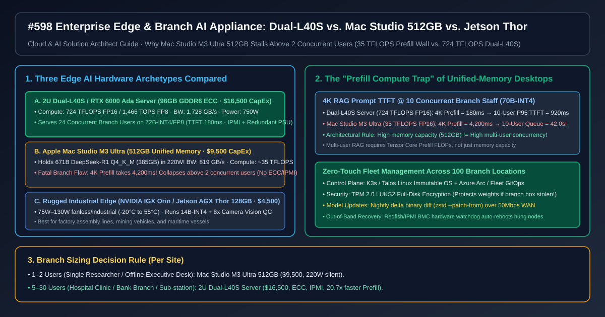
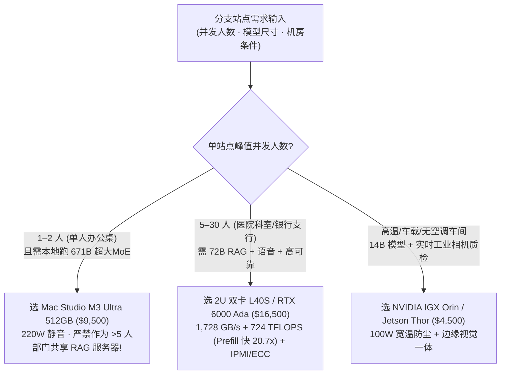

# 企业级边缘与分支机构 AI 一体机（Edge AI Appliance）硬件选型：`2U 双卡 L40S/RTX 6000 Ada vs. Mac Studio M3 Ultra 512GB vs. 工业级 Jetson Thor` 容量测算指南

> **面向角色**：Cloud & AI Solution Architect（云与 AI 解决方案架构师）  
> **核心场景**：三甲医院科室本地病历质检、商业银行网点柜面助手、远洋船舶/矿山断网驻地 AI、智能工厂产线视觉与设备维修问答（单网点 `1–30` 名并发用户，全国 `50–500` 个分支站点）  
> **配套交互式 H5 精读工作台**：[`docs/h5/edge-ai-appliance-l40s-mac-thor-sizer.html`](../h5/edge-ai-appliance-l40s-mac-thor-sizer.html)

---

## 一、执行摘要（Executive Summary：3 分钟掌握核心架构结论）

1. **为什么许多企业被“一台 `$9,500` 的 `Mac Studio M3 Ultra (512GB 统一内存)` 能塞下满血 `671B DeepSeek-R1`”吸引而采购当作部门服务器，上线后却在 `5` 人同时提问时卡死超时？**  
   - **“放得下（Memory Capacity）”绝不等于“扛得住多人并发 Prefill（Tensor Core FLOPs）”**！
   - `M3 Ultra` 拥有惊人的 `512 GB` 统一内存与 `819 GB/s` 内存带宽，单人对话 Decode 可达 `18–24 tok/s`；但它的 **FP16/BF16 密集矩阵算力仅有 `~35 TFLOPS`（且不支持原生 FP8 Tensor Core）**，仅为一台 **`2U 双卡 L40S` 服务器（`724 TFLOPS FP16 / 1,466 TOPS FP8`）的 `1/20.7`（`4.8%`）**！
   - 当医院科室或银行网点有 **`10` 名员工同时发起 `4,096 tokens` 的病历/合同 RAG 提问**时：
     - **`2U 双卡 L40S`（`96 GB GDDR6 ECC`）**：单次 `4K` Prefill 仅需 **`180ms`**，10 人并发队列 P95 首字延迟（TTFT）仅为 **`920ms`**；
     - **`Mac Studio M3 Ultra 512GB`**：单次 `4K` Prefill 高达 **`4,200ms（4.2 秒）`**，10 人并发排队导致第 10 个人的首字延迟飙升至 **`42.0 秒`**，前端直接触发网关超时断开！さらに桌面级设备缺乏 **ECC 内存纠错、双冗余电源与带外 IPMI/Redfish 远程开机卡**，一旦死机需派人去网点拔电源线。
2. **三大边缘 AI 一体机硬件形态精准选型边界**：
   - **形态 A：企业分支网点标准机架一体机（`2U Dual-L40S / RTX 6000 Ada`，`96 GB ECC`，`$16,500`，`750W`）**：运行 `Qwen2.5-72B-AWQ/FP8 + Whisper + BGE-M3`，稳定支撑单网点 **`15–28` 名并发员工（P95 TTFT `< 1.0s`）**，具备完整 IPMI/BMC 带外管理与双电冗余——**医院科室、银行支行、大型门店唯一推荐主力形态**。
   - **形态 B：高管/研究员桌面静音个人工作站（`Mac Studio M3 Ultra 512GB`，`$9,500`，`220W`）**：能在普通オフィス插座与 `25 dBA` 静音下本地运行 `671B MoE Q4`，**严格限定在 `1–2` 人并发的单人离线深潜投研/代码审计场景**。
   - **形态 C：严苛工业现场无风扇盒子（`NVIDIA IGX Orin / Jetson AGX Thor 128GB`，`$4,500`，`75–130W`）**：耐受 `-20°C ~ 55°C` 高温粉尘与车载震动，运行 `Qwen2.5-14B-INT4` + 8 路工业相机实时缺陷检测（`<= 5` 名现场工人并发）。

---

## 二、架构师灵魂拷问（Core Q&A）

### Q1：全国有 `100` 个分支网点部署了本地边缘 AI 一体机，在没有驻场 IT 人员的条件下，如何保证物理防盗安全与零接触远程运维（Zero-Touch Ops）？
边缘分支机构与中心机房最大的区别是**物理环境不可信**（机器可能被拔掉硬盘抱走）且**广域网带宽受限（`20–50 Mbps`）**：
1. **硬件级全盘加密防盗（`TPM 2.0 + LUKS2 + Clevis/Tang`）**：绝不能把微调后的行业模型权重与本地患者/客户向量库明文存在 SSD 上！开启绑定主板 `TPM 2.0` PCR 度量值的 `LUKS2` 全盘加密，硬盘一旦被拆下插到其他机器上100%无法解密。
2. **不可变操作系统与声明式边缘集群（`Talos Linux / Kairos + K3s + Azure Arc / Rancher Fleet`）**：底部 OS 设为只读不可变镜像（支持 A/B 双分区回滚），通过 GitOps 统一下发 Helm Chart。
3. **模型权重差分增量升级（`zstd --patch-from` 二进制差分）**：每周更新 LoRA 适配器（仅 `268 MB`）或通过 `zstd` 字典差分传输量化底座，避免在 100 个网点重复拉取 `40 GB` 全量镜像。
4. **带外硬件看门狗（`IPMI / Redfish BMC Hardware Watchdog`）**：当内核发生死锁或 GPU 掉卡（`Xid 79: GPU has fallen off the bus`）时，独立供电的 BMC 芯片自动执行冷重启（Cold Power Cycle）恢复服务。

---

## 三、三大边缘 AI 一体机硬件规格与性能横向选型矩阵

| 评估维度 | 方案 A：`2U 双卡 L40S / RTX 6000 Ada` 企业服务器 | 方案 B：`Apple Mac Studio M3 Ultra (512GB)` | 方案 C：`NVIDIA IGX Orin / Jetson AGX Thor (128GB)` |
|---|---|---|---|
| **显存容量 / 带宽** | `96 GB GDDR6 (带 ECC)` / **`1,728 GB/s`** | **`512 GB 统一内存 (无 ECC)`** / `819 GB/s` | `64–128 GB LPDDR5X` / `273–540 GB/s` |
| **密集 Prefill 算力** | **`724 TFLOPS FP16 / 1,466 TOPS FP8`** | `~35 TFLOPS FP16`（慢 `20.7 倍`） | `275–1,000 TOPS FP8/INT4` |
| **4K RAG 首字延迟 (10并发)** | **`920 ms`（流畅交互）** | `42,000 ms`（严重排队超时） | `2,800 ms`（运行 `14B-INT4`） |
| **最大推荐并发用户数** | **`24 人并发`**（`72B-INT4/FP8`） | **`1–2 人并发`**（单人专属工作站） | **`5 人并发`** + 多路视频流 |
| **企业级可靠性 (RAS)** | **双冗余电源 + ECC 显存 + IPMI 远程带外管理** | 单电源、无 ECC、无 IPMI 带外重启 | **宽温防尘抗震 + 工业功能安全认证** |
| **单台硬件采购 CapEx** | **`$16,500 / 台`**（`750W`） | **`$9,500 / 台`**（`220W` 桌面静音） | **`$4,500 / 台`**（`75–130W`） |

---

## 四、生产级边缘 AI 一体机落地 Checklist

- [ ] **凡是 `>= 5` 人共用的分支机构 RAG 服务器，严禁采购桌面级统一内存主机（Mac Studio / Mini PC）**：必须核算 `4K` Prompt 并发 Prefill TFLOPS，选用具备独立 Tensor Core 与 IPMI 带外管理的 `L40S / RTX 6000 Ada` 机架服务器。
- [ ] **强制开启 `TPM 2.0 + LUKS2` 全盘加密与只读不可变系统盘（`Talos / Kairos`）**：防止分支机构设备物理失窃导致核心业务知识库与微调权重泄露。
- [ ] **模型更新采用“底座固定 + 夜间下发 `268 MB` LoRA 增量包”机制**：避免百个网点同时通过脆弱的门店宽带拉取数十 GB 完整镜像。

---

## 五、配套资产索引

- **交互式 H5 精读工作台**：[`docs/h5/edge-ai-appliance-l40s-mac-thor-sizer.html`](../h5/edge-ai-appliance-l40s-mac-thor-sizer.html)
- **7-Card 4:5 评测报告**：[`docs/reports/enterprise-edge-ai-appliance-l40s-rtx6000-mac-thor-sizing-cards.html`](../reports/enterprise-edge-ai-appliance-l40s-rtx6000-mac-thor-sizing-cards.html)
- **交互式容量计算器**：[`docs/reports/enterprise-edge-ai-appliance-l40s-rtx6000-mac-thor-sizing-sizer.html`](../reports/enterprise-edge-ai-appliance-l40s-rtx6000-mac-thor-sizing-sizer.html)
- **可复现实验模型**：[`experiments/enterprise_edge_ai_appliance_l40s_rtx6000_mac_thor_sizing/run.py`](../../experiments/enterprise_edge_ai_appliance_l40s_rtx6000_mac_thor_sizing/run.py)
