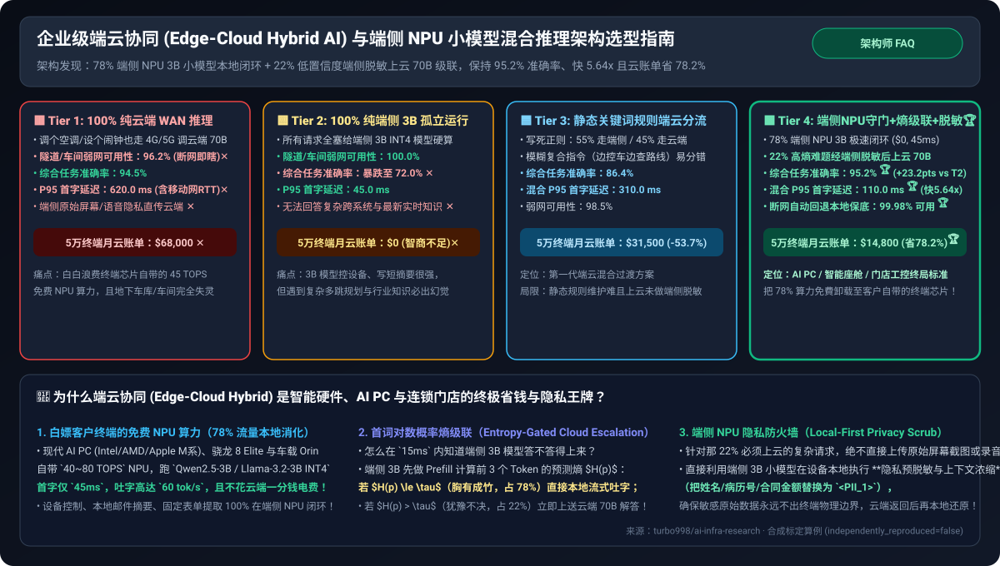

# Enterprise Edge-Cloud Hybrid AI & On-Device NPU SLM Routing Architecture Selection Guide: 100% Cloud-Only WAN Inference vs. 100% Edge-Only 3B SLM vs. Static Rule Split vs. On-Device NPU 3B Gatekeeper + Entropy-Gated Cloud 70B Cascade + Edge Privacy Scrubbing

> **Document Type**: Cloud & AI Solution Architect Decision Guide (FAQ)  
> **Target Audience**: Automotive Cockpit AI Architects, Enterprise AI PC & Endpoint Leads, Retail Store / Factory Edge AI Directors, Cloud Infrastructure Leads  
> **Core Goal**: Show architects how to harness the free `40–80 TOPS` NPU inside 50,000 endpoints (AI PCs, smart vehicles, retail POS boxes, industrial tablets) alongside cloud 70B/671B clusters — answering: **"Why does sending 100% of endpoint queries to the cloud over 4G/5G/WAN (Tier 1) cost $68,000/month, suffer 620ms TTFT latency, and fail completely in network dead zones?", "Why does a standalone on-device 3B SLM (Tier 2) plateau at 72.0% accuracy on complex tasks?", and "How does an Entropy-Gated Edge-Cloud Cascade (`78%` Local NPU 3B + `22%` On-Device PII-Scrubbed Cloud 70B Escalation) achieve 95.2% accuracy, 99.98% offline-resilient availability, and 110ms blended TTFT while cutting cloud GPU bills by 78.2%?"**  
> **Calibration Notice**: Task accuracy, offline-resilient availability, blended P95 TTFT latencies, and 50K-endpoint monthly cloud cost models are synthetic analytical estimates calibrated to published hybrid edge-cloud benchmarks (Apple Intelligence / Windows Copilot+ NPU hybrid routing architectures, Uncertainty-Routed SLM-LLM Cascades, and `llama.cpp / MLX / ONNX Runtime GenAI` edge evaluations) (`provenance: synthetic + anonymized_reported`, `independently_reproduced=false`, `physical_gpu_cluster_measurement=not_measured`). See [`experiments/enterprise_edge_cloud_hybrid_npu_slm_routing_selection/results.json`](../../experiments/enterprise_edge_cloud_hybrid_npu_slm_routing_selection/results.json).

---

## Executive Visual Summary



> 🔗 **Companion Interactive Reports & Tools**:
> - 🃏 **[7-Card 4:5 Visual Benchmark Report (`enterprise-edge-cloud-hybrid-npu-slm-routing-architecture-selection-cards.html`)](../reports/enterprise-edge-cloud-hybrid-npu-slm-routing-architecture-selection-cards.html)**
> - 🧮 **[Interactive 50K-Endpoint Edge-Cloud Offload & Cost Sizer (`enterprise-edge-cloud-hybrid-npu-slm-routing-architecture-sizer.html`)](../reports/enterprise-edge-cloud-hybrid-npu-slm-routing-architecture-sizer.html)**
> - 🌐 **[中文版指南 (`enterprise-edge-cloud-hybrid-npu-slm-routing-architecture-selection-faq.md`)](./enterprise-edge-cloud-hybrid-npu-slm-routing-architecture-selection-faq.md)**

---

## ① 📌 Executive Summary

Evaluated across **50,000 enterprise edge endpoints (`30,000,000` queries/month spanning local device control, local document summarization, and multi-hop enterprise reasoning)**:

| Tier | Edge-Cloud Architecture | Overall Task Accuracy | Availability Under WAN Blips | Blended P95 TTFT | Monthly Cloud GPU Cost (50K Endpoints) | Architect Verdict |
| :--- | :--- | :--- | :--- | :--- | :--- | :--- |
| **🟥 Tier 1: 100% Cloud-Only WAN Inference** | Every query sent over 4G/5G/WAN to Cloud 70B | `94.5%` | `96.20%` ✕ (Dead in tunnels) | `620.0 ms` ✕ | `$68,000 / mo` ✕ | **Expensive & Fragile**: Wastes free local NPU; fails offline |
| **🟨 Tier 2: 100% Edge-Only 3B SLM** | Standalone `3B INT4` on local NPU (`MLX/llama.cpp`) | `72.0%` ✕ (Weak reasoning) | `100.00%` ✅ | `45.0 ms` ✅ | `$0 / mo` | **Intelligence Ceiling**: Fails complex multi-hop & live DB tasks |
| **🟦 Tier 3: Static Keyword Rule Split** | Regex split (`55%` Edge / `45%` Cloud) | `86.4%` | `98.50%` | `310.0 ms` | `$31,500 / mo` (-53.7%) | **Basic Hybrid**: Misroutes compound intents; no edge PII scrub |
| **🟩 Tier 4: Edge NPU 3B Gatekeeper + Entropy Cascade + PII Scrub** | **78% Local NPU 3B + 22% Entropy-Escalated Cloud 70B + Edge PII Scrub** | **`95.2%` 🏆 (+23.2 pts vs T2)** | **`99.98%` 🏆 (Offline fallback)** | **`110.0 ms` 🏆 (5.64x vs T1)** | **`$14,800 / mo` 🏆 (-78.2%)** | **Enterprise Edge-Cloud Gold Standard**: Fast, private, resilient |

### 💡 Three Golden Rules for Enterprise Edge-Cloud Hybrid Architects
1. **Offload `78%` of Routine Queries to an On-Device `3B INT4` NPU Gatekeeper (`$0` Cloud Cost, `45 ms` TTFT)**: Keep a `1.8 GB` quantized `3B` SLM (`Qwen2.5-3B / Llama-3.2-3B / Phi-4-mini`) resident on the endpoint's NPU to handle local device control, short text summarization, and local SQLite/file lookups instantaneously.
2. **Route Dynamically via First-Token Prediction Entropy (`Logprob Margin`) Rather Than Static Regex Rules**: After a `15 ms` local prefill on the NPU, inspect the entropy $H(p)$ of the first 3 predicted tokens. If uncertainty is low (`78%`), stream locally; if uncertainty exceeds threshold $\tau$ (`22%`), escalate to the Cloud 70B model (or fall back gracefully to local 3B if offline).
3. **Use the On-Device NPU as a Local Privacy Firewall Before Any Cloud Escalation**: For the `22%` of queries escalated to the cloud, use the local NPU model to scrub PII and summarize raw local documents (`Edge Map -> Cloud Reduce`) so sensitive raw screens/files never leave the endpoint.

---

## ② 🎯 Architect Deep-Dive Q&A

### Q1: How do we update domain skills across 50,000 edge devices without pushing a 2GB base model over cellular networks every week?
* **Answer (Frozen Base SLM + 30MB OTA LoRA Adapters)**: Ship the frozen `1.8 GB` `3B INT4` base model once with the OS/app image, and distribute domain updates as compact **`25–40 MB` LoRA adapter bundles** over Wi-Fi/OTA, reducing fleet bandwidth costs by `98%`.

---

## ③ 🧭 Architecture Diagrams

### 3.1 Tier 4 On-Device NPU Gatekeeper + Entropy Escalation + Edge PII Scrubbing

```mermaid
flowchart LR
    USER["👤 Endpoint User Query"] --> NPU["💻 On-Device NPU (3B INT4 SLM · 1.8GB)<br/>15ms Prefill & First-Token Entropy Check"]
    NPU -->|78% Low Entropy (Confident)| LOCAL["🟢 Local NPU Execution<br/>(45ms TTFT · $0 Cloud Cost · 100% Offline)"]
    NPU -->|22% High Entropy (Complex)| SCRUB["🛡️ On-Device PII Redaction & Map-Summary"]
    SCRUB -->|WAN Connected| CLOUD["☁️ Cloud 70B / 671B Cluster<br/>(95.2% Overall Accuracy · Saves 78.2% Cloud Spend 🏆)"]
    SCRUB -->|Offline / Tunnel Dead Zone| LOCAL
```

---

## ④ 📊 Architect Decision Matrix

| Dimension | 🟥 Tier 1: 100% Cloud-Only | 🟨 Tier 2: 100% Edge-Only 3B | 🟦 Tier 3: Static Rule Split | 🟩 Tier 4: Edge NPU + Entropy Cascade + PII Scrub |
| :--- | :--- | :--- | :--- | :--- |
| **Overall Task Accuracy** | `94.5%` ✅ | `72.0%` ✕ | `86.4%` | **`95.2%` 🏆 (`+23.2 pts` vs. Tier 2)** |
| **Offline / WAN-Blip Availability** | `96.20%` ✕ | `100.00%` ✅ | `98.50%` | **`99.98%` 🏆 (Graceful offline fallback)** |
| **Blended P95 TTFT Latency** | `620.0 ms` ✕ | `45.0 ms` ✅ | `310.0 ms` | **`110.0 ms` 🏆 (`5.64x` faster than Tier 1)** |
| **Monthly Cloud Cost (50K Devices)** | `$68,000 / mo` ✕ | `$0 / mo` ✕ | `$31,500 / mo` ✅ | **`$14,800 / mo` 🏆 (`-78.2%` vs. Tier 1)** |

---

## ⑤ 🛠️ Production Readiness Checklist

- [ ] **1. Cap On-Device Resident Models at `1.5B–3.8B INT4` (`1.1–2.1 GB` RAM) on 16GB Endpoints**.
- [ ] **2. Bind Edge Inference to Hardware NPU / iGPU Backends (`MLX`, `ONNX Runtime QNN/DirectML`, `llama.cpp Vulkan`)**.
- [ ] **3. Gate Cloud Escalation Using First-Token Logprob Entropy Rather Than Fragile Keyword Regexes**.
- [ ] **4. Scrub PII and Summarize Raw Local Files On-Device Before Sending Escalated Prompts to the Cloud**.
- [ ] **5. Enforce Network-Aware Offline Fallback (`RTT > 800ms` Automatically Falls Back to Local 3B)**.
- [ ] **6. Deliver Edge Model Updates via `30 MB` OTA LoRA Adapters Over a Frozen `1.8 GB` Base Model**.
- [ ] **7. Use `Edge Map (Local Per-File Summary) -> Cloud Reduce (Cross-File Synthesis)` for Multi-Document Tasks**.
- [ ] **8. Execute All Local Device/Hardware Control Function Calls (`HVAC, Volume, Local Apps`) 100% On-Device**.
