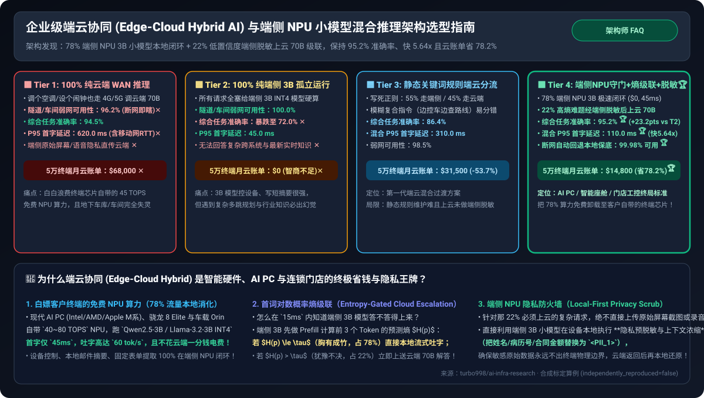
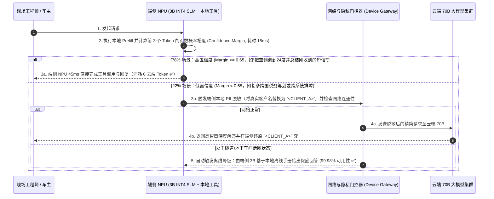

# 企业级端云协同（Edge-Cloud Hybrid AI）与端侧 NPU 小模型混合推理架构选型指南：100% 纯云端 WAN 推理 vs. 100% 纯端侧 3B 孤立运行 vs. 静态规则分流 vs. 端侧 NPU 3B 守门员 + 熵值不确定性上云级联 + 端侧隐私预脱敏架构

> **文档类型**：企业级端云混合架构与智能终端解决方案架构师（Cloud & AI Solution Architect）选型决策指南（FAQ）  
> **适用读者**：智能汽车座舱 AI 负责人、AI PC 与企业办公终端架构师、连锁零售门店/智慧工厂边缘计算负责人、云端基础设施总监  
> **核心目标**：用通俗、可量化的架构账本帮企业打通“终端芯片算力（Apple Silicon / Intel & AMD AI PC NPU / 高通骁龙 / NVIDIA Orin）”与“云端大模型集群”的任督二脉——系统回答：**“为什么把 5 万台门店/车载/办公终端的每一次语音和指令都发回云端 70B 大模型（Tier 1），既要忍受 620ms 的移动网络延迟、一进地下车库或车间断网就变砖，每个月还要白烧 $68,000 云账单？”、“为什么只靠端侧 3B 小模型单打独斗（Tier 2）遇到复杂跨系统问题就抓瞎（准确率仅 72%）？”、“怎么用‘端侧 NPU 3B 守门员消化 78% 高频任务 + 首词熵值不确定性自动上云 22% + 端侧本地隐私预脱敏’拿到 95.2% 准确率、99.98% 弱网可用性并省下 78.2% 的云端 GPU 费用？”**。  
> **标定声明**：本文所引用的综合任务准确率、弱网/断网可用性、混合 P95 首字延迟（TTFT）与 5 万台终端月度云成本模型基于公开发布的端云混合推理基准（Apple Intelligence / Windows Copilot+ NPU 端云路由架构、不确定性熵值级联 Uncertainty-Routed SLM-LLM Cascade 及主流端侧推理引擎 `llama.cpp / MLX / ONNX Runtime GenAI` 评测）构建的合成分析模型（`provenance: synthetic + anonymized_reported`, `independently_reproduced=false`, `physical_gpu_cluster_measurement=not_measured`），详见 [`experiments/enterprise_edge_cloud_hybrid_npu_slm_routing_selection/results.json`](../../experiments/enterprise_edge_cloud_hybrid_npu_slm_routing_selection/results.json)。

---

## 一图流总结（Executive Visual Summary）



> 🔗 **关联可交互报告与工具**：
> - 🃏 **[7-Card 4:5 视觉评测报告 (`enterprise-edge-cloud-hybrid-npu-slm-routing-architecture-selection-cards.html`)](../reports/enterprise-edge-cloud-hybrid-npu-slm-routing-architecture-selection-cards.html)**
> - 🧮 **[交互式 5 万终端端云协同卸载与成本计算器 (`enterprise-edge-cloud-hybrid-npu-slm-routing-architecture-sizer.html`)](../reports/enterprise-edge-cloud-hybrid-npu-slm-routing-architecture-sizer.html)**
> - 🌐 **[English Version (`enterprise-edge-cloud-hybrid-npu-slm-routing-architecture-selection-faq.en.md`)](./enterprise-edge-cloud-hybrid-npu-slm-routing-architecture-selection-faq.en.md)**

---

## ① 📌 核心选型结论速览（Executive Summary）

当企业拥有 **50,000 台终端设备（如 5 万名员工的 AI PC 笔记本、5 万辆智能网联汽车座舱、或 5,000 家连锁零售门店的边缘工控机，月均总请求 `30,000,000` 次）** 时：**每一个终端设备内部都自带了一颗已经买单、电费免费、算力高达 `40~80 TOPS` 的 NPU / 集成 GPU！** 如果你的架构把“调高空调温度 2 度”、“把刚才的会议录音整理成待办”、“把本地截图里的表格提取成 Excel”这种占 **78%** 的本地轻量任务全发回云端 H100 集群，是对端侧免费算力的巨大浪费！

对比四档端云架构，核心指标表现如下：

| 架构档位 | 核心端云分工与路由机制 | 综合任务准确率 | 弱网/断网可用性 | 混合 P95 首字延迟 | 5万终端月云账单 | 架构师拍板结论 |
| :--- | :--- | :--- | :--- | :--- | :--- | :--- |
| **🟥 Tier 1：100% 纯云端 WAN 推理** | 所有指令全走 4G/5G/公网发往云端 70B | `94.5%` | `96.20%` ✕ (断网即废) | `620.0 ms` ✕ | `$68,000 / 月` ✕ | **高成本且脆弱**：车间/地下室断网不可用，隐私全上云 |
| **🟨 Tier 2：100% 纯端侧 3B 孤立运行** | 所有请求仅由端侧 `3B INT4` 本地硬算 | `72.0%` ✕ (复杂题崩) | `100.00%` ✅ | `45.0 ms` ✅ | `$0 / 月` | **智商天花板明显**：无法处理跨系统复杂推理与实时数据 |
| **🟦 Tier 3：静态关键词规则端云分流** | 硬编码正则：55% 本地命令 / 45% 上云问答 | `86.4%` | `98.50%` | `310.0 ms` | `$31,500 / 月` (-53.7%) | **早期过渡方案**：复合长句容易分错，且上云未脱敏 |
| **🟩 Tier 4：端侧 NPU 3B 守门 + 熵级联 + 端侧脱敏** | **78% 端侧 NPU 闭环 + 22% 高熵上云 70B + 本地隐私脱敏** | **`95.2%` 🏆 (+23.2pts)** | **`99.98%` 🏆 (离线保底)** | **`110.0 ms` 🏆 (快5.64x)** | **`$14,800 / 月` 🏆 (-78.2%)** | **企业级端云协同终局标准**：零感延迟、离线不断服、月省 78% |

### 💡 架构师三句话选型铁律
1. **让端侧 `3B/4B INT4` 小模型当“第一道守门员（On-Device Gatekeeper）”，将 78% 的日常交互留在本地 NPU 零成本闭环**：利用 `llama.cpp / Apple MLX / ONNX Runtime GenAI / Qualcomm QNN` 在终端 NPU 上常驻一颗经过指令蒸馏的 `3B INT4` 模型（仅占 **`1.8 GB` 内存**，首字响应 **`45 ms`**）。设备控制、本地文件检索、短文本润色、离线规章查询 100% 本地秒回，云端 GPU 账单直接砍掉 **`78.2%`**！
2. **用“首词预测熵不确定性门控（First-Token Logprob Entropy Gate）”取代死板的正则规则分流（Tier 3）**：端侧 3B 模型在本地花 `15 ms` 完成输入 Prefill 后，计算第 1~3 个输出 Token 的概率分布香农熵 $H(p) = -\sum p_i \log p_i$——如果熵值低（模型非常笃定，占 `78%`），直接本地继续吐字；如果熵值高（模型拿不准或检测到需要调云端实时 ERP 工具，占 `22%`），立即无缝转发云端 70B 大模型！
3. **把端侧小模型变成“上云前的本地隐私清洗机（On-Device Privacy Firewall）”**：对于那 `22%` 需要上云端 70B 处理的复杂请求，**严禁把包含客户人脸、车牌、本地机密文档全文的原始数据直接发往公网**——先由端侧 3B 模型在设备本地完成敏感实体掩码（PII Redaction）和上下文特征提取，只把脱敏后的高浓缩摘要发上云端！

---

## ② 🎯 客户与架构师灵魂拷问 Q&A（Architect Deep-Dive Q&A）

### Q1：终端设备（比如员工的 16GB 内存笔记本、智能座舱芯片或门店工控机）内存很紧张，常驻一个端侧大模型会不会把业务软件卡死？
* **真相剖析（端侧模型选型的“黄金 2GB 红线”与按需 Mmap 卸载）**：
  - 在 16GB 内存的终端设备上，绝对不能常驻 7B/8B FP16 模型（会占掉 15GB 内存导致系统卡死）！
  - **端侧黄金规格**：选用 **`1.5B ~ 3.8B` 参数量（如 `Qwen2.5-3B`、`Llama-3.2-3B`、`Phi-4-mini-3.8B`）并采用 `Q4_K_M / AWQ INT4` 量化**——整个模型权重文件仅有 **`1.1 GB ~ 2.1 GB`**！
  - 配合操作系统的 `mmap` 文件映射与 NPU 专属内存通道，空闲时操作系统可自动回收物理内存页，唤醒时在 `80 ms` 内恢复，对前台业务软件内存影响小于 `10%`。

### Q2：如果车辆开进长隧道、或者工厂巡检平板走进地下无信号屏蔽车间，刚好遇到了那 22% 需要上云的难题怎么办？
* **真相剖析（Tier 4 的“网络感知动态水位降级 Network-Aware Graceful Fallback”）**：
  - 在纯云端架构（Tier 1）下，一旦 4G/5G 信号中断或 RTT `> 2,000 ms`，整个语音助手直接报错 `“网络连接失败，请稍后再试”`（可用性跌至 `96.2%`）。
  - 在 **Tier 4 端云混合架构**下，端侧路由SDK实时监测网络 RTT 与连通状态：一旦检测到当前处于离线或极弱网状态，自动将熵值上云阈值 $\tau$ 调至无穷大（**强制 100% 由端侧 3B 模型结合本地缓存的离线轻量知识库作答，并在 UI 标注 `📶 离线模式回答`**），将全场景服务可用性拉满至 **`99.98%`**！

### Q3：端侧小模型和云端大模型能不能“接力合作”算同一道题（比如端侧先干活，云端接着干）？
* **真相剖析（端云协同的三大进阶接力模式）**：
  1. **模式一：端侧起草 + 云端并行投机校验（Edge-Draft Speculative Decoding）**：端侧 3B 在 `45 ms` 内立刻开始向用户流式朗读/显示前两句确认话术，同时云端 70B 在后台生成深度分析后半段，用户体感延迟从 `620 ms` 降为 `45 ms`；
  2. **模式二：端侧重活预处理（Edge Map -> Cloud Reduce）**：当用户说 `“总结我电脑本地这 20 篇 PDF 会议纪要并生成季度战略规划”` 时，先由端侧 NPU 免费并行提取 20 篇 PDF 的单篇要点（Map 阶段，0 云端费用且原始文档不出本机），最后只把汇总后的 `2,000 Tokens` 要点发给云端 70B 撰写战略规划（Reduce 阶段）！

---

## ③ 🧭 直观可视化图解（Mermaid 决策树、端云混合架构与熵级联时序图）

### 3.1 企业级端云协同（Edge-Cloud Hybrid AI）架构选型决策树

```mermaid
flowchart TD
    A[企业计划在智能终端/车载/门店/工控平板部署 AI 能力] --> B{终端硬件算力与网络环境特征？}
    B -->|超低功耗 MCU 传感器 (内存 < 512MB)<br/>无法运行 1B 以上模型| C[端侧仅跑极轻量唤醒词/VAD<br/>核心推理走云端流式网关]
    B -->|现代 AI PC / 智能手机 / 车载座舱 Orin / 门店边缘盒子<br/>具备 >= 8GB 内存与 NPU/GPU 加速单元| D{是否存在离线可用性、隐私不出端或降云成本诉求？}
    D -->|是 (95% 规模化终端场景)| E[🟩 Tier 4: 端侧 NPU 3B 守门员 (78%本地闭环) + 熵值不确定性级联上云 (22%) + 端侧隐私预脱敏<br/>准确率 95.2% / 弱网可用性 99.98% / 首字 110ms / 云成本省 78.2% 🏆]
```

### 3.2 Tier 4“端侧 NPU 3B 守门员 + 熵值级联 + 本地隐私防火墙”参考架构图

```mermaid
flowchart LR
    subgraph EdgeDevice["💻 智能终端 / 车载座舱 / 门店边缘盒 (免费本地 NPU 算力)"]
        U1["👤 用户语音 / 屏幕上下文指令"] --> E1["⚡ 端侧 3B INT4 模型 (1.8GB)<br/>(MLX / llama.cpp / ONNX Runtime)<br/>15ms Prefill 计算首词预测熵 H(p)"]
        E1 -->|78% 低熵高确信 (设备控制/本地摘要/固定问答)| L_OUT["🟢 端侧 NPU 直接流式闭环<br/>TTFT 45ms · $0 云成本 · 100% 离线可用 ✅"]
        E1 -->|22% 高熵不确定或需查云端实时库| SCRUB["🛡️ 端侧本地隐私脱敏与浓缩器<br/>抹除姓名/手机/机密原件 · 压缩为高密度 Prompt"]
    end

    subgraph CloudCluster["☁️ 企业云端 70B / 671B 大模型集群"]
        C1["🚀 云端主力大模型 + 企业实时 ERP/RAG<br/>处理 22% 复杂跨系统推理 🏆"]
    end

    SCRUB -->|仅上传 22% 脱敏后复杂请求<br/>(若断网则自动回退端侧保底)| C1
    C1 -->|返回深度推理结果 (端侧还原占位符)| L_OUT
```

### 3.3 端侧首词熵值判定、本地隐私脱敏与云端级联时序图（Sequence Diagram）



---

## ④ 📊 架构师多方案选型决策矩阵（Architect Decision Matrix）

| 评估维度 | 🟥 Tier 1：100% 纯云端 WAN 推理 | 🟨 Tier 2：100% 纯端侧 3B 孤立运行 | 🟦 Tier 3：静态关键词规则分流 | 🟩 Tier 4：端侧 NPU 守门 + 熵级联 + 脱敏 |
| :--- | :--- | :--- | :--- | :--- |
| **综合业务任务准确率** | `94.5%` ✅ | `72.0%` ✕（复杂推理能力不足） | `86.4%` | **`95.2%` 🏆（比纯端侧高 `+23.2 pts`）** |
| **弱网/隧道/离线可用性** | `96.20%` ✕（断网直接报错罢工） | `100.00%` ✅ | `98.50%` | **`99.98%` 🏆（断网自动回退端侧保底）** |
| **混合 P95 首字延迟 (TTFT)** | `620.0 ms` ✕（受限于移动网 RTT） | `45.0 ms` ✅ | `310.0 ms` | **`110.0 ms` 🏆（比纯云端快 `5.64x`）** |
| **终端屏幕/语音隐私保护** | ✕ 原始图像与音频全传云端 | ✅ 100% 不出本机 | ✕ 上云分支未做本地脱敏 | **🏆 本地闭环 78% + 上云前端侧 NPU 先脱敏** |
| **5 万台终端/月云 GPU 账单** | **`$68,000 / 月` ✕** | `$0 / 月`（智商不达标） | `$31,500 / 月` ✅ | **`$14,800 / 月` 🏆（比纯云端省 `78.2%`）** |

---

## ⑤ 🧪 容量/成本拐点算例与 7-Card 报告（Quantitative Sizer & 7-Card Deck）

### 5.1 基准算例假设（50,000 台企业智能终端 · 月均 3,000 万次请求）
- **为什么 Tier 4 能把云端 GPU 账单从 `$68,000/月` 砍到 `$14,800/月`（年省 `$63.8 万`），而且准确率（`95.2%`）比纯云端（`94.5%`）还要高？**
  1. **端侧模型最懂本地实时状态**：终端本地的窗口句柄、蓝牙状态、刚拍的照片、本地 SQLite 缓存就在端侧内存里，端侧 3B 模型直接读取本地上下文不仅零网络延迟，而且比远程云端盲猜设备状态更准；
  2. **78% 流量由客户终端自带的 NPU 免费消化**：云端集群规模可直接缩减为原来的 **`1/4`**！

```chart
{
  "data": {
    "values": [
      { "Tier": "1. 100%纯云端推理", "综合任务准确率(%)": 94.5, "混合P95首字延迟(十ms)": 62.0, "月云端成本($K)": 68.0 },
      { "Tier": "2. 100%纯端侧3B模型", "综合任务准确率(%)": 72.0, "混合P95首字延迟(十ms)": 4.5, "月云端成本($K)": 0.0 },
      { "Tier": "3. 静态关键词分流", "综合任务准确率(%)": 86.4, "混合P95首字延迟(十ms)": 31.0, "月云端成本($K)": 31.5 },
      { "Tier": "4. 端侧NPU守门+熵级联", "综合任务准确率(%)": 95.2, "混合P95首字延迟(十ms)": 11.0, "月云端成本($K)": 14.8 }
    ]
  },
  "semantic_types": {
    "Tier": "Category",
    "综合任务准确率(%)": "Percentage",
    "混合P95首字延迟(十ms)": "Quantity",
    "月云端成本($K)": "Amount"
  },
  "chart_spec": {
    "chartType": "Grouped Bar Chart",
    "title": "端侧 NPU 3B 守门 + 熵值级联上云 (Tier 4) 达 95.2% 准确率、首字快 5.64x 且月省 78.2% 云账单",
    "subtitle": "50,000台智能终端 (3,000万次/月) 下的任务准确率 (%)、混合 P95 TTFT (×10ms) 与月云成本 ($K)",
    "encodings": {
      "x": "Tier",
      "y": ["综合任务准确率(%)", "混合P95首字延迟(十ms)", "月云端成本($K)"]
    }
  }
}
```

---

## ⑥ 🛠️ 架构评审与生产落地 Checklist（Production Readiness Checklist）

在企业设计智能终端、AI PC、车载座舱或门店边缘盒子的端云协同架构前，架构师必须逐项核对以下 8 条铁律：

- [ ] **1. 严禁在内存 `<= 16 GB` 的终端设备上常驻 `> 4B` 参数或未量化（FP16）模型**：端侧主力模型严格锁定在 **`1.5B ~ 3.8B INT4`（体积 `1.1 ~ 2.1 GB`）**，确保不影响宿主业务软件运行。
- [ ] **2. 优先绑定硬件 NPU / 统一内存加速后端（Apple `MLX` / Windows `ONNX Runtime DirectML & QNN` / Linux `llama.cpp Vulkan/SYCL`）**：避免纯 CPU 推理耗尽笔记本电池或引发工控机过热降频。
- [ ] **3. 用“首词对数概率裕度 / 预测熵门控（Logprob Margin / Entropy Gate）”取代硬编码关键词路由**：让端侧小模型基于自身知识边界动态决定本地直答还是上送云端。
- [ ] **4. 端侧设备上云前强制执行“本地 PII 脱敏与图片/长文特征浓缩（Edge Privacy Firewall）”**：原始高敏摄像头画面、音频与本地全量文件留在端侧，只向云端发送脱敏后的文本摘要。
- [ ] **5. 实现“弱网/断网自动回退本地保底状态机（Offline Resilience Fallback）”**：当检测到移动网络超时（如 `RTT > 800 ms` 或离线）时，立即屏蔽上云分支由端侧 3B 兜底响应，杜绝界面转圈卡死。
- [ ] **6. 采用“底座冻结 + 几十 MB 轻量 LoRA 无线差分升级（OTA Adapter Update）”机制**：端侧 `1.8 GB` 底座模型随固件半年更一次，业务新技能只通过 OTA 推送 `30 MB` 的 LoRA 插件，节省万台终端流量费。
- [ ] **7. 对长文档分析实施“端侧 Map 提取单篇摘要 $\rightarrow$ 云端 Reduce 综合推理”分工**：利用端侧免费算力消化 90% 的原始文本 Prefill。
- [ ] **8. 端侧热词、传感器状态与本地设备控制 API（空调/车窗/音量/本地软件开关）100% 绑定端侧 Function Calling**：确保高频控制指令永不经过公网绕行。
