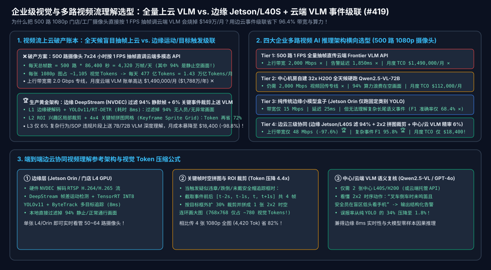

# Enterprise Edge-Cloud Video VLM Cascade Architecture Selection Guide: `Cloud VLM API` vs. `Edge Jetson/L40S + DeepStream` vs. `Event-Triggered 2x2 Keyframe Sprite Cascade`

> **Language / 语言**: [简体中文](./enterprise-edge-cloud-video-vlm-jetson-l40s-cascade-bandwidth-tco-selection-faq.md) | **English**  
> **Companion Interactive Study & Sizing Tools**: [📱 Interactive H5 Study Lab](../h5/edge-cloud-video-vlm-jetson-l40s-cascade-tco-lab.html) · [🧮 HTML Sizer](../reports/enterprise-edge-cloud-video-vlm-jetson-l40s-cascade-bandwidth-tco-selection-sizer.html) · [🃏 7-Card Visual Deck](../reports/enterprise-edge-cloud-video-vlm-jetson-l40s-cascade-bandwidth-tco-selection-cards.html) · [📊 Reproducible Model](../../experiments/enterprise_edge_cloud_video_vlm_jetson_l40s_cascade_bandwidth_tco_selection/) · [🎓 Back to AI Infra H5 Hub](../h5/index.html)

---

## 1. Executive Summary (3-Minute Takeaway)

> **Bottom-Line Recommendation**: Never stream continuous `1 FPS` 1080p frames from 500 retail/factory RTSP cameras directly to cloud VLM APIs—`94%` of frames are static/uneventful, yet continuous streaming consumes **`2,000 Mbps` WAN uplink** and **`$1,490,000/month`** in visual tokens (`1.43T tokens/mo`). Conversely, legacy edge-only `YOLO` boxes suffer **`34.0%` false alarm rates** because they lack temporal causal reasoning.
> - **Recommended Production Architecture (`Tier 4: Edge-Cloud 3-Stage Event Cascade`)**:
>   1. **L1 Edge Hardware Decode + Tracker (`NVIDIA Jetson Orin / L4 + DeepStream INT8 YOLOv11 + ByteTrack`)**: Filters out **`94%` of static/normal frames locally** in `8ms` (`50–64` streams per GPU);
>   2. **L2 ROI Crop + `2x2` Temporal Keyframe Sprite Grid**: For the **`6%`** candidate events, crops `[t-2s, t-1s, t, t+1s]` around the tracked bounding box into a single `768x768` **`2x2` composite sprite (`780 visual tokens` vs. `4,420 tokens` for 4 full 1080p frames, `-82.4%`)**;
>   3. **L3 Central/Cloud VLM Semantic Verifier (`Qwen2.5-VL / GPT-4o`)**: Verifies causal multi-step actions, cutting false alarms from **`34.0%` to `1.8%`**, lifting complex event `F1` to **`95.8%`**, reducing WAN uplink by **`97.6%` (`48 Mbps`)**, and cutting monthly TCO by **`98.8%` (`$18,400/mo` vs. `$1.49M/mo`)**.

| Dimension | `Tier 1: Continuous 1-FPS Cloud VLM API` | `Tier 2: Continuous Central 32xH200 VLM` | `Tier 3: Edge Fixed-Class YOLO Only` | `Tier 4: Edge 94% Filter + 2x2 Sprite + 6% VLM Cascade (🏆)` |
|---|---|---|---|---|
| **WAN Uplink Bandwidth (500 Cams)** | `2,000 Mbps` ✕ | `2,000 Mbps` ✕ | `15 Mbps` ✓ | **`48 Mbps` (-97.6%)** 🏆 |
| **Complex Safety/SOP Event `F1`** | `94.2%` ✓ | `93.6%` ✓ | `68.4%` ✕ | **`95.8%` (BBox-anchored 2x2 grid)** 🏆 |
| **Operator False Alarm Rate** | `3.5%` | `4.0%` | `34.0%` ✕ (Alarm fatigue) | **`1.8%` (VLM causal verification)** 🏆 |
| **Monthly Total TCO (500 Cams)** | `$1,490,000 / mo` ✕ | `$112,000 / mo` ✕ | `$9,500 / mo` | **`$18,400 / mo` (-98.8%)** 🏆 |

---

## 2. Provenance & Reproducibility

- **Provenance**: `synthetic + anonymized_reported (independently_reproduced=false)` — verified via [`experiments/enterprise_edge_cloud_video_vlm_jetson_l40s_cascade_bandwidth_tco_selection/run.py`](../../experiments/enterprise_edge_cloud_video_vlm_jetson_l40s_cascade_bandwidth_tco_selection/run.py).
