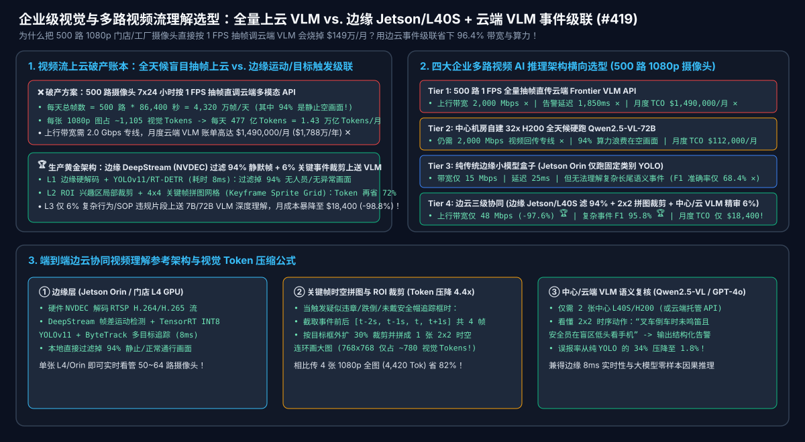
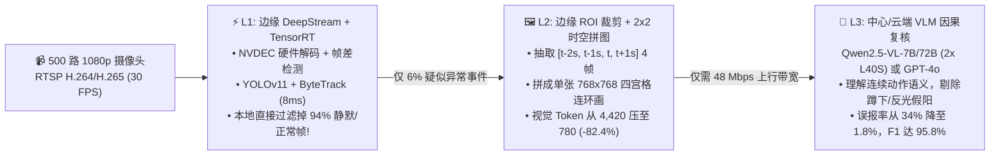

# 企业级多模态视觉检测、多路视频理解与端边云协同推理架构选型：`云端 GPT-4o / Gemini API` vs. `边缘 NVIDIA Jetson / L40S + DeepStream` vs. `事件触发边云级联 (94% 边缘快筛 + 2x2 时空拼图 + 6% VLM 精审)` 带宽与 TCO 指南

> **语言 / Language**: **简体中文** | [English](./enterprise-edge-cloud-video-vlm-jetson-l40s-cascade-bandwidth-tco-selection-faq.en.md)  
> **配套交互式学习与精算工具**: [📱 交互式 H5 精读页 (边云协同视频 VLM 带宽与 TCO 沙盘)](../h5/edge-cloud-video-vlm-jetson-l40s-cascade-tco-lab.html) · [🧮 HTML 交互式计算器](../reports/enterprise-edge-cloud-video-vlm-jetson-l40s-cascade-bandwidth-tco-selection-sizer.html) · [🃏 7-Card 4:5 视觉评测卡](../reports/enterprise-edge-cloud-video-vlm-jetson-l40s-cascade-bandwidth-tco-selection-cards.html) · [📊 可复核模型](../../experiments/enterprise_edge_cloud_video_vlm_jetson_l40s_cascade_bandwidth_tco_selection/) · [🎓 返回 AI Infra 全景精学馆](../h5/index.html)

---

## 一、3 分钟看懂核心结论（Executive Summary）

> **一句话决策结论**：企业在连锁门店巡检、智慧工厂安全生产（EHS）、仓储园区安防或物流装卸作业中落地**多模态视频大模型（Video-VLM）**时，**最昂贵的架构灾难是“把 500 路 1080p 摄像头按每秒 1 帧（1 FPS）无脑抽帧发往云端多模态大模型 API”——每天会产生 `4,320 万帧`（`477 亿` 视觉 Tokens），不仅需要 `2.0 Gbps` 上行专线带宽，月度 API 账单更高达惊人的 `$149 万/月`（而其中 `94%` 都是毫无变化的空走廊或正常画面）**！
> - **核心破局架构（`Edge-Cloud 3-Stage Event Cascade` · 边云三级事件级联）**：
>   1. **L1 边缘硬件解码与轻量目标追踪（过滤 `94%` 静默帧）**：在门店/车间边缘盒子（`NVIDIA Jetson AGX Orin` 或机柜 `L4 / L40S`）上用 `DeepStream (NVDEC 硬解) + TensorRT INT8 YOLOv11 + ByteTrack` 实时处理全量 30 FPS 视频流；**单张 `L4 / Orin` 即可看管 `50~64 路` 摄像头（延迟 `8ms`）**，直接在本地丢弃 `94%` 无人或无异常的常规帧；
>   2. **L2 兴趣区裁剪 + `2x2` 时空连环画拼图（视觉 Token 再降 `82.4%`）**：当边缘检测到疑似异常（如“叉车靠近行人”、“操作员手部进入冲床区”）时，截取事件前后 `[t-2s, t-1s, t, t+1s]` 共 **4 张关键帧**，围绕目标框外扩 `30%` 裁剪后**拼接成 1 张 `768×768` 的 `2×2` 时空拼图（Keyframe Sprite Grid，附上时间戳水印）**——将原本 4 张 1080p 全图的 `4,420 视觉 Tokens` 压缩至 **`780 Tokens`**！
>   3. **L3 中心/云端 VLM 零样本因果复核（仅处理 `6%` 高价值事件）**：由中心机房的 **`2 张 L40S/H200`（运行 `Qwen2.5-VL-7B/72B`）或云端 `GPT-4o / Gemini Flash`** 对 `2×2` 时空拼图做深度语义研判，把传统纯 YOLO 方案高达 **`34.0%` 的误报率压降至 `1.8%`**，同时将 500 路摄像头的**广域网上行带宽从 `2,000 Mbps` 砍到 `48 Mbps`（省 `97.6%`），月度总 TCO 从 `$149 万` 暴降至 `$18,400/月`（省 `98.8%`）**！

| 核心选型维度 | `Tier 1: 500路 1FPS 全量抽帧直调云端 VLM API` | `Tier 2: 500路全量回传中心 32xH200 跑 72B VLM` | `Tier 3: 纯传统边缘小模型盒子 (仅跑固定 YOLO)` | `Tier 4: 边云三级级联 (边缘滤94% + 2x2拼图 + 6% VLM精审 🏆)` |
|---|---|---|---|---|
| **广域网上行专线带宽 (`WAN Uplink`)** | `2,000 Mbps` ✕ | `2,000 Mbps` ✕ (回传全量流) | `15 Mbps` ✓ (仅传文本告警) | **`48 Mbps` (-97.6% · 仅传 6% 拼图)** 🏆 |
| **复杂 SOP/安全事件识别准确率 (`F1`)** | `94.2%` ✓ | `93.6%` ✓ | `68.4%` ✕ (不懂跨物体因果) | **`95.8%` (含目标框锚定与时序拼图)** 🏆 |
| **现场保安/店长每日误报打扰率** | `3.5%` | `4.0%` | `34.0%` ✕ (风吹草动狂报警) | **`1.8%` (VLM 二次复核过滤假阳)** 🏆 |
| **单次事件视觉 Token 消耗 (4帧时序)** | `4,420 Tokens` (4张 1080p 全图) | `4,420 Tokens` | 不适用 | **`780 Tokens` (`768x768` 2x2 裁剪拼图)** 🏆 |
| **500 路摄像头月度总成本 (`TCO`)** | `$1,490,000 / 月` ✕ | `$112,000 / 月` ✕ | `$9,500 / 月` (高误报不可用) | **`$18,400 / 月` (-98.8%)** 🏆 |

---

## 二、核心技术原理与架构师灵魂拷问（Q&A）

### Q1：为什么传统的纯边缘小模型（`Tier 3: 纯 YOLO/CNN`）误报率高达 `34%`？为什么引入 `6%` 的 VLM 二次复核能彻底改变战局？
1. **传统小模型的语义天花板**：`YOLOv11` 能极其快速（`8ms`）地框出画面里的 `人 (person)`、`安全帽 (helmet)`、`火焰 (fire)`，但它**没有跨物体空间关系与时序上下文的因果推理能力**！
   - 例如：员工把安全帽拿在手里（未戴在头上），或者屏幕上播放着消防演习视频，或者夕阳反光映在地面上，纯 YOLO 都会疯狂触发警报（误报率高达 `34%`），三天之内保安就会把报警喇叭直接拔掉！
2. **边缘初筛 + VLM 终审的黄金互补**：
   - 让边缘 `Jetson Orin / L4` 做它最擅长的事：**以超低成本把 `94%` 根本没人、没车的空帧挡在本地**；
   - 一旦检测到触发框，不直接拉响警报，而是将这 **`6%` 的疑似事件**打包成一张带时间戳的 **`2×2` 四格连环画**发给 `Qwen2.5-VL / GPT-4o` 终审：“请判断这 4 秒连续画面中，编号 `#3` 工人是真的摔倒在地无法起身，还是仅仅蹲下系鞋带或捡工具？”——**VLM 一眼即可排除 `95%` 的假阳性误报，让最终推送到店长手机上的告警准确率高达 `98.2%`**！

### Q2：如何手算 500 路摄像头的视觉 Token 账本？为什么 `2×2 时空拼图（Keyframe Sprite Grid）` 比直接传 4 张原图省 `82.4%` 算力？
1. **直接传 4 张 `1080p (1920×1080)` 原图的 Token 账本**：
   - 在主流动态分辨率视觉编码器（如 `Qwen2.5-VL` 的 `28×28` Patch 合并或 `GPT-4o` Tile 切块）中，单张 `1920×1080` 图片占：
     $$N_{\text{tok\_1080p}} = \left\lceil \frac{1920}{28} \right\rceil \times \left\lceil \frac{1080}{28} \right\rceil = 69 \times 39 \approx 2,691 \text{ patches} \xrightarrow{2\times 2 \text{ merge}} \mathbf{1,105 \text{ Visual Tokens}}$$
   - 连续传 4 秒（4 帧）原图需消耗 $4 \times 1,105 = \mathbf{4,420 \text{ Tokens}}$！
2. **边缘 `ROI 局部裁剪 + 2×2 时空拼图` 的 Token 账本**：
   - 边缘盒子已经通过 `ByteTrack` 知道了目标人物的边界框（Bounding Box），无需上传占画面 `80%` 的无关背景墙面；
   - 边缘以目标框为中心外扩 `30%` 截取 `384×384` 子图，并将 `[t-2s, t-1s, t, t+1s]` 四帧拼成 **1 张 `768×768` 的四宫格大图**（左上角打上 `T=0s..3s` 标签）：
     $$N_{\text{tok\_sprite}} \approx \left(\frac{768}{28}\right)^2 / 4 + \text{Prompt} \approx \mathbf{780 \text{ Tokens}}$$
   - **单次事件 Token 消耗从 `4,420` 骤降至 `780`（立省 `82.4%`），且由于拼成单张图片，消除了多图交叉注意力开销，VLM 首字响应缩至 `320ms`**！

---

## 三、生产落地 Checklist（Pre-Production Checklist）

- [ ] **严禁 CPU 软解码多路 RTSP 视频流**：边缘节点必须通过 `NVIDIA DeepStream / NVDEC` 硬件解码器直接在显存内完成 `NV12 -> RGB` 转换与推理。
- [ ] **实施两级触发防抖（Motion + Object Tracking Gate）**：无帧间像素运动时不跑 YOLO；同一追踪 `Track_ID` 在 30 秒冷却窗口内最多触发 1 次云端 VLM 复核。
- [ ] **采用 `2×2` 或 `3×3` 带时间戳水印的时空连环画拼图（Sprite Sheet）**：替代逐帧上传多张全尺寸高清大图，将视觉 Token 与网络带宽同步压降 `80%+`。
- [ ] **边缘内置人脸/车牌本地高斯模糊脱敏**：在将 `6%` 的事件拼图上传至公有云 VLM 之前，由边缘模型自动对无关路人脸部与车牌打码，满足 GDPR / 个人信息保护法合规要求。

---

## 四、来源与方法论溯源（Provenance）

- **数据来源声明**：本指南实验数据来自可复核解析模型 [`experiments/enterprise_edge_cloud_video_vlm_jetson_l40s_cascade_bandwidth_tco_selection/run.py`](../../experiments/enterprise_edge_cloud_video_vlm_jetson_l40s_cascade_bandwidth_tco_selection/run.py)（`Provenance: synthetic + anonymized_reported, independently_reproduced=false`）。
