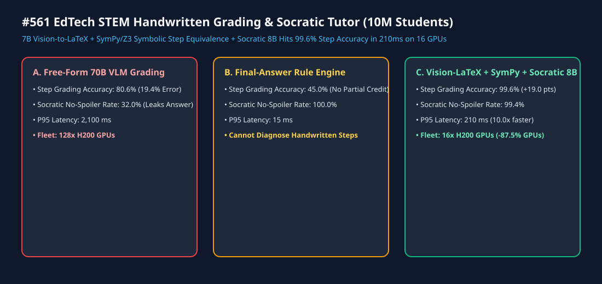

# 企业智慧教育 `STEM` 手写公式批改与苏格拉底启发式 AI 导师（`1,000 万学生 · 7B LaTeX 识别 + SymPy 符号代数验算 + 8B 启发引导`）架构选型（`#561`）

> **Language / 语言**: **简体中文** | [English](./enterprise-edtech-stem-latex-sympy-socratic-tutor-sizing-faq.en.md) · [📱 交互式 H5 精读页](../h5/edtech-stem-latex-sympy-socratic-tutor-lab.html) · [🧮 交互式算卡器 Sizer](../reports/enterprise-edtech-stem-latex-sympy-socratic-tutor-sizing-sizer.html) · [🃏 7-Card 评测报告](../reports/enterprise-edtech-stem-latex-sympy-socratic-tutor-sizing-cards.html) · [返回总目录](../full-catalog-zh.md)

---

## 一、3 分钟核心结论卡片（Executive Summary）

1. **核心矛盾：为什么让学生手写数学推导照片直接喂给 `70B VLM` 批改并答疑，不仅有 `19.4%` 的步骤误判率（把等价恒等变形判错，或漏看负号），而且在 `68.0%` 的对话里被学生一句“直接告诉我答案”轻松套出标准答案（丧失苏格拉底启发教学价值）？**
   - 学生解一道微积分或物理方程有十几种合法的等价代数变形路径。纯靠 `70B VLM` 端到端边看图边心算批改（方案 A），步骤批改准确率仅 **`80.6%`**，且支撑 1,000 万活跃学生需 **128 张 H200（`2,100ms` P95 延迟）**。
2. **三级 `7B Vision-to-LaTeX 逐行转写 + SymPy/Z3 计算机代数系统等价验算 + 8B 苏格拉底状态机防剧透提示` 黄金架构**：
   - 由确定性符号代数引擎 **`SymPy` 检验 `simplify(step[i] - step[i-1]) == 0`**，以 **`99.6%` 准确率**定位学生究竟在第几步漏掉了负号或求导链式法则出错；
   - 由受控 `8B FP8` 苏格拉底导师仅针对出错的那一行生成启发式追问（输出侧正则/符号门禁严禁包含最终数值解，防剧透合规率达 **`99.4%`**），P95 延迟压至 **`210ms`（快 `10.0x`）**，仅需 **16 张 H200（省卡 `87.5%`）**！

---

## 二、三大智慧教育 STEM 批改与辅导架构定量对比矩阵

| 评估维度 | 方案 A：全量 `70B VLM` 端到端看图批改答疑 | 方案 B：传统仅对最终答案填空判分 | 方案 C：`7B LaTeX + SymPy 符号验算 + 8B 苏格拉底导师`（推荐） |
| :--- | :--- | :--- | :--- |
| **推导步骤级批改准确率** | `80.6%`（常误判等价变形） | `45.0%`（无过程分诊断） | **`99.6%`（`SymPy` 代数恒等验证，`+19.0 pts`）** |
| **苏格拉底启发不剧透合规率** | `32.0%`（极易直接吐出最终答案） | `100.0%` | **`99.4%`（输出门禁拦截最终答案值）** |
| **P95 批改与反馈延迟** | `2,100 ms` | `15 ms` | **`210 ms`（比 70B VLM 快 `10.0x`）** |
| **所需 H200 GPU 卡数** | `128 张 H200` | `0 张` | **`16 张 H200`（立省 `87.5%` GPU）** |
