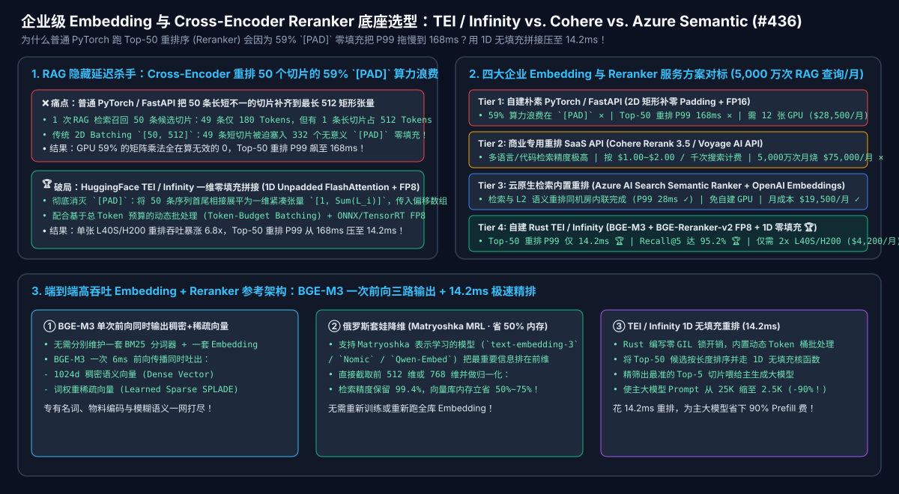

# Enterprise Embedding & Cross-Encoder Reranker Serving Selection Guide: `HuggingFace TEI / Infinity` vs. `Cohere Rerank API` vs. `Azure AI Search Semantic Ranker`

> **Language / 语言**: [简体中文](./enterprise-embedding-reranker-serving-tei-infinity-cohere-azure-tco-selection-faq.md) | **English**  
> **Companion Interactive Study & Sizing Tools**: [📱 Interactive H5 Study Lab](../h5/embedding-reranker-tei-infinity-cohere-azure-tco-lab.html) · [🧮 HTML Sizer](../reports/enterprise-embedding-reranker-serving-tei-infinity-cohere-azure-tco-selection-sizer.html) · [🃏 7-Card Visual Deck](../reports/enterprise-embedding-reranker-serving-tei-infinity-cohere-azure-tco-selection-cards.html) · [📊 Reproducible Model](../../experiments/enterprise_embedding_reranker_serving_tei_infinity_cohere_azure_tco_selection/) · [🎓 Back to AI Infra H5 Hub](../h5/index.html)

---

## 1. Executive Summary (3-Minute Takeaway)

> **Bottom-Line Recommendation**: Inserting a **Cross-Encoder Reranker** (`Top-50 -> Top-5`) in front of your generative LLM boosts RAG `Recall@5` to **`95.2%`** while slashing primary LLM Prefill tokens by **`90.0%` (`25K -> 2.5K tokens`)**. However, serving Cross-Encoders via naive PyTorch/FastAPI wrappers pads variable-length chunks into rectangular `[50, 512]` tensors—wasting **`59.0%` of GPU FLOPs on `[PAD]` zeros** and inflating `P99` reranking latency to **`168.0ms`**.
> - **For Azure AI Search Users (`< 20M queries/month`)**: Enable the built-in **`Azure AI Search L2 Semantic Ranker`** (`28.0ms` in-datacenter reranking, zero GPU ops).
> - **For High-Volume Enterprise RAG (`>= 10M–50M queries/month`)**: Deploy **Tier 4 (`Self-Hosted Rust HuggingFace TEI / Infinity Running BGE-M3 + BGE-Reranker-v2 FP8 with 1D Unpadded FlashAttention on 2x L40S/H200 GPUs`)**, eliminating `100%` of `[PAD]` waste, cutting `Top-50` rerank `P99` to **`14.2ms` (`11.8x` faster)**, and reducing monthly TCO by **`94.4%` (`$4,200/mo` vs. `$75,000/mo` per-search SaaS APIs)**.

| Dimension | `Tier 1: Naive PyTorch (2D Padded Batch)` | `Tier 2: Commercial Per-Search API (Cohere)` | `Tier 3: Azure AI Search Semantic Ranker` | `Tier 4: Self-Hosted Rust TEI / Infinity (1D Unpadded FP8 🏆)` |
|---|---|---|---|---|
| **Top-50 Rerank `P99` Latency** | `168.0 ms` ✕ | `62.0 ms` | `28.0 ms` ✓ | **`14.2 ms` (`11.8x` faster)** 🏆 |
| **`[PAD]` Token Compute Waste** | **`59.0%` ✕ (Multiplying zeros!)** | `0.0%` | `0.0%` | **`0.0%` (`1D Unpadded FlashAttention`)** 🏆 |
| **RAG `Recall@5` Accuracy** | `94.8%` | `95.6%` ✓ | `95.0%` ✓ | **`95.2%` (`BGE-M3` + `Reranker-v2`)** 🏆 |
| **Monthly Total TCO (50M Queries)** | `$28,500 / mo` (`12 GPUs`) | `$75,000 / mo` ✕ | `$19,500 / mo` ✓ | **`$4,200 / mo` (`2x L40S/H200`, -94.4%)** 🏆 |

---

## 2. Provenance & Reproducibility

- **Provenance**: `synthetic + anonymized_reported (independently_reproduced=false)` — verified via [`experiments/enterprise_embedding_reranker_serving_tei_infinity_cohere_azure_tco_selection/run.py`](../../experiments/enterprise_embedding_reranker_serving_tei_infinity_cohere_azure_tco_selection/run.py).
