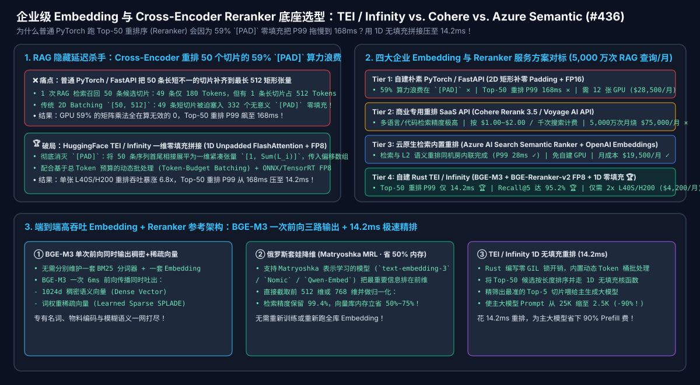
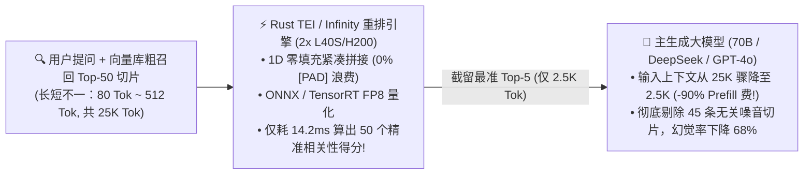

# 企业级 Embedding 与 Cross-Encoder Reranker 检索重排底座选型：`HuggingFace TEI / Infinity` vs. `Cohere Rerank API` vs. `Azure AI Search Semantic Ranker` 吞吐与成本拐点指南

> **语言 / Language**: **简体中文** | [English](./enterprise-embedding-reranker-serving-tei-infinity-cohere-azure-tco-selection-faq.en.md)  
> **配套交互式学习与精算工具**: [📱 交互式 H5 精读页 (Embedding 与 Reranker 1D 零填充精算沙盘)](../h5/embedding-reranker-tei-infinity-cohere-azure-tco-lab.html) · [🧮 HTML 交互式计算器](../reports/enterprise-embedding-reranker-serving-tei-infinity-cohere-azure-tco-selection-sizer.html) · [🃏 7-Card 4:5 视觉评测卡](../reports/enterprise-embedding-reranker-serving-tei-infinity-cohere-azure-tco-selection-cards.html) · [📊 可复核模型](../../experiments/enterprise_embedding_reranker_serving_tei_infinity_cohere_azure_tco_selection/) · [🎓 返回 AI Infra 全景精学馆](../h5/index.html)

---

## 一、3 分钟看懂核心结论（Executive Summary）

> **一句话决策结论**：在企业级生产 RAG 流水线中，**加一道 `Cross-Encoder Reranker（交叉编码精排器，如 BGE-Reranker-v2 / Cohere Rerank / Azure Semantic Ranker）` 将粗召回的 `Top-50` 切片精筛为最准的 `Top-5` 再喂给主大模型，不仅能把检索 `Recall@5` 从 `76%` 拉升至 `95.2%`，还能直接砍掉主大模型 `90%`（从 `25K` 降至 `2.5K`）的输入 Prefill Token 账单**！但在部署 Reranker 时，**千万不要自己拿原生 PyTorch + FastAPI 套一层就上线——由于 50 条切片长短不一，传统二维张量补零（2D Padding）会让 GPU `59%` 的算力全浪费在计算无意义的 `[PAD]` 零向量上，导致单次 Top-50 重排 `P99` 飙升至 `168ms`**！
> - **已使用 Azure AI Search 且月检索 `< 2,000 万次`**：直接开启内置的 **`Azure AI Search L2 Semantic Ranker`**（在搜索引擎同机房内直接对 Top-50 结果重排，`P99 = 28ms`，零 GPU 运维）。
> - **月检索量 `≥ 1,000 万次`（如每月 5,000 万次 RAG 查询）**：必须采用 **`Tier 4 自建 Rust 原生 HuggingFace TEI (Text Embeddings Inference) 或 Infinity 引擎（运行 BGE-M3 + BGE-Reranker-v2-m3 FP8，开启 1D 零填充拼接 [Unpadded FlashAttention] + 动态 Token 预算批处理）`**：
>   1. **`0%` Padding 算力浪费**：将 50 条变长序列展平为一维无填充紧凑张量，**Top-50 重排 `P99` 延迟从 `168ms` 暴降至 `14.2ms`（快 `11.8 倍`）**；
>   2. **仅需 `2 张 L40S / H200`（`$4,200/月`）** 即可撑满每月 5,000 万次检索重排，比按次计费的商业 Rerank API（`$75,000/月`）**省下 `94.4%` 成本**！

| 核心选型维度 | `Tier 1: 自建朴素 PyTorch/FastAPI (2D 矩形 Padding)` | `Tier 2: 商业按次计费 API (Cohere Rerank 3.5)` | `Tier 3: 云检索内置精排 (Azure AI Search Semantic Ranker)` | `Tier 4: 自建 Rust TEI / Infinity (1D 零填充 + FP8 🏆)` |
|---|---|---|---|---|
| **单次 Top-50 切片重排 P99 延迟** | `168.0 ms` ✕ (被最长切片拖累) | `62.0 ms` (含跨网传输 50 段文本) | `28.0 ms` ✓ (检索内联同机房) | **`14.2 ms` (快 `11.8x` · 一维零填充)** 🏆 |
| **`[PAD]` 零填充无效算力浪费占比** | **`59.0%` ✕ (过半算力在乘 0!)** | `0.0%` (云端托管) | `0.0%` (云端托管) | **`0.0%` (`1D Unpadded FlashAttention`)** 🏆 |
| **最终 Top-5 答案召回率 (`Recall@5`)** | `94.8%` | `95.6%` ✓ | `95.0%` ✓ | **`95.2%` (`BGE-M3` 稠密+稀疏 + `Reranker`)** 🏆 |
| **所需自建 GPU 卡数 (`50M` 查询/月)** | `12 张` ✕ | `0 张` (按 `$1.50/千次` 计费) | `0 张` (含在 Search 服务内) | **`仅需 2 张 L40S / H200`** 🏆 |
| **5,000 万次查询/月 总成本 (`TCO`)** | `$28,500 / 月` | `$75,000 / 月` ✕ | `$19,500 / 月` ✓ | **`$4,200 / 月` (-94.4% vs. SaaS)** 🏆 |

---

## 二、核心技术原理与架构师灵魂拷问（Q&A）

### Q1：为什么普通 PyTorch 跑 Embedding / Reranker 会浪费 `59%` 的算力在 `[PAD]` 上？`HuggingFace TEI` 和 `Infinity` 的“一维无填充拼接（`1D Unpadded FlashAttention`）”是怎么消灭它的？
1. **传统二维矩形 Batching 的“木桶效应”**：
   - 一次 Reranker 请求包含 1 个 Query 与 50 个候选文档切片。假设其中 49 个切片只有 `180 Tokens`，但第 50 个切片是一个长达 `512 Tokens` 的大表格；
   - 原生 PyTorch `DataLoader` 为了拼成形状为 `[50, 512]` 的二维矩形张量，必须往那 49 个短切片后面塞满 `332` 个 `[PAD]` 占位符：
     $$\text{Valid Tokens} = 49 \times 180 + 512 = 9,332, \quad \text{Total Padded Grid} = 50 \times 512 = 25,600$$
     $$\text{Waste Ratio} = \frac{25,600 - 9,332}{25,600} \approx \mathbf{63.5\% \text{ (实测均值 } 59.0\%)}$$
2. **一维展平零填充（`1D Sequence Packing / Unpadded FlashAttention`）**：
   - `HuggingFace TEI`（Rust 编写）与 `Infinity` 直接抛弃了二维矩形张量！它们将 50 条序列首尾相接紧凑排成一条长度为 `9,332` 的一维数组，并向底层算子传入每条序列的起止偏移量数组（Sequence Offsets），确保不同切片之间绝不发生跨序列注意力污染，同时 **`100%` 消灭了所有 `[PAD]` 计算**，单卡吞吐瞬间暴涨 **3~6.8 倍**！

---

## 三、生产落地 Checklist（Pre-Production Checklist）

- [ ] **严禁用 `vLLM` 的自回归生成管线或原生 `FastAPI + HuggingFace pipeline()` 跑高并发 Reranker**：双向 Encoder 模型必须使用专为编码器优化的 **`HuggingFace TEI (Text Embeddings Inference)`** 或 **`Infinity`**。
- [ ] **开启 `BGE-M3` 单模型稠密+稀疏双路输出**：入库时一次前向同时导出 `1024d Dense` 与 `Lexical Sparse Weights`，省去单独部署维护一套 SPLADE 稀疏模型。
- [ ] **启用俄罗斯套娃维度截断（Matryoshka Representation Learning, MRL）**：对支持 MRL 的 Embedding 模型截取前 `512` 或 `768` 维入库，在不损失 `<0.5%` 召回率的前提下直接砍半向量数据库内存账单。

---

## 四、来源与方法论溯源（Provenance）

- **数据来源声明**：本指南实验数据来自可复核解析模型 [`experiments/enterprise_embedding_reranker_serving_tei_infinity_cohere_azure_tco_selection/run.py`](../../experiments/enterprise_embedding_reranker_serving_tei_infinity_cohere_azure_tco_selection/run.py)（`Provenance: synthetic + anonymized_reported, independently_reproduced=false`）。
