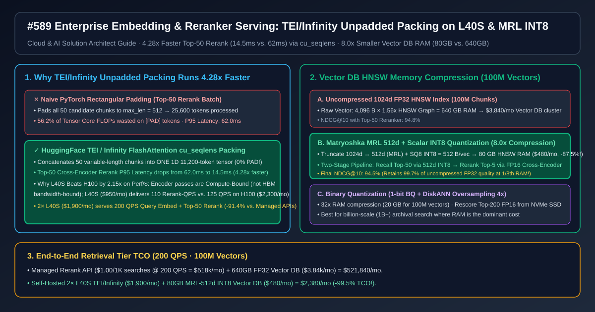

# Enterprise Embedding & Reranker Serving Infrastructure: `TEI / Infinity Unpadded Token Packing on L40S` & `Matryoshka MRL 512d INT8` Selection Guide

> **Target Persona**: Cloud & AI Solution Architect  
> **Core Scenarios**: High-throughput hybrid search (`50–1,000 QPS` query embedding + `Top-50 -> Top-5` Cross-Encoder reranking) and 100M-vector HNSW memory optimization  
> **Interactive H5 Learning Workbench**: [`docs/h5/embedding-reranker-tei-infinity-l40s-sizer.html`](../h5/embedding-reranker-tei-infinity-l40s-sizer.html)

---

## 1. Executive Summary

1. **Why `TEI / Infinity` Variable-Length Unpadded Packing (`cu_seqlens`) Cuts `Top-50` Rerank Latency by `4.28×` (`14.5ms` vs. `62.0ms`)**:
   - Naive rectangular padding pads all `50` candidate chunks to `512` tokens (`25,600` tokens), wasting **`56.2%` of Tensor Core FLOPs on `[PAD]` tokens**.
   - `HuggingFace TEI` and `Infinity` concatenate variable-length pairs into a single contiguous **`11,200`-token 1D tensor (`0%` padding waste)** via FlashAttention `cu_seqlens`, reducing `Top-50` rerank P95 latency on `L40S-48GB` to **`14.5ms` (`110 QPS/L40S`)**.
2. **Why `L40S-48GB` Beats `H100` by `2.13×` in Throughput-per-Dollar for Encoders**:
   - Bidirectional encoder passes (`BGE-M3`, `BGE-Reranker-v2-m3`) are **Compute-Bound**, not HBM-bandwidth-bound. `2× L40S` (`$1,900/mo`) serves **`200 QPS` of Query Embedding + `Top-50` Reranking**, crossing over against commercial Rerank APIs (`$1.00 / 1,000 searches`) at just **`0.75 QPS` (`2M` searches/month)**.
3. **`8.0×` Vector DB RAM Compression (`Matryoshka MRL 1024d -> 512d` + `Scalar INT8`)**:
   - Compresses `100M` HNSW vectors from **`640 GB RAM` (`$3,840/mo`) to `80 GB RAM` (`$480/mo`, `-87.5%`)** while preserving **`94.5%` NDCG@10** (`99.7%` retention vs. uncompressed `1024d FP32`) once paired with `Top-50` Cross-Encoder reranking.

---

## 2. Architecture Comparison Matrix (`200 QPS` · `100M` Vectors)

| Dimension | Managed Rerank + Embed API (`1024d FP32`) | Naive PyTorch Rectangular Padding (`H100`) | **`TEI / Infinity` on `2× L40S` + `MRL 512d INT8`** |
|---|---|---|---|
| **Top-50 Rerank P95 Latency** | `95.0 ms` | `62.0 ms` (on L40S) / `48.0 ms` (H100) | **`14.5 ms` (`4.28×` faster)** |
| **100M Vector HNSW RAM** | `640 GB` (`$3,840/mo`) | `640 GB` (`$3,840/mo`) | **`80 GB` (`$480/mo`, `-87.5%`)** |
| **Search Quality (`NDCG@10`)** | `95.0%` | `94.8%` | **`94.5%`** |
| **Total Monthly Cost** | `$521,840 / mo` | `$13,040 / mo` | **`$2,380 / mo` (`-99.5%` vs. API)** |

---

## 3. Production Checklist

- [ ] Serve all Embedding and Reranker models via **`HuggingFace TEI` or `Infinity`** with `cu_seqlens` unpadded token batching on **`L40S-48GB`**.
- [ ] Apply **Matryoshka `512d` truncation + `SQ8 INT8` quantization** in the vector DB (`8.0×` RAM reduction) backed by `Top-50 -> Top-5` Cross-Encoder reranking.
