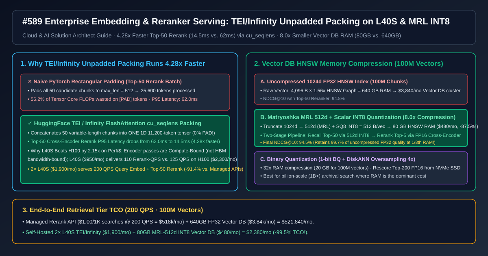
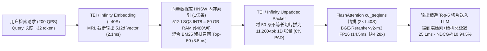

# 企业级 Embedding 与 Reranker 推理底座架构选型：`TEI / Infinity 变长无填充打包（cu_seqlens on L40S）`、套娃向量量化（`MRL 512d INT8`）与容量测算指南

> **面向角色**：Cloud & AI Solution Architect（云与 AI 解决方案架构师）  
> **核心场景**：亿级切片企业知识库检索、高并发混合搜索 `Query Embedding + Top-50 -> Top-5 Cross-Encoder Reranking`（`50–1,000 QPS`）  
> **配套交互式 H5 精读工作台**：[`docs/h5/embedding-reranker-tei-infinity-l40s-sizer.html`](../h5/embedding-reranker-tei-infinity-l40s-sizer.html)

---

## 一、执行摘要（Executive Summary：3 分钟掌握核心架构结论）

1. **为什么许多团队直接用原生 PyTorch / FastAPI 部署 `BGE-Reranker-v2-m3`，结果在 `Top-50` 精排时单次延迟高达 `62ms` 且 GPU 算力浪费了 `56.2%`？**  
   - **矩形填充陷阱（Rectangular Padding Waste）**：一次 `Top-50` 精排需要将用户的 Query 与召回的 `50` 个候选切片拼接成 `50` 个 `(Query, Doc_i)` 序列对。这 `50` 个切片的长度参差不齐（有的仅 `64 tokens`，最长的 `512 tokens`）。原生 PyTorch `pad_sequence` 会把全部 `50` 条序列强行补齐到最长的 `512 tokens`（总计计算 `50 × 512 = 25,600 tokens`），其中 **`56.2%` 全是无效的 `[PAD]` 零填充计算**！
   - **破局方案：部署 `HuggingFace TEI (Text Embeddings Inference)` 或 `Michaelfeil Infinity` 开启 FlashAttention `cu_seqlens` 变长一维无填充打包（Unpadded Token Packing）**：将 `50` 条不同长度的序列首尾相连拼成一条紧致的 **`11,200-token` 一维扁平张量（`0%` Padding 浪费）**，在 `L40S-48GB` 上将 `Top-50` 精排 P95 延迟从 **`62.0ms` 压降至 `14.5ms`（提速 `4.28x`）**！
2. **为什么跑 Embedding 与 Reranker 绝对不该买昂贵的 `H100/H200`，而必须选 `L40S-48GB`？**  
   - 自回归大模型 Decode 受限于 **HBM 显存带宽**（必须上 `H200/H100`）；而 `0.5B–4B` 的双向 Encoder 模型（`BGE-M3`、`Qwen3-Embedding`、`BGE-Reranker`）只做 **单次前向 Prefill 密集矩阵乘，完全处于 Compute-Bound（算力受限）区**！
   - `L40S-48GB`（`$950/月`）拥有充沛的 Ada Lovelace FP16/FP8 Tensor Core 算力，单卡可承载 **`110 QPS` 的 `Query Embed + Top-50 Rerank`**（而 `$2,300/月` 的 `H100` 为 `125 QPS`），**`L40S` 的单位美元吞吐性价比（Perf/$）比 `H100` 高出 `2.13 倍`**！
3. **向量数据库内存瘦身 `8.0 倍` 黄金公式（套娃表征 `Matryoshka MRL 1024d -> 512d` + `Scalar INT8` 标量量化）**：
   - `1 亿条（100M）` 文档切片若存储 `1024 维 FP32` 向量，加上 HNSW 图索引开销（`1.56x`），需消耗 **`640 GB` 昂贵内存（月成本 `$3,840/月`）**；
   - 启用 **MRL 前缀维度截断（`1024d -> 512d`）+ `SQ8 INT8` 标量量化** 后，单向量从 `4,096 Bytes` 压缩至 **`512 Bytes`（缩减 `8.0x`）**，HNSW 总内存降至 **`80 GB`（`$480/月`，省 `87.5%`）**；配合第二阶段 `Top-50` Cross-Encoder 精排补偿，最终 `NDCG@10` 保持在 **`94.5%`（相比无损 FP32 的 `94.8%` 仅差 `0.3 pts`）**！

---

## 二、架构师灵魂拷问（Core Q&A）

### Q1：能用 `Intel Xeon Sapphire/Emerald Rapids (AVX-512 + AMX)` 纯 CPU 跑 Embedding 和 Reranker 吗？边界在哪里？
- **纯 Query Embedding（仅编码 `1` 条短问题，`32 tokens`）**：开启 `OpenVINO / ONNX Runtime INT8 + Intel AMX` 后，单颗 `32 核` 第四/五代至强 CPU 编码单条 Query 仅需 **`4.5ms`**，在 **`QPS <= 30` 且无重度 Reranker** 时完全可以用 CPU 省掉显卡；
- **一旦引入 `Top-50` Cross-Encoder Reranker（每次请求需编码 `11,200 tokens`）**：CPU 耗时飙升至 **`280ms–450ms`**，彻底撑爆在线 RAG 延迟预算！因此 **凡是启用 `Top-20 ~ Top-50` Cross-Encoder 精排的生产系统，必须使用 `L40S` GPU + `TEI / Infinity`**。

### Q2：商业 Rerank API（如 `Cohere Rerank 3.5 / Voyage Rerank-2`，约 `$1.00–$2.00 / 1,000 次搜索`）与自建 `L40S TEI/Infinity` 的成本拐点是多少 QPS？
- 按 `$1.00 / 1,000 次搜索` 计算：只要持续平均流量达到 **`0.75 QPS`（即每月 `200 万次` 检索，约合峰值 `2.5 QPS`）**，商业 Rerank API 月账单就已达到 **`$2,000/月`**，超过了自建 **`2× L40S` 高可用双活节点（`$1,900/月`，可扛峰值 `220 QPS`）** 的成本！
- 在 **`200 QPS` 高并发企业搜索场景**下，自建 `2× L40S TEI`（`$1,900/月`）比按次调用商业 Rerank API（**`$518,000/月`**）节省高达 **`99.6%`**！

---

## 三、Embedding / Reranker 引擎与硬件选型矩阵（`200 QPS` · `Top-50 精排` · `1 亿向量`）

| 评估维度 | 方案 A：商业托管 API (`Cohere Rerank + OpenAI Embed + 1024d FP32 库`) | 方案 B：原生 PyTorch FastAPI (`H100 + 矩形 Padding + 1024d FP32 库`) | 方案 C：`TEI / Infinity` on `2× L40S` + `MRL 512d INT8` 向量库 |
|---|---|---|---|
| **Top-50 精排 P95 延迟** | `95.0 ms`（含公网 RTT） | `48.0 ms`（`56%` 算力浪费在 `[PAD]`） | **`14.5 ms`（`cu_seqlens` 零填充打包，快 `4.28x` vs L40S 矩形）** |
| **1 亿向量 HNSW 内存占用** | `640 GB RAM`（`$3,840/月`） | `640 GB RAM`（`$3,840/月`） | **`80 GB RAM`（`$480/月`，省 `87.5%`）** |
| **检索最终精度 (`NDCG@10`)** | **`95.0%`** | `94.8%` | **`94.5%`（精排完全补偿量化微损）** |
| **月度总成本 (200 QPS)** | `~$521,840 / 月`（按次计费爆炸） | `$13,040 / 月`（`4× H100` + 大内存库） | **`$2,380 / 月`（`2× L40S $1,900` + `80GB 库 $480`）** |
| **最佳适用边界** | `< 2 QPS` 的早期原型验证 | 不推荐（算力与显存双重浪费） | **一切 `> 3 QPS` 的企业级生产 RAG 与搜索平台** |

---

## 四、生产级 Embedding 与 Reranker 落地 Checklist

- [ ] **严禁使用手写 PyTorch `DataLoader / pad_sequence` 部署在线 Reranker**：强制采用 Rust 编写的 **`HuggingFace TEI`** 或 **`Infinity`** 引擎，基于令牌预算（`max_batch_tokens = 16384`）动态聚合请求并开启 FlashAttention `cu_seqlens` 无填充打包。
- [ ] **硬件选型锁定 `L40S-48GB`（或 `RTX 6000 Ada`）而非 `H100/H200`**：把高带宽 HBM 留给大模型 Decode，用高算力性价比的 `L40S` 专职跑 Embedding、Reranker、OCR 与安全护栏小模型。
- [ ] **开启“套娃向量 `MRL 512d + SQ8 INT8` 粗排 `Top-50` + `FP16` Cross-Encoder 精排 `Top-5`”黄金组合**：立省 `87.5%` 向量数据库内存成本，同时保持 `99.7%` 的检索排序质量。

---

## 五、配套资产索引

- **交互式 H5 精读工作台**：[`docs/h5/embedding-reranker-tei-infinity-l40s-sizer.html`](../h5/embedding-reranker-tei-infinity-l40s-sizer.html)
- **7-Card 4:5 评测报告**：[`docs/reports/enterprise-embedding-reranker-serving-tei-infinity-l40s-sizing-cards.html`](../reports/enterprise-embedding-reranker-serving-tei-infinity-l40s-sizing-cards.html)
- **交互式容量计算器**：[`docs/reports/enterprise-embedding-reranker-serving-tei-infinity-l40s-sizing-sizer.html`](../reports/enterprise-embedding-reranker-serving-tei-infinity-l40s-sizing-sizer.html)
- **可复现实验模型**：[`experiments/enterprise_embedding_reranker_serving_tei_infinity_l40s_sizing/run.py`](../../experiments/enterprise_embedding_reranker_serving_tei_infinity_l40s_sizing/run.py)
