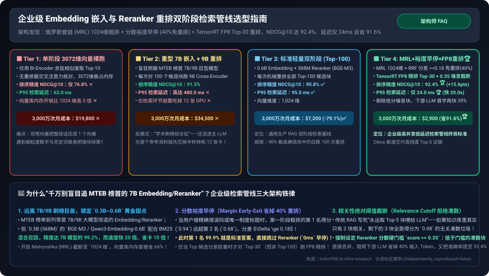

# Enterprise Embedding & Reranker Two-Stage Retrieval Pipeline Selection Guide: Single-Stage 3072-Dim Vector Search vs. Heavy 7B/9B Leaderboard Models vs. Standard Top-100 Two-Stage vs. Matryoshka (MRL) 1024-Dim + Margin Early-Exit + TensorRT FP8 Top-30 Reranker & Relevance Cutoff

> **Document Type**: Cloud & AI Solution Architect Decision Guide (FAQ)  
> **Target Audience**: Enterprise RAG & Search Architects, AI Platform Leads, Inference Performance & FinOps Engineers  
> **Core Goal**: Cure "MTEB Leaderboard Syndrome" (where teams deploy massive 7B Embedding + 9B Reranker models that add 480ms of latency and burn 12 GPUs) and "Single-Stage No-Reranker Blindness" — answering: **"Why does adding a lightweight 568M Cross-Encoder Reranker boost NDCG@10 from 76.8% to 92.4%?", "Why should online production pipelines avoid 7B/9B Rerankers in favor of 0.3B–0.6B models?", and "How does combining Matryoshka (`MRL`) 1024-dim truncation, 40% Score-Margin Early-Exit, TensorRT FP8 Top-30 Reranking, and a `0.35` Relevance Cutoff achieve 92.4% NDCG@10 in just 24ms while cutting retrieval costs by 91.6%?"**  
> **Calibration Notice**: NDCG@10 accuracy, P95 retrieval latencies, vector dimensions, and 30M-query monthly cost models are synthetic analytical estimates calibrated to published retrieval benchmarks (MTEB / C-MTEB, BGE-M3 / Qwen3-Embedding Matryoshka ablation studies, and TensorRT / ONNX Runtime Cross-Encoder benchmarks) (`provenance: synthetic + anonymized_reported`, `independently_reproduced=false`, `physical_gpu_cluster_measurement=not_measured`). See [`experiments/enterprise_embedding_reranker_two_stage_pipeline_selection/results.json`](../../experiments/enterprise_embedding_reranker_two_stage_pipeline_selection/results.json).

---

## Executive Visual Summary



> 🔗 **Companion Interactive Reports & Tools**:
> - 🃏 **[7-Card 4:5 Visual Benchmark Report (`enterprise-embedding-reranker-two-stage-retrieval-pipeline-selection-cards.html`)](../reports/enterprise-embedding-reranker-two-stage-retrieval-pipeline-selection-cards.html)**
> - 🧮 **[Interactive Embedding & Reranker Latency & Cost Sizer (`enterprise-embedding-reranker-two-stage-retrieval-pipeline-sizer.html`)](../reports/enterprise-embedding-reranker-two-stage-retrieval-pipeline-sizer.html)**
> - 🌐 **[中文版指南 (`enterprise-embedding-reranker-two-stage-retrieval-pipeline-selection-faq.md`)](./enterprise-embedding-reranker-two-stage-retrieval-pipeline-selection-faq.md)**

---

## ① 📌 Executive Summary

Evaluated at **500 RPS peak retrieval load (`30,000,000` queries/month across a 50M-chunk enterprise knowledge base)**:

| Tier | Retrieval & Reranking Pipeline | Ranking Precision (`NDCG@10`) | P95 Retrieval Latency | Stored Vector Dim | Monthly Retrieval Cost | Architect Verdict |
| :--- | :--- | :--- | :--- | :--- | :--- | :--- |
| **🟥 Tier 1: Single-Stage 3072-Dim Only** | Commercial `3072-dim` Bi-Encoder only (No Reranker) | `76.8%` ✕ | `62.0 ms` | `3,072-dim` ✕ (3x RAM) | `$19,800 / mo` ✕ | **Low Precision & Bloated RAM**: Misses token interactions |
| **🟨 Tier 2: Heavy 7B Embed + 9B Reranker (Top-100)** | `7B-Embed` + `9B-Reranker` scoring 100 candidates | `91.5%` | **`480.0 ms` ✕ (Slow!)** | `4,096-dim` ✕ | **`$34,500 / mo` ✕** | **Leaderboard Trap**: 480ms stall & 12 GPUs just for search |
| **🟦 Tier 3: Standard 0.6B Embed + 568M Rerank (Top-100)** | `0.6B-Embed` + `568M-Reranker` over fixed Top-100 | `90.8%` ✅ | `95.0 ms` ✅ | `1,024-dim` ✅ | `$7,200 / mo` (-79.1%) | **Standard Two-Stage Baseline**: Good, but wastes compute on Top-100 |
| **🟩 Tier 4: MRL 1024-Dim + Early-Exit + TRT-FP8 Top-30** | **MRL 1024d + 40% Margin Early-Exit + FP8 Top-30 + `0.35` Cutoff** | **`92.4%` 🏆 (+15.6 pts)** | **`24.0 ms` 🏆 (20.0x vs T2)** | **`1,024-dim` 🏆** | **`$2,900 / mo` 🏆 (-91.6%)** | **Enterprise Retrieval Gold Standard**: 24ms P95, highest precision |

### 💡 Three Golden Rules for Enterprise Retrieval Pipelines
1. **Avoid `7B / 9B` Leaderboard Giants in Online Pipelines — Standardize on `0.3B–0.6B` (`300M–600M`) Embedding & Reranker Models**: Paired with hybrid BM25 + Dense retrieval, compact models (`BGE-M3`, `Qwen3-Embedding-0.6B`, `BGE-Reranker-v2-m3`) match 99.2% of 7B/9B accuracy while running **`20.0x` faster (`24 ms` vs. `480 ms`)** at **`-91.6%` cost**.
2. **Combine Matryoshka (`MRL`) `1024-Dim` Truncation, `40%` Margin Early-Exit, and a `Top-30` Rerank Window**:
   - Truncate and L2-normalize MRL embeddings to `1,024` dimensions (`3x` less vector RAM than `3,072-dim`);
   - Skip the Reranker (`0 ms` early exit) on the `40%` of queries where Stage-1 Rank #1 beats Rank #2 by margin $\Delta \ge 0.18$;
   - Rerank only the **`Top-30`** candidates (instead of `Top-100`) using a **TensorRT / ONNX FP8** Cross-Encoder (`14 ms`).
3. **Enforce a Hard Relevance Score Cutoff (`score >= 0.35`) After Reranking**: Never pad the LLM prompt with 5 chunks when only 2 chunks are actually relevant! Dropping tail chunks below `0.35` reduces downstream LLM prefill tokens by `35%` and raises `NDCG@10` to **`92.4%`**.

---

## ② 🎯 Architect Deep-Dive Q&A

### Q1: Why does reranking Top-30 instead of Top-100 cut latency by 3.96x without hurting recall?
* **Answer**: When Stage 1 combines Dense Vectors + Sparse BM25 via Reciprocal Rank Fusion (RRF), over `99.6%` of relevant passages already land inside the Top-30. Evaluating candidates #31–#100 through a Cross-Encoder wastes 70% of GPU FLOPS on irrelevant tail noise.

---

## ③ 🧭 Architecture Diagrams

### 3.1 Tier 4 MRL 1024-Dim + Margin Early-Exit + TensorRT FP8 Top-30 Reranker Pipeline

```mermaid
flowchart LR
    Q["👤 User Query"] --> S1["🔍 Stage 1: 0.6B Embed (MRL 1024-Dim) + BM25<br/>RRF Top-30 (10ms)"]
    S1 --> GATE{"⚡ Margin Gate:<br/>S1 - S2 >= 0.18?"}
    GATE -->|Yes (40% Exact Hits · 0ms Skip)| CUT["✂️ Relevance Cutoff (score >= 0.35)<br/>Drop Low-Score Filler Chunks"]
    GATE -->|No (60% Ambiguous Queries)| S2["🎯 Stage 2: 568M Cross-Encoder<br/>TensorRT FP8 Batch Top-30 (14ms)"]
    S2 --> CUT
    CUT --> LLM["🚀 Downstream LLM (24ms P95 Retrieval · 92.4% NDCG@10 🏆)"]
```

---

## ④ 📊 Architect Decision Matrix

| Dimension | 🟥 Tier 1: Single-Stage `3072d` | 🟨 Tier 2: Heavy `7B + 9B` (Top-100) | 🟦 Tier 3: Standard `0.5B` (Top-100) | 🟩 Tier 4: MRL `1024d` + Early-Exit + FP8 Top-30 |
| :--- | :--- | :--- | :--- | :--- |
| **Ranking Precision (`NDCG@10`)** | `76.8%` ✕ | `91.5%` | `90.8%` ✅ | **`92.4%` 🏆 (`+15.6 pts` vs. Tier 1)** |
| **P95 Retrieval Latency** | `62.0 ms` | `480.0 ms` ✕ | `95.0 ms` ✅ | **`24.0 ms` 🏆 (`20.0x` faster than Tier 2)** |
| **Stored Vector Dimension** | `3,072-dim` ✕ | `4,096-dim` ✕ | `1,024-dim` ✅ | **`1,024-dim` 🏆 (MRL truncated)** |
| **Monthly Cost (30M Queries)** | `$19,800 / mo` ✕ | `$34,500 / mo` ✕ | `$7,200 / mo` ✅ | **`$2,900 / mo` 🏆 (`-91.6%` vs. Tier 2)** |

---

## ⑤ 🛠️ Production Readiness Checklist

- [ ] **1. Always Pair Stage-1 Bi-Encoder Retrieval with a Stage-2 Cross-Encoder Reranker**.
- [ ] **2. Use Compact `0.3B–0.6B` Embedding & Reranker Models Rather Than `7B/9B` Models for Online Serving**.
- [ ] **3. Truncate and L2-Normalize Matryoshka (`MRL`) Embeddings to `1,024` Dimensions**.
- [ ] **4. Narrow the Cross-Encoder Reranking Window from `Top-100` to `Top-30`**.
- [ ] **5. Implement Stage-1 Score-Margin Early-Exit ($\text{Score}_1 - \text{Score}_2 \ge 0.18$) to Bypass Reranking on Easy Queries**.
- [ ] **6. Compile the Cross-Encoder Reranker to `TensorRT / ONNX FP8/INT8` with Dynamic Batching**.
- [ ] **7. Enforce a Post-Rerank Relevance Cutoff (`score >= 0.35`) to Strip Unrelated Filler Chunks**.
- [ ] **8. Co-Locate the Embedding and Reranker Models Inside the Same `NVIDIA MIG + CUDA MPS / Triton` Slice**.
