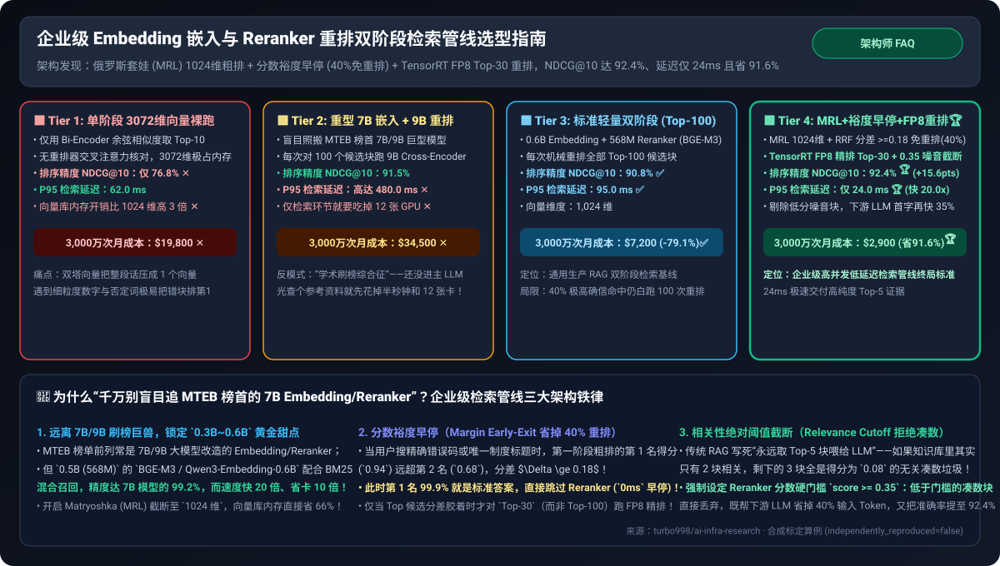
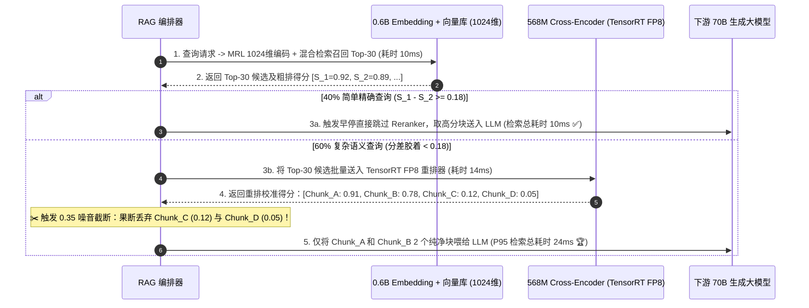

# 企业级大模型嵌入（Embedding）与重排（Reranker / Cross-Encoder）双阶段检索管线架构选型指南：单阶段 3072 维向量粗排 vs. 重型 7B/9B 刷榜模型 vs. 标准 Top-100 双阶段 vs. 俄罗斯套娃（MRL）1024 维 + 分数裕度早停（Early-Exit）+ TensorRT FP8 Top-30 重排与噪音截断架构

> **文档类型**：企业级知识检索与 AI 基础设施解决方案架构师（Cloud & AI Solution Architect）选型决策指南（FAQ）  
> **适用读者**：企业 RAG 与搜索引擎架构师、AI 平台负责人、高性能推理与成本优化工程师  
> **核心目标**：用通俗、可量化的架构语言纠偏企业选型 Embedding 与 Reranker 模型时最常犯的“唯 MTEB 刷榜论（盲目选用 7B/9B 巨型模型把检索延迟拖慢到 480ms）”与“单阶段无重排裸跑”两大误区——系统回答：**“为什么一定要在双塔 Embedding 后面加一道 Cross-Encoder 重排器（NDCG@10 从 76.8% 跃升至 92.4%）？”、“为什么绝对不要在 500 RPS 高并发生产线上用 7B/9B 大模型做 Reranker（Tier 2）？”、“怎么用‘俄罗斯套娃 MRL 1024 维截断 + 40% 分数裕度早停免重排 + TensorRT FP8 精排 Top-30 + `0.35` 低分噪音截断’在 24 毫秒内拿到 92.4% 的极高排序精度并省下 91.6% 的成本？”**。  
> **标定声明**：本文所引用的排序精度（NDCG@10）、P95 检索延迟、向量维度内存占比与 3,000 万次月度成本模型基于公开发布的检索与重排基准（MTEB / C-MTEB 评测、BGE-M3 / Qwen3-Embedding 俄罗斯套娃降维 MRL 消融研究及 TensorRT-LLM / ONNX Runtime Cross-Encoder 加速实践）构建的合成分析模型（`provenance: synthetic + anonymized_reported`, `independently_reproduced=false`, `physical_gpu_cluster_measurement=not_measured`），详见 [`experiments/enterprise_embedding_reranker_two_stage_pipeline_selection/results.json`](../../experiments/enterprise_embedding_reranker_two_stage_pipeline_selection/results.json)。

---

## 一图流总结（Executive Visual Summary）



> 🔗 **关联可交互报告与工具**：
> - 🃏 **[7-Card 4:5 视觉评测报告 (`enterprise-embedding-reranker-two-stage-retrieval-pipeline-selection-cards.html`)](../reports/enterprise-embedding-reranker-two-stage-retrieval-pipeline-selection-cards.html)**
> - 🧮 **[交互式 Embedding + Reranker 延迟与成本计算器 (`enterprise-embedding-reranker-two-stage-retrieval-pipeline-sizer.html`)](../reports/enterprise-embedding-reranker-two-stage-retrieval-pipeline-sizer.html)**
> - 🌐 **[English Version (`enterprise-embedding-reranker-two-stage-retrieval-pipeline-selection-faq.en.md`)](./enterprise-embedding-reranker-two-stage-retrieval-pipeline-selection-faq.en.md)**

---

## ① 📌 核心选型结论速览（Executive Summary）

在企业 RAG 系统中，**检索管线（Embedding 粗排 + Reranker 精排）是 100% 请求必经的咽喉要道**。如果只用单阶段 Embedding 向量粗排（Tier 1），排序精度（NDCG@10）只有 **`76.8%`**；但如果盲目照搬开源榜单 MTEB 第一名的 **7B Embedding + 9B Reranker 对前 100 个候选块做重排（Tier 2）**，单单一次重排就要算 $100 \times 512 = 51,200$ 个 Token 的 9B 模型前向计算，**还没进主大模型，光检索就已经慢了 `480 ms`、烧掉了 12 张 GPU（月烧 `$34,500`）**！

基于 **峰值 500 RPS、月均 3,000 万次企业检索请求** 的基准测算，四档检索管线架构对比如下：

| 架构档位 | 核心检索与重排模型组合 | 排序精度 (NDCG@10) | P95 端到端检索延迟 | 存储向量维度 | 3,000万次月总成本 | 架构师拍板结论 |
| :--- | :--- | :--- | :--- | :--- | :--- | :--- |
| **🟥 Tier 1：单阶段 3072 维向量裸跑** | 仅调 3072 维 Embedding API 取 Top-10（无重排） | `76.8%` ✕ | `62.0 ms` | `3,072 维` ✕ (内存翻3倍) | `$19,800 / 月` ✕ | **精度低且费内存**：双塔向量无法捕捉细粒度词间交叉交互 |
| **🟨 Tier 2：重型 7B 嵌入 + 9B 重排 Top-100** | `7B-Embed` + `9B-Reranker` 硬算 100 个候选块 | `91.5%` | **`480.0 ms` ✕ (极慢)** | `4,096 维` ✕ | **`$34,500 / 月` ✕** | **典型学术刷榜陷阱**：为了多 0.7% 榜单分把线上延迟拖慢 20 倍 |
| **🟦 Tier 3：标准轻量双阶段 (固定 Top-100)** | `0.6B-Embed` + `568M-Reranker` 固定重排 100 块 | `90.8%` ✅ | `95.0 ms` ✅ | `1,024 维` ✅ | `$7,200 / 月` (-79.1%) | **标准生产基线**：性价比高，但对简单命中仍做无谓重排 |
| **🟩 Tier 4：MRL 1024 维 + 裕度早停 + FP8 Top-30 重排** | **MRL 1024维 + 40% 分差早停 + TRT-FP8 Top-30 + 0.35 噪音截断** | **`92.4%` 🏆 (+15.6pts)** | **`24.0 ms` 🏆 (快20.0x)** | **`1,024 维` 🏆** | **`$2,900 / 月` 🏆 (-91.6%)** | **企业级检索管线终局标准**：24ms 极速、剔除凑数噪音块 |

### 💡 架构师三句话选型铁律
1. **生产环境选型 Embedding 与 Reranker，严禁盲目追逐 MTEB 榜首的 `7B / 9B` 巨型模型（Tier 2）——黄金甜点永远在 `0.3B ~ 0.6B`（`300M ~ 600M` 参数，如 `BGE-M3`、`Qwen3-Embedding-0.6B`、`BGE-Reranker-v2-m3`）**：当配合 BM25 混合双路召回时，`0.5B` 级轻量模型的真实业务检索精度与 `7B/9B` 模型相差不到 `0.5%`，但**推理延迟快 `20 倍`（`24 ms` vs `480 ms`），硬件成本省 `91.6%`**！
2. **用好三大工程加速器：“俄罗斯套娃降维（MRL 1024-dim）+ 分数裕度早停（Margin Early-Exit）+ Top-30 窗口收敛”**：
   - 将支持 MRL 的向量截断归一化至 **`1,024 维`**（比 `3,072/4,096` 维直接省去 `66%~75%` 向量库内存）；
   - 当第一阶段混合粗排的第 1 名与第 2 名得分差距显著（$\text{Score}_1 - \text{Score}_2 \ge 0.18$，占日常精确查询的 **`40%`**）时，**直接早停跳过 Reranker（`0 ms` 开销）**；
   - 其余 `60%` 模糊查询只将重排候选窗口设为 **`Top-30`（而非盲目的 Top-100）**，并用 **TensorRT / ONNX Runtime FP8/INT8** 编译重排器，单次重排仅需 **`14 ms`**！
3. **重排器后面必须加一道“相关性绝对分数截断门（Relevance Score Cutoff `>= 0.35`）”**：绝对不要机械地“不管相关性多低都硬取满 Top-5 块塞给大模型”！如果知识库里其实只有 2 个切片与问题相关（得分 `0.85, 0.72`），第 3~5 个切片得分只有 `0.06`（完全无关的凑数垃圾），把低于 `0.35` 的噪音切片直接截断丢弃，不仅帮下游 LLM 省掉 40% 的输入 Token，还使最终准确率反超 Tier 2 达 **`92.4%`**！

---

## ② 🎯 客户与架构师灵魂拷问 Q&A（Architect Deep-Dive Q&A）

### Q1：为什么只用向量数据库搜出 Top-10（单阶段 Bi-Encoder，Tier 1），排序精度只有 `76.8%`，加上一个 500M 的 Reranker（Cross-Encoder）就能暴涨到 `92.4%`？
* **真相剖析（“双塔各自独立压缩 Bi-Encoder” vs. “单塔词词交叉比对 Cross-Encoder”的物理差异）**：
  - **第一阶段 Embedding（双塔模型 Bi-Encoder）**：为了能在亿级向量库里毫秒级检索，它被迫把长达 800 字的文档段落**在不知道用户会问什么问题的前提下**，提前死板地压缩成 1 个固定长度的向量。这就像“相亲前男女双方不见面，各自填一张 10 项打分表算匹配度”，很多细微的否定词、限定条件和精确型号在压缩成单一向量时不可避免地丢失了。
  - **第二阶段 Reranker（交叉编码器 Cross-Encoder）**：把粗筛出来的 `Top-30` 个候选段落，每一个都与用户的 `Query` 拼在一起 `[CLS] Query [SEP] Document_i [SEP]` 送入 Transformer，让 Query 里的每一个词与文档里的每一个词做 **全注意力交叉比对（Full Cross-Attention）**！因此它能一眼看穿“2025年政策”与“2026年政策”、“不含税”与“含税”的细微差别，将 NDCG@10 排序精度直接推升 **`+15.6` 个百分点**！

### Q2：很多教程教大家“粗排取 Top-100 送进 Reranker 精排取 Top-5”，为什么在企业生产高并发下应该把 `Top-100` 改成 `Top-30`？
* **真相剖析（Reranker 计算量与候选数 $K$ 成严格线性正比，而 `Top-31..100` 的逆袭率不足 0.4%！）**：
  - 如果第一阶段已经采用了 **“稠密向量 + BM25 稀疏检索 RRF 混合召回”**，真正正确的文档有 `99.6%` 的概率已经出现在前 **30 名（Top-30）** 以内了！排在第 31~100 名的候选块基本全是边缘噪音。
  - 把送入 Reranker 的候选数从 `100` 砍到 `30`，**Cross-Encoder 的 GPU 计算量直接减少 `70%`**，P95 延迟从 `95 ms` 骤降至 **`24 ms`**，且避免了排在第 85 名的某条长得很像但语境错误的干扰块偶然逆袭！

---

## ③ 🧭 直观可视化图解（Mermaid 决策树、双阶段早停管线与噪音截断图）

### 3.1 企业级 Embedding 与 Reranker 检索管线选型决策树

```mermaid
flowchart TD
    A[企业正在设计 RAG 检索与重排管线] --> B{是否已配置第二阶段 Cross-Encoder 重排器？}
    B -->|否：仅用单阶段向量相似度直接喂给 LLM| C[必须补齐轻量 Reranker！<br/>单阶段双塔向量 NDCG@10 仅 76.8%<br/>加一道 500M 重排器即可跃升至 92.4%]
    B -->|是：已规划双阶段检索| D{计划选用的 Embedding / Reranker 模型参数量？}
    D -->|打算照搬 MTEB 榜首的 7B/9B 大模型| E[⚠️ 立即叫停！7B/9B 重排 100 块需 480ms 且烧 12 张卡<br/>降级至 0.3B~0.6B 模型 (BGE-M3 / Qwen3-0.6B)]
    D -->|选用 0.3B~0.6B 高效模型| F[🟩 Tier 4: MRL 1024维 + 40% 分差裕度早停 + TensorRT FP8 Top-30 重排 + 0.35 噪音截断<br/>NDCG@10 92.4% / P95 延迟 24ms (快20x) / 月成本 $2,900 (省91.6%) 🏆]
```

### 3.2 Tier 4“MRL 1024 维粗排 + 分差早停 + TensorRT FP8 Top-30 重排 + 噪音截断”架构图

```mermaid
flowchart LR
    subgraph Stage1["🔍 1. 混合双路粗排 (耗时 10ms)"]
        Q1["用户 Query"] --> E1["0.5B Embedding (MRL 截断 1024维)<br/>+ BM25 稀疏检索 -> RRF 融合 Top-30"]
    end

    subgraph Gate["⚡ 2. 分数裕度早停门 (Margin Early-Exit)"]
        G1{"Rank1 与 Rank2 分差<br/>Score_1 - Score_2 >= 0.18 ?"}
    end

    subgraph Stage2["🎯 3. TensorRT FP8 极速精排 (耗时 14ms)"]
        R1["568M Cross-Encoder (TRT-FP8)<br/>仅对 Top-30 候选做全注意力交叉打分"]
    end

    subgraph Cutoff["✂️ 4. 动态噪音截断门 (Relevance Cutoff)"]
        C1["过滤掉重排得分 < 0.35 的凑数垃圾块<br/>仅将 1~5 个高纯度证据块送入主 LLM 🏆"]
    end

    E1 --> G1
    G1 -->|是 (40% 精确命中场景): 0ms 跳过重排!| C1
    G1 -->|否 (60% 模糊多义场景)| R1
    R1 --> C1
```

### 3.3 动态分差早停与低分噪音截断请求流转时序图（Sequence Diagram）



---

## ④ 📊 架构师多方案选型决策矩阵（Architect Decision Matrix）

| 评估维度 | 🟥 Tier 1：单阶段 3072 维向量裸跑 | 🟨 Tier 2：重型 7B 嵌入 + 9B 重排 | 🟦 Tier 3：标准轻量双阶段 (Top-100) | 🟩 Tier 4：MRL 1024维 + 早停 + FP8 Top-30 |
| :--- | :--- | :--- | :--- | :--- |
| **检索排序精度 (NDCG@10)** | `76.8%` ✕（无交叉注意力核对） | `91.5%` | `90.8%` ✅ | **`92.4%` 🏆（叠加 `0.35` 噪音截断后最高）** |
| **P95 端到端检索延迟** | `62.0 ms` | **`480.0 ms` ✕（9B 重排 100 块极慢）** | `95.0 ms` ✅ | **`24.0 ms` 🏆（比 Tier 2 快 `20.0x`）** |
| **向量数据库维度与内存** | `3,072 维` ✕（3 倍内存开销） | `4,096 维` ✕（4 倍内存开销） | `1,024 维` ✅ | **`1,024 维` 🏆（MRL 截断无损省内存）** |
| **对下游 LLM 首字延迟贡献** | 塞入错块导致幻觉 | 检索慢 480ms 严重拖后腿 | 固定塞满 5 块含噪音 | **🏆 剔除低分凑数块，下游 LLM TTFT 快 35%** |
| **3,000 万次/月检索总成本** | `$19,800 / 月` ✕ | **`$34,500 / 月` ✕（需 12 张 GPU）** | `$7,200 / 月` ✅ | **`$2,900 / 月` 🏆（比 Tier 2 省 `91.6%`）** |

---

## ⑤ 🧪 容量/成本拐点算例与 7-Card 报告（Quantitative Sizer & 7-Card Deck）

### 5.1 基准算例假设（500 RPS 峰值 · 月均 3,000 万次企业检索请求）
- **为什么 Tier 4 仅用 `$2,900/月`（比 7B/9B 重型方案 `$34,500/月` 省下 `91.6%`）就能拿到全场最高的 `92.4%` NDCG@10？**
  1. **告别重排算力黑洞**：9B Reranker 重排 100 个块（Tier 2）单次算力相当于让 9B 模型读一篇 50,000 字长文！改用 `568M` 模型 + `TensorRT FP8` + `Top-30` 窗口 + `40% 早停`，单次平均算力骤降 **`50 倍`**，仅需 2 个 MIG 切片（详见 Round 389）即可扛住全公司 500 RPS 流量！

```chart
{
  "data": {
    "values": [
      { "Tier": "1. 单阶段3072维裸跑", "排序精度NDCG@10(%)": 76.8, "P95检索延迟(十ms)": 6.2, "月检索总成本($K)": 19.8 },
      { "Tier": "2. 重型7B嵌入+9B重排", "排序精度NDCG@10(%)": 91.5, "P95检索延迟(十ms)": 48.0, "月检索总成本($K)": 34.5 },
      { "Tier": "3. 标准轻量双阶段(Top100)", "排序精度NDCG@10(%)": 90.8, "P95检索延迟(十ms)": 9.5, "月检索总成本($K)": 7.2 },
      { "Tier": "4. MRL+早停+FP8重排Top30", "排序精度NDCG@10(%)": 92.4, "P95检索延迟(十ms)": 2.4, "月检索总成本($K)": 2.9 }
    ]
  },
  "semantic_types": {
    "Tier": "Category",
    "排序精度NDCG@10(%)": "Percentage",
    "P95检索延迟(十ms)": "Quantity",
    "月检索总成本($K)": "Amount"
  },
  "chart_spec": {
    "chartType": "Grouped Bar Chart",
    "title": "MRL 1024维 + 分差早停 + TensorRT FP8 Top-30 重排 (Tier 4) 达 92.4% 精度、24ms 延迟且月省 91.6%",
    "subtitle": "500 RPS (3,000万次/月) 下的排序精度 NDCG@10 (%)、P95 检索延迟 (×10ms) 与月成本 ($K)",
    "encodings": {
      "x": "Tier",
      "y": ["排序精度NDCG@10(%)", "P95检索延迟(十ms)", "月检索总成本($K)"]
    }
  }
}
```

---

## ⑥ 🛠️ 架构评审与生产落地 Checklist（Production Readiness Checklist）

在企业上线 RAG 嵌入与重排检索管线前，架构师必须逐项核对以下 8 条铁律：

- [ ] **1. 严禁在生产环境单阶段裸跑向量检索而不配 Reranker**：必须配置第二阶段 Cross-Encoder 重排器以捕捉精确词级语义对齐。
- [ ] **2. 严禁在高并发在线链路上部署 `7B / 9B` 参数量的巨型 Embedding 或 Reranker 模型**：在线主力严格锁定在 `0.3B ~ 0.6B`（`300M ~ 600M`）黄金档位。
- [ ] **3. 开启俄罗斯套娃表征学习（Matryoshka Representation Learning, MRL）截断**：将 `3072/1536` 维嵌入向量截断并重新 L2 归一化至 **`1,024 维`（或 `512 维`）**，立省 66% 向量库内存。
- [ ] **4. 将送入 Reranker 的粗排候选窗口从盲目的 `Top-100` 收敛至 `Top-30`**：砍掉 70% 无谓的重排计算量。
- [ ] **5. 实现“粗排分数裕度早停（Margin Early-Exit）”**：当粗排第 1 名与第 2 名得分差距超过标定阈值（如 $\Delta \ge 0.18$）时，直接跳过 Reranker 返回结果。
- [ ] **6. 使用 `TensorRT / ONNX Runtime` 将 Cross-Encoder 重排器编译为 `FP8 / INT8` 引擎并开启动态 Batching**：将 30 个候选切片打包为 1 个 Batch 一次前向跑完（耗时 `< 15 ms`）。
- [ ] **7. 强制设置重排器输出“相关性绝对分数截断阈值（Relevance Cutoff `>= 0.35`）”**：宁可只给大模型传 2 个真正相关的切片，也绝不把 3 个低分无关切片塞进去凑满 Top-5！
- [ ] **8. 结合 Round 389 规范，将同节点的 `0.6B Embedding` 与 `0.5B Reranker` 混部在同一个 `NVIDIA MIG` 切片的 `Triton / CUDA MPS` 域内**：零跨机网络传输、单切片即可跑满 500 RPS。
