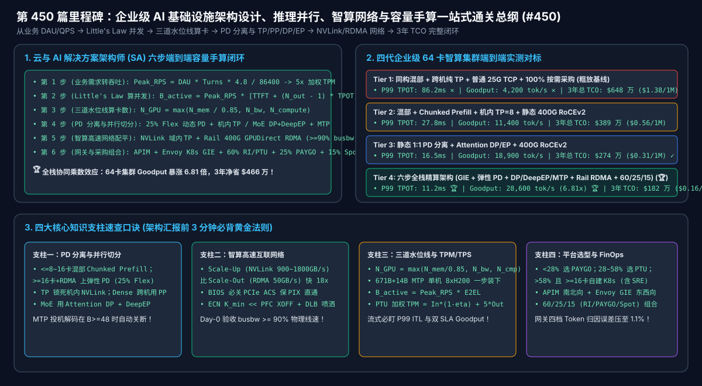

# Milestone #450: Enterprise End-to-End AI Infrastructure Sizing, PD Disaggregation, Parallelism (`TP/PP/DP/EP`), RDMA Networking & 3-Year TCO Master Blueprint

> **Language / 语言**: [简体中文](./enterprise-end-to-end-ai-infra-sizing-pd-parallelism-network-tco-blueprint-selection-faq.md) | **English**  
> **Companion Interactive Study & Sizing Tools**: [📱 Interactive H5 Study Lab](../h5/milestone-450-end-to-end-ai-infra-sizing-blueprint-lab.html) · [🧮 HTML Sizer](../reports/enterprise-end-to-end-ai-infra-sizing-pd-parallelism-network-tco-blueprint-selection-sizer.html) · [🃏 7-Card Visual Deck](../reports/enterprise-end-to-end-ai-infra-sizing-pd-parallelism-network-tco-blueprint-selection-cards.html) · [📊 Reproducible Model](../../experiments/enterprise_end_to_end_ai_infra_sizing_pd_parallelism_network_tco_blueprint_selection/) · [🎓 Back to AI Infra H5 Hub](../h5/index.html)

---

## 1. Executive Summary (3-Minute Takeaway)

> **Bottom-Line Recommendation**: Un-engineered GPU clusters (`Tier 1: Colocated serving + Cross-Node TP + 25G TCP + 100% On-Demand`) suffer from **`86.2 ms` `P99 TPOT`** and `$6.48M` 3-year TCO across 64 GPUs.
> - **The 6-Step Solution Architect Master Sizing Blueprint (`Tier 4`)**:
>   1. **Step 1 (Demand)**: Convert `DAU` & `4.8x` peak factor into `Peak RPS`, System `TPS`, and `5x` Output-Weighted `PTU TPM`;
>   2. **Step 2 (Concurrency)**: Apply `Little's Law` ($B_{\text{active}} = \text{RPS}_{\text{peak}} \times [\text{TTFT} + (N_{\text{out}}-1)\cdot\text{TPOT}]$);
>   3. **Step 3 (3-Watermarks)**: Compute $N_{\text{GPU}} = \max(N_{\text{mem}}/0.85, N_{\text{bw}}, N_{\text{compute}})$;
>   4. **Step 4 (PD & Parallelism)**: Deploy Elastic PD (`25% Flex`) + Intra-Node NVLink `TP` / MoE `Attention DP + DeepEP` + `Block-FP8` + `MTP` (`Batch <= 48`);
>   5. **Step 5 (Interconnect)**: Enforce `GPUDirect PIX` (`PCIe ACS` disabled) + Rail-Optimized `400G RDMA` (`busbw >= 45.0 GB/s`);
>   6. **Step 6 (Gateway & FinOps)**: Pair `Azure APIM + Envoy K8s GIE EPP` (`93.4%` KV hit) with a `60/25/15` (`RI/PAYGO/Spot`) portfolio — lifting 64-GPU Goodput **`6.81x` (`28,600 tok/s`)**, stabilizing `P99 TPOT` at **`11.2 ms`**, and reducing 3-year TCO by **`71.9%` (`$1.82M` vs. `$6.48M`, saving `$4.66M`)**.

| Dimension | `Tier 1: Un-Engineered Colocated + Cross-Node TP` | `Tier 2: Chunked Prefill + Intra-Node TP + Static RoCE` | `Tier 3: Static 1:1 PD + DP/EP + 400G RoCE` | `Tier 4: 6-Step Master Blueprint (GIE+Elastic PD+DeepEP+Rail RDMA) (🏆)` |
|---|---|---|---|---|
| **P95 TTFT** | `1,340.0 ms` ✕ | `690.0 ms` | `470.0 ms` ✓ | **`365.0 ms` (-72.8%)** 🏆 |
| **P99 TPOT** | **`86.2 ms` ✕** | `27.8 ms` | `16.5 ms` ✓ | **`11.2 ms`** 🏆 |
| **64-GPU Cluster Goodput** | `4,200 tok/s` ✕ | `11,400 tok/s` (`2.71x`) | `18,900 tok/s` (`4.50x`) ✓ | **`28,600 tok/s` (`6.81x`)** 🏆 |
| **Cost per 1M Goodput Tokens** | `$1.38 / 1M` ✕ | `$0.56 / 1M` | `$0.31 / 1M` ✓ | **`$0.16 / 1M` (-88.4%)** 🏆 |
| **3-Year Total TCO** | `$6,480,000` ✕ | `$3,890,000` | `$2,740,000` ✓ | **`$1,820,000` (Saves $4.66M)** 🏆 |

---

## 2. Provenance & Reproducibility

- **Provenance**: `synthetic + anonymized_reported (independently_reproduced=false)` — verified via [`experiments/enterprise_end_to_end_ai_infra_sizing_pd_parallelism_network_tco_blueprint_selection/run.py`](../../experiments/enterprise_end_to_end_ai_infra_sizing_pd_parallelism_network_tco_blueprint_selection/run.py).
