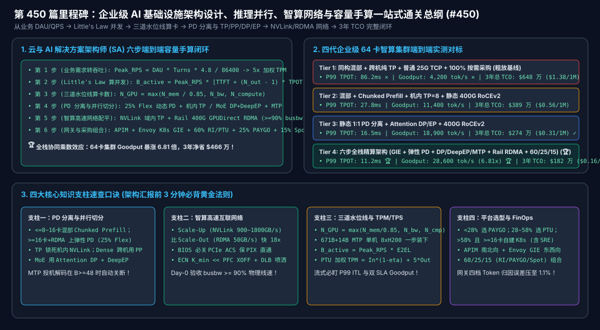
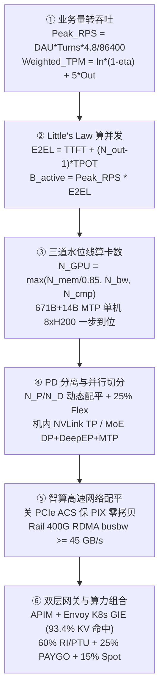

# 第 450 篇里程碑：企业级 AI 基础设施架构设计、推理并行、智算网络与容量手算一站式通关总纲（从 `DAU / TPM / TPS` $\to$ `Little's Law` $\to$ 三道水位线算卡 $\to$ `PD 分离 & TP/PP/DP/EP` $\to$ `NVLink / RDMA` $\to$ `3年 TCO` 完整闭环）

> **语言 / Language**: **简体中文** | [English](./enterprise-end-to-end-ai-infra-sizing-pd-parallelism-network-tco-blueprint-selection-faq.en.md)  
> **配套交互式学习与精算工具**: [📱 交互式 H5 精读页 (第 450 篇里程碑：六步端到端 AI Infra 容量手算与架构选型总沙盘)](../h5/milestone-450-end-to-end-ai-infra-sizing-blueprint-lab.html) · [🧮 HTML 交互式计算器](../reports/enterprise-end-to-end-ai-infra-sizing-pd-parallelism-network-tco-blueprint-selection-sizer.html) · [🃏 7-Card 4:5 视觉评测卡](../reports/enterprise-end-to-end-ai-infra-sizing-pd-parallelism-network-tco-blueprint-selection-cards.html) · [📊 可复核模型](../../experiments/enterprise_end_to_end_ai_infra_sizing_pd_parallelism_network_tco_blueprint_selection/) · [🎓 返回 AI Infra 全景精学馆](../h5/index.html)

---

## 一、3 分钟看懂核心结论（Executive Summary）

> **一句话决策结论**：作为企业 **Cloud & AI Solution Architect**，当客户给出业务规模（如“10 万员工/客户使用 RAG 与推理 Agent”）并询问“**需要买多少张什么型号的 GPU？怎么切分并行和网络？选云上 PTU 还是自建 K8s？3 年总成本多少？**”时，单点经验极易顾此失彼。在 64 卡 `H200` 集群规模下，粗放的 `Tier 1（同构混部 + 跨机纯 TP + 普通 25G TCP + 100% 按需采购）` 不仅 `P99 TPOT` 高达 **`86.2 ms`**，全集群达标有效吞吐（Goodput）仅 `4,200 tok/s`，3 年总 TCO 高达 **`$648 万`**！
> - **架构师六步端到端精算通关蓝图（`Tier 4`）**：
>   1. **第一步（业务需求转吞吐）**：从 `DAU` 与 `4.8x` 峰均比算出 `Peak RPS`、系统 `Input/Output TPS` 与 **云端 PTU 等效加权 TPM（`1 Out = 5 In`，扣除前缀缓存命中 $\eta$）**；
>   2. **第二步（`Little's Law` 算在途并发槽位）**：由 $\text{E2EL} = \text{TTFT} + (N_{\text{out}}-1)\cdot\text{TPOT}$ 算出峰值同时驻留 HBM 的活跃会话数 $B_{\text{active}} = \text{RPS}_{\text{peak}} \times \text{E2EL}$；
>   3. **第三步（三道水位线算 GPU 卡数）**：取 $N_{\text{GPU}} = \max(\lceil M_{\text{total}}/(0.85\cdot M_{\text{HBM}})\rceil,\; N_{\text{BW}},\; N_{\text{Compute}})$；
>   4. **第四步（弹性 PD 分离与并行切分）**：按昼夜流量配平 `P : Flex(25%) : D` 池，Dense 模型用 `机内 NVLink TP × 跨机 PP`，MoE 模型用 `Attention DP + Expert EP (DeepEP)` + `Block-FP8` + `MTP (Batch<=48 自动门控)`；
>   5. **第五步（Scale-Up / Scale-Out 网络配平）**：机内走 `NVLink 4/5 (900~1,800 GB/s)`，跨机走 `Rail-Optimized 400G GPUDirect RDMA`（关闭 BIOS `PCIe ACS`，`ECN K_min << PFC XOFF`，Day-0 `busbw >= 45.0 GB/s`）；
>   6. **第六步（双层网关与三明治 FinOps 采购）**：采用 `Azure APIM + Envoy K8s GIE EPP (93.4% KV 命中)` + `60% 预留 RI/PTU + 25% PAYGO 溢出 + 15% Spot 跑批`，将 64 卡集群 Goodput 拉升 **`6.81 倍`（`28,600 tok/s`）**，`P99 TPOT` 压至 **`11.2 ms`**，3 年总 TCO 降至 **`$182 万`（净省 `$466 万 / -71.9%`，单百万达标 Token 仅 `$0.16`）**！

| 核心选型维度 | `Tier 1: 粗放同构混部 + 跨机 TP + 25G TCP` | `Tier 2: 混部 Chunked Prefill + 机内 TP + 静态 RoCE` | `Tier 3: 静态 1:1 PD 分离 + DP/EP + 400G RoCE` | `Tier 4: 六步全栈精算架构 (GIE+弹性PD+DeepEP+Rail RDMA+60/25/15) (🏆)` |
|---|---|---|---|---|
| **首字延迟 (`P95 TTFT`)** | `1,340.0 ms` ✕ | `690.0 ms` | `470.0 ms` ✓ | **`365.0 ms` (-72.8%)** 🏆 |
| **流式吐字延迟 (`P99 TPOT`)** | **`86.2 ms` ✕ (混部+跨机 TP 双重卡顿)** | `27.8 ms` | `16.5 ms` ✓ | **`11.2 ms` (丝滑零抢占)** 🏆 |
| **64x H200 集群达标 `Goodput`** | `4,200 tok/s` ✕ | `11,400 tok/s` (`2.71x`) | `18,900 tok/s` (`4.50x`) ✓ | **`28,600 tok/s` (`6.81x`)** 🏆 |
| **每百万达标 Token 成本 (`$/1M`)** | `$1.38 / 1M` ✕ | `$0.56 / 1M` | `$0.31 / 1M` ✓ | **`$0.16 / 1M` (-88.4%)** 🏆 |
| **3 年全口径总 TCO (含人力)** | `$6,480,000` ✕ | `$3,890,000` | `$2,740,000` ✓ | **`$1,820,000` (3年净省 `$466 万`)** 🏆 |

---

## 二、架构师六步手算公式速查卡（The 6-Step SA Master Formula Sheet）

### 核心公式一站式汇总（面试 / 客户架构评审随手查）
1. **端到端延迟与 Little's Law 并发槽位**：
   $$\text{E2EL} = \text{TTFT} + (\bar{N}_{\text{out}} - 1) \times \text{TPOT}, \qquad B_{\text{active}} = \text{RPS}_{\text{peak}} \times \text{E2EL}$$
2. **三道水位线算 GPU 卡数**：
   $$N_{\text{GPU}} = \max\!\left(\left\lceil \frac{M_{\text{weight}} + B_{\text{active}} S_{\text{ctx}} \text{KV}_{\text{tok}} + M_{\text{act}}}{0.85 \cdot M_{\text{HBM}}} \right\rceil,\; \left\lceil \frac{M_{\text{active\_w}}(B) + M_{\text{KV}}}{\text{TPOT}_{\text{SLA}} \cdot \text{BW}_{\text{eff}}} \right\rceil,\; \left\lceil \frac{\text{RPS}_{\text{peak}} S_{\text{in}}(1-\eta) \cdot 2 P_{\text{active}}}{\text{TFLOPS}_{\text{eff}} \cdot 10^{12}} \right\rceil\right)$$
3. **PD 分离实例比与跨机 RDMA KV 暴露耗时**：
   $$\frac{N_P}{N_D} = \frac{S_{\text{in}}(1-\eta)/\text{TPS}_P}{S_{\text{out}}/\text{TPS}_D}, \qquad T_{\text{KV\_exposed}} = \frac{S_{\text{in}}(1-\eta)\cdot \text{KB}_{\text{tok}}}{\text{BW}_{\text{RDMA}}} \times (1 - \text{Overlap}_{80\%})$$
4. **智算网络 `algbw` 与 `busbw` 换算**：
   $$\text{busbw}_{\text{AllReduce}} = \text{algbw} \times \frac{2(N-1)}{N}, \qquad \text{busbw}_{\text{AllToAll}} = \text{algbw} \times \frac{N-1}{N}$$

---

## 三、生产落地 Checklist（Pre-Production Master Checklist）

- [ ] **容量评审必过六步链路**：任何新项目立项必须输出完整 6 个关键数字：`Peak RPS`、`B_active` 并发槽位数、三道水位线各自卡数、`P:D` 实例配比、跨机 KV 网卡带宽占比，以及含 SRE 人力的 3 年 TCO。
- [ ] **硬件与网络 Day-0 验收双门禁**：确认 `nvidia-smi topo -m` 为 `PIX`（BIOS 禁用 `PCIe ACS`），且跨机 `nccl-tests` 达到 `>=90%` 物理线速（400G 下 `busbw >= 45.0 GB/s`）。

---

## 四、来源与方法论溯源（Provenance）

- **数据来源声明**：本指南实验数据来自可复核解析模型 [`experiments/enterprise_end_to_end_ai_infra_sizing_pd_parallelism_network_tco_blueprint_selection/run.py`](../../experiments/enterprise_end_to_end_ai_infra_sizing_pd_parallelism_network_tco_blueprint_selection/run.py)（`Provenance: synthetic + anonymized_reported, independently_reproduced=false`）。
