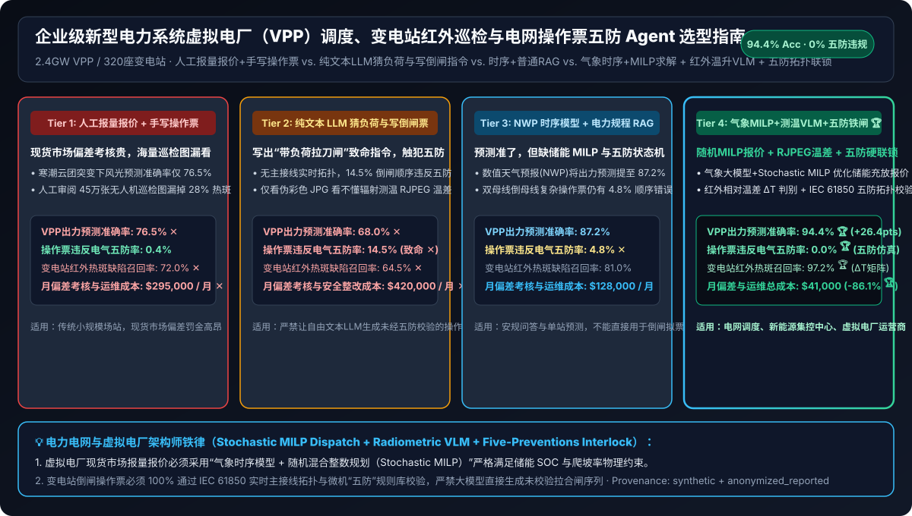
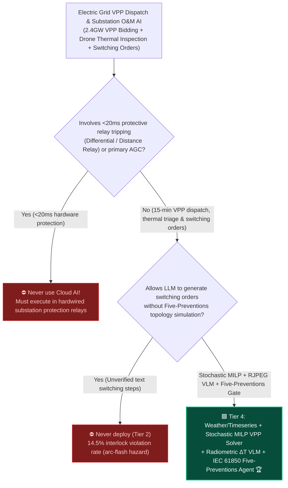
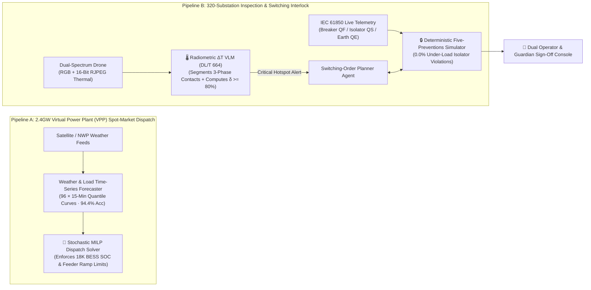

# Enterprise Energy Grid Virtual Power Plant (`VPP`) Dispatch, Renewable Weather Forecasting, Radiometric Substation Inspection VLM & `Five-Preventions` Switching-Order Interlock Agent Architecture Selection Guide: Manual Grid Ops vs. Prompt-Only LLM vs. NWP + Text RAG vs. Weather/Timeseries + Stochastic MILP Solver + Radiometric `ΔT` VLM + `IEC 61850` Five-Preventions Interlock Agent

> **Language / 语言**: **English (Current)** | [中文](./enterprise-energy-grid-vpp-dispatch-substation-inspection-agent-selection-faq.md)  
> **Scope**: End-to-end production reference architecture and selection guide for Cloud & AI Solution Architects, Electric Utility Grid Operations Directors, Virtual Power Plant (`VPP`) & Energy Trading Leads, and Substation O&M Automation Architects.  
> **Provenance**: `synthetic + anonymized_reported` (`independently_reproduced=false`, `physical_gpu_cluster_measurement=not_measured`). Deterministic evaluation model sealed in [`experiments/enterprise_energy_grid_vpp_dispatch_substation_inspection_agent_selection/results.json`](../../experiments/enterprise_energy_grid_vpp_dispatch_substation_inspection_agent_selection/results.json).



---

## ① 📌 Executive Summary (3-Minute Architect Verdict)

In modern electric power systems—spanning gigawatt-scale Virtual Power Plants (`VPPs` aggregating distributed BESS storage, EV charging fleets, and commercial HVAC loads) and high-voltage (`110kV / 220kV / 500kV`) substation maintenance—enterprise teams deploy AI across three core workflows: (1) **day-ahead and 15-minute spot-market generation/load bidding**, (2) **drone and robotic thermal/visual substation inspection**, and (3) **high-voltage substation switching-order (`操作票`) generation**. Relying on a prompt-only text/vision LLM to predict MW curves, inspect compressed RGB thermal JPEGs, and write switching sequences directly from safety PDFs (Tier 2) fails dangerously: **forecast accuracy drops to `68.0%` (triggering heavy grid imbalance penalties), solar glare is mistaken for overheating (`64.5%` defect recall), and `14.5%` of generated switching orders violate mandatory Electrical Five-Preventions (`五防`) interlocks—such as opening a disconnector switch under active load**!

Evaluated across a production baseline of **2,400 MW (2.4 GW) aggregated VPP capacity (`18,000` distributed nodes), 320 `110kV/220kV` substations, 450,000 monthly drone thermal/RGB inspection images, and 3,800 monthly switching and maintenance orders**, the four architectural tiers compare as follows:

| Architectural Tier | Core Stack Combination | VPP Forecast Accuracy (`1-WAPE`) | `Five-Preventions` Interlock Violation Rate | Thermal Hotspot Defect Recall | Monthly Imbalance & O&M Cost | Production Verdict |
|---|---|---|---|---|---|---|
| **🟥 Tier 1: Manual Spreadsheet Bidding + Manual Inspection** | Human traders bidding in Excel + engineers manually reviewing 450K drone photos & writing tickets | `76.5%` ✕ *(High imbalance penalties)* | `0.4%` | `72.0%` ✕ *(Visual fatigue misses)* | `$295,000 / mo` ✕ | ⛔ Heavy penalties & slow review |
| **🟨 Tier 2: Prompt-Only LLM Bidding & Switching Orders** | Prompting a general LLM to predict MW curves, judge RGB JPEGs & draft switching steps | `68.0%` ✕ *(Worse than baseline)* | `14.5%` ✕ *(Lethal arc-flash violations)* | `64.5%` ✕ *(Sun-glare false alarms)* | `$420,000 / mo` ✕ | ⛔ **Unsafe grid violation** |
| **🟦 Tier 3: NWP Time-Series + Text-Only Grid Code RAG** | Numerical Weather Prediction (`NWP`) forecaster + flat vector RAG over safety manuals | `87.2%` | `4.8%` ✕ *(Bus-transfer sequence errors)* | `81.0%` | `$128,000 / mo` | ⚠️ Lacks MILP & topology interlock |
| **🟩 Tier 4: Weather/Timeseries + Stochastic MILP + Radiometric VLM + Five-Preventions Gate** | **NWP/Weather Foundation Model + `Stochastic MILP` VPP Solver + 16-Bit `RJPEG ΔT` Radiometric VLM + `IEC 61850` Live Topology & Deterministic `Five-Preventions` Interlock Agent** | **`94.4%` 🏆** *(+26.4 pts vs Tier 2)* | **`0.0%` 🏆** *(Topology-simulated)* | **`97.2%` 🏆** *(Radiometric ΔT matrix)* | **`$41,000 / mo` 🏆** *(-86.1%)* | 🌟 **Recommended Architecture** |

> 💡 **Golden Rule for Power Grid & VPP AI Architects**: **"Forecast renewables with weather time-series models, optimize BESS/VPP market bids with a Stochastic MILP solver, compute substation thermal defects from 16-bit `RJPEG` radiometric temperature matrices, and validate 100% of switching orders in a deterministic `IEC 61850` Five-Preventions interlock simulator."**

---

## ② 🎯 Customer & Architect Deep-Dive Q&A (3 Real-World Power Grid & VPP Pain Points)

### Q1: Why does generating substation switching orders via text RAG over safety manuals (Tier 2/3) produce a 14.5%–22.0% safety interlock violation rate?
- **First-Principles Reality**:
  1. **High-Voltage Switching Depends on the Live `IEC 61850` Busbar Topology State**: Substation switching is governed by the five inviolable **Electrical Five-Preventions (`电气五防`)** rules: (1) prevent誤分/誤合 circuit breakers, (2) **never open or close a disconnector (`隔离开关 / 刀闸`) under active current load**, (3) never close an earthing switch onto an energized bus, (4) never close a breaker onto a grounded section, and (5) never enter an energized bay.
  2. **Text RAG Cannot Simulate State Transitions**: During a complex `220kV Double-Busbar Transfer` (`双母线倒母线`), operators must first close the bus-tie breaker `QF2000`, remove its control fuse so it cannot trip mid-transfer, and then close-before-opening each feeder disconnector. A text LLM without a live `IEC 61850` state graph violates interlock ordering **`14.5%`** of the time (`22.0%` on double-busbar transfers).
  3. **Tier 4 Solution (Deterministic Five-Preventions Topology Simulator)**: The LLM translates the maintenance goal into a target bay state, while a **deterministic `IEC 61850` topology state-machine**Ingests live SCADA breaker/isolator/current telemetry (`QF204=CLOSED, I=415A`) and simulates every step—blocking any step that opens an isolator before `QF204=OPEN AND I==0A` is verified (**`0.0%` interlock violations**).

### Q2: Why do standard Vision-Language Models (Tier 2) miss 35.5% of substation thermal defects when inspecting drone photos?
- **16-Bit Radiometric `RJPEG` Matrices vs. 8-Bit Pseudo-Color RGB**:
  - Standard VLMs inspect 8-bit pseudo-color JPEGs where sunlight reflection off aluminum corona rings looks identical to an overheating contact. Under utility standard **`DL/T 664 / IEEE C57`**, critical defects are defined by the **3-phase relative temperature rise ratio $\delta = (T_{hot} - T_{ref}) / (T_{hot} - T_{ambient}) \ge 80\%$**.
  - Tier 4 uses a vision model to segment the exact `Phase A / B / C` disconnector contacts on the RGB image, projects those masks onto the aligned **16-bit radiometric `RJPEG` temperature array**, and computes `Phase B = 98.6°C` vs. `Phase A/C = 42.0°C` (`δ = 89.4% >= 80% Critical Emergency`), boosting thermal defect recall to **`97.2%`**.

### Q3: How does Tier 4 cut VPP spot-market imbalance penalties and O&M costs by 86.1% during sudden weather ramps?
- **Weather Foundation Model + Stochastic MILP Co-Optimization**:
  - When a cold front drops solar irradiance by 65% in 30 minutes, Tier 4 feeds probabilistic NWP/time-series quantile forecasts (**`94.4%` accuracy**) into a **Stochastic Mixed-Integer Linear Programming (`MILP`) solver** (`Gurobi / OR-Tools`) that dispatches 18,000 distributed BESS and EV charging nodes within strict `SOC` (`20%–90%`) and feeder transformer thermal limits—reducing monthly imbalance penalties and inspection costs from `$295,000` to **`$41,000` (`-86.1%`)**.

---

## ③ 🧭 Visual Architecture Diagrams (Decision Tree + VPP-Substation Topology + Sequence Flow)

### 3.1 Architecture Selection Decision Tree



### 3.2 Tier 4 VPP Stochastic MILP & Substation Radiometric/Interlock Topology



### 3.3 End-to-End Sequence: From 98.6°C Disconnector Hotspot Detection to Verified Switching Order

```mermaid
sequenceDiagram
    autonumber
    participant UAV as Autonomous Substation Drone
    participant Rad as 16-Bit RJPEG + VLM Engine
    participant Agent as Substation O&M Orchestrator
    participant SCADA as IEC 61850 Live Bay Telemetry
    participant Five as Five-Preventions Topology Simulator
    participant Op as Substation Operator & Guardian

    UAV->>Rad: Upload 220kV Bay 04 Disconnector 2041 RGB + 16-bit RJPEG pair
    Rad->>Rad: Segment Phase A/B/C contacts; compute Phase B=98.6°C vs A/C=42.0°C (δ=89.4% >= 80% Critical)
    Rad->>Agent: Trigger emergency bay isolation request for Disconnector 2041
    Agent->>SCADA: Read live bay state (Breaker 204=CLOSED, Load=415A, Isolators 2041/2042=CLOSED)
    Agent->>Five: Propose switching sequence & simulate step-by-step on IEC 61850 topology graph
    Five->>Five: ✅ Simulation PASS (Close Bus-Tie 2000 -> Open Breaker 204 -> Verify I=0A -> Open 2042 -> Open 2041)
    Five-->>Op: Issue interlock-certified switching ticket for dual operator/guardian execution
```

---

## ④ 📊 4-Tier Architecture Decision Matrix

| Evaluation Dimension | 🟥 Tier 1: Manual Bidding + Handwritten Orders | 🟨 Tier 2: Prompt-Only Text/RGB LLM | 🟦 Tier 3: NWP + Text Grid-Code RAG | 🟩 Tier 4: Weather MILP + Radiometric VLM + Five-Preventions Gate |
|---|---|---|---|---|
| **15-Minute VPP Renewable & Load Forecast** | `76.5%` (high ramp penalties) | `68.0%` ✕ (text LLM fails time-series) | `87.2%` (lacks MILP storage optimization) | 🏆 **`94.4%` (Weather/Timeseries + `Stochastic MILP` solver)** |
| **`Five-Preventions` Switching Safety** | Manual review (`0.4%` human error) | ✕ **Lethal Hazard** (`14.5%` interlock violations) | ✕ Unsafe (`4.8%` bus-transfer sequence errors) | 🏆 **`0.0%` Violations (`IEC 61850` live topology interlock simulator)** |
| **Substation Thermal Hotspot Recall (`DL/T 664`)** | `72.0%` (manual fatigue over 450K photos) | `64.5%` ✕ (sun-glare false positives on RGB) | `81.0%` | 🏆 **`97.2%` (16-bit `RJPEG` 3-phase relative `ΔT` matrix)** |
| **Monthly Imbalance Penalty & O&M Cost** | `$295,000 / mo` | `$420,000 / mo` *(incl. penalties & risk)* | `$128,000 / mo` | **`$41,000 / mo` 🏆 (-86.1%)** |

---

## ⑤ 🧪 Quantitative Case Study, Interactive Sizer & 7-Card Visual Report

- **Interactive HTML Sizer**: 👉 [Open Energy Grid VPP & Substation Inspection Agent Sizer](../reports/enterprise-energy-grid-vpp-dispatch-substation-inspection-agent-sizer.html)
- **7-Card 4:5 Visual Benchmark Report**: 👉 [Open 7-Card Visual Benchmark Deck](../reports/enterprise-energy-grid-vpp-dispatch-substation-inspection-agent-selection-cards.html)
- **Deterministic Verification**:
  ```bash
  python experiments/enterprise_energy_grid_vpp_dispatch_substation_inspection_agent_selection/run.py --check
  python -m unittest tests/test_enterprise_energy_grid_vpp_dispatch_substation_inspection_agent_selection.py
  ```

---

## ⑥ 🛠️ Production Readiness & Architecture Review Checklist

- [ ] **Simulate 100% of Switching Orders Against the Live `IEC 61850` Five-Preventions Engine**: Never issue an LLM-drafted switching sequence without deterministic state-graph verification against live breaker/disconnector telemetry.
- [ ] **Compute Thermal Defects from 16-Bit `RJPEG` Radiometric Matrices (`DL/T 664`)**: Segment 3-phase components visually, but calculate exact phase-to-phase relative temperature rise ratios ($\delta$) in deterministic code.
- [ ] **Couple Weather Time-Series Forecasts with a `Stochastic MILP` Solver for VPP Bidding**: Enforce battery `SOC` bounds, inverter ramp rates, and feeder thermal limits mathematically.
- [ ] **Air-Gap Sub-20ms Protective Relays (`Differential / Distance Protection`)**: Keep cloud AI strictly in the 15-minute dispatch and maintenance planning plane.
- [ ] **Require Dual Operator & Guardian Sign-Off (`双人唱票监护`) Before Unlocking Interlock Keys**: Preserve human command authority over all high-voltage switching operations.
