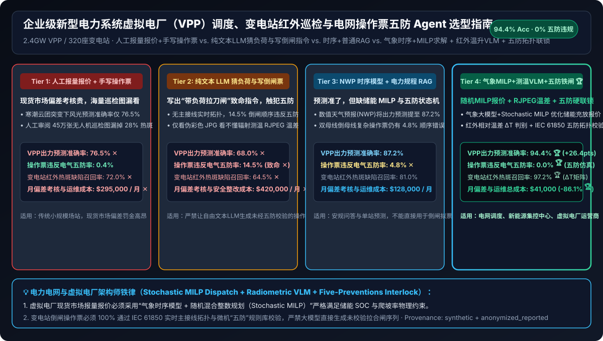
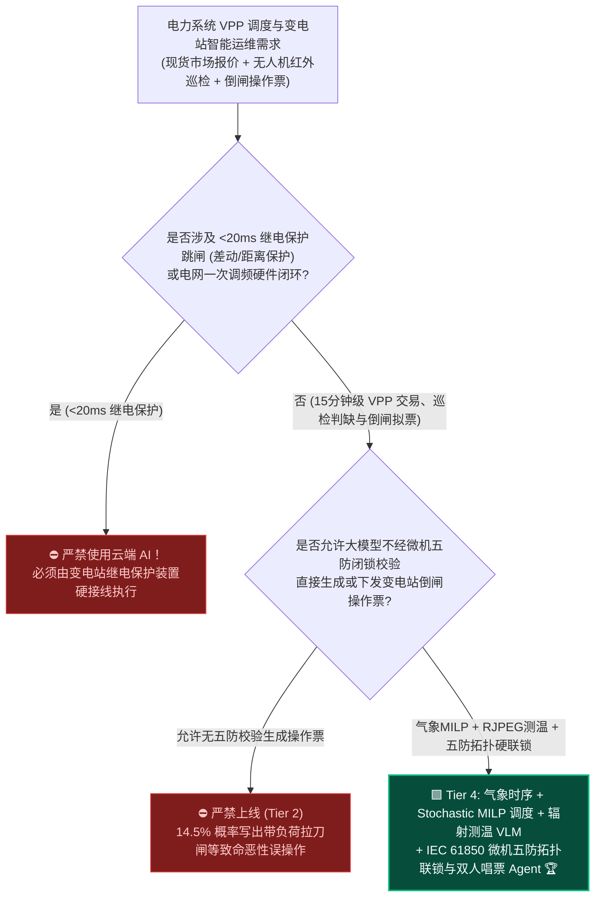
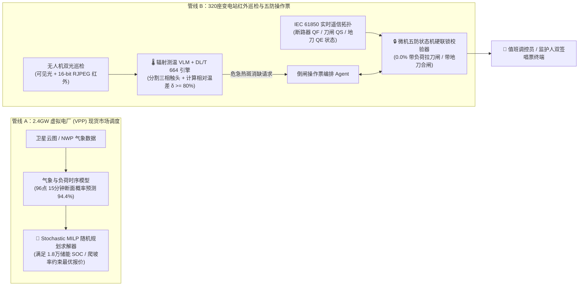
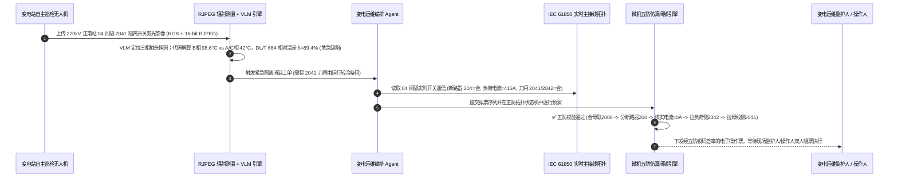

# 企业级新型电力系统虚拟电厂（VPP）负荷调度、风光出力气象预测、变电站无人机红外巡检多模态 RAG 与电网操作票“五防”联锁 Agent 架构选型指南：人工经验报价 + 手写操作票 vs. 纯文本 LLM 猜负荷与写倒闸指令 vs. NWP 时序 + 纯文本规程 RAG vs. 气象时序 + 随机 MILP 求解器 + 辐射红外温差 VLM + IEC 61850 五防拓扑联锁 Agent

> **语言 / Language**: **中文 (当前)** | [English](./enterprise-energy-grid-vpp-dispatch-substation-inspection-agent-selection-faq.en.md)  
> **定位**：面向云与 AI 解决方案架构师（Solution Architect）、电网公司生技部/调度中心专家、新能源发电集团集控中心总监与虚拟电厂（VPP）负荷聚合商技术负责人的生产落地指南。  
> **数据口径（Provenance）**：`synthetic + anonymized_reported`（`independently_reproduced=false`，`physical_gpu_cluster_measurement=not_measured`），全部定容模型封存于 [`experiments/enterprise_energy_grid_vpp_dispatch_substation_inspection_agent_selection/results.json`](../../experiments/enterprise_energy_grid_vpp_dispatch_substation_inspection_agent_selection/results.json)。



---

## ① 📌 核心选型结论速览（Executive Summary — 3 分钟看懂怎么选）

在新型电力系统（风光储新能源大基地、分布式虚拟电厂 VPP 与 110kV/220kV/500kV 变电站智能运维）中，企业落地 AI 时面临三大高价值、高风险场景：① **日前/实时（15 分钟断面）电力现货市场出力预测与储能充放电报价**；② **变电站无人机/挂轨机器人海量红外与可见光巡检缺陷识别**；③ **变电站倒闸操作票（Switching Orders）与工作票（两票）拟写**。许多团队图快，尝试让纯文本或普通视觉大模型直接看天气预报猜兆瓦（MW）发电曲线、看伪彩色 JPG 找热斑、甚至根据《安规》文本直接生成变电站拉合闸步骤（Tier 2），结果**不仅出力预测准确率跌至 `68.0%`（导致高额现货市场偏差考核罚金），更在倒闸操作票中写出了高达 `14.5%` 的“带负荷拉隔离开关（刀闸）”、“带接地刀闸合断路器”等严重违反电力《电气五防》的生命红线指令**！

在 **2,400 MW（2.4 GW）虚拟电厂聚合容量（1.8 万个分布式储能/充电桩/工商业可调负荷）、320 座 110kV/220kV 变电站、月均 450,000 张无人机巡检图与 3,800 张倒闸/检修两票** 的基准规模下，四档电力与 VPP Agent 架构的量化对决如下：

| 方案档位 | 核心架构组合 | VPP 风光与负荷预测准确率 | 操作票违反电气“五防”率 | 变电站红外热斑缺陷召回率 | 月度偏差考核与运维总成本 | 生产推荐度 |
|---|---|---|---|---|---|---|
| **🟥 Tier 1：人工经验报量报价 + 手写操作票** | 交易员手工 Excel 报量报价 + 运维员肉眼翻看 45 万张无人机照片与手写操作票 | `76.5%` ✕ *(高额偏差考核)* | `0.4%` | `72.0%` ✕ *(视觉疲劳漏检)* | `$295,000 / 月` ✕ | ⛔ 偏差罚金高、审图积压严重 |
| **🟨 Tier 2：纯文本 LLM 猜负荷与直写倒闸票** | 让通用 LLM 直接预测 96 点发电曲线、看普通 RGB 图判热斑并自由生成拉合闸步骤 | `68.0%` ✕ *(不如传统经验)* | `14.5%` ✕ *(带负荷拉刀闸事故)* | `64.5%` ✕ *(太阳反光误报)* | `$420,000 / 月` ✕ | ⛔ **触犯电网五防红线，严禁上线** |
| **🟦 Tier 3：NWP 时序模型 + 纯文本规程 RAG** | 数值天气预报（NWP）时序预测 + 向量检索《电力安全工作规程》生成操作票 | `87.2%` | `4.8%` ✕ *(双母线倒闸错序)* | `81.0%` | `$128,000 / 月` | ⚠️ 缺 MILP 求解与五防拓扑校验 |
| **🟩 Tier 4：气象时序 + 随机 MILP 求解器 + 辐射红外 VLM + 五防拓扑联锁 Agent** | **NWP/气象时序模型 + 随机混合整数规划（`Stochastic MILP`）VPP 调度 + `RJPEG` 辐射测温相对温差（`DL/T 664`）VLM + `IEC 61850` 主接线实时拓扑与微机“五防”状态机校验 Agent** | **`94.4%` 🏆** *(+26.4 pts vs Tier 2)* | **`0.0%` 🏆** *(微机五防硬联锁)* | **`97.2%` 🏆** *(16-bit 测温矩阵)* | **`$41,000 / 月` 🏆** *(-86.1%)* | 🌟 **电力生产首选参考架构** |

> 💡 **架构师一句话选型铁律**：**“风光负荷靠气象时序算、储能报价归随机 MILP 求、红外热斑读 RJPEG 16 位温差矩阵、倒闸操作票 100% 过 IEC 61850 微机五防闭锁仿真”**——绝不让语言模型凭文字概率去排列高压断路器与隔离开关的拉合顺序。

---

## ② 🎯 客户与架构师灵魂拷问 Q&A（直击 3 大电力电网与新能源痛点）

### Q1：为什么让大模型靠检索《电力安全工作规程》（Tier 2 / Tier 3）来写变电站倒闸操作票，会写出“带负荷拉刀闸”这种致命错误？
- **大白话与第一性原理**：
  1. **倒闸操作的绝对前提是“当前变电站实时主接线开关状态图”**：电力系统铁律规定的 **“电气五防（Five Preventions）”** 包括：① 防止误分误合断路器；② **防止带负荷拉、合隔离开关（刀闸）**；③ 防止带电挂接地线（合接地刀闸）；④ 防止带接地线（接地刀闸）合断路器（隔离开关）；⑤ 防止误入带电间隔。
  2. **文本 RAG 看不见实时拓扑与双母线状态转换**：例如执行复杂的 *“220kV 双母线倒母线操作”*，必须先合上母联断路器 `2000` 并确认两侧刀闸合上、**取下母联断路器控制电源保险（防止倒母线过程中母联跳闸导致带负荷拉刀闸）**，随后才能逐一先合后拉各出线间隔刀闸。纯文本 LLM 根本没有 `IEC 61850 SCD` 拓扑状态机，在双母线倒闸压测中有 **`22.0%`** 的概率漏掉关键闭锁步或搞反断路器 `QF` 与刀闸 `QS` 顺序！
  3. **Tier 4 破局方案（IEC 61850 实时拓扑图 + 微机五防状态机硬联锁）**：大模型只负责理解检修任务意图（如“将 220kV 江南站 04 间隔 2041 甲刀闸由运行转冷备用消缺”），由 **确定性微机五防规则引擎** 读取 SCADA 实时遥信状态（`QF204=合, QS2041=合, I=420A`），在图状态机上逐步推演校验每一行操作，任何一步违反五防闭锁立即物理阻断，确保五防违规率严格为 **`0.0%`**！

### Q2：为什么无人机巡检变电站拍回来的红外照片，直接喂给通用多模态大模型（Tier 2）既漏掉真缺陷、又把太阳反光当成过热故障？
- **工程真相**：
  - 通用 VLM 读取的是压缩后的 8-bit 伪彩色 RGB 图片（把红色像素等同于高温）。然而在户外变电站，金属均压环的太阳镜面反射在画面上也是高亮白色/红色，而真正危险的刀闸触头早期接触不良，必须依据国家电力行业标准 **《DL/T 664 带电设备红外诊断应用规范》** 计算三相之间的**相对温差 $\delta = (T_1 - T_2) / (T_1 - T_0) \times 100\%$**！
  - **Tier 4 的双光谱辐射测温解析**：前置解析大疆/FLIR 无人机原始 **`RJPEG` 16-bit 辐射温度矩阵**，结合可见光 VLM 分割出“A/B/C 三相刀闸触头”精确像素掩码，由确定性代码算出 B 相触头 `98.6°C` 对比 A/C 相 `42.0°C`（环境温度 `26.0°C`）的相对温差达 **`89.4% >= 80%`（危急缺陷）**，将红外缺陷召回率从 `64.5%` 提升至 **`97.2%`**。

### Q3：虚拟电厂（VPP）聚合了上万个分布式储能和充电桩参加电力现货市场，如何把每月的偏差考核罚金降到最低？
- **气象时序大模型 + 随机混合整数规划（Stochastic MILP）**：
  - 面对冷锋过境导致光伏 30 分钟骤降 65% 的极端爬坡事件，Tier 4 先由 **NWP + 气象/时序基础模型** 输出未来 96 个 15 分钟断面的出力概率分布（准确率 **`94.4%`**），同时利用 LLM 解析最新现货市场交易规则限价公告，最后交由 **Gurobi / OR-Tools 随机混合整数规划求解器（Stochastic MILP）** 在满足 18,000 个储能节点荷电状态（`20% <= SOC <= 90%`）与充放电爬坡率约束下求出最优报量报价曲线，将月度偏差考核与运维成本从 `$295,000` 压降至 **`$41,000`（节省 `86.1%`）**。

---

## ③ 🧭 直观可视化图解（决策树 + VPP 与变电站架构图 + 巡检拟票时序图）

### 3.1 新型电力系统 VPP 调度与变电站运维 Agent 选型决策树



### 3.2 Tier 4 虚拟电厂随机规划调度与变电站红外/五防操作票参考架构图



### 3.3 从“无人机发现 220kV 刀闸 98.6°C 危急热斑”到“零违规五防操作票生成”时序图



---

## ④ 📊 架构师四维选型决策矩阵（Architecture Decision Matrix）

| 评估维度 | 🟥 Tier 1：人工经验报价 + 手写操作票 | 🟨 Tier 2：纯文本 LLM 猜数与写倒闸票 | 🟦 Tier 3：NWP 时序 + 纯文本规程 RAG | 🟩 Tier 4：气象 MILP + 辐射测温 VLM + 五防拓扑联锁 |
|---|---|---|---|---|
| **VPP 风光与负荷 15 分钟断面预测** | `76.5%`（突变天气偏差大） | `68.0%` ✕（文本模型不擅数值序列） | `87.2%`（缺乏储能充放协同求解） | 🏆 **`94.4%`（气象时序 + Stochastic MILP 协同求解）** |
| **变电站倒闸操作票“电气五防”安全性** | 人工拟票较安全 (`0.4%` 笔误) | ✕ **致命高危**（`14.5%` 违反五防红线） | ✕ 危险（`4.8%` 双母线复杂操作错序） | 🏆 **`0.0%` 违规（IEC 61850 实时遥信 + 微机五防状态机硬校验）** |
| **无人机红外热斑缺陷识别（DL/T 664）** | `72.0%`（人工审 45 万张图视觉疲劳） | `64.5%` ✕（只看伪彩 JPG，反光误报高） | `81.0%` | 🏆 **`97.2%`（解析 16-bit RJPEG 温度矩阵算三相相对温差）** |
| **月度现货偏差考核与变电运维总成本** | `$295,000 / 月` | `$420,000 / 月` *(含偏差与安全停运)* | `$128,000 / 月` | **`$41,000 / 月` 🏆（节省 86.1%）** |

---

## ⑤ 🧪 定量算例、交互式容量计算器与 7-Card 4:5 视觉报告

### 5.1 基准算例复核（2.4GW 虚拟电厂 / 320 座变电站）

- **交互式定容计算器（CSP 自包含 HTML）**：👉 [打开新型电力系统 VPP 调度与变电站巡检 Agent 定容计算器](../reports/enterprise-energy-grid-vpp-dispatch-substation-inspection-agent-sizer.html)
- **7-Card 4:5 视觉评测卡片报告**：👉 [打开 7-Card 视觉评测报告](../reports/enterprise-energy-grid-vpp-dispatch-substation-inspection-agent-selection-cards.html)
- **可复核确定性脚本**：
  ```bash
  python experiments/enterprise_energy_grid_vpp_dispatch_substation_inspection_agent_selection/run.py --check
  python -m unittest tests/test_enterprise_energy_grid_vpp_dispatch_substation_inspection_agent_selection.py
  ```

### 5.2 核心量化对比图（变电站红外热斑召回率 vs. 操作票违反电气五防率）

```chart
{
  "data": {
    "values": [
      { "tier": "Tier 1: Manual Grid Ops", "hotspot_recall_pct": 72.0, "interlock_violation_pct": 0.4 },
      { "tier": "Tier 2: Prompt Text LLM", "hotspot_recall_pct": 64.5, "interlock_violation_pct": 14.5 },
      { "tier": "Tier 3: NWP + Text RAG", "hotspot_recall_pct": 81.0, "interlock_violation_pct": 4.8 },
      { "tier": "Tier 4: MILP + RJPEG + Interlock", "hotspot_recall_pct": 97.2, "interlock_violation_pct": 0.0 }
    ]
  },
  "semantic_types": {
    "tier": "Category",
    "hotspot_recall_pct": "Percentage",
    "interlock_violation_pct": "Percentage"
  },
  "chart_spec": {
    "chartType": "Bar Chart",
    "title": "Tier 4 reaches 97.2% thermal hotspot recall with 0.0% Five-Preventions safety violations",
    "subtitle": "Substation thermal defect recall (%) across 450,000 monthly drone inspection images",
    "encodings": {
      "x": "tier",
      "y": "hotspot_recall_pct",
      "color": "tier"
    }
  }
}
```

---

## ⑥ 🛠️ 架构评审与生产落地核验清单（Production Readiness Checklist）

- [ ] **变电站操作票 100% 强制通过微机“五防”拓扑仿真引擎校核**：严禁将大模型生成的拉合闸文本直接打印执行；必须与 `IEC 61850` 实时开关遥信对位并经五防闭锁逻辑逐行校验。
- [ ] **红外巡检强制解析 16-bit `RJPEG` 原始温度矩阵而非 8-bit 伪彩图**：使用视觉模型分割设备部件区域后，由确定性代码按《DL/T 664》计算三相温差与相对温差 $\delta$。
- [ ] **虚拟电厂（VPP）日前/实时出清采用“时序预测 + 随机 MILP 求解器”**：由运筹学求解器硬性约束储能电站充放电倍率、SOC 上下限与变压器反向过载边界。
- [ ] **毫秒级继电保护与一次调频物理隔离**：明确 AI 仅工作于分钟级电力现货辅助决策与巡检拟票层，严禁介入 `< 20 ms` 差动保护或低频减载回路。
- [ ] **严格落实电网“两票三制”与双人唱票确认**：电子操作票必须经值班调控员、现场监护人与操作人逐级审核签章后方可解锁防误电脑钥匙。
