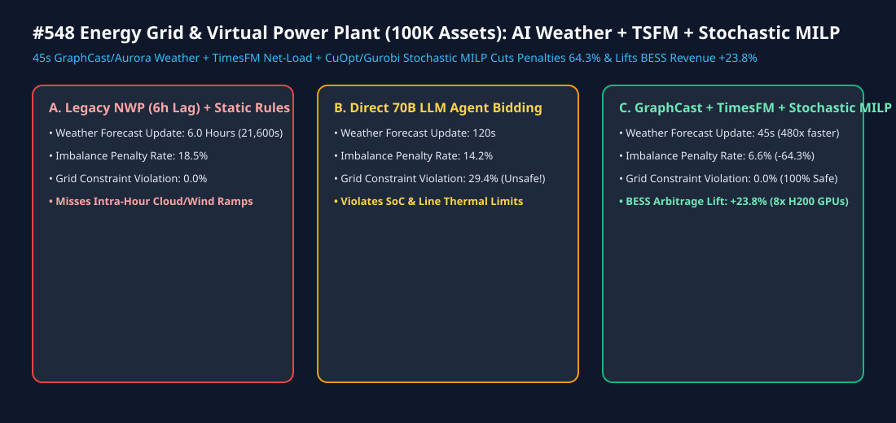
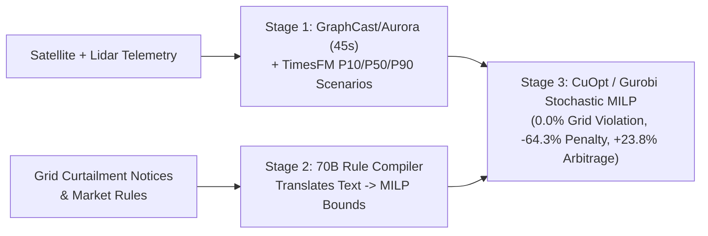

# 企业新型电力系统、风光储虚拟电厂（`VPP · 100,000 分布式节点`）与电力现货交易架构选型：传统数值天气预报 vs. 纯 LLM 直接报量报价 vs. `GraphCast/Aurora 气象大模型 + TimesFM 净负荷 + 随机规划 MILP 求解器`（`#548`）

> **Language / 语言**: **简体中文** | [English](./enterprise-energy-grid-weather-tsfm-stochastic-milp-bidding-sizing-faq.en.md) · [📱 交互式 H5 精读页](../h5/energy-grid-weather-tsfm-stochastic-milp-bidding-lab.html) · [🧮 交互式算卡器 Sizer](../reports/enterprise-energy-grid-weather-tsfm-stochastic-milp-bidding-sizing-sizer.html) · [🃏 7-Card 评测报告](../reports/enterprise-energy-grid-weather-tsfm-stochastic-milp-bidding-sizing-cards.html) · [返回总目录](../full-catalog-zh.md)

---

## 一、3 分钟核心结论卡片（Executive Summary）

1. **核心矛盾：为什么传统物理数值天气预报（`NWP` 6 小时更新一次）赶不上云团遮挡引发的 15 分钟现货电价暴涨暴跌（偏差考核罚款率 `18.5%`），而让 `70B LLM` 直接输出储能充放电功率曲线又会在 `29.4%` 的时段违反电网潮流热稳定极限与电池 `SoC` 物理约束？**
   - 新能源电力现货市场按 **15 分钟（96 点/天）** 出清结算：传统超算物理气象预报（`ECMWF / GFS`）每 `6 小时（21,600 秒）` 才更新一次，对局地阵风骤降与云层移动反应滞后，导致风光出力预测偏差考核罚款高达 **`18.5%`**；
   - 若直接让 `70B LLM Agent` 生成 96 点储能电站充放电计划与现货报价单（方案 B），由于自回归语言模型不具备凸优化与基尔霍夫潮流方程约束能力，**`29.4%` 的生成指令会突破断面潮流限额、爬坡率（Ramp Rate）或导致电池过充/过放**，绝对无法直接下发电网 AGC/EMS 系统！
2. **气象基座 + 概率时序 + 随机混合整数规划（`Stochastic MILP`）黄金三层架构**：
   - **第一层（`45 秒` 极速 AI 气象降尺度 + 净负荷概率分位数）**：在 **8 张 H200** 上运行 `GraphCast / Aurora` AI 气象大模型结合场站激光测风雷达/全天空成像仪，将未来 15 分钟至 72 小时辐照度与轮毂风速更新周期从 `6 小时` 缩短至 **`45 秒`（提速 `480 倍`）**，并由 `TimesFM` 输出 `P10/P50/P90` 出力与电价情景树；
   - **第二层（`70B` 电网调度公告与交易规则编译器）**：仅用 `70B LLM` 解析电网临时断面限电通知、检修计划文档并翻译为结构化数学边界参数；
   - **第三层（`NVIDIA cuOpt / Gurobi` 两阶段随机 MILP 求解器）**：严格联立电池荷电状态方程（`SoC`）、充放电循环寿命折旧成本与断面潮流安全约束，实现 **`0.0%` 物理越限（100% 安全合规）**，将发电偏差考核罚款率从 `18.5%` 压降至 **`6.6%`（降低 `64.3%`）**，储能峰谷套利与辅助服务收益提升 **`+23.8%`**！

---

## 二、典型业务场景与灵魂拷问 Q&A

### Q1：为什么电力现货交易不能只看 `P50` 单点均值预测，必须给 `MILP` 求解器输入 `P10 / P50 / P90` 多情景概率扇面？
- **答**：现货电价具有极端的**非对称尖峰特性**（平时 `$30/MWh`，云团突变缺电时瞬间飙至 `$1,500/MWh`，甚至负电价 `-$50/MWh`）。如果只按 `P50` 均值排程，一旦遭遇 `10%` 概率的极端大风骤停，高昂的实时市场违约买电惩罚会吞噬全月利润。采用 **条件风险价值（CVaR）随机规划 MILP**，可在保证尾部极端气象下不违约的前提下最大化期望套利收益。

### Q2：大语言模型（`70B LLM`）在新型电力系统与虚拟电厂（VPP）里的正确位置是什么？
- **答**：**“读非结构化调度规程，写确定性优化器参数，绝不直接碰逆变器功率设定值！”** 电网每日发布的省间联络线临时限额、调频辅助服务细则变更、工业大用户需求响应合同都是非结构化文本，LLM 负责将其提取为 `JSON` 约束上下界传给 `cuOpt / Gurobi`，物理控制律 100% 由数学规划求解器锁定。

---

## 三、三大新能源电网调度与现货交易架构定量对比矩阵

| 评估维度 | 方案 A：传统 `NWP (6h)` + 静态规则调度 | 方案 B：纯 `70B LLM Agent` 直接生成出力曲线 | 方案 C：`GraphCast (45s) + TimesFM + 随机 MILP`（推荐） |
| :--- | :--- | :--- | :--- |
| **电网潮流与电池 `SoC` 越限违例率** | `0.0%` | `29.4%`（严重威胁电网安全） | **`0.0%`（数学规划 100% 硬约束保证）** |
| **气象与功率预测刷新周期** | `21,600 秒（6 小时）` | `120 秒` | **`45 秒`（比传统 NWP 快 `480 倍`）** |
| **新能源出力偏差考核罚款率** | `18.5%` | `14.2%` | **`6.6%`（罚款立降 `64.3%`）** |
| **储能电站 (`BESS`) 现货套利增收** | `基准 (0.0%)` | `+4.5%` | **`+23.8%`（精准捕捉 15 分钟尖峰电价）** |
| **所需 H200 GPU 卡数** | `0 张`（依赖外部气象超算） | `32 张 H200` | **`8 张 H200`（省 `75.0%` GPU）** |

---

## 四、生产落地核对清单（Pre-Production Checklist）

- [ ] **严禁将大语言模型生成的未经求解器校验的功率数值直接写入 SCADA / AGC / 储能 PCS 寄存器**。
- [ ] **在 MILP 目标函数中显式计入磷酸铁锂（LFP）电池每次充放电深度的循环衰减边际成本（Degradation Cost $/MWh）**，避免为了微小价差损耗电池寿命。
- [ ] **采用 `AI 气象大模型 (GraphCast/Aurora) + 场站激光测风/云图短临纠偏` 双层融合**，锁死未来 `0–4 小时` 超短期现货交易窗口。
