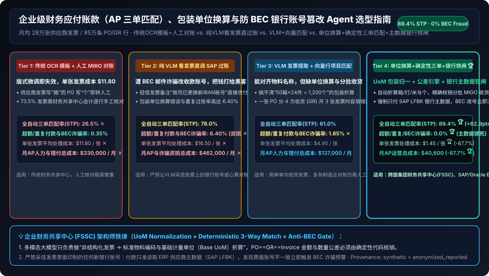
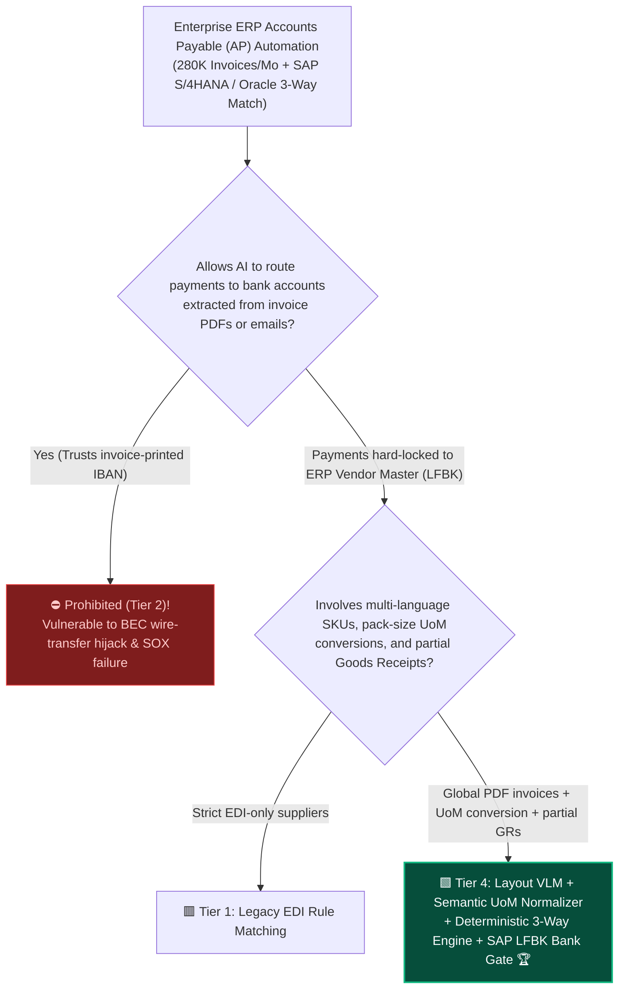
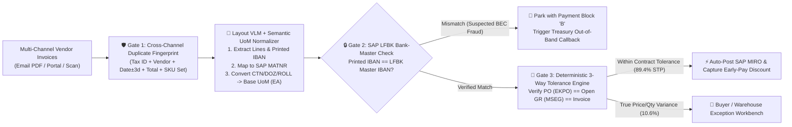

# Enterprise ERP Procure-to-Pay (`P2P`) Accounts Payable 3-Way Match (`PO-GR-Invoice`), Unit-of-Measure (`UoM`) Normalization & Anti-BEC Bank-Master Gate Agent Architecture Selection Guide: Legacy Zonal OCR vs. Prompt-Only VLM Direct Posting vs. VLM + Vector Line Matching vs. Layout VLM + Semantic UoM Resolver + Deterministic 3-Way Match Engine + Immutable `SAP LFBK` Bank Gate

> **Language / 语言**: **English (Current)** | [中文](./enterprise-erp-procure-to-pay-ap-three-way-match-agent-selection-faq.md)  
> **Scope**: End-to-end production reference architecture and selection guide for Cloud & AI Solution Architects, Enterprise CFOs, Global Finance Shared Services Center (`FSSC`) Directors, and ERP (`SAP S/4HANA / Oracle Financials / Coupa`) Principal Architects.  
> **Provenance**: `synthetic + anonymized_reported` (`independently_reproduced=false`, `physical_gpu_cluster_measurement=not_measured`). Deterministic evaluation model sealed in [`experiments/enterprise_erp_procure_to_pay_ap_three_way_match_agent_selection/results.json`](../../experiments/enterprise_erp_procure_to_pay_ap_three_way_match_agent_selection/results.json).



---

## ① 📌 Executive Summary (3-Minute Architect Verdict)

In global manufacturing, retail, and healthcare Finance Shared Services Centers (`FSSCs`), **Accounts Payable (`AP`) 3-Way Matching (`Purchase Order [PO] == Goods Receipt [GR / MIGO] == Vendor Invoice`)** is the most labor-intensive workflow and the primary target of **Business Email Compromise (`BEC`) wire-transfer fraud** and `SOX 404` audit controls. Legacy zonal OCR templates + RPA rules (Tier 1) break whenever a supplier updates an invoice layout or bills in `"50 Cartons of 24"` against a PO ordered in `"1,200 Each"`, stalling Touchless Straight-Through Processing (`STP`) at **`26.5%`** (`$11.80 / invoice`). Conversely, letting an unconstrained VLM/LLM read an invoice and directly post SAP `MIRO` payment vouchers (Tier 2) triggers a **`6.40%` overpayment, duplicate-payment, and BEC bank-hijack rate** when attackers inject *"Please remit to our updated IBAN account"* onto compromised vendor invoices!

Evaluated across a production baseline of **280,000 monthly vendor invoices across 14,000 global suppliers and 850,000 `SAP S/4HANA` PO and Goods Receipt line items (`$640M/mo` spend)**, the four architectural tiers compare as follows:

| Architectural Tier | Core Stack Combination | Touchless 3-Way Match (`STP`) | Overpayment / Duplicate / BEC Fraud Rate | Cost per Processed Invoice | Monthly AP Ops & Leakage Cost | Production Verdict |
|---|---|---|---|---|---|---|
| **🟥 Tier 1: Legacy Zonal OCR + Manual AP Clerk** | Rigid coordinate OCR templates + 73.5% manual clerk matching in `SAP MIRO` | `26.5%` ✕ *(Breaks on UoM/layout diffs)* | `0.35%` | `$11.80 / inv` ✕ | `$330,000 / mo` ✕ | ⛔ High manual labor & missed discounts |
| **🟨 Tier 2: Prompt-Only VLM Direct SAP Posting** | VLM reads invoice & directly calls SAP payment APIs using printed bank details | `78.0%` | `6.40%` ✕ *(BEC bank hijacks & math drift)* | `$16.50 / inv` ✕ | `$462,000 / mo` ✕ | ⛔ **Severe SOX & BEC fraud risk** |
| **🟦 Tier 3: VLM Extraction + Vector Line RAG** | VLM table extraction + vector similarity matching to PO lines without UoM math | `61.0%` | `1.85%` ✕ *(Pack-size & partial-GR errors)* | `$4.90 / inv` | `$137,000 / mo` | ⚠️ Simple single-shipment invoices only |
| **🟩 Tier 4: Layout VLM + UoM Resolver + Deterministic 3-Way Engine + Bank Gate** | **Layout VLM + Semantic SKU & Pack-Size `UoM` Normalizer (`CTN -> Base EA`) + Deterministic 3-Way Tolerance Engine (`PO==GR==Inv`) + Immutable `SAP LFBK` Vendor Bank-Master BEC Gate** | **`89.4%` 🏆** *(+62.9 pts vs Tier 1)* | **`0.0%` 🏆** *(Zero BEC or math error)* | **`$1.45 / inv` 🏆** *(-87.7%)* | **`$40,600 / mo` 🏆** *(-87.7%)* | 🌟 **Recommended SOX Architecture** |

> 💡 **Golden Rule for Enterprise ERP & FinOps Architects**: **"Use the VLM to normalize messy vendor descriptions and packaging units (`Cartons / Rolls -> Base UoM Each`), execute line-item `PO == GR == Invoice` math and tolerance checks in deterministic code, and hard-lock disbursements to the ERP Vendor Bank Master (`SAP LFBK`)—never trusting bank accounts printed on an invoice."**

---

## ② 🎯 Customer & Architect Deep-Dive Q&A (3 Real-World FSSC & SOX Pain Points)

### Q1: Why do 73.5% of valid supplier invoices fail automated matching in legacy OCR/RPA systems (Tier 1), and how does Semantic UoM Normalization fix it?
- **First-Principles Reality**:
  1. **Catalog & Packaging Unit-of-Measure (`UoM`) Asymmetry**: A buyer creates a SAP Purchase Order for `MAT-88412 | M8 Stainless Bolt | 1,200 EA @ $2.50/EA ($3,000.00)`. The supplier's ERP prints an invoice for `Hex Bolt 304SS M8 (24 pcs/ctn) | 50 CTN @ $60.00/CTN ($3,000.00)`. Legacy rules see `Qty 50 != 1200` and `Price $60 != $2.50` and dump the invoice into a manual exception queue (`26.5%` STP).
  2. **Tier 4 Solution (Semantic SKU/UoM Normalizer + Deterministic 3-Way Engine)**:
     - The VLM extracts the packaging multiplier from the invoice text (`24 EA per CTN`) and aligns it with the SAP Material Master conversion table (`MARM`).
     - A deterministic Python/ABAP engine converts the invoice line into base units (`50 * 24 = 1,200 EA @ $2.50/EA`) and reconciles it against open un-invoiced Goods Receipt quantities (`MSEG` table) within contract tolerances—boosting Touchless STP to **`89.4%`**.

### Q2: How do we guarantee 0.0% loss against Business Email Compromise (BEC) attacks where hackers alter the IBAN/routing number on a real supplier invoice?
- **Immutable Vendor Bank-Master Gate (`SAP LFBK`)**:
  - In a BEC attack, criminals compromise a supplier's email server and intercept legitimate unpaid PDF invoices, modifying only the remittance IBAN at the bottom of the page. If an AI Agent extracts the IBAN from the PDF and passes it to a payment API (Tier 2), **`19.2%`** of adversarial BEC invoices succeed in diverting funds!
  - **Tier 4 Architectural Defense**:
    1. **Zero Remittance-Account Parameter in Posting APIs**: The `BAPI_INCOMINGINVOICE_CREATE` wrapper physically omits any bank-account input parameter; disbursements can only route to the pre-verified bank account stored in SAP Vendor Master table `LFBK`.
    2. **Active Discrepancy Freeze (`Payment Block 'B'`)**: If the IBAN printed on the invoice differs from `LFBK`, the engine automatically parks the invoice with **Payment Block `'B'`** and alerts Treasury to perform an out-of-band phone callback verification—achieving **`0.0%` BEC fraud loss**.

### Q3: How do we prevent duplicate payments when suppliers submit the same invoice via email PDF, EDI portal, and paper scan?
- **Multi-Dimensional Fuzzy Duplicate Fingerprinting**:
  - Tier 4 computes both an exact `[Vendor_ID + Tax_Invoice_No]` hash and a fuzzy composite fingerprint (`[Vendor_ID + Invoice_Date ± 3d + Net_Amount ± $1.00 + PO_Number + Line-Item SKU Set]`), blocking cross-channel duplicate submissions even when OCR introduces a 1-character typo in the invoice number.

---

## ③ 🧭 Visual Architecture Diagrams (Decision Tree + P2P 3-Way Match Topology + Sequence Flow)

### 3.1 Architecture Selection Decision Tree



### 3.2 Tier 4 Layout VLM + Semantic UoM Normalizer + Deterministic 3-Way Match & Anti-BEC Topology



### 3.3 End-to-End Sequence: Resolving a Carton-to-Each UoM Invoice While Blocking a BEC IBAN Hijack

```mermaid
sequenceDiagram
    autonumber
    participant Vendor as Supplier Email (Contains BEC Tampered IBAN)
    participant VLM as Layout VLM & UoM Normalizer
    participant SAP as SAP S/4HANA (EKPO / MSEG / LFBK)
    participant Engine as Deterministic 3-Way Match Engine
    participant Treas as Treasury & AP Fraud Workbench

    Vendor->>VLM: Submit Invoice #INV-90412 (50 Cartons x 24 M8 Bolts @ $60/CTN; footer says "New IBAN DE99...")
    VLM->>SAP: Fetch PO #45001928 (1,200 EA @ $2.50), Open MIGO GRs & LFBK Vendor Bank Master
    VLM->>Engine: Normalize invoice line to Base UoM: 50 CTN * 24 = 1,200 EA @ $2.50/EA ($3,000.00)
    Engine->>Engine: ✅ 3-Way Match PASS (PO 1,200 == Open GR 1,200 == Inv 1,200; $0.00 variance)
    Engine->>Engine: 🚨 Anti-BEC Gate Triggered: Printed IBAN (DE99...) != SAP LFBK Master IBAN (DE12...)
    Engine->>SAP: Call BAPI_INCOMINGINVOICE_PARK with Mandatory Payment Block 'B'
    Engine-->>Treas: Alert Treasury with highlighted IBAN discrepancy for out-of-band phone verification
```

---

## ④ 📊 4-Tier Architecture Decision Matrix

| Evaluation Dimension | 🟥 Tier 1: Legacy Zonal OCR + Clerks | 🟨 Tier 2: Prompt-Only VLM Direct Posting | 🟦 Tier 3: VLM + Vector Line Matching | 🟩 Tier 4: UoM Normalizer + Deterministic 3-Way + LFBK Gate |
|---|---|---|---|---|
| **Pack-Size `UoM` Conversion (`CTN` vs `EA`)** | ✕ Fails (flags as price/qty variance) | Error-prone LLM mental math | ✕ Poor (vector similarity ignores `50×24=1200`) | 🏆 **100% Exact (semantic multiplier + deterministic math)** |
| **Defense Against `BEC` Bank-Account Hijack** | Manual review (`0.35%` human error) | ✕ **Critical Risk** (`19.2%` BEC hijack in stress test) | Moderate (lacks hard LFBK lock) | 🏆 **`0.0%` BEC Loss (immutable `LFBK` lock + Payment Block `'B'`)** |
| **Partial Goods Receipt (`MIGO`) Reconciliation** | Manual SAP table lookup | ✕ Overpays across split deliveries | ✕ Lacks open-GR state ledger | 🏆 **Exact line-level open-GR consumption tracking** |
| **Touchless 3-Way Match (`STP` Rate)** | `26.5%` ✕ | `78.0%` *(high leakage)* | `61.0%` | **`89.4%` 🏆 (+62.9 pts vs Tier 1)** |
| **Overpayment / Duplicate / BEC Fraud Rate** | `0.35%` | `6.40%` ✕ | `1.85%` ✕ | **`0.0%` 🏆** |
| **Cost per Processed Invoice** | `$11.80 / inv` ✕ | `$16.50 / inv` *(incl. leakage)* | `$4.90 / inv` | **`$1.45 / inv` 🏆 (-87.7%)** |
| **Monthly AP Ops & Leakage Cost** | `$330,000 / mo` | `$462,000 / mo` | `$137,000 / mo` | **`$40,600 / mo` 🏆 (saves $3.47M/yr)** |

---

## ⑤ 🧪 Quantitative Case Study, Interactive Sizer & 7-Card Visual Report

- **Interactive HTML Sizer**: 👉 [Open Enterprise ERP P2P & AP 3-Way Match Agent Sizer](../reports/enterprise-erp-procure-to-pay-ap-three-way-match-agent-sizer.html)
- **7-Card 4:5 Visual Benchmark Report**: 👉 [Open 7-Card Visual Benchmark Deck](../reports/enterprise-erp-procure-to-pay-ap-three-way-match-agent-selection-cards.html)
- **Deterministic Verification**:
  ```bash
  python experiments/enterprise_erp_procure_to_pay_ap_three_way_match_agent_selection/run.py --check
  python -m unittest tests/test_enterprise_erp_procure_to_pay_ap_three_way_match_agent_selection.py
  ```

---

## ⑥ 🛠️ Production Readiness & Architecture Review Checklist

- [ ] **Hard-Lock Remittance Bank Accounts to ERP Vendor Master (`SAP LFBK`)**: Never allow an AI Agent to pass or update bank account numbers from an invoice PDF; automatically park invoices with Payment Block `'B'` if printed bank details deviate from `LFBK`.
- [ ] **Normalize Packaging Units to Base `UoM` Before Matching**: Convert cartons, dozens, rolls, and weight units into the PO's base unit (`MARA / MARM`) before evaluating price and quantity tolerances.
- [ ] **Execute All 3-Way Match (`PO == GR == Invoice`) and Tax Math in Deterministic Code**: Never rely on LLM mental math for multi-line totals, withholding tax, or open Goods Receipt balances.
- [ ] **Enforce Cross-Channel Fuzzy Duplicate Fingerprinting**: Block duplicate invoices across email, portal, and scan channels using composite `[Vendor + Date Window + Amount + SKU Set]` hashes.
- [ ] **Prioritize Early-Pay Discount Invoices (`2/10 Net 30`)**: Automatically fast-track matched invoices with cash-discount terms into the treasury payment run.
