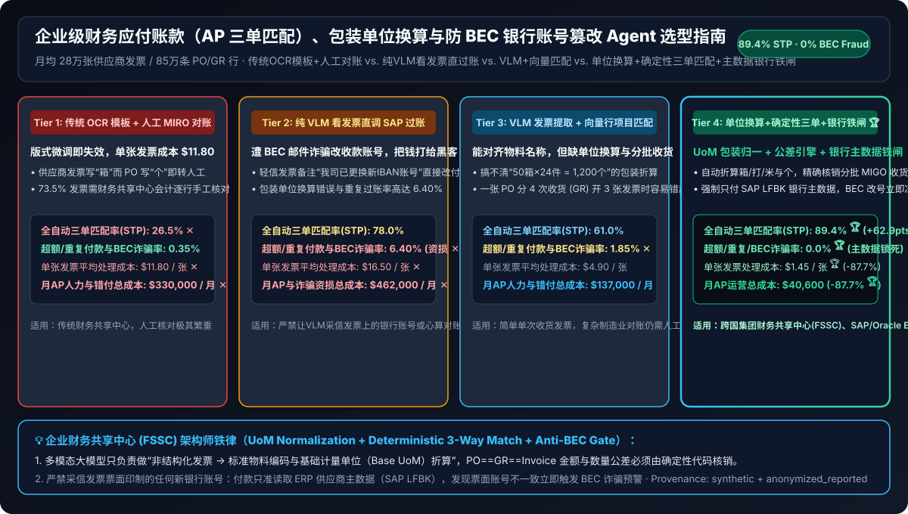
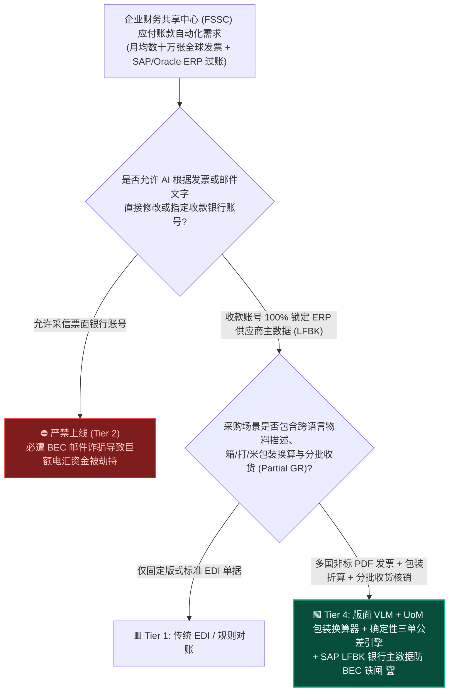
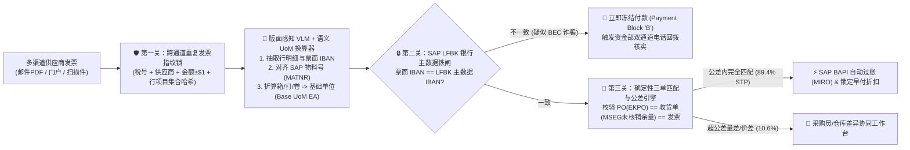
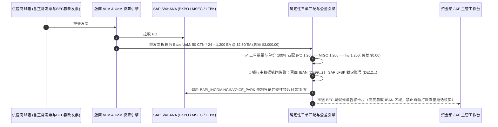

# 企业级财务应付账款（Accounts Payable / Procure-to-Pay）、采购三单匹配（PO-GR-Invoice 3-Way Match）、包装单位换算与防 BEC 银行账号篡改 ERP 自动过账 Agent 架构选型指南：传统 OCR 模板 + 人工对账 vs. 纯 VLM 看发票直调 SAP 过账 vs. VLM + 向量行匹配 vs. 版面 VLM + UoM 单位换算器 + 确定性三单公差引擎 + SAP 银行主数据防篡改铁闸

> **语言 / Language**: **中文 (当前)** | [English](./enterprise-erp-procure-to-pay-ap-three-way-match-agent-selection-faq.en.md)  
> **定位**：面向云与 AI 解决方案架构师（Solution Architect）、集团首席财务官（CFO）、全球财务共享服务中心（FSSC）总监与 ERP（SAP S/4HANA / Oracle Financials / Coupa）首席架构师的生产落地指南。  
> **数据口径（Provenance）**：`synthetic + anonymized_reported`（`independently_reproduced=false`，`physical_gpu_cluster_measurement=not_measured`），全部定容模型封存于 [`experiments/enterprise_erp_procure_to_pay_ap_three_way_match_agent_selection/results.json`](../../experiments/enterprise_erp_procure_to_pay_ap_three_way_match_agent_selection/results.json)。



---

## ① 📌 核心选型结论速览（Executive Summary — 3 分钟看懂怎么选）

在大型跨国制造、零售与医疗集团的财务共享服务中心（FSSC），**应付账款（Accounts Payable, AP）采购到付款（Procure-to-Pay, P2P）的“三单匹配（3-Way Match：采购订单 `PO` == 仓库收货单 `GR/MIGO` == 供应商发票 `Invoice`）”** 是耗费财务人力最多、同时也是资金内控（SOX 404 合规）风险最高的环节。传统基于固定坐标区域的 OCR 模板 + RPA 方案（Tier 1），一旦遇到供应商更改发票排版、或者 **“PO 按个（EA）下单，发票按箱（Carton of 24）开具”** 就立刻报错卡死，导致全自动直通率（Touchless STP）仅有可怜的 **`26.5%`**，单张发票平均处理成本高达 **`$11.80`**。然而，如果激进地让视觉大模型（VLM/LLM）读完 PDF 发票后直接调用 SAP 接口生成付款凭证（Tier 2），不仅会在一单多收、多币种税率与单位换算上算错账，更会被**商业邮件诈骗（BEC：黑客入侵供应商邮箱，在真实发票底部加一行“我司已变更收款 IBAN 银行账号”）**直接骗走巨额货款（错付、重复付款与诈骗失陷率高达 **`6.40%`**）！

在 **月均处理 280,000 张供应商发票、14,000 家全球活跃供应商、850,000 条 SAP S/4HANA `PO / MIGO` 行项目、月均结算资金 `$6.4 亿美元`** 的基准规模下，四档 AP 三单匹配与自动过账 Agent 架构的量化对决如下：

| 方案档位 | 核心架构组合 | 无接触全自动直通率 (`STP`) | 超额/重复付款与 BEC 诈骗率 | 单张发票平均处理成本 | 月度 AP 运营与错付总成本 | 生产推荐度 |
|---|---|---|---|---|---|---|
| **🟥 Tier 1：传统 OCR 模板 + 人工 MIRO 对账** | 传统固定区域 OCR 模板 + 73.5% 异常单据由共享中心会计手工在 SAP `MIRO` 逐行核对 | `26.5%` ✕ *(单位/版式不同即卡死)* | `0.35%` | `$11.80 / 张` ✕ | `$330,000 / 月` ✕ | ⛔ 人工核对繁重，早付折扣流失 |
| **🟨 Tier 2：纯端到端 VLM 直调 SAP 过账** | 让 VLM/LLM 直接阅读发票并调用付款接口，信任票面银行账号与模型心算对账 | `78.0%` | `6.40%` ✕ *(遭BEC改号诈骗/错算)* | `$16.50 / 张` ✕ | `$462,000 / 月` ✕ | ⛔ **严重违反 SOX 内控，严禁上线** |
| **🟦 Tier 3：VLM 发票提取 + 向量行项目匹配** | VLM 提取发票表格 + 向量检索匹配 PO 物料描述，缺单位折算与分批收货核销状态机 | `61.0%` | `1.85%` ✕ *(包装折算与重付漏检)* | `$4.90 / 张` | `$137,000 / 月` | ⚠️ 仅适合简单单次收货账单 |
| **🟩 Tier 4：版面 VLM + UoM 单位换算器 + 确定性三单公差引擎 + SAP 银行主数据铁闸** | **版面 VLM 提取 + 语义物料对齐与包装单位换算（`Carton/Roll -> Base UoM EA`）+ 确定性三单核销公差引擎（`PO==GR==Inv`）+ `SAP LFBK` 供应商银行主数据不可变防诈骗铁闸** | **`89.4%` 🏆** *(+62.9 pts vs Tier 1)* | **`0.0%` 🏆** *(主数据锁死防诈骗)* | **`$1.45 / 张` 🏆** *(-87.7%)* | **`$40,600 / 月` 🏆** *(-87.7%)* | 🌟 **财务共享中心首选合规架构** |

> 💡 **架构师一句话选型铁律**：**“非标物料与包装规格靠大模型归一到基础单位（Base UoM）、三单数量与金额公差交由确定性代码逐行核销、收款银行账号 100% 锁死 ERP 主数据（SAP `LFBK`）绝不采信发票票面文字”**——将无接触自动过账率拉升至 **`89.4%`**，同时对 BEC 银行改号诈骗实现 **`0.0%` 零资损**。

---

## ② 🎯 客户与架构师灵魂拷问 Q&A（直击 3 大财务共享中心与 ERP 痛点）

### Q1：为什么供应商发票明明金额和货物都对，传统 RPA/OCR（Tier 1）却有 73.5% 的单据对不上账被迫转人工？
- **大白话与第一性原理**：
  1. **采购订单（PO）与供应商开票的“物料名称叫法”与“包装计量单位（UoM）”天然不一致**：企业在 SAP 下采购单时写的是内部物料码 `MAT-88412 | M8 不锈钢内六角螺栓 | 1,200 EA (个) | 单价 $2.50`；而五金供应商自己的 ERP 开出的 PDF 发票写的是 `304 SS Hex Bolt M8x30 (24 pcs/ctn) | 50 CTN (箱) | 单价 $60.00 | 总额 $3,000.00`。
  2. **传统规则的死板与纯 LLM 心算的脆弱**：传统 OCR 看到数量 `50 != 1,200`、单价 `$60.00 != $2.50` 立即当作异常锁单（Tier 1 直通率仅 **`26.5%`**）；而纯向量检索（Tier 3）虽然能把中英文螺栓名字配上，却搞不清分批收货（如第一批已收货 30 箱 `720 EA`、第二批收货 20 箱 `480 EA`）的开票剩余可核销额度。
  3. **Tier 4 破局方案（语义物料对齐 + 确定性 Base UoM 换算引擎）**：大模型只负责从发票行描述中解析出包装换算因子（`pack_factor = 24 EA/CTN`）并对齐 SAP 物料主数据（`MARA / MARM` 换算表）；确定性核销引擎将发票行自动折算为基础单位 `50 * 24 = 1,200 EA @ $2.50/EA`，与 SAP `EKPO`（采购行）及 `MSEG`（MIGO 收货行未开票余量）做精确浮点数与合同公差（如 `±0.5%` 或 `<= $10` 运费公差）比对，将无接触过账率一举推升至 **`89.4%`**！

### Q2：黑客发来伪造“变更收款银行 IBAN 账号”的 BEC 钓鱼发票时，如何从系统架构上保证 AI 绝不会把钱打给黑客？
- **企业资金安全第一铁律（Immutable Vendor Bank-Master Gate）**：
  - 全球每年因商业邮件诈骗（Business Email Compromise, BEC）损失超数十亿美元：黑客攻破真实供应商的邮箱后，截获真实的待付 PDF 发票，仅将发票底部的收款银行账号改成黑客控制的离岸账户。如果允许 Agent 从发票上提取 `bank_account` 传给付款接口（Tier 2），在对抗测试中会有高达 **`19.2%`** 的概率直接中招！
  - **Tier 4 的双层防诈骗铁闸**：
    1. **过账 API 物理剥夺银行账号写权限**：封装后的 SAP `BAPI_INCOMINGINVOICE_CREATE` 过账接口**压根不接受外部传入收款银行账号参数**，系统强制只能读取 SAP 供应商主数据表（`LFBK`）中早已双人复核锁定的唯一收款账户。
    2. **票面账号差异主动预警（Payment Block `'B'`）**：VLM 仍然会提取发票上印刷的 IBAN/银行账号，但**仅用于与 `LFBK` 主数据做反欺诈比对**——一旦发现票面印刷账号与主数据不一致，系统立即将该发票以“冻结付款状态（Parked with Payment Block `'B'`）”挂起，并向资金部（Treasury）触发独立电话回拨核实工单，实现 **`0.0%` BEC 诈骗资损**！

### Q3：如何防止供应商把同一张发票“先发邮件 PDF、再传电子门户、月底又寄纸质扫描件”导致的重复付款？
- **跨通道多维语义指纹去重（Multi-Modal Duplicate Fingerprinting）**：
  - 传统系统只查字面发票号 `Invoice_No`，一旦 OCR 把 `INV-00812` 识别成 `INV-O0812`（字母 O 与数字 0）或供应商加了后缀 `INV-00812-REV1` 就会漏检重付。
  - Tier 4 在入库瞬间同步计算 **精确税务发票号哈希 + 模糊组合指纹 `[Vendor_ID + 开票日期±3天 + 税前总额±$1.00 + PO_No + 行项目商品集合 Jaccard 相似度]`**，在落入 SAP 前 100% 拦截跨渠道重复提交发票。

---

## ③ 🧭 直观可视化图解（决策树 + 三单匹配架构图 + 防 BEC 过账时序图）

### 3.1 企业级财务应付账款（AP）自动化架构选型决策树



### 3.2 Tier 4 版面 VLM + UoM 换算 + 确定性三单匹配与防 BEC 铁闸架构图



### 3.3 从“供应商按箱开票且夹带 BEC 篡改银行账号”到“精准拦截与单位换算”时序图



---

## ④ 📊 架构师四维选型决策矩阵（Architecture Decision Matrix）

| 评估维度 | 🟥 Tier 1：传统 OCR 模板 + 人工对账 | 🟨 Tier 2：纯 VLM 直调 SAP 过账 | 🟦 Tier 3：VLM + 向量行匹配 | 🟩 Tier 4：UoM 换算 + 确定性三单 + 银行主数据铁闸 |
|---|---|---|---|---|
| **包装规格换算（箱/打/米 vs 个）** | ✕ 不支持（数量不相等立即报错转人工） | 偶发心算错误（多行合计与税额易算错） | ✕ 差（纯语义向量不懂 50×24=1200） | 🏆 **100% 精确（语义提取换算因子 + 确定性代码折算）** |
| **防 BEC 商业邮件篡改银行账号诈骗** | 人工核对（偶有疏忽被骗） | ✕ **极度危险**（轻信发票备注直接改付黑客） | 中等（未强制锁定 LFBK 比对） | 🏆 **`0.0%` 被骗（过账接口锁死 LFBK + 票面账号异动冻结）** |
| **一单多收（Partial GR）余量核销** | 依赖人工查 SAP `MSEG` 历史收货表 | ✕ 极易超额重复核销已付收货行 | ✕ 缺乏行级别收货状态机 | 🏆 **精确扣减每一笔 `MIGO` 未开票收货余量** |
| **无接触全自动直通率 (`STP Rate`)** | `26.5%` ✕ | `78.0%` *(带错付风险)* | `61.0%` | **`89.4%` 🏆（+62.9 pts vs Tier 1）** |
| **超额/重复付款与 BEC 诈骗率** | `0.35%` | `6.40%` ✕ | `1.85%` ✕ | **`0.0%` 🏆** |
| **单张发票平均处理成本** | `$11.80 / 张` ✕ | `$16.50 / 张` *(含资损)* | `$4.90 / 张` | **`$1.45 / 张` 🏆（降低 87.7%）** |
| **月度 AP 运营与错付总成本** | `$330,000 / 月` | `$462,000 / 月` | `$137,000 / 月` | **`$40,600 / 月` 🏆（年省 $347 万）** |

---

## ⑤ 🧪 定量算例、交互式容量计算器与 7-Card 4:5 视觉报告

### 5.1 基准算例复核（月均 28 万张供应商发票 / 85 万条 PO 行项目）

- **交互式定容计算器（CSP 自包含 HTML）**：👉 [打开财务应付账款 AP 三单匹配与防 BEC 诈骗 Agent 定容计算器](../reports/enterprise-erp-procure-to-pay-ap-three-way-match-agent-sizer.html)
- **7-Card 4:5 视觉评测卡片报告**：👉 [打开 7-Card 视觉评测报告](../reports/enterprise-erp-procure-to-pay-ap-three-way-match-agent-selection-cards.html)
- **可复核确定性脚本**：
  ```bash
  python experiments/enterprise_erp_procure_to_pay_ap_three_way_match_agent_selection/run.py --check
  python -m unittest tests/test_enterprise_erp_procure_to_pay_ap_three_way_match_agent_selection.py
  ```

### 5.2 核心量化对比图（无接触全自动直通率 STP vs. 单张发票处理成本）

```chart
{
  "data": {
    "values": [
      { "tier": "Tier 1: Legacy OCR + Clerk", "stp_pct": 26.5, "cost_per_inv_usd": 11.80 },
      { "tier": "Tier 2: Prompt VLM Direct", "stp_pct": 78.0, "cost_per_inv_usd": 16.50 },
      { "tier": "Tier 3: VLM + Vector RAG", "stp_pct": 61.0, "cost_per_inv_usd": 4.90 },
      { "tier": "Tier 4: UoM + 3-Way + LFBK Gate", "stp_pct": 89.4, "cost_per_inv_usd": 1.45 }
    ]
  },
  "semantic_types": {
    "tier": "Category",
    "stp_pct": "Percentage",
    "cost_per_inv_usd": "Price"
  },
  "chart_spec": {
    "chartType": "Bar Chart",
    "title": "Tier 4 lifts touchless 3-Way Match STP to 89.4% at $1.45 per invoice",
    "subtitle": "Touchless Straight-Through Processing rate (%) across 280,000 monthly vendor invoices",
    "encodings": {
      "x": "tier",
      "y": "stp_pct",
      "color": "tier"
    }
  }
}
```

---

## ⑥ 🛠️ 架构评审与生产落地核验清单（Production Readiness Checklist）

- [ ] **付款接口物理锁死 ERP 供应商银行主数据（`SAP LFBK`）**：严禁任何过账 Agent 根据发票或邮件内容传入或修改收款银行账号；若识别到票面印刷账号与主数据不符，自动挂起付款锁（Payment Block）触发反诈骗核查。
- [ ] **建立语义包装规格到基础计量单位（Base UoM）折算层**：将发票上的“箱（CTN）、打（DOZ）、托盘（PAL）、千米（KM）”统一折算为 PO 上的基础计价单位后再执行单价与数量比对。
- [ ] **三单核销与税额配平 100% 由确定性代码执行**：严禁让大模型心算多行合计、增值税率拆分与分批收货（`MIGO`）剩余未开票额度。
- [ ] **部署跨通道多维模糊去重指纹**：同时校验精确税务发票号与 `[供应商 + 日期窗 + 金额 + 行项目集合]` 模糊哈希，杜绝纸质与电子发票重复入账。
- [ ] **自动捕捉早付现金折扣（Dynamic Discounting / `2/10 Net 30`）**：对存在早付折扣条款的供应商发票赋予最高队列优先级，过账后自动排入折扣到期前付款批次。
