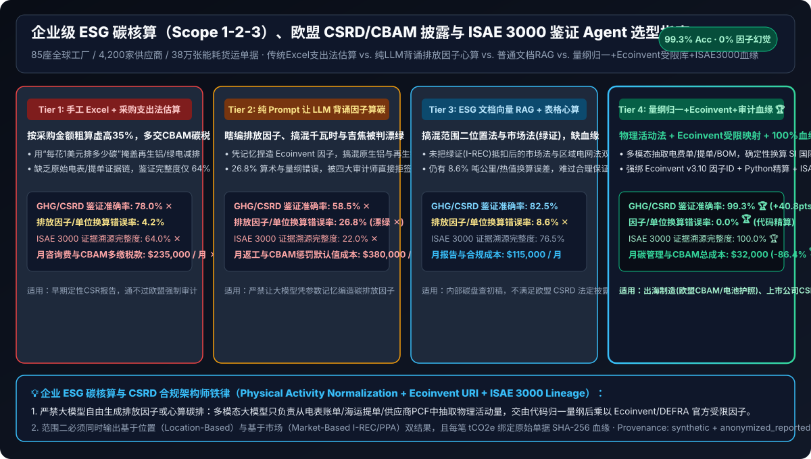
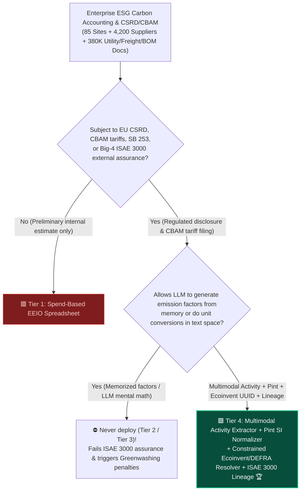
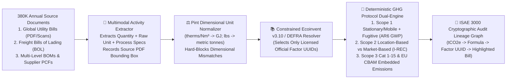

# Enterprise ESG Carbon Accounting (`GHG Protocol Scope 1-2-3`), EU `CSRD / CBAM` Compliance, Constrained `Ecoinvent / DEFRA` Factor Resolution & `ISAE 3000` Audit-Lineage Agent Architecture Selection Guide: Manual Spend-Based Excel vs. Prompt-Only LLM Memorized Factors vs. ESG Document RAG vs. Multimodal Activity Extractor + `Pint` Unit Normalizer + Constrained `Ecoinvent` Resolver + `ISAE 3000` Lineage Agent

> **Language / 语言**: **English (Current)** | [中文](./enterprise-esg-carbon-accounting-scope3-csrd-audit-agent-selection-faq.md)  
> **Scope**: End-to-end production reference architecture and selection guide for Cloud & AI Solution Architects, Chief Sustainability Officers (`CSOs`), Global Supply Chain Decarbonization Leads, and EU `CSRD / CBAM / Battery Passport` Compliance Architects.  
> **Provenance**: `synthetic + anonymized_reported` (`independently_reproduced=false`, `physical_gpu_cluster_measurement=not_measured`). Deterministic evaluation model sealed in [`experiments/enterprise_esg_carbon_accounting_scope3_csrd_audit_agent_selection/results.json`](../../experiments/enterprise_esg_carbon_accounting_scope3_csrd_audit_agent_selection/results.json).



---

## ① 📌 Executive Summary (3-Minute Architect Verdict)

Under the **EU Corporate Sustainability Reporting Directive (`CSRD / ESRS E1`)**, the **EU Carbon Border Adjustment Mechanism (`CBAM`)**, the **EU Battery Regulation (Digital Battery Passport)**, and **California `SB 253`**, corporate greenhouse gas (`GHG Protocol Scope 1, Scope 2, and Scope 3`) disclosures require **financial-grade external assurance (`ISAE 3000 / ISAE 3410 / ISO 14064-3`)** by Big-4 accounting firms or accredited verifiers. Relying on manual Excel sheets with crude financial Spend-Based `EEIO` factors (`kgCO2e per $1 spent`, Tier 1) inflates Scope 3 emissions by 35%+ and triggers punitive `CBAM` default tariffs. Conversely, prompting a general-purpose LLM to estimate carbon footprints and multiply emissions in token space (Tier 2) causes a **`26.8%` emission-factor hallucination and unit-conversion error rate (`34.2%` on Scope 2 dual-reporting & recycled materials)—leading external auditors to reject the filing as unverified Greenwashing**!

Evaluated across a production baseline of **85 global manufacturing and office sites, 4,200 supply-chain suppliers, and 380,000 annual utility bills, freight bills of lading (`BOL`), and BOM records**, the four architectural tiers compare as follows:

| Architectural Tier | Core Stack Combination | `GHG / CSRD` Assurance Accuracy | Factor / Unit Hallucination Rate | `ISAE 3000` Evidence Traceability | Monthly Reporting & CBAM Overpayment Cost | Production Verdict |
|---|---|---|---|---|---|---|
| **🟥 Tier 1: Manual Excel + Spend-Based `EEIO`** | Manual spreadsheet collection + financial spend multiplied by industry-average EEIO factors | `78.0%` ✕ *(Overstates emissions ~35%)* | `4.2%` *(Manual unit typos)* | `64.0%` ✕ *(Missing meter proofs)* | `$235,000 / mo` ✕ | ⛔ Overpays CBAM tariffs |
| **🟨 Tier 2: Prompt-Only LLM Memorized Factors** | Asking an LLM to output emission factors from memory & compute `tCO2e` in text | `58.5%` ✕ *(Wrong process factors)* | `26.8%` ✕ *(Fails Big-4 assurance)* | `22.0%` ✕ *(Unverifiable black box)* | `$380,000 / mo` ✕ | ⛔ **Severe greenwashing risk** |
| **🟦 Tier 3: ESG Document RAG + Table LLM Math** | Vector search over ESG PDFs + unconstrained LLM table arithmetic | `82.5%` | `8.6%` ✕ *(Confuses kWh/GJ & Scope 2)* | `76.5%` | `$115,000 / mo` | ⚠️ Internal draft estimates only |
| **🟩 Tier 4: Multimodal Activity Extractor + `Pint` Normalizer + `Ecoinvent` Resolver + `ISAE 3000` Lineage** | **Multimodal Utility/BOL/BOM Activity Extractor + Deterministic `Pint` SI Unit Normalizer + Constrained `Ecoinvent v3.10 / DEFRA` UUID Resolver + Deterministic `GHG` Dual-Engine & `ISAE 3000` Lineage Graph** | **`99.3%` 🏆** *(+40.8 pts vs Tier 2)* | **`0.0%` 🏆** *(Zero factor/math error)* | **`100.0%` 🏆** *(1-click source proof)* | **`$32,000 / mo` 🏆** *(-86.4%)* | 🌟 **Recommended Audit Architecture** |

> 💡 **Golden Rule for Enterprise ESG & Carbon Architects**: **"Use multimodal VLMs strictly to extract physical activity quantities (`mass, kWh, Nm³, ton-km`) and bounding-box coordinates from source bills/BOMs, normalize units deterministically via `Pint`, bind emission factors exclusively to versioned `Ecoinvent v3.10 / DEFRA / Grid` UUIDs, and persist a cryptographic `ISAE 3000` lineage graph from every reported `tCO2e` figure back to the source invoice page."**

---

## ② 🎯 Customer & Architect Deep-Dive Q&A (3 Real-World CSRD, CBAM & Big-4 Audit Pain Points)

### Q1: Why does financial Spend-Based carbon accounting (Tier 1) penalize sustainable procurement and inflate EU CBAM tariffs?
- **First-Principles Reality**:
  1. **The Spend-Based Paradox**: Suppose a manufacturer switches from high-carbon primary aluminum (`16.40 tCO2e/t`) to low-carbon 75% post-consumer recycled aluminum (`1.82 tCO2e/t`). Because certified recycled aluminum commands a higher dollar price per ton, a financial Spend-Based formula (`$ Spent × Sector Average kgCO2e/$`) perversely reports *higher* emissions for buying green material! Furthermore, EU `CBAM` imposes punitive default carbon prices on importers who cannot prove physical process-level emissions.
  2. **Tier 4 Solution (Physical Activity Extraction + Constrained `Ecoinvent v3.10` Process Mapping)**: Tier 4 extracts exact physical mass (`120.0 metric tonnes`) and recycled content (`75%`) from mill test certificates and BOMs, mapping them via constrained hybrid search to the exact **`Ecoinvent v3.10` process UUID** (`ecoinvent:v3.10/market-for-aluminium-wrought-alloy-recycled`)—legally documenting a `1,749.6 tCO2e` reduction on a single 120-ton shipment.

### Q2: Why do prompt-driven LLMs (Tier 2 / Tier 3) fail 8.6%–34.2% of dimensional conversions and Scope 2 dual-reporting checks?
- **Dimensional Analysis & Dual-Reporting Mechanics**:
  1. **Dimensional Unit Chaos (`therms`, `MMBtu`, `Nm³`, `GJ`, `kWh`)**: Global utility invoices report natural gas and steam in incompatible units requiring net calorific value (`NCV`) and `IPCC AR6 GWP-100` (`CH4 = 27.9`, `N2O = 273`) conversions. Tier 4 passes every extracted quantity through Python **`Pint` dimensional verification** before multiplication, guaranteeing **`0.0%` unit-mismatch errors**.
  2. **Mandatory Scope 2 Dual Reporting (`Location-Based` vs. `Market-Based`)**: Under the `GHG Protocol Scope 2 Guidance` and `ESRS E1`, companies retiring Renewable Energy Certificates (`I-RECs / Guarantees of Origin / PPAs`) must report *both* the physical grid average (`Location-Based`) and the contractually adjusted emission (`Market-Based` using residual mix factors for unbundled grid power). Tier 4 computes both ledgers deterministically and verifies `I-REC` retirement serial numbers against registry APIs.

### Q3: What does a Big-4 auditor require to issue an `ISAE 3000` assurance opinion on AI-assisted ESG disclosures?
- **`100.0%` Single-Click Source-to-Disclosure Lineage**:
  - External auditors reject any unanchored LLM summary. Tier 4 stores a four-hop immutable **Audit Lineage Graph** for every ledger entry: `Reported tCO2e -> Deterministic Formula Version -> Ecoinvent/DEFRA Factor UUID & Release Year -> Source Utility/BOL PDF SHA-256 & Highlighted Bounding Box`.

---

## ③ 🧭 Visual Architecture Diagrams (Decision Tree + ESG Lineage Topology + Assurance Sequence)

### 3.1 Architecture Selection Decision Tree



### 3.2 Tier 4 Multimodal Activity Extractor + Pint Normalizer + Ecoinvent UUID + ISAE 3000 Topology



### 3.3 End-to-End Sequence: From Utility Bill & Mill Certificate Upload to 1-Click Big-4 Audit Verification

```mermaid
sequenceDiagram
    autonumber
    participant Site as Global Plant & Supplier Portal
    participant VLM as Multimodal Activity Extractor
    participant Pint as Pint SI Unit Normalizer
    participant Eco as Constrained Ecoinvent/Grid DB
    participant Engine as Deterministic GHG/CBAM Engine
    participant Auditor as Big-4 External Auditor (ISAE 3000)

    Site->>VLM: Upload Plant #02 Electricity Bill (820,000 kWh), I-REC Retirement Cert & 120t 75%-Recycled Aluminum MTC
    VLM->>Pint: Extract physical quantities + PDF bounding boxes: Elec=820,000 kWh, Recycled_Al=120,000 kg
    Pint->>Eco: Normalize to SI units: 820.0 MWh (energy), 120.0 metric tonnes (mass)
    Eco-->>Engine: Bind official factor UUIDs: East China Grid (0.5703 tCO2e/MWh), I-REC (0.00), Ecoinvent Recycled Al (1.82 tCO2e/t)
    Engine->>Engine: Compute Scope 2 Location=467.64 tCO2e / Market=0.00 tCO2e; Scope 3 Cat.1=218.40 tCO2e
    Engine-->>Auditor: Export CSRD ESRS E1 XBRL report & ISAE 3000 lineage graph
    Auditor->>Engine: Click "218.40 tCO2e" in Scope 3 table for audit sampling
    Engine-->>Auditor: ✅ Display exact formula, Ecoinvent v3.10 UUID, and highlighted Mill Certificate scan in <1s (100% traceability)
```

---

## ④ 📊 4-Tier Architecture Decision Matrix

| Evaluation Dimension | 🟥 Tier 1: Manual Excel + Spend `EEIO` | 🟨 Tier 2: Prompt-Only LLM Math | 🟦 Tier 3: ESG Document RAG | 🟩 Tier 4: `Pint` + Constrained `Ecoinvent` + Lineage |
|---|---|---|---|---|
| **Emission-Factor Fidelity & Anti-Hallucination** | Crude spend averages (`+35%` inflation) | ✕ **Fails Audit** (`26.8%` hallucinated factors/math) | Occasional process/year drift | 🏆 **`0.0%` Hallucination (bound to licensed `Ecoinvent` UUIDs)** |
| **Dimensional Unit & Scope 2 Dual-Method Math** | Manual formula typos (`4.2%`) | ✕ Confuses `kWh/GJ` & Scope 2 (`34.2%` stress error) | `8.6%` unit/method errors | 🏆 **100% Exact (`Pint` dimensional check + dual Scope 2 ledger)** |
| **`ISAE 3000` Audit Evidence Traceability** | `64.0%` (scattered emails/sheets) | `22.0%` ✕ (unverifiable prose) | `76.5%` | 🏆 **`100.0%` (every number linked to source PDF crop & UUID)** |
| **`GHG / CSRD` External Assurance Accuracy** | `78.0%` ✕ | `58.5%` ✕ | `82.5%` | **`99.3%` 🏆 (+40.8 pts vs Tier 2)** |
| **Monthly ESG Reporting & CBAM Cost** | `$235,000 / mo` | `$380,000 / mo` *(incl. CBAM defaults)* | `$115,000 / mo` | **`$32,000 / mo` 🏆 (-86.4%)** |

---

## ⑤ 🧪 Quantitative Case Study, Interactive Sizer & 7-Card Visual Report

- **Interactive HTML Sizer**: 👉 [Open Enterprise ESG Carbon Accounting & CSRD/CBAM Agent Sizer](../reports/enterprise-esg-carbon-accounting-scope3-csrd-audit-agent-sizer.html)
- **7-Card 4:5 Visual Benchmark Report**: 👉 [Open 7-Card Visual Benchmark Deck](../reports/enterprise-esg-carbon-accounting-scope3-csrd-audit-agent-selection-cards.html)
- **Deterministic Verification**:
  ```bash
  python experiments/enterprise_esg_carbon_accounting_scope3_csrd_audit_agent_selection/run.py --check
  python -m unittest tests/test_enterprise_esg_carbon_accounting_scope3_csrd_audit_agent_selection.py
  ```

---

## ⑥ 🛠️ Production Readiness & Architecture Review Checklist

- [ ] **Never Allow an LLM to Emit Unanchored Emission Factors or Perform Mental Carbon Math**: Constrain factor selection to versioned `Ecoinvent / DEFRA / EPA / National Grid` UUIDs and execute all multiplications in deterministic code.
- [ ] **Enforce Dimensional Unit Consistency via `Pint` Before Multiplication**: Verify that extracted activity units (`MWh`, `GJ`, `Nm³`, `t·km`, `kg`) match the denominator of the selected emission factor.
- [ ] **Compute Parallel `Location-Based` and `Market-Based` Scope 2 Ledgers**: Validate `I-REC / Guarantee of Origin` retirement serial numbers, vintage years, and market boundaries deterministically.
- [ ] **Prioritize Physical Activity & Supplier-Specific `PCF` Data Over Spend-Based `EEIO`**: Capture physical weights and recycled content on high-impact materials (steel, aluminum, chemicals, batteries) to avoid punitive EU `CBAM` default tariffs.
- [ ] **Persist an Immutable `ISAE 3000` Audit Lineage Graph**: Link every XBRL-tagged disclosure figure back to the source invoice `SHA-256` hash, bounding-box crop, and factor version.
