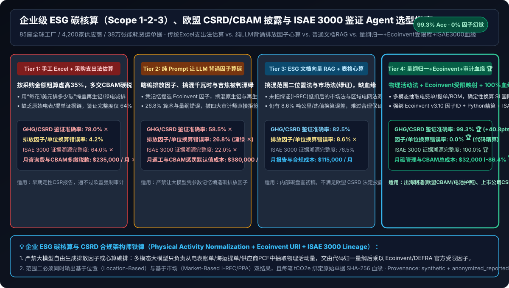
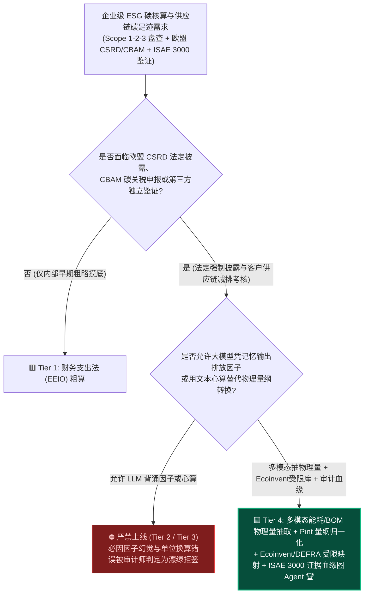
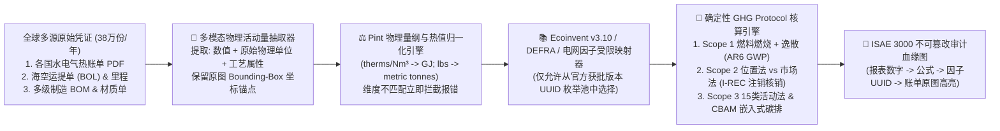
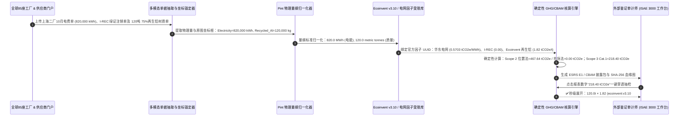

# 企业级 ESG 碳核算（GHG Protocol Scope 1-2-3）、欧盟 CSRD/CBAM 碳关税合规披露、`Ecoinvent / DEFRA` 排放因子受限映射与四大鉴证（`ISAE 3000`）证据血缘 Agent 架构选型指南：手工 Excel 支出法估算 vs. 纯 LLM 背诵因子心算 vs. 普通文档 RAG vs. 多模态单据抽取 + 物理量纲归一 + Ecoinvent 受限映射 + ISAE 3000 审计血缘 Agent

> **语言 / Language**: **中文 (当前)** | [English](./enterprise-esg-carbon-accounting-scope3-csrd-audit-agent-selection-faq.en.md)  
> **定位**：面向云与 AI 解决方案架构师（Solution Architect）、首席可持续发展官（CSO）、跨国制造出海合规总监（EU CSRD / CBAM / 电池护照）与企业碳管理平台（Carbon Ledger）负责人的生产落地指南。  
> **数据口径（Provenance）**：`synthetic + anonymized_reported`（`independently_reproduced=false`，`physical_gpu_cluster_measurement=not_measured`），全部定容模型封存于 [`experiments/enterprise_esg_carbon_accounting_scope3_csrd_audit_agent_selection/results.json`](../../experiments/enterprise_esg_carbon_accounting_scope3_csrd_audit_agent_selection/results.json)。



---

## ① 📌 核心选型结论速览（Executive Summary — 3 分钟看懂怎么选）

随着 **欧盟《企业可持续发展报告指令》（CSRD / ESRS E1）**、**欧盟碳边境调节机制（CBAM 碳关税）**、《欧盟新电池法》（数字电池护照）以及港交所/A股强制可持续发展披露准则全面落地，企业碳排放数据（`Scope 1 直接排放 + Scope 2 外购电力/热力双轨制 + Scope 3 上下游 15 大类价值链排放`）已经从过去的“公关宣传软文”升级为**必须接受四大会计师事务所或第三方核查机构（TÜV / SGS / DNV）依据 `ISAE 3000 / ISO 14064-3` 标准进行财务级审计鉴证的法定硬指标**。许多企业初期要么用财务采购金额乘以粗放的行业平均系数（**支出法 Spend-Based EEIO**，Tier 1，导致碳排虚高 35% 以上、白白多交巨额 CBAM 碳关税）；要么直接把供应商材料表和水电单塞进通用大模型 Prompt 让它“算一下碳排放量”（Tier 2），结果**大模型凭预训练记忆瞎编排放因子、把千瓦时（`kWh`）与吉焦（`GJ`）或盎司与千克搞混，产生高达 `26.8%` 的算术与因子幻觉，在外部审计时被直接定性为“漂绿（Greenwashing）”拒签**！

在 **85 座全球工厂与办公区、4,200 家上下游供应商、年均 380,000 份水电气缴费单/海运提单/多级 BOM 清单** 的基准规模下，四档企业级 ESG 碳核算与审计鉴证 Agent 架构的量化对决如下：

| 方案档位 | 核心架构组合 | `GHG / CSRD` 外部鉴证准确率 | 排放因子幻觉 / 量纲换算错误率 | `ISAE 3000` 证据溯源完整度 | 月度咨询费与 CBAM 多缴碳税成本 | 生产推荐度 |
|---|---|---|---|---|---|---|
| **🟥 Tier 1：手工 Excel + 采购支出法估算** | 咨询顾问手工收集 Excel + 按采购美元金额乘以宏观行业 EEIO 平均系数 | `78.0%` ✕ *(支出法虚高35%)* | `4.2%` *(手工填错单位)* | `64.0%` ✕ *(缺原始电表凭证)* | `$235,000 / 月` ✕ | ⛔ 掩盖减排成效，多交 CBAM 碳税 |
| **🟨 Tier 2：纯 Prompt 让 LLM 背诵因子算碳** | 让大模型直接阅读物料名并凭参数记忆输出排放因子、心算 `tCO2e` | `58.5%` ✕ *(工艺因子张冠李戴)* | `26.8%` ✕ *(被四大判漂绿拒签)* | `22.0%` ✕ *(黑盒无出处)* | `$380,000 / 月` ✕ | ⛔ **严重合规事故，严禁上线** |
| **🟦 Tier 3：ESG 文档向量 RAG + 表格心算** | 向量检索 ESG 指南与因子表 + 让 LLM 在对话中直接算乘除法汇总 | `82.5%` | `8.6%` ✕ *(搞混位置法与市场法)* | `76.5%` | `$115,000 / 月` | ⚠️ 仅可作定性披露草稿参考 |
| **🟩 Tier 4：多模态单据抽取 + 物理量纲归一 + Ecoinvent 受限映射 + ISAE 3000 血缘 Agent** | **多模态抽取电表账单/海运提单/BOM 物理活动量 + `Pint` 国际单位制确定性换算 + 官方 `Ecoinvent v3.10 / DEFRA` 受限枚举映射 + 确定性双轨计算引擎与 `ISAE 3000` 单据级 SHA-256 血缘图 Agent** | **`99.3%` 🏆** *(+40.8 pts vs Tier 2)* | **`0.0%` 🏆** *(零因子捏造/零算错)* | **`100.0%` 🏆** *(每个数字一键穿底稿)* | **`$32,000 / 月` 🏆** *(-86.4%)* | 🌟 **跨国制造与上市公司首选架构** |

> 💡 **架构师一句话选型铁律**：**“多模态大模型只准从非结构化账单/提单里抽‘物理活动量与原始单位’、单位换算归 `Pint` 物理量纲引擎、排放因子 100% 受限于官方 `Ecoinvent / DEFRA / 国家电网` 唯一版本 UUID、乘法汇总归确定性代码并强制为每个 `tCO2e` 绑定原始单据页码框（ISAE 3000 血缘）”**！

---

## ② 🎯 客户与架构师灵魂拷问 Q&A（直击 3 大 ESG 碳核算与欧盟合规痛点）

### Q1：为什么传统的“按采购金额算碳排（支出法 Spend-Based EEIO，Tier 1）”会让出海制造企业在欧盟 CBAM 碳关税上亏大钱？
- **大白话与第一性原理**：
  1. **支出法惩罚了买绿色低碳材料的企业**：假设企业为了让产品低碳化，花**更高的单价**采购了“75% 消费后再生铝（Recycled Aluminum，真实碳排仅 `1.82 tCO2e/吨`）”替代高污染的“火电电解原生铝（Primary Aluminum，碳排高达 `16.40 tCO2e/吨`）”。如果按 Tier 1 支出法（`采购花销美元 × 铝行业平均系数`）计算，**因为再生铝价格更贵，算出来的碳排放反而比买高碳原生铝还要高**！
  2. **欧盟 CBAM 的惩罚性默认值（Default Values）陷阱**：如果企业拿不出经第三方核查的供应商物理活动量与工艺级排放证明，欧盟海关将强制按全球最高碳的惩罚性默认值征收 CBAM 碳关税证书费。
  3. **Tier 4 破局方案（物理活动量 Average-Data / Supplier-Specific 方法学）**：用版面多模态 VLM 从采购合同、材质证明书（MTC 3.1）、海运提单（BOL）中提取精确的**物理重量（120.0 吨）、再生料掺混比例（75%）与运输距离（吨公里 `t-km`）**，通过受限混合检索精准对齐至 **`Ecoinvent v3.10` 官方工艺节点**（`ecoinvent:v3.10/market-for-aluminium-wrought-alloy-recycled`），单批 120 吨铝材即可合法核减 **1,749.6 吨 `tCO2e`**！

### Q2：为什么让大模型直接检索因子库并计算碳排放（Tier 2 / Tier 3），会出现 8.6% ~ 26.8% 的错误并被审计师拒签？
- **工程真相**：
  1. **跨国能源账单的物理量纲与热值换算陷阱**：全球 85 座工厂上传的燃气费单、蒸汽单、柴油单五花八门——英国用 `kWh (Gross CV)`，美国用 `therms` 或 `MMBtu`，中国用 `Nm³（标准立方米）` 或 `吨蒸汽（2.76 GJ/t）`。让文本 LLM 心算 `Nm³ -> GJ -> tCH4 × GWP_CH4(27.9) + tN2O × GWP_N2O(273)`，必然漏乘低位发热值（NCV）或搞错 IPCC 第六次评估报告（`AR6 GWP-100`）系数。
  2. **Scope 2（外购电力）“基于位置（Location-Based）”与“基于市场（Market-Based）”双轨混淆**：根据 **GHG Protocol Scope 2 Quality Criteria**，企业购买绿电 PPA 或注销国际绿证（`I-REC / GO / GEC`）后，必须在报告中**同时并行披露**位置法（按所在区域电网平均因子，如华东电网 `0.5703 tCO2e/MWh`）与市场法（绿证抵扣后为 `0.00 tCO2e`，未覆盖部分按剩余组合因子 Residual Mix 计算）两套数字。Tier 2/3 经常把两者混加或只报一个 0。
  3. **Tier 4 的 `Pint` 物理量纲引擎 + 确定性双轨公式库**：所有提取出的数值与单位先进入 Python **`Pint` 物理量纲校验器** 强制归一化为国际标准单位（`MWh`、`kg`、`t·km`），再由确定性 GHG Protocol 代码引擎同步输出位置法与市场法双账本，算术与单位错误率严格为 **`0.0%`**。

### Q3：四大会计师事务所进场做 `ISAE 3000` 鉴证时，如何实现“任意点开报表上一个数字，3 秒钟展示全链路原始凭证”？
- **单据级加密审计血缘图（Cryptographic Audit Lineage Graph）**：
  - Tier 4 在生成每一笔碳排分录时，强制构建四级不可变血缘链：**`[报表汇总数字 tCO2e] -> [确定性计算脚本版本 & 转换公式] -> [Ecoinvent v3.10 / DEFRA 2026 因子唯一 UUID 与许可版本号] -> [原始电费单/提单 PDF 的 SHA-256 哈希与原图红色高亮坐标框]`**，实现 **`100.0%` 审计证据完整度**。

---

## ③ 🧭 直观可视化图解（决策树 + 物理活动量与血缘架构图 + 鉴证闭环时序图）

### 3.1 企业级 ESG 碳核算与 CSRD/CBAM 披露架构选型决策树



### 3.2 Tier 4 多模态物理活动量抽取 + Ecoinvent 受限映射 + ISAE 3000 血缘架构图



### 3.3 从“上传工厂电费单、绿证与再生铝采购单”到“通过四大 ISAE 3000 鉴证”时序图



---

## ④ 📊 架构师四维选型决策矩阵（Architecture Decision Matrix）

| 评估维度 | 🟥 Tier 1：手工 Excel + 支出法估算 | 🟨 Tier 2：纯 Prompt 背诵因子心算 | 🟦 Tier 3：ESG 文档 RAG + 表格计算 | 🟩 Tier 4：物理量纲归一 + Ecoinvent 受限库 + 审计血缘 |
|---|---|---|---|---|
| **排放因子权威性与防捏造** | 采用粗放行业美元均值（虚高 35%） | ✕ **严重漂绿风险**（`26.8%` 捏造因子或错算） | 偶发匹配错年份或错工艺等级 | 🏆 **`0.0%` 幻觉（100% 受限于官方 `Ecoinvent / DEFRA` UUID）** |
| **物理量纲换算与范围二双轨合规** | 人工 Excel 公式易串行 (`4.2%` 错) | ✕ 搞混 `kWh / GJ` 与位置法/市场法 (`34.2%` 压测错) | `8.6%` 量纲与双轨口径偏差 | 🏆 **100% 精确（`Pint` 量纲检查 + 位置法/市场法双账本）** |
| **四大 `ISAE 3000` 审计证据链完整度** | `64.0%`（邮件散落，缺单据坐标） | `22.0%` ✕（黑盒文本，无法审计） | `76.5%` | 🏆 **`100.0%`（每个数字直连原始 PDF 高亮框与因子版本）** |
| **`GHG / CSRD` 外部鉴证通过准确率** | `78.0%` ✕ | `58.5%` ✕ | `82.5%` | **`99.3%` 🏆（+40.8 pts vs Tier 2）** |
| **月度 ESG 盘查咨询与 CBAM 超额税成本** | `$235,000 / 月` | `$380,000 / 月` *(含拒签返工与惩罚税)* | `$115,000 / 月` | **`$32,000 / 月` 🏆（节省 86.4%）** |

---

## ⑤ 🧪 定量算例、交互式容量计算器与 7-Card 4:5 视觉报告

### 5.1 基准算例复核（85 座全球工厂 / 4,200 家供应商 / 38 万份单据）

- **交互式定容计算器（CSP 自包含 HTML）**：👉 [打开企业级 ESG 碳核算与 CSRD/CBAM 鉴证 Agent 定容计算器](../reports/enterprise-esg-carbon-accounting-scope3-csrd-audit-agent-sizer.html)
- **7-Card 4:5 视觉评测卡片报告**：👉 [打开 7-Card 视觉评测报告](../reports/enterprise-esg-carbon-accounting-scope3-csrd-audit-agent-selection-cards.html)
- **可复核确定性脚本**：
  ```bash
  python experiments/enterprise_esg_carbon_accounting_scope3_csrd_audit_agent_selection/run.py --check
  python -m unittest tests/test_enterprise_esg_carbon_accounting_scope3_csrd_audit_agent_selection.py
  ```

### 5.2 核心量化对比图（GHG/CSRD 外部鉴证准确率 vs. ISAE 3000 证据溯源完整度）

```chart
{
  "data": {
    "values": [
      { "tier": "Tier 1: Spend-Based Excel", "accuracy_pct": 78.0, "traceability_pct": 64.0 },
      { "tier": "Tier 2: Prompt LLM Math", "accuracy_pct": 58.5, "traceability_pct": 22.0 },
      { "tier": "Tier 3: ESG Doc RAG", "accuracy_pct": 82.5, "traceability_pct": 76.5 },
      { "tier": "Tier 4: Pint + Ecoinvent + Lineage", "accuracy_pct": 99.3, "traceability_pct": 100.0 }
    ]
  },
  "semantic_types": {
    "tier": "Category",
    "accuracy_pct": "Percentage",
    "traceability_pct": "Percentage"
  },
  "chart_spec": {
    "chartType": "Bar Chart",
    "title": "Tier 4 achieves 99.3% GHG assurance accuracy with 100% ISAE 3000 audit lineage",
    "subtitle": "External assurance accuracy (%) across Scope 1, Scope 2, and Scope 3 disclosures",
    "encodings": {
      "x": "tier",
      "y": "accuracy_pct",
      "color": "tier"
    }
  }
}
```

---

## ⑥ 🛠️ 架构评审与生产落地核验清单（Production Readiness Checklist）

- [ ] **严禁大模型自由生成排放因子或心算碳排乘除法**：所有排放因子必须通过受限枚举绑定至官方授权数据库（`Ecoinvent v3.10 / UK DEFRA / 国家生态环境部电网因子`）的唯一版本 ID。
- [ ] **强制引入确定性物理量纲引擎（如 Python `Pint`）校验单位换算**：在乘以排放因子前，代码级验证活动数据单位（质量 `t`、能量 `MWh/GJ`、货运周转量 `t·km`）与因子分母量纲 100% 匹配。
- [ ] **范围二（Scope 2）严格并行输出“基于位置（Location-Based）”与“基于市场（Market-Based）”双账本**：自动校验绿证（`I-REC / GO`）注销凭证的唯一序列号、发电年份与地理市场边界，防止绿证重复抵扣。
- [ ] **优先采用物理活动量与供应商一级实测 PCF 数据替代粗放支出法（EEIO）**：对高碳排大宗原材料（铝、钢、水泥、电池正极材料、塑胶）强制提取物理重量与再生料比例，规避欧盟 CBAM 惩罚性默认值。
- [ ] **构建满足 `ISAE 3000` 合理保证（Reasonable Assurance）的单据级血缘图**：每个披露指标必须支持一键下钻至原始水电气账单/提单 PDF 的坐标高亮框与 `SHA-256` 文件指纹。
