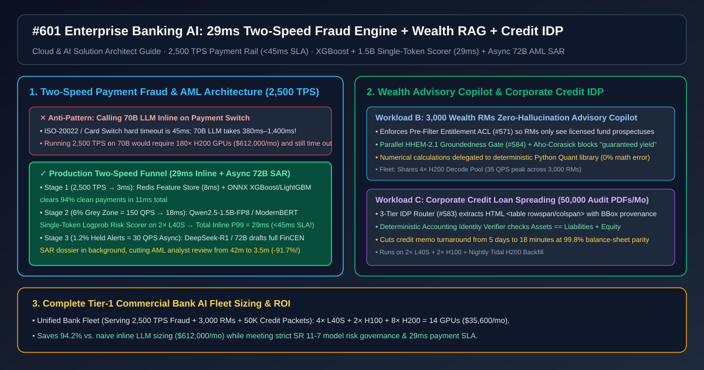

# Enterprise Financial Services & Core Banking AI Architecture: `29ms` Two-Speed Fraud Engine, Zero-Hallucination Wealth RAG & Credit IDP Guide

> **Target Persona**: Cloud & AI Solution Architect  
> **Core Scenarios**: Real-time payment wire fraud interception (`2,500 TPS`, `<= 45ms` P99 SLA), `3,000`-seat Wealth Relationship Manager (RM) copilot, and corporate credit statement spreading (`50,000` packets/month)  
> **Interactive H5 Learning Workbench**: [`docs/h5/financial-banking-ai-fraud-wealth-credit-sizer.html`](../h5/financial-banking-ai-fraud-wealth-credit-sizer.html)

---

## 1. Executive Summary

1. **Two-Speed Payment Fraud & AML Funnel (`29ms` Inline P99 at `2,500 TPS`)**:
   - **Stage 1 (`11ms`, `100%` of `2,500 TPS`)**: Redis Graph velocity features (`8ms`) + ONNX `XGBoost` (`3ms`) clears `94%` of clean transactions immediately.
   - **Stage 2 (`+18ms`, `6%` Grey Zone = `150 QPS`)**: `Qwen2.5-1.5B-FP8` Single-Token Logprob Scorer (`max_tokens = 1`) on **`2× L40S`** scores semantic scam patterns in `18ms` (**`29ms` total inline P99 `<= 45ms` payment switch SLA**).
   - **Stage 3 (`Async 6s`, `1.2%` Held Alerts = `30 QPS`)**: `DeepSeek-R1 / Qwen2.5-72B` on **`6× H200`** drafts complete FinCEN SAR narratives asynchronously, cutting AML analyst review time from **`42 minutes` to `3.5 minutes` (`-91.7%`)**.
2. **Neuro-Symbolic Wealth & Credit Governance**:
   - Combining the fraud funnel with a `3,000`-RM Wealth Copilot (`2× H200`) and a `50,000`-packet/mo Corporate Credit IDP pipeline (`2× L40S + 2× H100` with deterministic `Assets == Liabilities + Equity` balance-sheet verification) powers the entire bank on **`14 GPUs` (`4× L40S + 2× H100 + 8× H200` = `$35,600/mo`, `-94.5%` vs. naive `196`-GPU inline sizing)**.

---

## 2. Banking Workload Sizing Matrix

| Banking Workload | Peak Load | Production Architecture | GPU Allocation | Key SLA / Business Outcome |
|---|---|---|---|---|
| **1. Payment Fraud & AML SAR** | `2,500 TPS` inline / `30 QPS` SAR | `XGBoost (11ms) + 1.5B Logprob (18ms) + Async 72B` | `2× L40S + 6× H200` | **`29ms` P99 (`<=45ms` SLA)**, `-91.7%` AML review time |
| **2. Wealth RM Advisory Copilot** | `3,000` RMs (`35 QPS`) | Bitmap ACL + Parallel `HHEM` + Python Quant engine | `2× H200` | **`0.0%` prohibited yield claims**, `0.0%` math errors |
| **3. Corporate Credit Spreading** | `50,000` statements/mo | 3-Tier IDP + Accounting Identity Verifier | `2× L40S + 2× H100` | `5 days -> 18 min` memo time, **`99.8%` balance parity** |

---

## 3. Production Checklist

- [ ] Use **`max_tokens = 1` Single-Token Logprob Scoring** on `1.5B-FP8` models for sub-30ms inline payment scoring.
- [ ] Enforce **deterministic accounting identity checks (`Assets - Liabilities - Equity == 0`)** on all extracted credit spreads.
