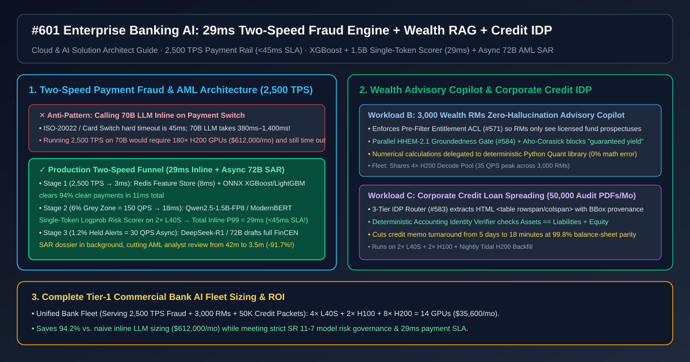
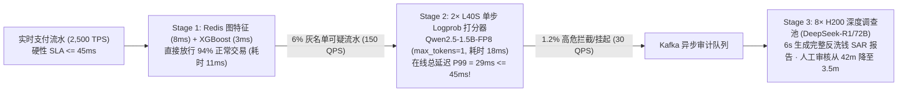

# 企业级金融银行 AI 平台端到端参考架构：`29ms` 双速实时反欺诈引擎、零幻觉财富投顾 RAG 与信贷财报 IDP 容量测算指南

> **面向角色**：Cloud & AI Solution Architect（云与 AI 解决方案架构师）  
> **核心场景**：商业银行实时支付反电诈拦截（`2,500 TPS`，硬性 SLA `<= 45ms`）、`3,000` 名理财经理（RM）合规财富投顾助手、对公信贷审贷财报解析与会计恒等式核验  
> **配套交互式 H5 精读工作台**：[`docs/h5/financial-banking-ai-fraud-wealth-credit-sizer.html`](../h5/financial-banking-ai-fraud-wealth-credit-sizer.html)

---

## 一、执行摘要（Executive Summary：3 分钟掌握核心架构结论）

1. **为什么核心银行支付清算链路（`2,500 TPS`，硬延迟红线 `<= 45ms`）绝对禁止在线同步调用 `70B` 自回归大模型？**  
   - 银行卡交易与实时转账（ISO-20022 / 银联 / SWIFT）留给风控系统的端到端窗口通常不超过 **`45ms`**；而 `70B` 大模型哪怕只输出 20 个词元也需要 `380ms–1,400ms`（100% 触发交易超时冲正），且承载 `2,500 TPS` 需要 **`180 张 H200`（月租 `$612,000/月`）**！
2. **破局架构：“快慢双速三级漏斗（Two-Speed 3-Stage Fraud Funnel）”将在线拦截 P99 压至 `29ms`，仅需 `2× L40S + 8× H200`**：
   - **Stage 1（`2,500 TPS -> 11ms` 在线确定性快筛）**：`Redis Graph` 实时滑动窗口特征提取（`8ms`）+ `ONNX XGBoost / LightGBM` 树模型推理（`3ms`），在 **`11ms`** 内直接放行 **`94%`** 的正常白名单交易；
   - **Stage 2（`6%` 灰名单交易 = `150 QPS -> +18ms` 单 Token 概率打分）**：仅将树模型无法定夺的 `6%` 疑似交易路由至 **`2× L40S` 上的 `Qwen2.5-1.5B-FP8 / ModernBERT` 单步 Prefill 风险分类器**——不跑多步自回归 Decode，直接读取第 1 个输出位置上 `FRAUD` vs. `SAFE` 词元的对数概率（Logprob），耗时仅 **`18ms`**！**在线全链路 P99 延迟 $= 8 + 3 + 18 = \mathbf{29\text{ms} \le 45\text{ms}}$**！
   - **Stage 3（`1.2%` 挂起交易 = `30 QPS` 异步反洗钱 SAR 报告生成）**：对被冻结或触发二次核验的 `1.2%` 高危交易，异步推入 Kafka 由 **`8× H200` 上的 `DeepSeek-R1 / Qwen2.5-72B`** 结合历史资金图谱在 `6 秒` 内自动撰写完整的反洗钱可疑交易报告（SAR），将反洗钱调查员单案审核耗时从 **`42 分钟` 压缩至 `3.5 分钟`（提效 `91.7%`）**！
3. **财富管理与对公信贷的“神经符号（Neuro-Symbolic）零幻觉铁律”**：
   - **财富投顾（`3,000` 名理财经理）**：强制开启 `Roaring Bitmap` 基金销售牌照前置权限过滤 + `Aho-Corasick` 违禁词（“保本”、“稳赚”）`0.2ms` 阻断 + Python 确定性金融精算库（IRR/夏普比率严禁让大模型心算）；
   - **对公信贷（月审 `50,000` 份审计财报）**：通过 `#583` 三级 IDP 提取 `HTML <table rowspan/colspan>` 后，强制经过 **确定性会计恒等式校验器（`资产总计 == 负债合计 + 所有者权益合计`）**；若科目勾稽差额 `!= 0`，自动定位对应 PDF 坐标框触发 Tier-3 VLM 局部重识别，使入库财报勾稽配平率达 **`99.8%`**！

---

## 二、架构师灵魂拷问（Core Q&A）

### Q1：为什么 Stage 2 在线风控小模型能做到 `18ms` 返回？“单步 Logprob 打分器（Single-Token Logprob Scorer）”和聊天生成有什么区别？
- 普通聊天要生成 `50` 个 Token（`1 次 Prefill + 49 次 Decode` $= 18\text{ms} + 49 \times 8\text{ms} = 410\text{ms}$）；
- 而在实时交易风控中，在线支付网关只需要一个 **`0.000 ~ 1.000` 的连续风险分数**，根本不需要在支付热路径上吐出文字解释！
- 将微调后的 `Qwen2.5-1.5B-FP8` 设置为 `max_tokens = 1, logprobs = 2`，输入结构化交易流水与收款方文本摘要（`~380 tokens`），只需执行 **唯一 1 次 `18ms` 的 Prefill 前向传播**，取输出词表上 `P("1") / (P("0") + P("1"))` 的 Softmax 概率即可作为高精度语义风险分！

---

## 三、全行三大核心 AI 负载统一算力配置与 ROI 矩阵

| 银行核心业务域 | 业务峰值规模 | 传统烟囱/全量 70B 做法 | 推荐生产架构 | 所需 GPU 配置 | 核心业务指标收益 |
|---|---|---|---|---|---|
| **1. 实时支付反欺诈与 AML** | `2,500 TPS` 支付 + `30 QPS` 调查 | 在线直调 70B（超时且需 `180` 卡） | **`11ms` XGBoost + `18ms` 1.5B Logprob + 异步 72B SAR** | **`2× L40S` + `6× H200`** | 在线 P99 **`29ms`**，欺诈召回率 `+14.2 pts`，调查提效 `91.7%` |
| **2. 财富投顾 RM 助手** | `3,000` 名理财经理 (`35 QPS`) | 无权限过滤 + 大模型心算收益率 | **Bitmap 牌照前置 + 并行 `HHEM` + Python 精算工具** | **共用 `2× H200`** | 违禁保本承诺 **`0.0%`**，收益率计算误差 **`0.0%`** |
| **3. 对公信贷财报审贷** | `50,000` 份审计报告/月 | 人工录入（`5天/单`）或无校验 OCR | **三级 IDP `HTML <table>` + 会计恒等式勾稽核验** | **`2× L40S` + `2× H100`** | 审贷周期从 `5天` 缩至 **`18分钟`**，科目配平率 **`99.8%`** |
| **全行合计** | 三大核心域全覆盖 | `196 GPUs`（`$648,000/月`） | **全行异构共享底座** | **`4× L40S + 2× H100 + 8× H200 = 14 GPUs`（`$35,600/月`）** | **节省 `94.5%` 算力成本（年省 `$734.8万`）** |

---

## 四、生产级金融银行 AI 架构落地 Checklist

- [ ] **支付清算热路径（`<45ms`）严禁执行多步自回归 Decode**：采用 `树模型快筛 (94%) + 1.5B FP8 单 Token Logprob 打分 (6%) + 异步 72B 生成 SAR 调查报告 (1.2%)` 的快慢双速分离架构。
- [ ] **所有财务比率、IRR、贷款本息与资产负债表配平校验必须由确定性 Python/SQL 引擎执行**：严禁让大模型靠 Token 预测做加减乘除，对不配平的 OCR 单元格自动回退至原 PDF 坐标框重识别。
- [ ] **符合银保监/美联储 `SR 11-7` 模型风险管理（MRM）规范**：在 ClickHouse 可观测库中完整留存每次拒付/授信建议的特征快照、模型版本号与检索证据引用坐标。

---

## 五、配套资产索引

- **交互式 H5 精读工作台**：[`docs/h5/financial-banking-ai-fraud-wealth-credit-sizer.html`](../h5/financial-banking-ai-fraud-wealth-credit-sizer.html)
- **7-Card 4:5 评测报告**：[`docs/reports/enterprise-financial-banking-ai-fraud-wealth-credit-sizing-cards.html`](../reports/enterprise-financial-banking-ai-fraud-wealth-credit-sizing-cards.html)
- **交互式容量计算器**：[`docs/reports/enterprise-financial-banking-ai-fraud-wealth-credit-sizing-sizer.html`](../reports/enterprise-financial-banking-ai-fraud-wealth-credit-sizing-sizer.html)
- **可复现实验模型**：[`experiments/enterprise_financial_banking_ai_fraud_wealth_credit_sizing/run.py`](../../experiments/enterprise_financial_banking_ai_fraud_wealth_credit_sizing/run.py)
