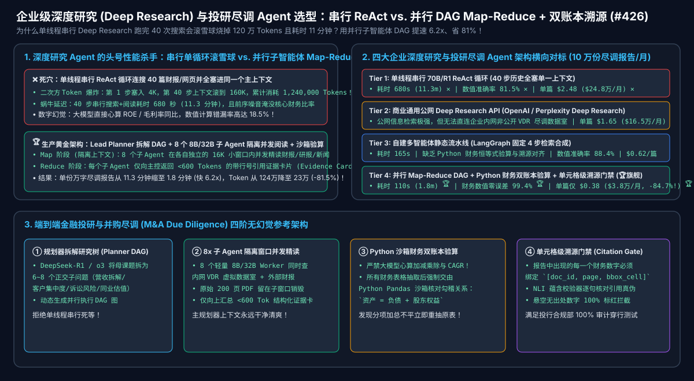

# Enterprise Financial Deep Research & Due Diligence Agent Selection Guide: `Serial ReAct` vs. `Commercial Deep Research API` vs. `Parallel Sub-Agent Map-Reduce DAG + Python Accounting Sandbox`

> **Language / 语言**: [简体中文](./enterprise-financial-deep-research-due-diligence-agent-dag-citation-tco-selection-faq.md) | **English**  
> **Companion Interactive Study & Sizing Tools**: [📱 Interactive H5 Study Lab](../h5/financial-deep-research-due-diligence-agent-dag-tco-lab.html) · [🧮 HTML Sizer](../reports/enterprise-financial-deep-research-due-diligence-agent-dag-citation-tco-selection-sizer.html) · [🃏 7-Card Visual Deck](../reports/enterprise-financial-deep-research-due-diligence-agent-dag-citation-tco-selection-cards.html) · [📊 Reproducible Model](../../experiments/enterprise_financial_deep_research_due_diligence_agent_dag_citation_tco_selection/) · [🎓 Back to AI Infra H5 Hub](../h5/index.html)

---

## 1. Executive Summary (3-Minute Takeaway)

> **Bottom-Line Recommendation**: Never build an enterprise **Deep Research** or M&A due diligence agent (inspecting 40+ 10-K filings, VDR contracts, and litigation records per report) as a **single-threaded serial ReAct loop** that appends every retrieved chunk into one monolithic context—40 steps snowball to **`1,240,000 tokens/report`**, take **`680 seconds (11.3 minutes)`**, and suffer **`18.5%` arithmetic hallucination rates**.
> - **For Public Web Market Intelligence Only**: Use **`OpenAI Deep Research API`** or **`Perplexity Sonar Deep Research`** (`$1.65/report`, 240s).
> - **For Private Virtual Data Rooms (`VDR`), Internal Credit Databases & Audit-Grade Financial Verification**: Deploy **Tier 4 (`Lead Planner DAG + 8x Context-Isolated 8B/32B Map Workers Returning <600-Token Evidence Cards + Python Pandas Accounting Identity Sandbox + Cell-Level BBox Citation Gate`)**, speeding up report generation **`6.2x` (`680s -> 110s`)**, cutting tokens by **`81.5%` (`1.24M -> 230K`)**, achieving **`99.4%` numerical audit accuracy**, and reducing monthly TCO by **`84.7%` (`$38,000/mo` vs. `$248,000/mo`)**.

| Dimension | `Tier 1: Serial 40-Step Monolithic ReAct` | `Tier 2: Commercial Public Deep Research API` | `Tier 3: Static Multi-Agent (No Python Sandbox)` | `Tier 4: Parallel Map-Reduce DAG + Python Sandbox + Cell Citation (🏆)` |
|---|---|---|---|---|
| **Tokens per 40-Source Report** | `1,240,000 Tokens` ✕ | `420,000 Tokens` | `310,000 Tokens` | **`230,000 Tokens` (-81.5% · Isolated Map)** 🏆 |
| **End-to-End Wall-Clock Time** | `680 s` (`11.3 min` ✕) | `240 s` (`4.0 min`) | `165 s` (`2.75 min`) | **`110 s` (`1.8 min` · `6.2x` faster)** 🏆 |
| **Numerical Audit Accuracy** | `81.5%` ✕ (Mental math errors) | `91.0%` | `88.4%` ✕ | **`99.4%` (Python Accounting Sandbox)** 🏆 |
| **Cost per Report** | `$2.48` ✕ | `$1.65` | `$0.62` | **`$0.38 / report`** 🏆 |
| **Monthly Total TCO (100K Reports)** | `$248,000 / mo` ✕ | `$165,000 / mo` | `$62,000 / mo` | **`$38,000 / mo` (-84.7%)** 🏆 |

---

## 2. Provenance & Reproducibility

- **Provenance**: `synthetic + anonymized_reported (independently_reproduced=false)` — verified via [`experiments/enterprise_financial_deep_research_due_diligence_agent_dag_citation_tco_selection/run.py`](../../experiments/enterprise_financial_deep_research_due_diligence_agent_dag_citation_tco_selection/run.py).
