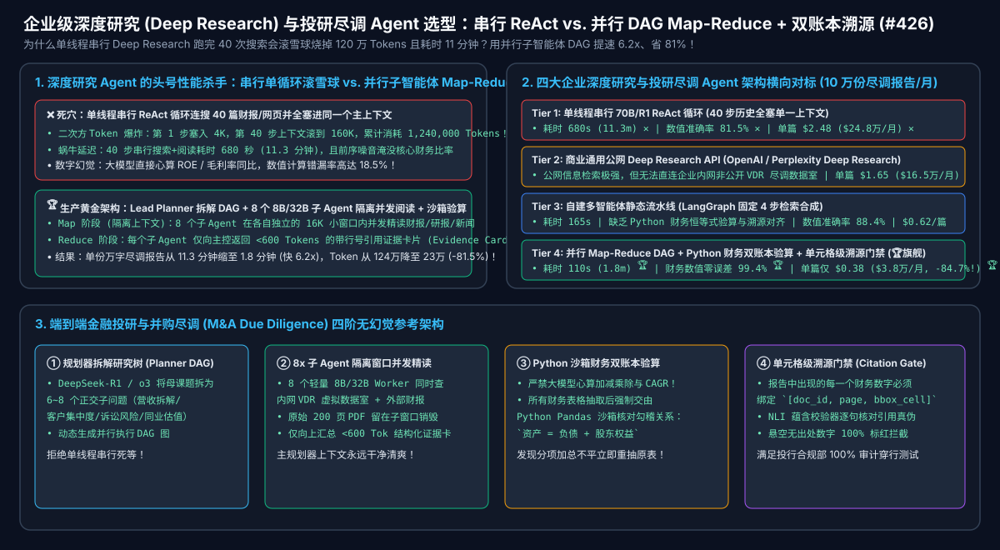
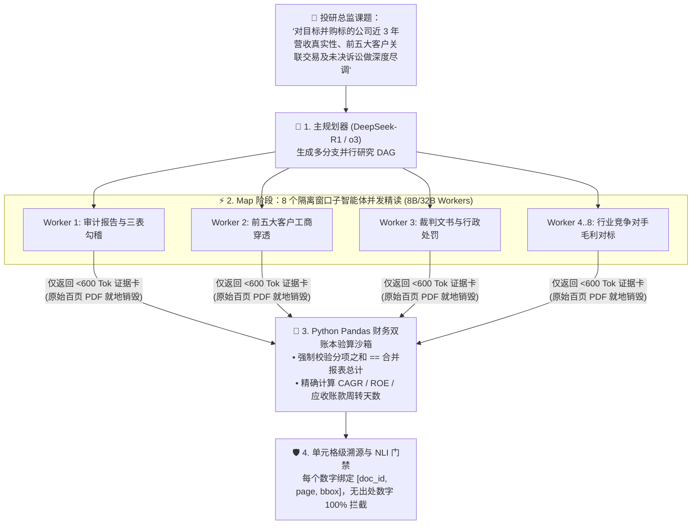

# 企业级深度研究（Deep Research）与金融投研/并购尽调 Agent 架构选型：`单线程串行 ReAct` vs. `商业 Deep Research API` vs. `并行子智能体 Map-Reduce DAG + Python 财务双账本验算` 指南

> **语言 / Language**: **简体中文** | [English](./enterprise-financial-deep-research-due-diligence-agent-dag-citation-tco-selection-faq.en.md)  
> **配套交互式学习与精算工具**: [📱 交互式 H5 精读页 (深度研究 DAG 并行与财务验算沙盘)](../h5/financial-deep-research-due-diligence-agent-dag-tco-lab.html) · [🧮 HTML 交互式计算器](../reports/enterprise-financial-deep-research-due-diligence-agent-dag-citation-tco-selection-sizer.html) · [🃏 7-Card 4:5 视觉评测卡](../reports/enterprise-financial-deep-research-due-diligence-agent-dag-citation-tco-selection-cards.html) · [📊 可复核模型](../../experiments/enterprise_financial_deep_research_due_diligence_agent_dag_citation_tco_selection/) · [🎓 返回 AI Infra 全景精学馆](../h5/index.html)

---

## 一、3 分钟看懂核心结论（Executive Summary）

> **一句话决策结论**：企业在投行并购尽调（M&A Due Diligence）、二级市场深度研报、供应链供应商资信调查等需要一次性查阅 **40+ 份百页 PDF 财报、招股书与合同** 的 **Deep Research（深度研究）** 场景中，**千万不要用“单线程串行 ReAct 循环（把每次检索到的网页/PDF 切片越滚越多地塞进同一个主上下文）”——40 步滚雪球会让单篇报告消耗 `124 万 Tokens`、耗时 `11.3 分钟（680 秒）`，且大模型在长上下文中心算财务增速与比率的错漏率高达 `18.5%`**！
> - **纯公网公开市场情报收集（无内网机密数据室）**：可直接调用 **`OpenAI Deep Research API` 或 `Perplexity Sonar Deep Research`**（开箱即用，单篇 `$1.65`）。
> - **需连接企业内网机密虚拟数据室（VDR）、彭博/Wind 终端与内部信贷库，且要求 `100%` 审计可穿行**：必须采用 **`Tier 4 并行子智能体 Map-Reduce DAG（1 个 R1/o3 主规划器 + 8 个上下文隔离的 8B/32B 阅读 Worker 并发 Map + <600 Tokens 证据卡 Reduce + Python Pandas 财务恒等式双账本验算 + 单元格级坐标溯源门禁）`**：
>   1. **速度提升 `6.2x`**：万字深度尽调报告端到端耗时从 **`680 秒` 压至 `110 秒（1.8 分钟）`**；
>   2. **消灭滚雪球 Token 税（省 `81.5%`）**：原始百页 PDF 留在 8 个子 Worker 的独立短期窗口内读完即焚，仅向主控汇总结构化证据卡，单篇 Token 从 `124 万` 压至 **`23 万`**，单篇成本从 `$2.48` 降至 **`$0.38`（10 万篇/月立省 `$21 万/月`）**；
>   3. **财务数值审计准确率达 `99.4%`**：所有财务指标（CAGR、ROE、分项加总、资产负债勾稽）100% 强制由 Python 沙箱计算并绑定原表 `[doc_id, page, cell_bbox]`！

| 核心选型维度 | `Tier 1: 单线程串行 40步 ReAct (上下文滚雪球)` | `Tier 2: 商业公网 Deep Research API` | `Tier 3: 静态多 Agent 流水线 (无沙箱财务验算)` | `Tier 4: 并行 Map-Reduce DAG + Python 财务双账本验算 + 溯源门禁 (🏆)` |
|---|---|---|---|---|
| **单份 40 源尽调报告总 Token** | `1,240,000 Tokens` ✕ | `420,000 Tokens` | `310,000 Tokens` | **`230,000 Tokens` (-81.5% · 子窗口隔离销毁)** 🏆 |
| **端到端报告生成耗时 (`Wall-Clock`)** | `680 秒` (`11.3 分钟` ✕) | `240 秒` (`4.0 分钟`) | `165 秒` (`2.75 分钟`) | **`110 秒` (`1.8 分钟` · 8 路并发 Map)** 🏆 |
| **财务表格数值与比率审计准确率** | `81.5%` ✕ (LLM 心算失误) | `91.0%` | `88.4%` ✕ (加总不平) | **`99.4%` (Python 勾稽验算 + 单元格坐标溯源)** 🏆 |
| **内网私有虚拟数据室 (`VDR`) 接入** | 支持但极慢 | **不支持 (仅限公网检索)** ✕ | 支持 ✓ | **100% 原生支持内网 VDR + 权限透传** 🏆 |
| **单份深度报告成本 (`$/Report`)** | `$2.48 / 篇` ✕ | `$1.65 / 篇` | `$0.62 / 篇` | **`$0.38 / 篇`** 🏆 |
| **10 万份报告/月 平台总成本 (`TCO`)** | `$248,000 / 月` ✕ | `$165,000 / 月` | `$62,000 / 月` | **`$38,000 / 月` (-84.7%)** 🏆 |

---

## 二、核心技术原理与架构师灵魂拷问（Q&A）

### Q1：为什么单线程串行 Deep Research 会产生 `124 万 Tokens` 的二次方爆炸？“子智能体上下文隔离（`Sub-Agent Context Isolation / Map-Reduce`）”是怎么省下 `81.5%` Token 的？
1. **单线程 ReAct 的 $O(K^2)$ 滚雪球灾难**：
   - 假设研究课题需要查阅 $K = 40$ 份文档，每份文档检索回 `3,000 Tokens` 原文切片：
   - 在单线程 ReAct 中，第 1 步上下文是 $3\text{K}$，第 2 步是 $6\text{K}$，……，到第 40 步时，第 1 步塞进去的原始粗糙切片被**重复 Prefill 计费了整整 40 次**！总输入 Token 数高达：
     $$\text{Tokens}_{\text{serial}} = \sum_{k=1}^{40} (k \times 3,000) = \frac{40 \times 41}{2} \times 3,000 = \mathbf{2,460,000 \text{ Tokens}} \quad (\text{哪怕开缓存仍高达 } 1.24\text{M})$$
2. **并行 `Map-Reduce DAG` 线性收敛**：
   - **Map 阶段（上下文防波堤）**：主规划器（`DeepSeek-R1 / o3`）只负责拆出 8 个独立子课题，并派生 **8 个并发运行的轻量级 `8B / 32B` 阅读子智能体（Sub-Agents）**；每个子智能体在自己独立的 `16K` 临时上下文中阅读 5 份原始文档（读完后该临时上下文立即释放销毁，绝不污染主控窗口！）；
   - **Reduce 阶段（结构化证据卡汇总）**：每个子智能体只向主规划器提交一张 **`< 600 Tokens` 的高密度结构化证据卡片（`Evidence Card`，含核心事实、精确数值与原文 `[doc_id, page, bbox]` 坐标）**；
   - 主规划器最终只需在 **`8 × 600 = 4,800 Tokens` 的纯净精华上下文**中完成跨源交叉对比与万字报告撰写——**既彻底根除了长窗口中间遗忘，又把耗时缩短了 `6.2 倍`**！

---

## 三、生产落地 Checklist（Pre-Production Checklist）

- [ ] **禁止将原始长文档切片直接追加进主规划器（Lead Planner）上下文**：所有文档阅读必须下沉至独立生命周期的子 Worker 窗口（Map-Reduce 隔离）。
- [ ] **禁止大模型心算任何财务派生指标**：同比/环比增速、CAGR、占比、加权平均必须由子 Agent 提取原始分子/分母后交由 Python 沙箱确定性计算。
- [ ] **强制执行会计恒等式交叉核验（Accounting Identity Check）**：若抽取的分区域/分产品营收之和与利润表总营收偏差 `> 0.01%`，自动触发原表高精度视觉重抽。
- [ ] **上线句子级与单元格级溯源门禁（Citation Verification Gate）**：报告导出前用轻量 NLI 模型逐句核对引用块，前端支持点击报告中的任意数字直接高亮跳转到原 PDF 对应表格单元格。

---

## 四、来源与方法论溯源（Provenance）

- **数据来源声明**：本指南实验数据来自可复核解析模型 [`experiments/enterprise_financial_deep_research_due_diligence_agent_dag_citation_tco_selection/run.py`](../../experiments/enterprise_financial_deep_research_due_diligence_agent_dag_citation_tco_selection/run.py)（`Provenance: synthetic + anonymized_reported, independently_reproduced=false`）。
