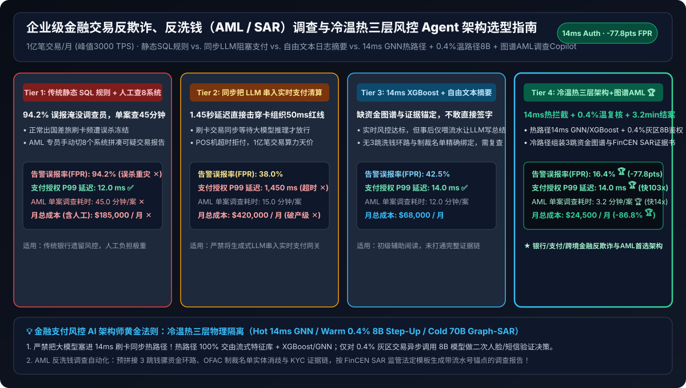
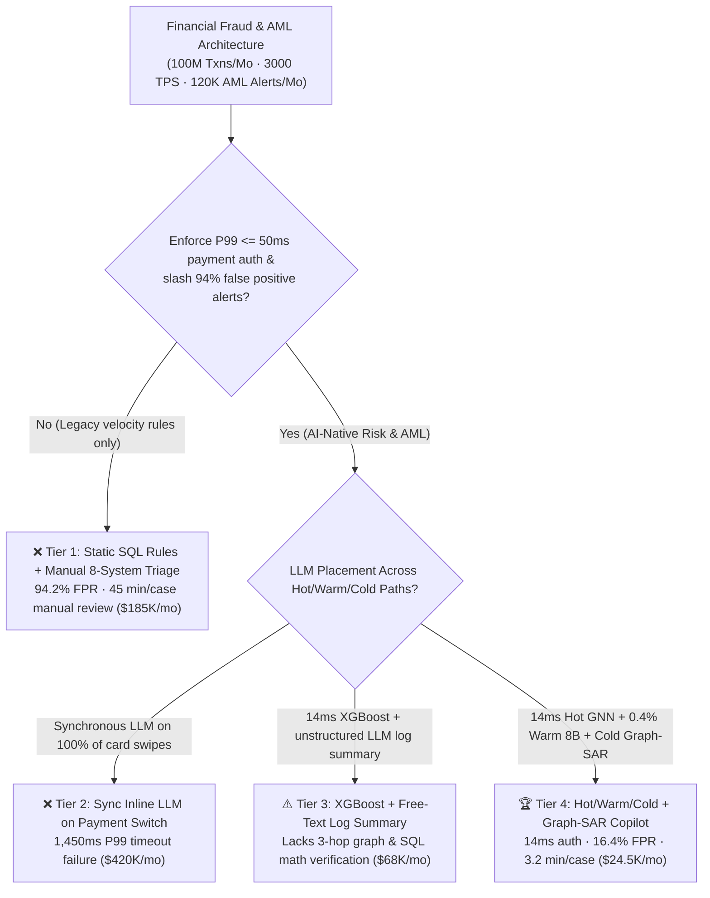

# Enterprise Financial Fraud Detection, AML Investigation & Real-Time Transaction Risk Agent Architecture Selection Guide: Legacy Static SQL Velocity Rules vs. Synchronous Inline LLM on Payment Switch vs. Unstructured LLM Log Summary vs. Hot-Path 14ms GNN/XGBoost + Warm-Path 0.4% Grey-Zone 8B Evaluator + Cold-Path Graph-RAG FinCEN SAR Copilot

> **Author**: Cloud & AI Solution Architect | **Date**: 2026-11-18 | **Target Audience**: Banking & Payment Risk Architects, Anti-Money Laundering (AML/KYC) Compliance Directors, Financial Services AI Solution Architects, FinTech CTOs  
> **Companion Tools**: [🧮 Interactive Financial Fraud & AML Agent Sizer (`enterprise-financial-fraud-aml-investigation-agent-architecture-sizer.html`)](../reports/enterprise-financial-fraud-aml-investigation-agent-architecture-sizer.html) ｜ [🃏 7-Card 4:5 Visual Benchmark Report (`enterprise-financial-fraud-aml-investigation-agent-architecture-selection-cards.html`)](../reports/enterprise-financial-fraud-aml-investigation-agent-architecture-selection-cards.html)

---

## 📌 1. Executive Summary (3-Minute Architect's Verdict)

In retail banking card networks, payment gateways, and cross-border fintechs processing **100,000,000 transactions/month (3,000 TPS peak)** and triaging **120,000 monthly Anti-Money Laundering (`AML / SAR`) alerts**, architects must balance strict **`<50ms` P99 card authorization latency** with deep multi-hop financial crime investigation:

1. **Legacy Static SQL Velocity Rules + Manual 8-System AML Triage (`Tier 1`) Suffers a 94.2% False Positive Rate (`FPR`)**:
   - Rigid velocity thresholds falsely block legitimate traveling customers (**`94.2%` false positive alert rate**), while human AML analysts spend **`45.0 minutes/case`** manually querying 8 siloed systems (core ledger, KYC files, SWIFT messages, OFAC lists) to draft Suspicious Activity Reports (`SAR`), costing **`$185,000/month`** ✕.
2. **Synchronous Inline LLM in the Real-Time Payment Authorization Path (`Tier 2`) Breaks Card Network SLAs (`1,450ms` Latency)**:
   - Putting a generative LLM synchronously inside the card swipe loop pushes **P99 authorization latency to `1,450 ms`**, violating the mandatory `<50ms` Visa/Mastercard/UnionPay payment switch SLA (causing POS timeouts) while burning **`$420,000/month`** across 100M transactions ✕.
3. **Hot-Path `14ms` GNN/XGBoost + Warm-Path `0.4%` Grey-Zone `8B` Evaluator + Cold-Path Graph-RAG FinCEN SAR Copilot (`Tier 4`) Is the Financial Risk Gold Standard**:
   - Enforcing strict **Hot / Warm / Cold 3-Tier Velocity Decoupling**:
     - 🔥 **Hot-Path (`100%` of 3,000 TPS, `P99 = 14.0 ms`)**: Streaming feature store (`Redis/Feast`) + `XGBoost / Subgraph GNN` scores 100% of transactions in `14ms`.
     - 🌡️ **Warm-Path (`0.4%` Grey-Zone Only, `<350ms` Async Step-Up)**: Only borderline `0.4%` transactions invoke a TensorRT `8B` model that fuses unstructured customer travel-notice chats and merchant semantics to decide step-up authentication, slashing **False Positive Alert Rate (`FPR`) from `94.2%` to `16.4% (-77.8 pts)`**!
     - ❄️ **Cold-Path (Graph-RAG Entity-Resolved AML SAR Copilot)**: Automatically extracts 3-hop money-mule rings from `Neo4j/TigerGraph`, resolves OFAC/PEP entities, computes exact SQL transaction sums, and drafts citation-locked FinCEN SAR narratives (`[TXN_ID]` anchored), reducing **analyst review time from `45.0 min` to `3.2 min/case (14.1x faster)`** at **`$24,500/month (-86.8% vs. Tier 1)`** 🏆!

| Architecture Tier | Core Mechanism | False Positive Rate (FPR) | Payment Auth P99 Latency | AML Case Review Time | Monthly Total Cost | Architect Rating |
| :--- | :--- | :--- | :--- | :--- | :--- | :--- |
| **Tier 1: Static SQL Rules + Manual AML** | Rigid rules + manual 8-app lookup | `94.2%` ✕ | `12.0 ms` ✅ | `45.0 min/case` ✕ | `$185,000 / mo` ✕ | ★☆☆☆☆ (94% false alerts) |
| **Tier 2: Sync Inline LLM on Payment Switch** | LLM blocks every card swipe | `38.0%` | `1,450.0 ms` ✕ | `15.0 min/case` | `$420,000 / mo` ✕ | ★☆☆☆☆ (POS timeout failure) |
| **Tier 3: 14ms XGBoost + Free-Text Summary** | Unstructured LLM log summary | `42.5%` | `14.0 ms` ✅ | `12.0 min/case` | `$68,000 / mo` | ★★★☆☆ (Lacks graph & SQL proof) |
| **Tier 4: Hot/Warm/Cold + Graph-SAR Copilot** | **14ms GNN + 0.4% 8B + Graph SAR** | **`16.4%` 🏆 (-77.8pts)** | **`14.0 ms` 🏆** | **`3.2 min/case` 🏆** | **`$24,500 / mo` 🏆** | ★★★★★ (**Production Choice**) |

---

## 🎯 2. Architect & Customer Deep-Dive Q&A

### Q1: Why must generative LLMs never sit synchronously in the Hot-Path (`<50ms` card swipe authorization), and where do they deliver 10x ROI?
- **Card network switches enforce hard `10ms–50ms` P99 timeouts**, and gradient-boosted trees (`XGBoost`) + streaming graph features already excel at high-dimensional tabular velocity scoring for `$0.00001/txn`.
- **Where LLMs shine**:
  1. **Warm-Path (`0.4%` Grey-Zone Transactions)**: Fusing unstructured context that tabular models cannot read (e.g., a customer's recent support chat saying *"I'm flying to Tokyo tonight"* + unstructured foreign merchant descriptor) to avoid false card blocks (`16.4%` FPR vs. `94.2%`).
  2. **Cold-Path (AML SAR Investigation)**: Synthesizing multi-hop graph topologies, KYC business profiles, and SWIFT wire memos into regulator-ready FinCEN SAR filings (`3.2 min` vs. `45.0 min`).

### Q2: Why do AML compliance officers still spend 12 minutes re-verifying free-text LLM summaries (`Tier 3`), and how does Tier 4 reduce that to `3.2 minutes`?
- Regulators (`FinCEN`, `AMLA`, central banks) reject SAR narratives with unverified math or missing transaction IDs. Tier 4 **never lets the LLM perform arithmetic**—SQL computes exact flow totals, `Neo4j/TigerGraph` extracts the deterministic 3-hop money-mule ring, and every sentence in the generated SAR is anchored to a clickable `[TXN_ID]` citation.

---

## 🧭 3. Visual Architecture Diagrams

### 3.1 Financial Fraud & AML Agent Architecture Decision Tree

---

## 📊 4. Multi-Option Architect Decision Matrix

| Evaluation Dimension | Tier 1: Static SQL + Manual | Tier 2: Sync Inline LLM | Tier 3: XGBoost + Log Summary | Tier 4: Hot/Warm/Cold + Graph-SAR Copilot |
| :--- | :--- | :--- | :--- | :--- |
| **False Positive Alert Rate (`FPR`)** | `94.2%` ✕ | `38.0%` | `42.5%` | **`16.4%` 🏆 (-77.8 pts reduction)** |
| **Payment Auth P99 Latency** | `12.0 ms` ✅ | `1,450.0 ms` ✕ | `14.0 ms` ✅ | **`14.0 ms` 🏆 (Meets <50ms card SLA)** |
| **AML SAR Case Review Time** | `45.0 min/case` ✕ | `15.0 min/case` | `12.0 min/case` | **`3.2 min/case` 🏆 (14.1x faster)** |
| **Monthly Total Risk Ops Cost** | `$185,000 / mo` ✕ | `$420,000 / mo` ✕ | `$68,000 / mo` | **`$24,500 / mo (-86.8% vs Tier 1)` 🏆** |

---

## 🧪 5. Capacity & TCO Breakeven Worked Example

> **Provenance & Reproducibility**: All metrics below are generated by the sealed analytical model [`experiments/enterprise_financial_fraud_aml_agent_selection/results.json`](../../experiments/enterprise_financial_fraud_aml_agent_selection/results.json) (`provenance: synthetic_analytical_model_calibrated_to_published_payment_risk_gnn_xgboost_fincen_sar_aml_agent_and_tiered_latency_benchmarks`, `independently_reproduced=false`, `physical_gpu_cluster_measurement=not_measured`). Verify via `python experiments/enterprise_financial_fraud_aml_agent_selection/run.py --check`.

| Metric | Tier 1 (SQL + Manual) | Tier 2 (Sync Inline LLM) | Tier 3 (Free-Text Summary) | Tier 4 (Hot/Warm/Cold Graph-AML) | Tier 4 Delta |
| :--- | :--- | :--- | :--- | :--- | :--- |
| **False Positive Alert Rate** | `94.2%` | `38.0%` | `42.5%` | **`16.4%`** | **`-77.8 pts` vs. Tier 1** |
| **Payment Auth P99 Latency** | `12.0 ms` | `1,450.0 ms` | `14.0 ms` | **`14.0 ms`** | **`103.6x faster` than Tier 2** |
| **AML Case Review Time** | `45.0 min` | `15.0 min` | `12.0 min` | **`3.2 min`** | **`14.1x faster` analyst review** |
| **Monthly Total Risk Cost** | `$185,000 / mo` | `$420,000 / mo` | `$68,000 / mo` | **`$24,500 / mo`** | **`-86.8%` (-$160,500/mo)** |

🔗 **Full 7-Card 4:5 Visual Benchmark Deck**: [`docs/reports/enterprise-financial-fraud-aml-investigation-agent-architecture-selection-cards.html`](../reports/enterprise-financial-fraud-aml-investigation-agent-architecture-selection-cards.html)

---

## 🛠️ 6. Production Readiness & Architecture Review Checklist

- [ ] **1. Keep Generative LLMs Strictly Out of the `<50ms` Synchronous Payment Switch**: Score 100% of real-time transactions on `Redis/Feast + XGBoost/GNN` (`14ms` P99).
- [ ] **2. Route Only the `0.4%` Grey-Zone Transactions to the Warm-Path `8B` Evaluator**: Fuse customer support travel notices and merchant text semantics to trigger intelligent Step-Up authentication.
- [ ] **3. Pre-Extract 3-Hop Money-Mule Subgraphs in `Neo4j/TigerGraph`**: Feed structured fan-in/fan-out and round-tripping rings into the Cold-Path AML copilot.
- [ ] **4. Prohibit LLM Mental Arithmetic on Transaction Totals**: Compute all currency sums and transaction counts deterministically in SQL.
- [ ] **5. Deterministic OFAC / PEP Sanction Entity Resolution**: Resolve homonyms using DOB, nationality, and corporate registry IDs before LLM summarization.
- [ ] **6. Mandatory `[TXN_ID]` Evidence Citation Pinning**: Reject any generated SAR sentence that cites a monetary transfer without a verified transaction ID.
- [ ] **7. Human Compliance Officer Sign-Off Gate**: Require 1-click licensed AML officer approval before submitting SAR filings to FinCEN/regulators.
- [ ] **8. Weekly Cold-to-Hot Feature Distillation**: Convert newly discovered AML typology patterns into fast Hot-Path `XGBoost` features weekly.
