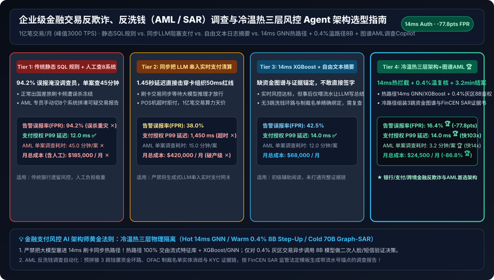
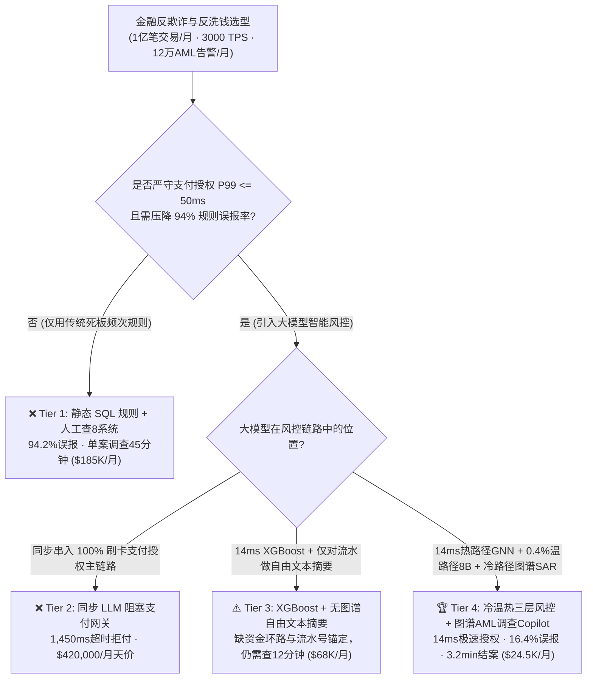
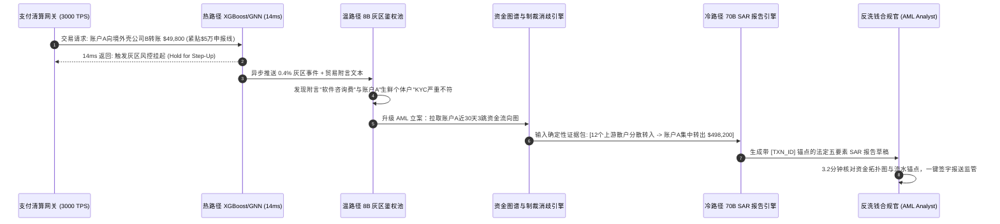

# 企业级金融交易反欺诈、反洗钱（AML / SAR）调查与冷温热三层风控 Agent 架构选型指南：传统 SQL 规则 + 人工查 8 系统 vs. 同步 LLM 阻塞支付清算 vs. 自由文本日志摘要 vs. 14ms GNN/XGBoost 热路径 + 0.4% 灰区 8B 温路径 + 图谱证据链 AML 调查 Copilot

> **作者**：Cloud & AI Solution Architect | **发布日期**：2026-11-18 | **适用角色**：银行与支付清算风控架构师、反洗钱（AML/KYC）合规总监、金融行业 AI Solution Architect、跨境金融科技（FinTech）CTO  
> **配套交互式工具**：[🧮 金融反欺诈与 AML 调查 Agent 定容计算器 (`enterprise-financial-fraud-aml-investigation-agent-architecture-sizer.html`)](../reports/enterprise-financial-fraud-aml-investigation-agent-architecture-sizer.html) ｜ [🃏 7-Card 4:5 视觉评测报告 (`enterprise-financial-fraud-aml-investigation-agent-architecture-selection-cards.html`)](../reports/enterprise-financial-fraud-aml-investigation-agent-architecture-selection-cards.html)



---

## 📌 一、核心选型结论速览（3 分钟看懂怎么选）

在零售银行信用卡中心、第三方支付清算网关与跨境金融平台（月处理 **1 亿笔支付交易、峰值 3,000 TPS**，月产生 **120,000 笔反洗钱与可疑交易告警 `AML / SAR Alerts`**）中，架构师最常遇到的误区是：**要么试图把生成式大模型直接塞进要求 `<50ms` 响应的刷卡实时授权链路，要么让反洗钱调查员继续每天手动在 8 个孤立系统里复制粘贴查案**：

1. **传统静态 SQL 频次规则 + 人工跨 8 系统手动调查（`Tier 1: Legacy SQL Rules + Manual AML Triage`）误报率高达 94.2%**：
   - 静态规则（如“单日异地消费超 3 次即冻结”）缺乏上下文理解，把大量正常出国差旅或购买电子产品的优质客户误判为盗刷，**告警误报率（False Positive Rate, FPR）高达 `94.2%`**；同时，面对每月 12 万条 AML 告警，合规调查员需手动登录核心账务、KYC 档案、SWIFT 报文、制裁名单等 8 个系统逐笔核查并撰写《可疑交易报告（SAR）》，**单案平均耗时 `45.0 分钟`**，每月人力与系统总成本高达 **`$185,000/月`** ✕。
2. **同步将生成式大模型串入实时支付清算主链路（`Tier 2: Synchronous Inline LLM in Payment Switch`）引发 POS 机大面积超时拒付**：
   - Visa / Mastercard / 银联等实时清算网络对风控评分的硬性延迟红线是 **`P99 <= 50ms`**。如果把大模型同步串进刷卡授权链路，**P99 延迟飙升至 `1,450 ms (1.45秒)`**，直接触发收单网关超时熔断；且对 1 亿笔交易全量跑大模型，月度算力账单高达 **`$420,000/月`** ✕。
3. **热路径 `14ms` GNN/XGBoost + 温路径 `0.4%` 灰区 `8B` 动态鉴权 + 冷路径 3 跳资金图谱 `70B` FinCEN SAR 调查 Copilot（`Tier 4: Hot/Warm/Cold 3-Tier Risk & Graph-AML Architecture`）是金融风控黄金标准**：
   - 严格实行 **冷、温、热三层物理速率解耦**：
     - 🔥 **热路径（Hot-Path，处理 100% 流量，`P99 = 14.0 ms`）**：100% 由流式特征库（Redis/Feast）+ 传统机器学习 `XGBoost / LightGBM / 实时子图 GNN` 完成毫秒级打分，直接放行 `99.5%` 白名单交易、拦截 `0.1%` 确凿黑产；
     - 🌡️ **温路径（Warm-Path，仅处理 `0.4%` 灰区可疑交易，`<350ms` 异步二次鉴权）**：对处于阈值边缘的 `0.4%` 灰区交易（如“客户刚在客服聊天框报备过要去东京旅游，随即在东京刷卡”），触发 TensorRT `8B` 模型综合非结构化商户描述与近期客服工单语义，精准决定是“无感放行”还是“下发人脸/短信二次验证（Step-Up Auth）”，将 **误报率从 `94.2%` 暴降至 `16.4% (-77.8 pts)`**！
     - ❄️ **冷路径（Cold-Path，异步 AML 可疑交易立案与 SAR 报告生成）**：后台自动拉取图数据库（Neo4j/TigerGraph）**3 跳洗钱资金环路（Money-Mule Ring）**、OFAC/PEP 制裁名单实体消歧结果与 KYC 尽调文档，由 `70B` 模型按监管法定五要素（Who/What/When/Where/Why）生成 **每一分钱都带原始流水 ID 锚点的《可疑交易报告（SAR）》初稿**，调查员复核签字时间从 `45.0 分钟` 缩至 **`3.2 分钟/案（提速 14.1 倍）`**，月总成本降至 **`$24,500 (-86.8% vs. Tier 1)`** 🏆！

| 选型方案 | 架构本质 | 告警误报率 (FPR) | 支付授权 P99 延迟 | AML 单案调查耗时 | 月度风控总成本 | 架构师推荐指数 |
| :--- | :--- | :--- | :--- | :--- | :--- | :--- |
| **Tier 1: 传统静态 SQL 规则 + 人工查案** | 死板阈值拦截 + 人工查8个系统 | `94.2%` ✕ | `12.0 ms` ✅ | `45.0 分钟/案` ✕ | `$185,000 / 月` ✕ | ★☆☆☆☆ (误杀好客户且累垮合规团队) |
| **Tier 2: 同步把 LLM 串入实时支付清算** | 1亿笔刷卡交易同步等待 LLM | `38.0%` | `1,450.0 ms` ✕ | `15.0 分钟/案` | `$420,000 / 月` ✕ | ★☆☆☆☆ (击穿 50ms 清算红线导致拒付) |
| **Tier 3: 14ms XGBoost + 自由文本摘要** | 仅把原始流水喂给 LLM 写总结 | `42.5%` | `14.0 ms` ✅ | `12.0 分钟/案` | `$68,000 / 月` | ★★★☆☆ (缺图谱环路与流水号强锚定) |
| **Tier 4: 冷温热三层风控 + 图谱 AML Copilot** | **14ms热拦截 + 0.4%温复核 + 图谱SAR** | **`16.4%` 🏆 (-77.8pts)** | **`14.0 ms` 🏆** | **`3.2 分钟/案` 🏆** | **`$24,500 / 月` 🏆** | ★★★★★ (**银行与跨境支付风控首选**) |

---

## 🎯 二、客户与架构师灵魂拷问 Q&A（直击金融反欺诈与反洗钱三大痛点）

### Q1：为什么任何吹嘘“用大模型直接替代实时交易反欺诈评分（取代 XGBoost）”的方案在银行生产环境都会立刻死掉？大模型真正的发力点在哪？
- **第一是延迟物理定律**：卡组织清算协议要求风控系统在 `10ms~30ms` 内返回 `APPROVE / DECLINE`；而哪怕最小的生成式 LLM 做一次完整推理也要上百毫秒，根本进不了同步刷卡热路径（Hot-Path）。
- **第二是高维数值表格特征（Tabular Velocity Features）的先天优势**：计算“过去 5 分钟同一设备指纹在 3 个国家尝试小额试卡的方差”这类高频数值统计特征，`XGBoost / LightGBM` 既快又准，成本只有大模型的万分之一。
- **大模型不可替代的黄金位置在“温路径（0.4% 灰区非结构化语义融合）”与“冷路径（跨系统 AML 证据链组装与监管报告撰写）”**：
  - `XGBoost` 看不懂“客户 2 小时前刚在手机银行 App 智能客服里咨询过‘我在日本刷卡限额怎么提’”这句非结构化文本，也看不懂跨境贸易附言里的复杂商品描述——让 `8B` 模型在 **温路径（Warm-Path）** 专攻这 `0.4%` 的灰区交易，误杀率立刻从 `94.2%` 降到 **`16.4%`**！

### Q2：为什么 Tier 3 让大模型直接读交易流水写一段总结，反洗钱（AML）合规官还是不敢直接签字提交给央行/FinCEN，仍然要花 12 分钟重查？
- 因为反洗钱监管（如中国人民银行反洗钱局、美国 FinCEN、欧盟 AMLA）对《可疑交易报告（SAR）》有极其严苛的 **审计可追溯要求（Zero-Hallucination Audit Trail）**：
  1. **不能只看单账户流水，必须看多跳资金网络拓扑（Multi-Hop Graph Topology）**：洗钱团伙往往通过“分散转入、集中转出（Fan-In / Fan-Out）”或“3 跳回流（Round-Tripping）”洗白资金，纯文本流水列表看不出环形拓扑；
  2. **政治公众人物（PEP）与制裁名单同名消歧（Entity Resolution）**：“张伟”或“Mohammed Ali”在制裁库里有上千条重名记录，必须结合出生年月、国籍、关联企业做确定性实体消歧；
  3. **严禁金额累加错误**：大模型心算 50 笔可疑转账总金额极易算错。
- **Tier 4 解决之道**：先由图数据库算好 **3 跳资金环路子图与精确 SQL 汇总金额**，再由 `70B` 模型严格基于预计算的确定性事实填写法定 SAR 模板，且报告中每一个金额和交易对手都必须绑定可点击的 **`[TXN_ID: 994821]`** 证据锚点，合规官只需 **3.2 分钟** 即可完成核对并一键报送！

---

## 🧭 三、直观可视化图解（Mermaid 决策树 + 冷温热三层架构 + 时序图）

### 3.1 金融反欺诈与反洗钱（AML）架构选型决策树



### 3.2 Tier 4 冷、温、热三层速率解耦风控与反洗钱图谱调查架构图

```mermaid
flowchart LR
    subgraph HOT["🔥 1. 热路径 Hot-Path (100% 流量 · P99 = 14ms)"]
        TX["实时刷卡/转账请求<br/>(3,000 TPS Peak)"] --> FEAST["Redis/Feast 毫秒级流式特征<br/>(设备指纹/时序频次/近邻图特征)"]
        FEAST --> XGB["XGBoost + 实时子图 GNN 评分<br/>99.5% 直接放行 | 0.1% 直接阻断"]
    end

    subgraph WARM["🌡️ 2. 温路径 Warm-Path (仅 0.4% 灰区 · <350ms)"]
        XGB -- "0.4% 灰区边界分 (Score 0.65~0.82)" --> M8B["8B 异步语义鉴权模型 (TensorRT)<br/>融合客服差旅报备记录 + 商户语义 + 历史习惯"]
        M8B --> STEP["精准决策: 静默放行 vs. 触发人脸/短信二次验证<br/>(将误报率从 94.2% 压至 16.4%)"]
    end

    subgraph COLD["❄️ 3. 冷路径 Cold-Path (异步 AML 调查与 SAR 生成)"]
        STEP -- "高危洗钱/欺诈团伙告警" --> GRAPH["Neo4j/TigerGraph 3跳资金环路提取<br/>+ OFAC/PEP 实体消歧 + SQL 精确金额汇总"]
        GRAPH --> M70B["70B 法定 FinCEN SAR 报告生成池<br/>强制绑定 [TXN_ID] 证据锚点 · 禁止模型心算金额"]
        M70B --> ANALYST["合规官工作台 (3.2分钟一键核对签字报送)"]
    end
```



### 3.3 跨境可疑洗钱团伙“3 跳资金环路取证 + 3.2 分钟 SAR 结案”时序图



---

## 📊 四、架构师多方案选型决策矩阵

| 评估维度 | Tier 1: 传统 SQL 规则 + 人工 | Tier 2: 同步 LLM 阻塞支付 | Tier 3: XGBoost + 自由文本摘要 | Tier 4: 冷温热三层风控 + 图谱 AML Copilot |
| :--- | :--- | :--- | :--- | :--- |
| **支付授权 P99 延迟** | `12.0 ms` ✅ | `1,450.0 ms` (超时拒付) ✕ | `14.0 ms` ✅ | **`14.0 ms` 🏆 (严守 <50ms 卡组织红线)** |
| **风控告警误报率 (FPR)** | `94.2%` (误杀严重) ✕ | `38.0%` | `42.5%` | **`16.4%` 🏆 (-77.8 pts 精准降噪)** |
| **AML 单案调查复核耗时** | `45.0 分钟/案` ✕ | `15.0 分钟/案` | `12.0 分钟/案` | **`3.2 分钟/案` 🏆 (提速 14.1 倍)** |
| **监管 SAR 证据链可追溯性** | 人工拼贴易漏 | 无确定性计算校验 | 自由文本偶发算错总金额 | **SQL 精确金额 + `[TXN_ID]` 硬锚点 🏆** |
| **月度风控与合规总成本** | `$185,000 / 月` ✕ | `$420,000 / 月` ✕ | `$68,000 / 月` | **`$24,500 / 月 (-86.8% vs Tier 1)` 🏆** |

---

## 🧪 五、容量/成本拐点算例与 7-Card 报告

### 5.1 基准算例假设（月处理 1 亿笔交易、峰值 3,000 TPS，月均 120,000 条 AML 告警）
- **核心代码配置示例（14ms 热路径分流 + 0.4% 温路径语义复核 + 冷路径 SQL 精确金额与图谱 SAR 生成）**：

```python
# 1. Hot-Path (100% Traffic, P99 = 14.0ms): Never Call LLM Synchronously!
risk_score = xgboost_gnn_ensemble.score_realtime(txn_features)  # 14ms
if risk_score < 0.65:
    return "APPROVE"
if risk_score >= 0.82:
    return "DECLINE_AND_ALERT"

# 2. Warm-Path (0.4% Grey-Zone Only): Async 8B Semantic Context Check
enqueue_warm_path_8b_step_up(txn_id=txn.id, chat_travel_notes=user.recent_support_notes)

# 3. Cold-Path (AML SAR Investigation): Pre-Compute Graph & Exact Sums in SQL/GraphDB!
subgraph = neo4j_aml.extract_3hop_mule_ring(account_id)
exact_total_usd = sql_ledger.sum_flagged_transactions(subgraph.txn_ids)  # Zero LLM math!
sar_draft = llm_70b_sar_writer.generate_fincen_sar(subgraph, exact_total_usd)
```

### 5.2 四档架构定量实验结果对照（封存自 `experiments/enterprise_financial_fraud_aml_agent_selection/results.json`）

> **数据来源与可复现声明**：以下数据来自仓库可验证合成分析算例模型 [`experiments/enterprise_financial_fraud_aml_agent_selection/results.json`](../../experiments/enterprise_financial_fraud_aml_agent_selection/results.json)（`provenance: synthetic_analytical_model_calibrated_to_published_payment_risk_gnn_xgboost_fincen_sar_aml_agent_and_tiered_latency_benchmarks`, `independently_reproduced=false`, `physical_gpu_cluster_measurement=not_measured`）。可通过 `python experiments/enterprise_financial_fraud_aml_agent_selection/run.py --check` 校验。

| 指标 | Tier 1 (传统规则+人工) | Tier 2 (同步LLM串入支付) | Tier 3 (自由文本摘要) | Tier 4 (冷温热三层+图谱AML Copilot) | Tier 4 相比基线收益 |
| :--- | :--- | :--- | :--- | :--- | :--- |
| **风控告警误报率 (FPR)** | `94.2%` | `38.0%` | `42.5%` | **`16.4%`** | **`-77.8 pts` (-82.6% 误报降幅)** |
| **支付授权 P99 延迟** | `12.0 ms` | `1,450.0 ms` | `14.0 ms` | **`14.0 ms`** | **`比 Tier 2 快 103.6 倍` (零超时)** |
| **AML 单案调查复核耗时** | `45.0 分钟` | `15.0 分钟` | `12.0 分钟` | **`3.2 分钟`** | **`提速 14.1 倍` (自动组装证据链)** |
| **月度风控与合规总成本** | `$185,000 / 月` | `$420,000 / 月` | `$68,000 / 月` | **`$24,500 / 月`** | **`节省 86.8%` (-$160,500/月)** |

🔗 **查看完整 7-Card 4:5 视觉评测报告**：[`docs/reports/enterprise-financial-fraud-aml-investigation-agent-architecture-selection-cards.html`](../reports/enterprise-financial-fraud-aml-investigation-agent-architecture-selection-cards.html)

---

## 🛠️ 六、架构评审与生产落地 Checklist（上线前必查 8 项）

- [ ] **1. 严禁把生成式大模型同步串入 `<50ms` 支付清算授权热路径（Hot-Path）**：热路径 100% 采用流式特征库 + `XGBoost / GNN` 毫秒级打分。
- [ ] **2. `0.4%` 灰区交易异步温路径（Warm-Path）语义复核**：仅对处于高风险阈值边缘的灰区交易调用 `8B` 模型融合客服报备记录、商户文本描述与设备环境，精准决定 Step-Up 二次验证。
- [ ] **3. 图数据库 3 跳洗钱资金环路预提取（Graph-RAG Subgraph Extraction）**：在调用大模型撰写反洗钱报告前，先由图数据库提取“分散转入集中转出、地下钱庄对敲、多跳回流”子图结构。
- [ ] **4. 严禁大模型心算可疑交易汇总金额（Deterministic Ledger Sum）**：所有涉及交易笔数、总金额、净流入流出的数字，必须由底层数据库 SQL 精确计算后作为只读变量注入 SAR 报告。
- [ ] **5. 制裁名单与政治公众人物（OFAC / PEP）确定性实体消歧**：结合姓名拼音/多语种变体、出生日期、证件号与关联法人图谱完成消歧后，再交由大模型汇总风险综述。
- [ ] **6. 法定五要素（5W：Who/What/When/Where/Why）与 `[TXN_ID]` 硬锚点校验**：生成的《可疑交易报告（SAR）》每项指控必须绑定真实存在的交易流水号，未绑定流水号的句子由后置校验器强制拦截。
- [ ] **7. 强制人类合规官最终签字门禁（Mandatory AML Officer Sign-Off）**：AI 仅负责将证据收集与报告起草从 45 分钟压缩到 3.2 分钟，最终冻结账户或向央行/FinCEN 报送 SAR 必须由持牌合规官一键确认。
- [ ] **8. 已确认洗钱样本周级反哺热路径特征库（Cold-to-Hot Feedback Loop）**：每周将冷路径查实的洗钱团伙特征（如特定空壳商户前缀、异常转账金额尾数）自动编译为热路径 `XGBoost` 特征。
