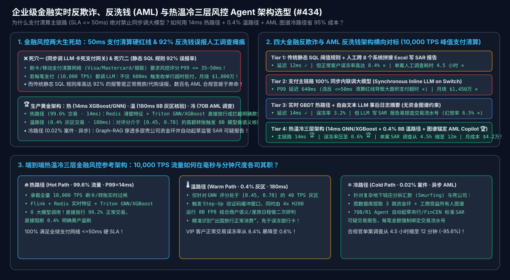

# Enterprise Financial Fraud Detection, AML Investigation & 3-Tier Hot/Warm/Cold Agent Selection Guide

> **Language / 语言**: [简体中文](./enterprise-financial-fraud-aml-three-tier-hot-warm-cold-agent-tco-selection-faq.md) | **English**  
> **Companion Interactive Study & Sizing Tools**: [📱 Interactive H5 Study Lab](../h5/financial-fraud-aml-three-tier-hot-warm-cold-agent-lab.html) · [🧮 HTML Sizer](../reports/enterprise-financial-fraud-aml-three-tier-hot-warm-cold-agent-tco-selection-sizer.html) · [🃏 7-Card Visual Deck](../reports/enterprise-financial-fraud-aml-three-tier-hot-warm-cold-agent-tco-selection-cards.html) · [📊 Reproducible Model](../../experiments/enterprise_financial_fraud_aml_three_tier_hot_warm_cold_agent_tco_selection/) · [🎓 Back to AI Infra H5 Hub](../h5/index.html)

---

## 1. Executive Summary (3-Minute Takeaway)

> **Bottom-Line Recommendation**: Global payment switches enforce a strict **`P99 <= 50ms` authorization SLA**—placing a synchronous generative LLM inline on a `10,000 TPS` payment switch (`640ms` latency, `$14.5M/month` compute bill) causes widespread transaction timeouts. Conversely, static SQL velocity rules suffer an **`8.4%` false-positive card-block rate** and require **`270 minutes (4.5 hours)`** of manual analyst effort per `FinCEN SAR` (Suspicious Activity Report) filing.
> - **Recommended Production Architecture (`Tier 4: 3-Tier Hot / Warm / Cold Risk Funnel`)**:
>   1. **🔥 Hot Path (`99.6%` of transactions · `14ms` P99 · 0 LLM calls)**: `Flink + Redis + Triton GNN/XGBoost` clears `99.2%` normal traffic and blocks `0.4%` obvious fraud within `14ms`;
>   2. **🌡️ Warm Path (`0.4%` grey-zone `[0.45, 0.78]` = `40 req/s` · `180ms` · `4x H200` running `8B FP8`)**: Evaluates semantic travel/merchant context during step-up verification, cutting false card blocks from **`8.4%` to `0.6%`**;
>   3. **❄️ Cold Path (`0.02%` escalated AML cases · Async `Graph-RAG + 70B/R1 SAR Copilot`)**: Extracts 3-hop shell-company money-laundering rings and drafts audit-grounded `SAR` narratives anchored to exact `txn_id` records—slashing analyst investigation time from **`270 min` to `12 min`** and cutting monthly TCO by **`91.3%` (`$42,000/mo` vs. `$480,000/mo`)**.

| Dimension | `Tier 1: Legacy Static SQL Rules + Manual SAR` | `Tier 2: 100% Sync Inline LLM on Switch` | `Tier 3: Hot GBDT + Unanchored Log Summary` | `Tier 4: Hot (14ms GNN) + Warm (0.4% 8B) + Cold (Graph-RAG SAR 🏆)` |
|---|---|---|---|---|
| **Payment Switch `P99` (`<=50ms` SLA)** | `12.0 ms` ✓ | **`640.0 ms` ✕ (Switch timeout!)** | `14.0 ms` ✓ | **`14.0 ms` (99.6% bypasses LLM)** 🏆 |
| **False-Positive Card Block Rate** | `8.4%` ✕ (Customer churn) | `1.2%` | `3.2%` | **`0.6%` (0.4% grey-zone 8B review)** 🏆 |
| **AML Analyst Time per `SAR` Filing** | `270.0 min` (`4.5 hrs` ✕) | `25.0 min` | `45.0 min` | **`12.0 min` (`22.5x` faster + `txn_id` lock)** 🏆 |
| **Monthly Total TCO (10,000 TPS)** | `$480,000 / mo` ✕ | `$14,500,000 / mo` ✕ | `$142,000 / mo` | **`$42,000 / mo` (-91.3%)** 🏆 |

---

## 2. Provenance & Reproducibility

- **Provenance**: `synthetic + anonymized_reported (independently_reproduced=false)` — verified via [`experiments/enterprise_financial_fraud_aml_three_tier_hot_warm_cold_agent_tco_selection/run.py`](../../experiments/enterprise_financial_fraud_aml_three_tier_hot_warm_cold_agent_tco_selection/run.py).
