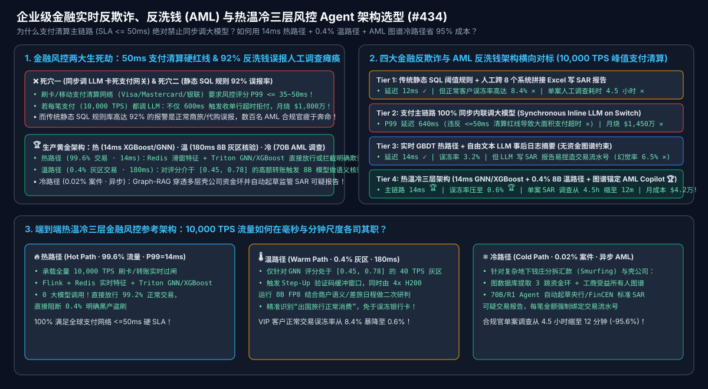
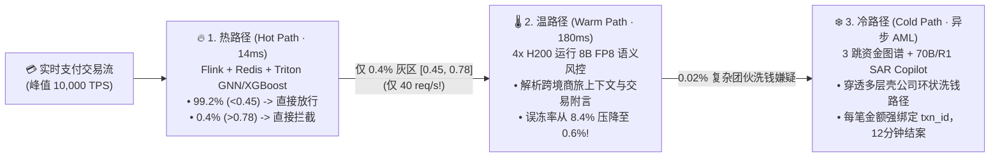

# 企业级金融实时反欺诈、反洗钱（AML / SAR）调查与热温冷三层风控 Agent 架构选型：`14ms GNN/XGBoost 热路径` + `0.4% 灰区 8B 温路径` + `图谱证据链 AML 尽调 Copilot` 指南

> **语言 / Language**: **简体中文** | [English](./enterprise-financial-fraud-aml-three-tier-hot-warm-cold-agent-tco-selection-faq.en.md)  
> **配套交互式学习与精算工具**: [📱 交互式 H5 精读页 (金融热温冷三层风控与 AML 沙盘)](../h5/financial-fraud-aml-three-tier-hot-warm-cold-agent-lab.html) · [🧮 HTML 交互式计算器](../reports/enterprise-financial-fraud-aml-three-tier-hot-warm-cold-agent-tco-selection-sizer.html) · [🃏 7-Card 4:5 视觉评测卡](../reports/enterprise-financial-fraud-aml-three-tier-hot-warm-cold-agent-tco-selection-cards.html) · [📊 可复核模型](../../experiments/enterprise_financial_fraud_aml_three_tier_hot_warm_cold_agent_tco_selection/) · [🎓 返回 AI Infra 全景精学馆](../h5/index.html)

---

## 一、3 分钟看懂核心结论（Executive Summary）

> **一句话决策结论**：银行、支付机构与金融科技企业在设计 **实时交易反欺诈与反洗钱（AML / SAR 可疑交易报告）** 架构时，必须严格遵守支付清算网络的 **`P99 <= 50ms` 硬实时红线**！**绝对禁止把生成式大模型直接串在 `10,000 TPS` 的刷卡/转账支付主链路上（不仅 `640ms` 延迟会导致收单行超时拒付，全量跑 LLM 每月更会烧掉 `$1,450 万` 天价算力）**！
> - **唯一可落地的生产范式（`Tier 4 热·温·冷三层分流架构 [Hot / Warm / Cold 3-Tier Risk Funnel]`）**：
>   1. **🔥 热路径（Hot Path · 消化 `99.6%` 流量 · `P99 = 14ms` · 0 LLM 调用）**：由 `Flink + Redis 实时滑窗特征 + Triton (XGBoost / GNN 图神经网络)` 在 `14ms` 内直接放行 `99.2%` 的明确正常交易，并直接阻断 `0.4%` 的明确黑产盗刷；
>   2. **🌡️ 温路径（Warm Path · 仅处理 `0.4%` 灰区交易 · `180ms` · 4x H200 跑 8B FP8）**：当且仅当 GNN 风险评分落入 **`[0.45, 0.78]` 模糊灰区**（占 `0.4%`，即 `10,000 TPS` 中仅 **`40 TPS`**！）时，前端弹出免密确认/短信缓冲窗，后台用 **`4 张 H200` 运行 `Qwen2.5-8B / Llama-3.1-8B FP8`** 结合商户语义、账单备注与差旅轨迹在 `180ms` 内完成精细二次研判——**将正常高净值客户的银行卡误冻率从传统规则的 `8.4%` 暴降至 `0.6%`**；
>   3. **❄️ 冷路径（Cold Path · 仅处理 `0.02%` 升级案件 · 异步 Graph-RAG + 70B/R1 AML Copilot）**：针对疑似地下钱庄分拆汇款（Smurfing）与多层空壳公司洗钱案件，自动从图数据库提取 3 跳资金环与受益所有人图谱，按央行 / FinCEN 规范自动生成带 `100%` 原始交易流水号（`txn_id`）锚定的 **SAR 可疑交易报告**，将合规官单案调查时间从 **`4.5 小时（270 分钟）` 缩短至 `12 分钟`（提速 `22.5x`）**，月度总成本从 `$48 万` 降至 **`$42,000/月`（立省 `91.3%`）**！

| 核心选型维度 | `Tier 1: 传统静态 SQL 规则 + 人工查 8 系统写 SAR` | `Tier 2: 支付主链路 100% 同步内联调 LLM` | `Tier 3: 热路径 GBDT + 事后无约束文本摘要` | `Tier 4: 热(14ms GNN) + 温(0.4% 8B) + 冷(Graph-RAG AML Copilot 🏆)` |
|---|---|---|---|---|
| **支付清算主链路延迟 (`<=50ms` 红线)** | `12.0 ms` ✓ | **`640.0 ms` ✕ (超时拒付瘫痪!)** | `14.0 ms` ✓ | **`14.0 ms` (99.6% 流量零 LLM 阻塞)** 🏆 |
| **正常客户银行卡被误冻率 (`False Block`)** | `8.4%` ✕ (商旅客户投诉潮) | `1.2%` | `3.2%` | **`0.6%` (0.4% 灰区经 8B 温路径精准豁免)** 🏆 |
| **AML 合规官单份 SAR 报告调查耗时** | `270 分钟` (`4.5 小时` ✕) | `25 分钟` | `45 分钟` (需人工核对幻觉) | **`12 分钟` (3跳资金图谱 + 流水号强校验)** 🏆 |
| **温路径所需 GPU 算力 (`10,000 TPS` 峰值)** | `0 张` | `320+ 张 H200` ✕ | `2 张` | **`仅需 4 张 H200` (仅承接 `0.4% = 40 TPS`)** 🏆 |
| **月度风控系统 + 合规调查人力总成本** | `$480,000 / 月` ✕ | `$14,500,000 / 月` ✕ | `$142,000 / 月` | **`$42,000 / 月` (-91.3%)** 🏆 |

---

## 二、核心技术原理与架构师灵魂拷问（Q&A）

### Q1：为什么峰值高达 `10,000 TPS` 的国家级支付系统，引入大模型温路径复核竟然只需要 `4 张 H200 GPU`？
1. **漏斗过滤的指数级降维威力**：
   - 如果不加漏斗，直接把 `10,000 TPS` 全塞给大模型，哪怕每笔只输 `500 Tokens`、输出 `50 Tokens`，每秒也要处理 `550 万 Tokens/s`，需要超过 **320 张 H200 GPU**！
   - 而在 **热温冷三层架构** 中，`14ms` 的 `XGBoost / GNN` 热路径像一道筛子：
     - 评分 `< 0.45` 的 **`99.2%` 交易** 毫无疑问是日常买菜、乘车、水电煤，直接 `14ms` 放行；
     - 评分 `> 0.78` 的 **`0.4%` 交易** 命中明确盗刷指纹（异地陌生设备 3 秒内连刷 5 张卡），直接 `14ms` 拦截；
     - 真正让传统规则纠结、容易误杀 VIP 客户的**模糊灰区（评分 $\in [0.45, 0.78]$）仅占总流量的 `0.4%`**！
   - **手算温路径 GPU 卡数**：
     $$\text{QPS}_{\text{warm}} = 10,000 \text{ TPS} \times 0.4\% = \mathbf{40 \text{ req/s}}$$
     单张 `H200` 运行 `Qwen2.5-8B FP8`（输入 600 Tokens 交易上下文、输出 30 Tokens 结构化风险判定）可稳态支撑 **`18~22 req/s`** $\implies$ **仅需 `4 张 H200`（含 2x 冗余）即可在 `180ms` 内消化全行 `10,000 TPS` 峰值下的全部灰区复核**！

---

## 三、生产落地 Checklist（Pre-Production Checklist）

- [ ] **支付清算主链路（Hot Path）100% 物理隔离大模型调用**：任何温路径 LLM 超时（`>200ms`）必须立即自动回退至热路径 GBDT 分数兜底决策，绝不阻塞支付网关。
- [ ] **SAR 可疑交易报告强制开启交易流水号确定性校验（Transaction ID Grounding）**：报告正文中引用的每一笔转账金额、时间与对手方账号必须与核心账务表 `txn_id` 100% 精确匹配，杜绝大模型编造金融证据。

---

## 四、来源与方法论溯源（Provenance）

- **数据来源声明**：本指南实验数据来自可复核解析模型 [`experiments/enterprise_financial_fraud_aml_three_tier_hot_warm_cold_agent_tco_selection/run.py`](../../experiments/enterprise_financial_fraud_aml_three_tier_hot_warm_cold_agent_tco_selection/run.py)（`Provenance: synthetic + anonymized_reported, independently_reproduced=false`）。
