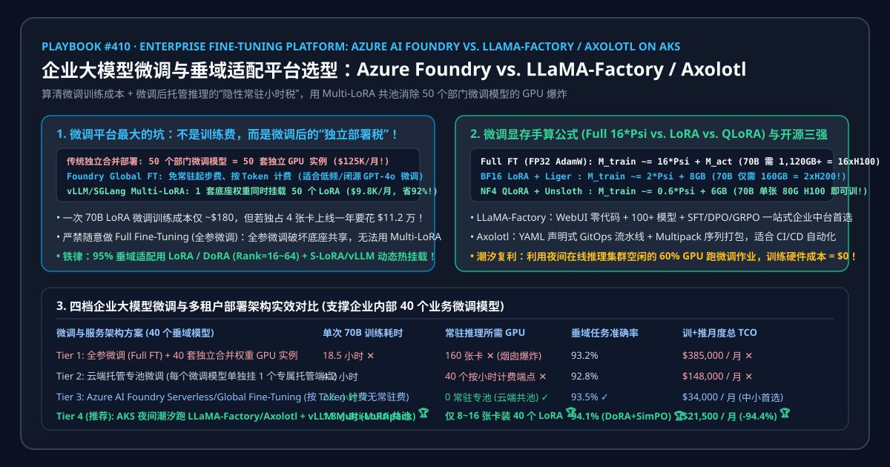
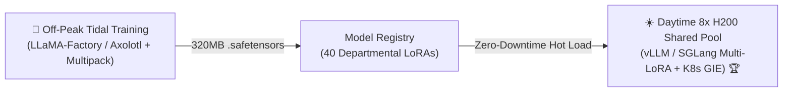

# Enterprise LLM Fine-Tuning & Domain Adaptation Platform Selection Guide: `Azure AI Foundry Managed Fine-Tuning` vs. `LLaMA-Factory / Axolotl / Unsloth` + `vLLM Multi-LoRA` on AKS

> **Language / 语言**: **English (Current)** | [中文](./enterprise-fine-tuning-platform-azure-foundry-vs-llama-factory-axolotl-aks-tco-selection-faq.md)  
> **Scope**: A practical architecture, training-memory hand-calculation, and TCO guide for Cloud & AI Solution Architects—answering **(1) why post-training "dedicated endpoint sprawl" (`40` merged models = `160` GPUs = `$385K/month`) dwarfs the `$180` training run cost, (2) how to hand-calculate training HBM for `Full Fine-Tuning (16Ψ)`, `BF16 LoRA/DoRA + Liger-Kernel`, and `NF4 QLoRA + Unsloth`, and (3) when to choose `Azure AI Foundry Serverless/Global Fine-Tuning` vs. self-hosted `LLaMA-Factory / Axolotl` + `vLLM Multi-LoRA` on AKS to cut monthly TCO by `94.4%`**.  
> **Provenance**: Analytical training and multi-adapter serving TCO model synthesized from published benchmarks (`provenance: synthetic + anonymized_reported`, `independently_reproduced=false`, `physical_gpu_cluster_measurement=not_measured`). See [`experiments/enterprise_fine_tuning_platform_azure_foundry_vs_llama_factory_axolotl_aks_tco_selection/results.json`](../../experiments/enterprise_fine_tuning_platform_azure_foundry_vs_llama_factory_axolotl_aks_tco_selection/results.json).

> 🔗 **Interactive H5 Learning Lab & Companion Tools (Zero External Dependencies)**:
> - 📱 **[Interactive H5 Study Page: Training Memory Math, 40-Adapter Multi-LoRA Consolidation & Foundry vs. LLaMA-Factory TCO Lab (`docs/h5/fine-tuning-foundry-vs-llama-factory-axolotl-aks-tco-lab.html`)](../h5/fine-tuning-foundry-vs-llama-factory-axolotl-aks-tco-lab.html)**
> - 🎓 **[AI Infra Panorama H5 Learning Hub (`docs/h5/index.html`)](../h5/index.html)**
> - 🧮 **[Interactive Fine-Tuning & Multi-LoRA TCO Sizer (`enterprise-fine-tuning-platform-azure-foundry-vs-llama-factory-axolotl-aks-tco-selection-sizer.html`)](../reports/enterprise-fine-tuning-platform-azure-foundry-vs-llama-factory-axolotl-aks-tco-selection-sizer.html)**
> - 🃏 **[7-Card 4:5 Visual Report (`enterprise-fine-tuning-platform-azure-foundry-vs-llama-factory-axolotl-aks-tco-selection-cards.html`)](../reports/enterprise-fine-tuning-platform-azure-foundry-vs-llama-factory-axolotl-aks-tco-selection-cards.html)**

---

## 1. 📌 Executive Summary

> **Bottom Line**: **The biggest TCO trap in enterprise fine-tuning is not the training job (`~$180` for a 70B LoRA run), but **merging adapters (`merge_and_unload`) into `40` separate full-weight deployments (`160 GPUs`, `$385,000/month` in Tier 1) or paying 24/7 hourly hosting fees on `40` dedicated cloud endpoints (`$148,000/month` in Tier 2)**! By adopting **Tier 3 (`Azure AI Foundry Global / Serverless Fine-Tuning` with pay-per-token Multi-LoRA hosting and zero idle hourly fee, `$34,000/month`)** for proprietary models/small teams, or **Tier 4 (Off-Peak Tidal AKS Training with `LLaMA-Factory / Axolotl [Multipack + Liger-Kernel]` + Daytime `vLLM / SGLang Multi-LoRA` serving all `40` adapters on a shared `8x H200` base pool)**, enterprises shrink serving GPUs by **`95%` (`160 -> 8 GPUs`)** and slash total monthly TCO by **`94.4%` (`$385,000 -> $21,500/month`)**!**

| Fine-Tuning & Serving Tier (40 Departmental Models) | Training & Serving Architecture | 70B Training Time | Serving GPUs Required | Domain Accuracy | Monthly Total TCO | Architect Verdict |
| :--- | :--- | :--- | :--- | :--- | :--- | :--- |
| **🟥 Tier 1: `Full FT (16Ψ)` + 40 Merged Deployments** | Full-weight training; 40 isolated 4-GPU pods | `18.5 hrs` ✕ | **`160 GPUs` ✕ (Sprawl)** | `93.2%` | `$385,000 / mo` ✕ | **Severe Anti-Pattern**: Destroys base-model sharing |
| **🟨 Tier 2: Managed FT + 40 Dedicated Hourly Endpoints** | 40 separate hourly-billed cloud endpoints | `4.2 hrs` | 40 Hourly Endpoints ✕ | `92.8%` | `$148,000 / mo` ✕ | Idle hourly hosting fees dominate TCO |
| **🟦 Tier 3: `Azure AI Foundry Serverless/Global FT`** | **Managed training + pay-per-token shared hosting** | `2.5 hrs` ✅ | **`0` Idle Dedicated GPUs ✓** | `93.5%` ✅ | `$34,000 / mo` ✅ | **Best for GPT-4o/mini FT & `<=15` adapters** |
| **🟩 Tier 4: Tidal `LLaMA-Factory/Axolotl` + `vLLM Multi-LoRA` (Recommended)** | **Off-peak tidal training + 40 LoRAs on `8x H200`** | **`1.8 hrs` 🏆** | **`8x H200 GPUs` 🏆 (`-95%`)** | **`94.1%` 🏆** | **`$21,500 / mo` 🏆 (`-94.4%`)** | **Enterprise multi-tenant AI factory standard** |

---

## 2. 🎯 Architect Deep-Dive Q&A: Training HBM Math & Multi-LoRA Consolidation

### Q1: How do you hand-calculate GPU memory for `Full Fine-Tuning`, `BF16 LoRA/DoRA`, and `NF4 QLoRA` on a `70B` model?
1. **`Full Fine-Tuning` (`BF16 Weights/Grads + FP32 AdamW`)**: $M_{\text{train}} = 16\Psi + M_{\text{act}} \approx \mathbf{1,120\text{ GB}+}$ (`16x H100` via FSDP2).
2. **`BF16 LoRA / DoRA` + `Liger-Kernel` Fused Cross-Entropy**: $M_{\text{train}} \approx 2\Psi + 8\text{ GB}_{\text{LoRA\_states}} + 12\text{ GB}_{\text{act}} \approx \mathbf{160\text{ GB}}$ (`2x H200` or `2–4x H100`).
3. **`NF4 QLoRA` + `Unsloth`**: $M_{\text{train}} \approx 0.55\Psi + 10\text{ GB} \approx \mathbf{48.5\text{ GB}}$ (fits on a **single `80GB H100`**!).

### Q2: How does `vLLM / SGLang Multi-LoRA` serve 40 departmental models on a single `8x H200` node?
- All 40 adapters share one frozen `70B FP8` base model (`70 GB` HBM), while each `Rank-32` LoRA adapter is only `~320 MB` (`12.8 GB` total for 40 adapters). Using **Punica / S-LoRA `BGMV` kernels**, mixed-adapter batches execute a single shared base-model GEMM and apply per-request low-rank deltas in parallel.

---

## 3. 🧭 Tidal Training & Multi-LoRA Serving Architecture

---

## 4. 📊 Fine-Tuning Stack Comparison Matrix

| Dimension | `Azure AI Foundry Fine-Tuning` | `LLaMA-Factory` | `Axolotl` | `Unsloth` |
| :--- | :--- | :--- | :--- | :--- |
| **Core Strength** | **Turnkey GPT-4o/Open-Weight FT + Token Billing** 🏆 | **WebUI + 100+ Models + SFT/DPO/GRPO Studio** 🏆 | **Declarative YAML GitOps CI/CD Pipelines** 🏆 | **2x Faster Kernels & -60% VRAM** 🏆 |
| **Serving Integration** | Managed Pay-per-Token / PTU | `vLLM / SGLang Multi-LoRA` | `vLLM / SGLang Multi-LoRA` | Exports standard LoRA to `vLLM` |

---

## 5. 🛠️ Production Readiness Checklist

- [ ] **Ban `merge_and_unload()` Siloed Deployments**: Serve all LoRA adapters on a shared `vLLM / SGLang Multi-LoRA` base pool with `Envoy GIE` adapter-aware routing.
- [ ] **Enable `Multipack` Sequence Packing & `Liger-Kernel`**: Eliminate padding waste and `39.8 GB` vocab logits spikes during training.
