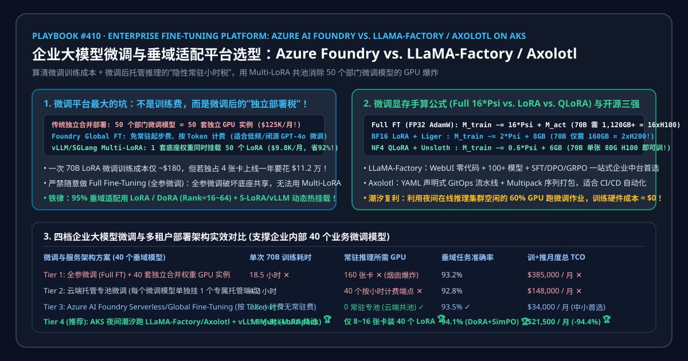
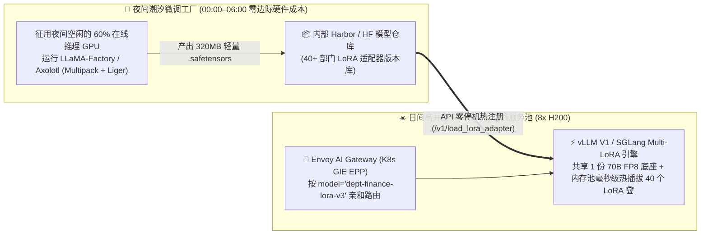

# 企业级大模型微调与垂域适配平台选型：`Azure AI Foundry Managed Fine-Tuning` vs. `自建 AKS + LLaMA-Factory / Axolotl / Unsloth` + `vLLM Multi-LoRA` 架构、显存手算与 ROI 成本拐点指南

> **语言 / Language**: **中文 (当前)** | [English](./enterprise-fine-tuning-platform-azure-foundry-vs-llama-factory-axolotl-aks-tco-selection-faq.en.md)  
> **文档定位**：面向 Cloud & AI Solution Architect 的企业模型微调（SFT / DPO / GRPO）与多租户服务架构指南——直击企业在落地几十个部门微调模型时最容易踩的“百万美金成本陷阱”：**① 为什么微调一次 70B 模型训练费只要 `$180`，但上线后一年却烧掉 `$14.8 万 ~ $38.5 万`（微调后独立部署常驻小时税）？② 如何手算 `Full Fine-Tuning (16Ψ)`、`BF16 LoRA/DoRA` 与 `NF4 QLoRA` 的训练显存水位线？③ `Azure AI Foundry Fine-Tuning`、`LLaMA-Factory`、`Axolotl` 与 `Unsloth` 四大工具链怎么分工组合？**  
> **标定声明**：本文所引用的单次训练耗时、常驻推理 GPU 卡数、垂域任务准确率与月度训推总 TCO 基于公开微调框架基准与云端定价构建的合成定量模型（`provenance: synthetic + anonymized_reported`, `independently_reproduced=false`, `physical_gpu_cluster_measurement=not_measured`），详见 [`experiments/enterprise_fine_tuning_platform_azure_foundry_vs_llama_factory_axolotl_aks_tco_selection/results.json`](../../experiments/enterprise_fine_tuning_platform_azure_foundry_vs_llama_factory_axolotl_aks_tco_selection/results.json)。

> 🔗 **关联交互式 H5 精读页与工具（点击即开，零外部依赖）**：
> - 📱 **[交互式 H5 精读页：微调显存手算、40 租户 Multi-LoRA 共池与 Foundry vs. LLaMA-Factory 成本沙盘 (`docs/h5/fine-tuning-foundry-vs-llama-factory-axolotl-aks-tco-lab.html`)](../h5/fine-tuning-foundry-vs-llama-factory-axolotl-aks-tco-lab.html)**
> - 🎓 **[AI Infra 全景可视化精学馆首页 (`docs/h5/index.html`)](../h5/index.html)**
> - 🧮 **[交互式微调与 Multi-LoRA TCO 计算器 (`enterprise-fine-tuning-platform-azure-foundry-vs-llama-factory-axolotl-aks-tco-selection-sizer.html`)](../reports/enterprise-fine-tuning-platform-azure-foundry-vs-llama-factory-axolotl-aks-tco-selection-sizer.html)**
> - 🃏 **[7-Card 4:5 视觉评测报告 (`enterprise-fine-tuning-platform-azure-foundry-vs-llama-factory-axolotl-aks-tco-selection-cards.html`)](../reports/enterprise-fine-tuning-platform-azure-foundry-vs-llama-factory-axolotl-aks-tco-selection-cards.html)**

---

## 1. 📌 核心选型结论速览（Executive Summary）

> **一句话结论**：**企业微调最大的财务黑洞从来不是“训练那几小时的算力费（一次 70B LoRA 仅需 `~$180`）”，而是**微调完成后把 40 个部门的模型合并权重（`merge_and_unload`）各自部署成 40 套独立 GPU 实例（Tier 1，需 `160 张卡`、月烧 `$385,000`）或 40 个按小时计费的专属云端点（Tier 2，月烧 `$148,000`）**！通过落地两条黄金路线：① **闭源模型或 `<=15` 个低频微调场景首选 `Azure AI Foundry Global / Developer Tier Fine-Tuning`（Tier 3，云端原生 Multi-LoRA 按 Token 计费、免除常驻小时托管费，月仅 `$34,000`）**；② **中大型开源模型场景落地 `Tier 4（利用夜间推理集群空闲算力潮汐运行 LLaMA-Factory / Axolotl [Multipack + Liger-Kernel] 训练 LoRA/DoRA 适配器 + 白天在单套 8x H200 vLLM/SGLang Multi-LoRA 底座上动态热挂载全部 40 个适配器）`**，可将常驻推理显卡从 `160 张` 暴砍至 **`8 张 H200`（立省 `95%` 显卡）**，训推一体月度总 TCO 从 `$385,000` 压降至 **`$21,500 / 月`（节省 `94.4%`）**！**

| 微调与部署架构档位（企业 40 个部门垂域模型） | 训练方法与在线推理挂载模式 | 单次 70B 训练耗时 | 常驻推理所需 GPU | 垂域任务准确率 | 训+推月度总 TCO | 架构师拍板结论 |
| :--- | :--- | :--- | :--- | :--- | :--- | :--- |
| **🟥 Tier 1：全参微调 (`Full FT`) + 40 套独立实例** | 改写全部 70B 权重，每个模型独占 4 张卡 | `18.5 小时` ✕ | **`160 张卡` ✕ (烟囱爆炸)** | `93.2%` | `$385,000 / 月` ✕ | **头号破产反模式**：破坏底座共享能力 |
| **🟨 Tier 2：云端微调 + 40 个独立按小时托管端点** | 每个微调模型单独起 1 个专属托管端点付小时费 | `4.2 小时` | 40 个按小时计费端点 ✕ | `92.8%` | `$148,000 / 月` ✕ | 低频部门模型 90% 时间空转白交托管费 |
| **🟦 Tier 3：`Azure AI Foundry Serverless/Global FT`** | **云端托管训练 + 无常驻费按实际调用 Token 计费** | `2.5 小时` ✅ | **`0` 独占常驻卡 ✓** | `93.5%` ✅ | `$34,000 / 月` ✅ | **闭源 GPT-4o 微调与中小团队零运维首选** |
| **🟩 Tier 4：AKS 夜间潮汐 `LLaMA-Factory` + `vLLM Multi-LoRA` (推荐)** | **夜间空闲卡免费训 `DoRA` + 白天 8 卡热挂载 40 个 LoRA** | **`1.8 小时` 🏆** | **`8 张 H200` 🏆 (`-95%`)** | **`94.1%` 🏆** | **`$21,500 / 月` 🏆 (`-94.4%`)** | **多业务线企业 AI 平台训推一体终局标准** |

---

## 2. 🎯 架构师灵魂拷问与微调显存第一性原理手算 Q&A

### Q1：微调一个 70B 大模型到底需要多少 GB 显存？（`Full FT 16Ψ` vs. `BF16 LoRA` vs. `NF4 QLoRA` 手算公式）
* **三种微调范式的显存账本第一性原理公式（以 $\Psi = 70\text{B}$ 参数、词表 $152\text{K}$ 为例）**：
  1. **全参数微调（`Full Fine-Tuning`，混合精度 `BF16 + FP32 AdamW`）**：
     $$M_{\text{Full\_FT}} = \underbrace{2\Psi}_{\text{BF16 权重}} + \underbrace{2\Psi}_{\text{BF16 梯度}} + \underbrace{12\Psi}_{\text{FP32 主权重(4)+动量(4)+方差(4)}} + M_{\text{activations}} = \mathbf{16\Psi + M_{\text{act}}}$$
     - 对 `70B` 模型：仅静态状态就高达 $16 \times 70 = \mathbf{1,120\text{ GB}}$，加上激活值至少需要 **`2 台 8x H100 (1,280 GB)` 或 `2 台 8x H200`** 通过 `FSDP2 / ZeRO-3` 跨机切分！不仅贵，而且产出的是一个 **`140 GB` 的全新独立模型**，上线推理必须单独再买一组 GPU！
  2. **`BF16 LoRA / DoRA`（冻结 `99%` 底座权重，仅训练 `<1%` 低秩矩阵 $A, B$）+ `Liger-Kernel` 融合交叉熵**：
     $$M_{\text{LoRA}} \approx \underbrace{2\Psi}_{\text{冻结 BF16 底座}} + \underbrace{16 \times \Psi_{\text{trainable}}}_{\text{仅 0.5B 可训参数的梯度+Adam}} + M_{\text{act\_liger}} \approx 140\text{ GB} + 8\text{ GB} + 12\text{ GB} = \mathbf{160\text{ GB}}$$
     - **仅需 `2 张 H200 (282 GB)` 或 `2~4 张 H100`** 即可全速完成！且开启 `Liger-Kernel FusedLinearCrossEntropy` 后，彻底消除了最后一层 $152\text{K}$ 大词表产生的 **`39.8 GB` Logits 瞬时显存尖峰**！
  3. **`NF4 QLoRA`（底座压成 4-Bit `0.55Ψ`）+ `Unsloth` 手写反向传播融合**：
     $$M_{\text{QLoRA}} \approx 0.55\Psi + 10\text{ GB} \approx 38.5\text{ GB} + 10\text{ GB} = \mathbf{48.5\text{ GB}}$$
     - **仅仅 `1 张 80GB H100 / A100`** 就能把 70B 模型微调跑起来！

### Q2：为什么绝对不能让业务团队把 LoRA 权重 `merge_and_unload()` 合并回主权重去部署？`vLLM / SGLang Multi-LoRA` 是怎么做到 8 张卡同时服务 40 个微调模型的？
* **`Multi-LoRA (Punica / S-LoRA / BGMV)` 核心机理**：
  - 所有 40 个部门微调模型共享同一个冻结的 `70B FP8` 基础权重（占 `70 GB` HBM），而每个部门的 `LoRA (Rank=32)` 适配器体积仅有 **`~320 MB`**！
  - 在推理时，哪怕同一个 Batch 的 32 个请求分别指向 15 个不同的部门 LoRA，引擎首先用**同一个大矩阵乘（GEMM）**一次性算完所有请求在基础权重 $W_0 X$ 上的输出，然后再通过专门的 **`BGMV`（Batched Gather Matrix-Vector Multiplication）算子**并行加上各自的低秩增量 $\Delta W_i X_i$！
  - 40 个 LoRA 全部常驻在显存/主机锁页内存中只占 `12.8 GB`，**仅用 1 套 `8x H200` 基础池就能同时响应全公司 40 个微调模型，硬件成本直降 `95%`**！

---

## 3. 🧭 直观可视化图解（训推潮汐共池 + Multi-LoRA 动态热挂载架构图）

---

## 4. 📊 四大主流企业微调平台与工具链选型矩阵

| 对比维度 | `Azure AI Foundry Fine-Tuning` | `LLaMA-Factory` (on AKS/K8s) | `Axolotl` (on AKS/K8s) | `Unsloth` |
| :--- | :--- | :--- | :--- | :--- |
| **核心定位** | **云端全托管闭源/开源微调 + 按 Token 计费部署** 🏆 | **零代码 WebUI + 100+ 模型全生命周期企业微调中台** 🏆 | **YAML 声明式 GitOps 自动化微调流水线标准** 🏆 | **单卡极致省显存（`-60%` HBM）与 `2x` 提速内核** 🏆 |
| **支持微调算法** | SFT / DPO / RFT（强化微调） | **SFT / DPO / SimPO / KTO / PPO / GRPO 全家桶** 🏆 | SFT / DPO / ORPO / KTO + Multipack | LoRA / QLoRA / GRPO（可作为 LLaMA-Factory 后端） |
| **微调后推理计费** | Global/Serverless 按 Token 计费（无常驻费）或 PTU | 对接自建 `vLLM / SGLang Multi-LoRA` 共池 | 对接自建 `vLLM / SGLang Multi-LoRA` 共池 | 导出标准 LoRA 挂载至 vLLM/SGLang |
| **最佳适用团队** | 需微调 `GPT-4o/mini` 或无 K8s 运维团队 | 建企业内部自助式 AI 模型工坊（Model Studio） | 追求严格 CI/CD 版本可复现的算法工程团队 | 显存受限（单卡训 70B）或快速 GRPO 实验 |

---

## 5. 🛠️ 生产落地核对清单（SA Production Readiness Checklist）

- [ ] **微调立项先过“Prompt + Prefix Cache -> RAG -> LoRA”三阶漏斗**：严禁拿微调去灌输动态业务事实（事实知识一律走 RAG）；微调仅用于 **固化输出格式、垂域行文风格、专属 DSL/SQL 方言与大带小知识蒸馏**。
- [ ] **禁止合并权重独立部署（Enforce Multi-LoRA）**：要求所有业务线统一基于公司选定的 `2~3 个` 标准基座（如 `Qwen2.5-7B/72B`、`Llama-3.3-70B`）训练 `LoRA (r=16~64)`，统一挂载在共享 `vLLM Multi-LoRA` 池上，通过 `/v1/load_lora_adapter` 零停机热上线。
- [ ] **训练必开 `Multipack` 无污染序列打包与 `Liger-Kernel`**：消灭短样本 `80%+` 的 `[PAD]` 算力浪费与大词表 Logits 显存爆炸，将训练速度提升 `3.5x ~ 6x`。
