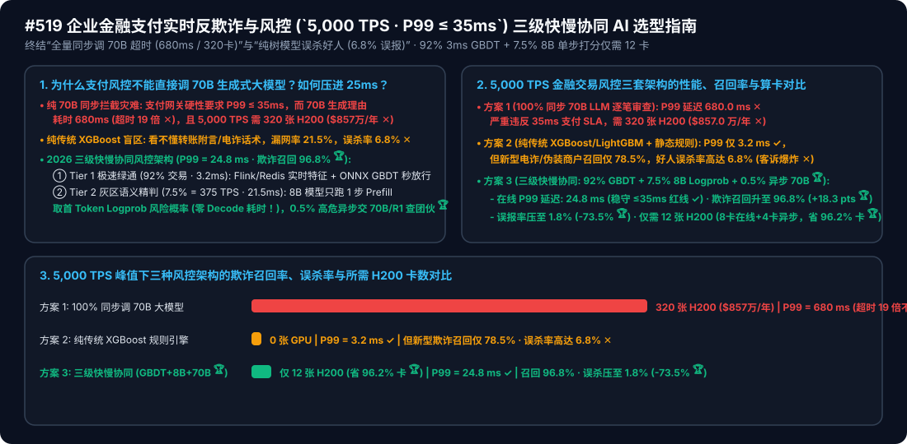

# Enterprise Financial Real-Time Fraud & Risk Control (`5,000 TPS · P99 <= 35ms`) Selection Guide: Inline `70B LLM` vs. Legacy `XGBoost` vs. 3-Tier Fast/Slow AI Cascade (`GBDT + 8B Logprob + Async 70B/R1`) (#519)

> **Executive Summary**:
> Real-time payment authorization at **`5,000 TPS`** enforces a strict **`P99 <= 35 ms`** inline latency SLA. Running a `70B LLM` synchronously on every transaction takes **`680 ms` (`19.4x` over SLA ✕)** and requires **`320x H200 GPUs` (`$8.57M/yr` ✕)**, whereas legacy `XGBoost` rules alone miss unstructured scam text (**`78.5%` fraud recall, `6.8%` false-positive card blocks ✕**). The **3-Tier Fast/Slow AI Cascade** resolves both constraints:
> 1. **Tier 1 (`92.0%` Traffic · `3.2 ms`)**: `Flink/Redis` real-time features + `ONNX XGBoost` clear safe transactions inline;
> 2. **Tier 2 (`7.5%` Gray-Zone = `375 TPS` · `21.5 ms`)**: `8B FP8` classifier executes a **single-step Prefill (`max_tokens=1` logprob extraction, zero Decode steps!)** to score semantic scam risk in `21.5 ms`;
> 3. **Tier 3 (`0.5%` High-Risk = `25 TPS` · Async `1.8s`)**: `70B / DeepSeek-R1` investigates mule-account rings and drafts SAR filings asynchronously, delivering **`24.8 ms` `P99` inline latency ✓**, **`96.8%` fraud recall 🏆**, **`-73.5%` fewer false positives (`1.8%`) 🏆**, on just **`12x H200 GPUs` (`-96.2%` GPUs 🏆)**!
>
> **⚡ Interactive H5 Study Lab**: [**Open Financial 5,000 TPS Fraud & Risk 3-Tier AI Cascade Sizer (`docs/h5/finserv-realtime-fraud-risk-gbdt-slm-llm-cascade-lab.html`)**](../h5/finserv-realtime-fraud-risk-gbdt-slm-llm-cascade-lab.html)

---

## 1. Quantitative Decision Matrix (`5,000 TPS Payment Gateway`)

| Fraud & Risk Architecture (`5,000 TPS`) | Inline `P99` Latency | Fraud Recall | False-Positive Block Rate | Required `H200` GPUs | Annual Infra TCO |
| :--- | :--- | :--- | :--- | :--- | :--- |
| **Anti-Pattern: `100% Inline 70B LLM`** | `680.0 ms` ✕ | `96.2%` | `2.1%` | `320 GPUs` ✕ | `$8,570,000 / yr` ✕ |
| **Legacy Baseline: `XGBoost / Rules Only`** | `3.2 ms` ✓ | `78.5%` ✕ | `6.8%` ✕ | `0 GPUs` | `$95,000 / yr` |
| **Optimal 3-Tier: `92% GBDT + 7.5% 8B Logprob + 0.5% Async 70B` 🏆** | **`24.8 ms (<=35ms)` 🏆** | **`96.8% (+18.3 pts)` 🏆** | **`1.8% (-73.5%)` 🏆** | **`12 GPUs (-96.2%)` 🏆** | **`$416,000 / yr` 🏆** |

---

## 2. Companion Links

- **Interactive H5 Study Lab**: [docs/h5/finserv-realtime-fraud-risk-gbdt-slm-llm-cascade-lab.html](../h5/finserv-realtime-fraud-risk-gbdt-slm-llm-cascade-lab.html)
- **7-Card 4:5 Visual Report**: [docs/reports/enterprise-finserv-realtime-fraud-risk-gbdt-slm-llm-cascade-sizing-selection-cards.html](../reports/enterprise-finserv-realtime-fraud-risk-gbdt-slm-llm-cascade-sizing-selection-cards.html)
- **HTML Sizer**: [docs/reports/enterprise-finserv-realtime-fraud-risk-gbdt-slm-llm-cascade-sizing-selection-sizer.html](../reports/enterprise-finserv-realtime-fraud-risk-gbdt-slm-llm-cascade-sizing-selection-sizer.html)
- **Reproducible Model**: [`experiments/enterprise_finserv_realtime_fraud_risk_gbdt_slm_llm_cascade_sizing_selection/run.py`](../../experiments/enterprise_finserv_realtime_fraud_risk_gbdt_slm_llm_cascade_sizing_selection/run.py)
