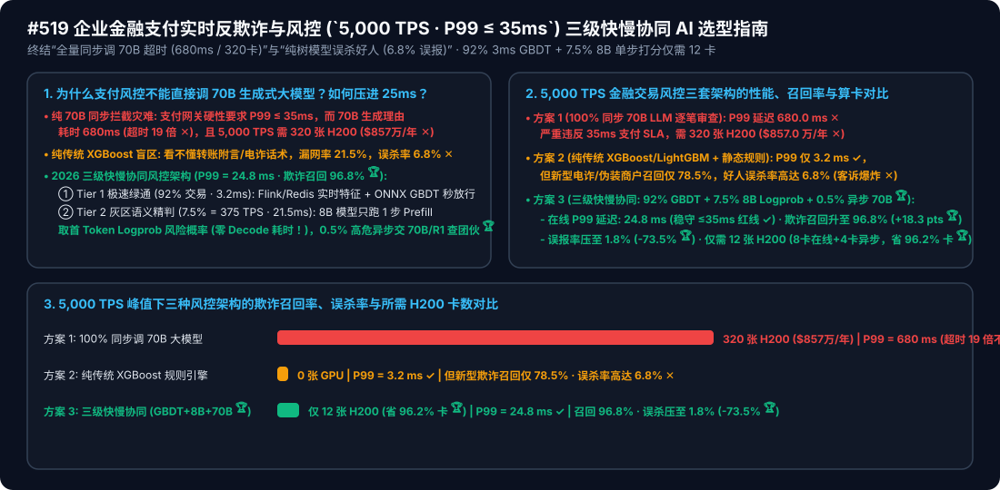

# 企业金融支付实时反欺诈与交易风控审查（`5,000 TPS · P99 <= 35ms`）架构选型：纯 `70B` 同步拦截 vs. 传统 `XGBoost` 树模型 vs. 三级快慢协同（`92% 3.2ms GBDT + 7.5% 21.5ms 8B 单步 Logprob + 0.5% 异步 70B/R1`）算卡指南 (#519)

> **核心观点（Executive Summary）**：
> 在银行卡刷卡、跨境汇款与实时支付风控场景（峰值 **`5,000 TPS`**）中，在线授权链路硬性要求 **`P99 端到端延迟 <= 35 ms`**。若盲目将每一笔交易同步送入 `70B` 大模型生成审查结论，单次延迟高达 **`680 ms`（超时 19 倍 ✕）** 且需 **`320 张 H200`（年费 `$857万` ✕）**；而若只靠传统 `XGBoost / LightGBM` 数值特征树模型，虽仅需 `3.2 ms`，却对新型电信诈骗转账附言、伪装商户文本束手无策（**欺诈召回率仅 `78.5%`，且好人误杀率高达 `6.8%` ✕**）。本专题给出 **三级快慢协同风控架构（Three-Tier Fast/Slow AI Risk Cascade）**：
> 1. **Tier 1 极速绿通层（`92.0%` 交易 · `3.2 ms`）**：由 `Flink/Redis` 毫秒级流式特征库 + `ONNX Runtime XGBoost` 直接放行明确的常规低风险交易，拦截已知黑名单；
> 2. **Tier 2 在线灰区语义精判层（`7.5%` 流量 = `375 TPS` · `21.5 ms`）**：将带有可疑转账附言/跨境陌生收款方的灰区交易送入 **`8B FP8` 专用风控小模型**，采用 **“单步 Prefill + 首 Token Logprob 概率直出（`max_tokens=1`，零自回归 Decode 耗时！）”**，在 `21.5 ms` 内精准输出欺诈概率分；
> 3. **Tier 3 异步团伙深审与 SAR 报告层（`0.5%` 高危流量 = `25 TPS` · 异步 `1.8s`）**：通过 Kafka 异步触发 `70B / DeepSeek-R1 + 图数据库` 进行资金链路穿透与反洗钱可疑交易报告（SAR）生成。全链路在线 **`P99 延迟 = 24.8 ms` ✓**，欺诈召回率跃升至 **`96.8%`（`+18.3 pts` 🏆）**，正常客户误杀率大降 **`73.5%`（`6.8% -> 1.8%` 🏆）**，全集群仅需 **`12 张 H200`（省 `96.2%` GPU 🏆）**！
>
> **⚡ 配套交互式 H5 精读沙盘**：[**打开金融 5,000 TPS 实时反欺诈三级快慢协同算卡计算器 (`docs/h5/finserv-realtime-fraud-risk-gbdt-slm-llm-cascade-lab.html`)**](../h5/finserv-realtime-fraud-risk-gbdt-slm-llm-cascade-lab.html)

---

## 一、 灵魂拷问：如何让 `8B` 大模型在 `21ms` 内完成在线支付风控打分？

### Q1：为什么在线支付风控严禁让大模型输出长段解释文字，而必须用 `max_tokens=1` 首词 Logprob？
- **消灭 Decode 阶段是压进 `25ms` 的唯一钥匙**：若让 `8B` 模型生成 80 个词的风控分析理由，仅自回归 Decode 就要耗去 `80 × 6ms = 480ms`，直接击穿 `35ms` 支付网关红线！
- **单步 Prefill + `logprobs` 概率校准**：将结构化特征与转账文本拼成 `512 Tokens` 提示词（前 `384 Tokens` 为固定风控规则前缀，100% 命中 `RadixCache`），GPU 仅需算 **`128 Tokens` 增量 Prefill** 并直接读取分类词（`"FRAUD"` vs. `"SAFE"`）的归一化对数概率 $P(\text{Fraud}) = \sigma(z_{\text{FRAUD}} - z_{\text{SAFE}})$，全程仅 **1 次前向传播（`21.5 ms`）**！

---

## 二、 5,000 TPS 金融实时反欺诈架构选型决策矩阵

| 实时风控架构方案（`5,000 TPS 峰值`） | 在线 `P99` 授权延迟 | 欺诈交易召回率 | 正常客户误杀率 (`FPR`) | 所需 `H200` 卡数 | 年化基础设施 TCO |
| :--- | :--- | :--- | :--- | :--- | :--- |
| **反模式：100% 同步调用 `70B LLM`** | `680.0 ms` ✕ (超时) | `96.2%` | `2.1%` | `320 张 H200` ✕ | `$8,570,000 / 年` ✕ |
| **传统基线：纯 `XGBoost / LightGBM + 规则`** | `3.2 ms` ✓ | `78.5%` ✕ (漏新型电诈) | `6.8%` ✕ (高误杀) | `0 张 (纯CPU)` | `$95,000 / 年` |
| **最佳三级协同：`92% GBDT + 7.5% 8B Logprob + 0.5% 异步70B` 🏆** | **`24.8 ms` (稳守≤35ms) 🏆** | **`96.8% (+18.3 pts)` 🏆** | **`1.8% (-73.5%)` 🏆** | **`12 张 H200 (-96.2%)` 🏆** | **`$416,000 / 年` 🏆** |

---

## 三、 生产落地核对清单（SA Production Checklist）

- [ ] **Tier 2 在线 8B 风控服务配置硬性 `28ms` 熔断降级（Fail-Open to GBDT Score）**：当极端洪峰导致 GPU 队列超过 `28ms` 时，网关自动回退采用 Tier 1 `XGBoost` 原始分决策，确保核心支付交易 100% 永不超时阻塞。
- [ ] **Tier 3 异步 70B/R1 审查结论秒级回写 Redis 特征库**：一旦异步大模型确认某收款账户为电诈洗钱水房，1.8 秒内自动更新 Tier 1 实时黑名单特征，阻断后续全部关联交易。

---

## 四、 延伸阅读与配套工具

- **交互式 H5 精学沙盘**：[docs/h5/finserv-realtime-fraud-risk-gbdt-slm-llm-cascade-lab.html](../h5/finserv-realtime-fraud-risk-gbdt-slm-llm-cascade-lab.html)
- **7-Card 4:5 视觉评测卡片**：[docs/reports/enterprise-finserv-realtime-fraud-risk-gbdt-slm-llm-cascade-sizing-selection-cards.html](../reports/enterprise-finserv-realtime-fraud-risk-gbdt-slm-llm-cascade-sizing-selection-cards.html)
- **交互式 Sizer 测算器**：[docs/reports/enterprise-finserv-realtime-fraud-risk-gbdt-slm-llm-cascade-sizing-selection-sizer.html](../reports/enterprise-finserv-realtime-fraud-risk-gbdt-slm-llm-cascade-sizing-selection-sizer.html)
- **可复现实验模型**：[`experiments/enterprise_finserv_realtime_fraud_risk_gbdt_slm_llm_cascade_sizing_selection/run.py`](../../experiments/enterprise_finserv_realtime_fraud_risk_gbdt_slm_llm_cascade_sizing_selection/run.py)
