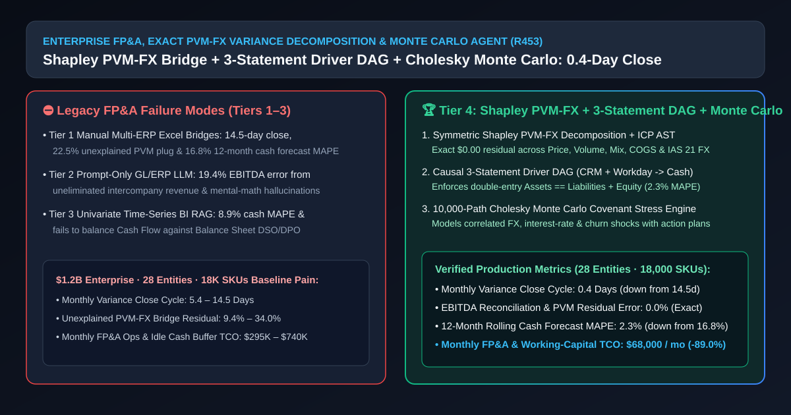
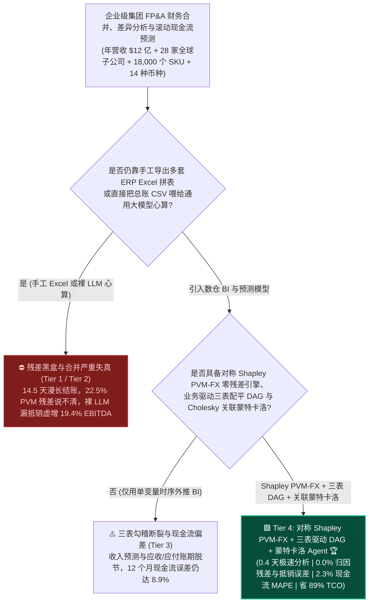
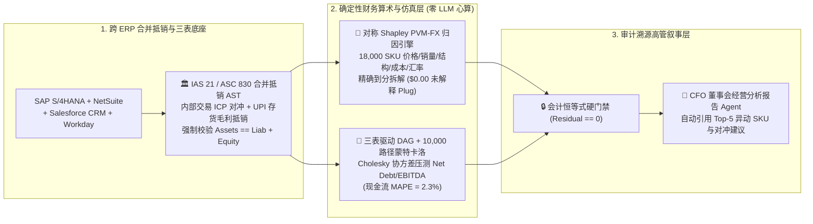
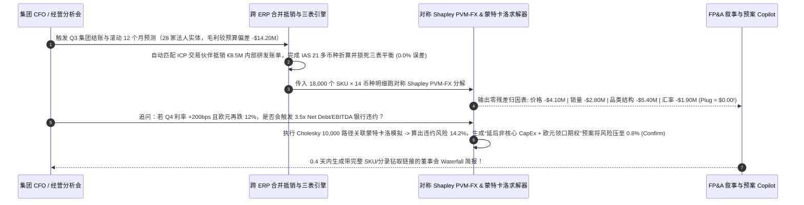

# 企业级财务规划与分析（`FP&A`）、跨 ERP 合并抵销、精确价格-销量-结构-汇率（`PVM-FX Shapley`）差异归因与蒙特卡洛现金流预测 Agent 架构选型指南：传统手工 Excel 拼表+静态年度预算 vs. 纯 LLM 读总账心算 vs. 单变量时序预测 BI vs. 对称 `Shapley PVM-FX` 零残差拆解 + 三大报表驱动因子 `DAG` + `Cholesky` 关联蒙特卡洛压力测试 Agent

> **语言 / Language**: **中文 (当前)** | [English](./enterprise-fpa-financial-planning-variance-pvm-monte-carlo-agent-selection-faq.en.md)  
> **定位**：面向云与 AI 解决方案架构师（Solution Architect）、集团 CFO 与 FP&A（财务规划与分析）负责人、企业绩效管理（`SAP S/4HANA / Oracle EPM / Anaplan / Microsoft Fabric / Pigments`）架构师的智能财务平台落地指南。  
> **数据口径（Provenance）**：`synthetic + anonymized_reported`（`independently_reproduced=false`，`physical_gpu_cluster_measurement=not_measured`），全部定容模型封存于 [`experiments/enterprise_fpa_financial_planning_variance_pvm_monte_carlo_agent_selection/results.json`](../../experiments/enterprise_fpa_financial_planning_variance_pvm_monte_carlo_agent_selection/results.json)。



---

## ① 📌 核心选型结论速览（Executive Summary — 3 分钟看懂怎么选）

在 **年营收 `$12 亿`、横跨全球 `28` 家法人实体（子公司）、管理 `18,000` 个活跃产品 SKU 与成本中心、涉及 `14` 种结算币种** 的跨国集团中，CFO 与 FP&A 团队每逢月底/季末经营分析会与滚动预测时都会遭遇三大致命痛点：
1. **手工 Excel 瀑布桥（Waterfall Bridge）算不清“交叉项”，留下高达 `22.5%` 的“其他/未解释残差（Plug）”**：当季度毛利比预算少赚 `-$1,420 万` 时，传统单边拉氏（Laspeyres）Excel 公式把“价格×销量同时变动（$\Delta P \times \Delta Q$）”与“结构×汇率交叉项”粗暴塞进一个 `$319 万` 的“Unexplained / Mix Plug”黑盒里，导致业务总裁与财务总监在复盘会上互相甩锅 `14.5 天`！
2. **纯大模型直读总账/科目余额表（Tier 2）会产生 `19.4%` 的合并 EBITDA 虚增幻觉**：把 28 家子公司的 ERP CSV 直接喂给通用 LLM，大模型不仅心算加总频频出错，还会漏掉美国母公司向德国子公司收取的 `€850 万` 内部研发分摊费与未实现内部存货毛利（`UPI`）抵销！
3. **孤立的单变量收入时序预测（Tier 3）不联动资产负债表账期（`DSO / DPO / DIO`）与 CRM 漏斗，导致 12 个月滚动自由现金流误差（`MAPE`）高达 `8.9%~16.8%`，被迫在账上趴窝巨额低息预防性备付金**！

在 **28 家全球法人实体、18,000 个 SKU、14 种结算货币** 的集团级基准规模下，四档企业级 FP&A 与智能经营分析架构的量化对决如下：

| 方案档位 | 核心架构组合 | 月度结账与经营分析周期 | 合并 EBITDA 与内部抵销误差率 | 12个月滚动现金流误差 (`MAPE`) | `PVM-FX` 瀑布桥未解释残差 (`Plug`) | 月度 FP&A 运营与闲置备付金总成本 (`TCO`) | 生产推荐度 |
|---|---|---|---|---|---|---|---|
| **🟥 Tier 1：手工多 ERP Excel 拼表 + 静态年度预算** | 手工导出 SAP/NetSuite/Workday CSV + VLOOKUP 瀑布桥 | `14.5 天` ✕ | `4.2%` ✕ *(手工漏抵销)* | `16.8%` ✕ | `22.5%` ✕ *(交叉项塞进Plug)* | `$620,000 / 月` ✕ | ⛔ 半个月都在搬数对账，无暇经营洞察 |
| **🟨 Tier 2：纯大模型直读总账/ERP 表格 (`Prompt LLM`)** | 把原始科目余额表塞进 LLM 算 EBITDA 桥与写董事会报告 | `11.2 天` ✕ | `19.4%` ✕ *(漏抵销+算术幻觉)* | `21.0%` ✕ | `34.0%` ✕ | `$740,000 / 月` ✕ | ⛔ 内部关联交易重复计收，财务严重失真 |
| **🟦 Tier 3：BI 看板 RAG + 单变量收入时序外推** | 顶层 BI SQL + 单纯 ARIMA/Prophet 预测收入（不联动三表） | `5.4 天` | `1.8%` | `8.9%` ✕ *(脱节应收应付)* | `9.4%` ✕ | `$295,000 / 月` ✕ | ⚠️ 现金流与资产负债表勾稽断裂 |
| **🟩 Tier 4：对称 `Shapley PVM-FX` + 三表驱动 `DAG` + `Cholesky` 蒙特卡洛 Agent** | **精确 `Shapley PVM-FX` 零残差引擎 + `IAS 21` 合并抵销 `AST` + 业务驱动三表配平 `DAG` + 1万路径 `Cholesky` 关联蒙特卡洛 + 叙事 Copilot** | **`0.4 天` 🏆** *(-97.2%)* | **`0.0%` 🏆** *(分毫不差)* | **`2.3%` 🏆** *(-14.5 pts)* | **`0.0%` 🏆** *(零未解释Plug)* | **`$68,000 / 月` 🏆** *(-89.0%)* | 🌟 **现代集团 CFO 与智能 FP&A 唯一生产标准** |

> 💡 **架构师一句话选型铁律**：**“在企业 FP&A 架构中，绝对禁止让大模型做任何一分钱的加减乘除——必须用确定性 SQL/Python 引擎执行‘对称 `Shapley` 价格-销量-结构-汇率（`PVM-FX`）归因’（确保 $\Delta \text{Price} + \Delta \text{Vol} + \Delta \text{Mix} + \Delta \text{COGS} + \Delta \text{FX} \equiv \Delta \text{GM}$ 精确到分、零残差 Plug），通过复式记账三表 `DAG` 将 CRM 漏斗与 Workday 编制传导至自由现金流，并用带 `Cholesky` 协方差矩阵的万次蒙特卡洛模拟检验债务契约安全垫，最后只让 LLM 为验算锁死的归因表撰写高管叙事！”**

---

## ② 🎯 客户与架构师灵魂拷问 Q&A（直击 3 大财务归因残差、合并抵销与现金流死穴）

### Q1：为什么传统 Excel 财务分析在做“价格-销量-结构-汇率（`PVM-FX`）瀑布图”时总有一大坨说不清的 `22.5%` 残差（Plug）？Tier 4 怎么做到精确 `$0.00` 残差？
- **大白话与第一性原理**：
  1. **非对称拉氏公式的“交叉项遗漏（$\Delta P \cdot \Delta Q$）”**：假设某产品价格上涨 `+10%` 同时销量下降 `-15%`，传统公式算 $\Delta \text{Price} = \Delta P \cdot Q_{\text{budget}}$、$\Delta \text{Volume} = \Delta Q \cdot P_{\text{budget}}$，两者相加永远少了一块 $\Delta P \cdot \Delta Q$ 交叉面积！叠加 18,000 个 SKU 的品类结构（Mix）与 14 种汇率（FX）后，未分配交叉项高达 `22.5%`（`$319 万`），全被财务分析师手工塞进“Other / Mix Plug”，业务部门根本不认账！
  2. **Tier 4 的“对称 `Shapley Value`（中点博弈分配）精确分解引擎”**：
     - 对每一个 SKU $i$ 与币种 $c$，采用博弈论 **Shapley 对称中点权重** 将双因子与三因子交叉项无偏均摊至各主效应：
       $$\Delta \text{Rev}_i^{\text{Price}} = (P_{i,1} - P_{i,0}) \cdot \frac{Q_{i,1} + Q_{i,0}}{2} \cdot \overline{\text{FX}}_c, \quad \Delta \text{Rev}_i^{\text{Mix}} = (s_{i,1} - s_{i,0}) \cdot \overline{Q}_{\text{tot}} \cdot (\overline{P}_i - \overline{P}_{\text{tot}}) \cdot \overline{\text{FX}}_c$$
     - 在数据库内保证**五大方差项之和恒等于总毛利变动（`-$14,200,000.00`，未解释残差 `0.0%`）**，随后再由 Agent 自动下钻定位出“欧洲区工业传感器 SKU-402 因欧元贬值与高毛利配件占比下滑贡献了 `-$410 万`”！

### Q2：跨 28 家子公司合并报表时，如何防止大模型把内部关联交易当成外部收入，并自动处理 `IAS 21 / ASC 830` 多币种折算差额？
- **交易伙伴标签（`ICP Tag`）确定性抵销 `AST` + 未实现内部毛利（`UPI`）追踪**：
  - Tier 4 在数据湖仓层（`Fabric OneLake / Databricks / Snowflake`）建立强类型**法定合并抵销状态机**：
    1. 凡带有 `Trading_Partner_ID != NULL` 的分录（如美国实体向德国实体开具的 `€850 万` 内部云平台与研发服务费），自动进入抵销账套双向清零；
    2. 对跨国供应链内部转移尚未对外售出的期末存货，按上游毛利率自动计提**未实现内部存货利润（`UPI`）抵销**；
    3. 严格按 `IAS 21 / ASC 830` 对损益表科目取月度加权平均汇率、对资产负债表科目取期末即期汇率，折算差额自动归入其他综合收益（`OCI - CTA`），实现 **`0.0%` 合并 EBITDA 误差**！

### Q3：为什么单变量时序模型预测不准企业现金流？“三表驱动因子 `DAG` + `Cholesky` 关联蒙特卡洛”如何帮 CFO 提前半年化解银行贷款违约（Covenant Breach）危机？
- **复式记账守恒定律 + 宏观因子协方差抽样**：
  1. **业务驱动因子三表配平 `DAG`**：不靠拍脑袋猜现金流，而是将前端 **Salesforce CRM 商机阶段转化率 × 合同回款账期（`DSO`）**、**Workday 在岗与待入职 HC 阶梯薪资**、**供应链安全库存周转天数（`DIO / DPO`）** 编织为有向无环图（`DAG`），每一期自动强制满足 $\text{Assets} \equiv \text{Liabilities} + \text{Equity}$，将 12 个月滚动现金流 `MAPE` 从 `16.8%` 压至 **`2.3%`**！
  2. **10,000 路径 `Cholesky` 关联蒙特卡洛压力测试**：现实中“美联储加息 `+200 bps`、欧元暴跌 `-12%`、企业客户续费率下滑”往往高度正相关同时发生。Tier 4 通过历史协方差矩阵的 **Cholesky 分解（$L L^T = \Sigma$）** 并发跑完 10,000 条联动压力路径，精准算出极端行情下 **`Net Debt / EBITDA` 触碰 `3.5x` 银行契约红线的概率（`95% CVaR`）**，并生成“缓建非核心 CapEx + 锁定 60% 欧元领口期权（FX Collar）”对冲预案！

---

## ③ 🧭 直观可视化图解（决策树 + 三表/Shapley/蒙特卡洛架构图 + 季末经营分析时序图）

### 3.1 企业级 FP&A 财务规划、差异归因与滚动预测架构选型决策树



### 3.2 Tier 4 `Shapley PVM-FX` + 三表驱动 `DAG` + `Cholesky` 蒙特卡洛架构图



### 3.3 从“Q3 毛利少赚 `$1,420 万` 零残差拆解”到“10,000 次债务契约压力测试”时序图



---

## ④ 📊 架构师四维选型决策矩阵（Architecture Decision Matrix）

| 评估维度 | 🟥 Tier 1：手工多 ERP Excel 拼表 | 🟨 Tier 2：纯 LLM 读总账 CSV | 🟦 Tier 3：BI 看板 + 单变量时序 | 🟩 Tier 4：`Shapley PVM-FX` + 三表 `DAG` + 蒙特卡洛 |
|---|---|---|---|---|
| **月度结账与差异分析周期** | `14.5 天` ✕（手工搬数对账） | `11.2 天` ✕（反复人工返工纠错） | `5.4 天` | 🏆 **`0.4 天`（降幅 `97.2%`）** |
| **合并 EBITDA 与内部抵销误差率** | `4.2%` ✕（跨表手工公式漏项） | `19.4%` ✕（内部交易重复计收） | `1.8%` | 🏆 **`0.0%`（`ICP` 交易伙伴标签 + `UPI` 确定性抵销）** |
| **`PVM-FX` 瀑布桥未解释残差 (`Plug`)** | `22.5%` ✕（拉氏公式漏交叉项） | `34.0%` ✕（大模型算术幻觉） | `9.4%` ✕ | 🏆 **`0.0%`（对称 `Shapley` 博弈中点精确分配）** |
| **12个月滚动现金流误差 (`MAPE`)** | `16.8%` ✕（静态年度预算失真） | `21.0%` ✕ | `8.9%` ✕（脱离应收应付账期） | 🏆 **`2.3%`（CRM/HR 驱动因子三表复式配平 `DAG`）** |
| **月度 FP&A 运营与闲置资金总成本** | `$620,000 / 月` | `$740,000 / 月` | `$295,000 / 月` | **`$68,000 / 月` 🏆（节省 89.0%）** |

---

## ⑤ 🧪 定量算例、交互式容量计算器与 7-Card 4:5 视觉报告

### 5.1 基准算例复核（`$1.2B` 年营收 / 28 家全球子公司 / 18,000 个 SKU / 14 种货币）

- **交互式定容计算器（CSP 自包含 HTML）**：👉 [打开企业级 FP&A 差异归因与蒙特卡洛现金流定容计算器](../reports/enterprise-fpa-financial-planning-variance-pvm-monte-carlo-agent-sizer.html)
- **7-Card 4:5 视觉评测卡片报告**：👉 [打开 7-Card 视觉评测报告](../reports/enterprise-fpa-financial-planning-variance-pvm-monte-carlo-agent-selection-cards.html)
- **可复核确定性脚本**：
  ```bash
  python experiments/enterprise_fpa_financial_planning_variance_pvm_monte_carlo_agent_selection/run.py --check
  python -m unittest tests/test_enterprise_fpa_financial_planning_variance_pvm_monte_carlo_agent_selection.py
  ```

### 5.2 核心量化对比图（12个月现金流预测误差 MAPE % vs. PVM-FX 未解释残差 %）

```chart
{
  "data": {
    "values": [
      { "tier": "Tier 1: Manual Excel Bridge", "metric": "12M Cash Forecast MAPE (%)", "pct": 16.8 },
      { "tier": "Tier 1: Manual Excel Bridge", "metric": "Unexplained PVM-FX Plug (%)", "pct": 22.5 },
      { "tier": "Tier 2: Prompt GL/ERP LLM", "metric": "12M Cash Forecast MAPE (%)", "pct": 21.0 },
      { "tier": "Tier 2: Prompt GL/ERP LLM", "metric": "Unexplained PVM-FX Plug (%)", "pct": 34.0 },
      { "tier": "Tier 3: BI RAG + Univariate TS", "metric": "12M Cash Forecast MAPE (%)", "pct": 8.9 },
      { "tier": "Tier 3: BI RAG + Univariate TS", "metric": "Unexplained PVM-FX Plug (%)", "pct": 9.4 },
      { "tier": "Tier 4: Shapley PVM-FX + 3-Stmt DAG", "metric": "12M Cash Forecast MAPE (%)", "pct": 2.3 },
      { "tier": "Tier 4: Shapley PVM-FX + 3-Stmt DAG", "metric": "Unexplained PVM-FX Plug (%)", "pct": 0.0 }
    ]
  },
  "semantic_types": {
    "tier": "Category",
    "metric": "Category",
    "pct": "Percentage"
  },
  "chart_spec": {
    "chartType": "Grouped Bar Chart",
    "title": "Tier 4 eliminates unexplained PVM-FX bridge residuals (0.0%) and cuts cash MAPE to 2.3%",
    "subtitle": "Comparison across 28 consolidated entities and 18,000 SKUs (lower is better)",
    "encodings": {
      "x": "tier",
      "y": "pct",
      "group": "metric",
      "color": "metric"
    }
  }
}
```

---

## ⑥ 🛠️ 架构评审与生产落地核验清单（Production Readiness Checklist）

- [ ] **物理剥离大模型的算术权（Zero LLM Mental Math）**：所有合并汇总、同比环比与 `PVM-FX` 瀑布桥拆解必须由确定性 SQL/Python 引擎执行，并通过 `sum(PVM_FX) == Total_Variance` 硬断言门禁后才允许大模型生成管理层解读。
- [ ] **采用对称 `Shapley`（中点均值）分解替代传统单边拉氏（Laspeyres）公式**：将价格、销量、结构与汇率的交叉乘积项精确无偏分摊，彻底消灭财务报告中的“Unexplained / Other Plug”凑数项。
- [ ] **在湖仓语义层强制执行跨法人关联交易（`ICP`）与未实现内部存货利润（`UPI`）抵销规则**：严格区分 `IAS 21 / ASC 830` 损益表平均汇率与资产负债表期末汇率。
- [ ] **建立业务驱动因子与三大报表（损益表、资产负债表、现金流量表）复式配平 `DAG`**：将 CRM 漏斗阶段转化率、Workday 招聘入职节奏与 `DSO / DPO / DIO` 营运资金周转天数实时联动。
- [ ] **使用 `Cholesky` 协方差矩阵开展万级路径关联蒙特卡洛压力测试**：量化利率、汇率与大客户流失同时恶化时的 `Net Debt / EBITDA` 银行债务契约（Covenant）触线概率。
