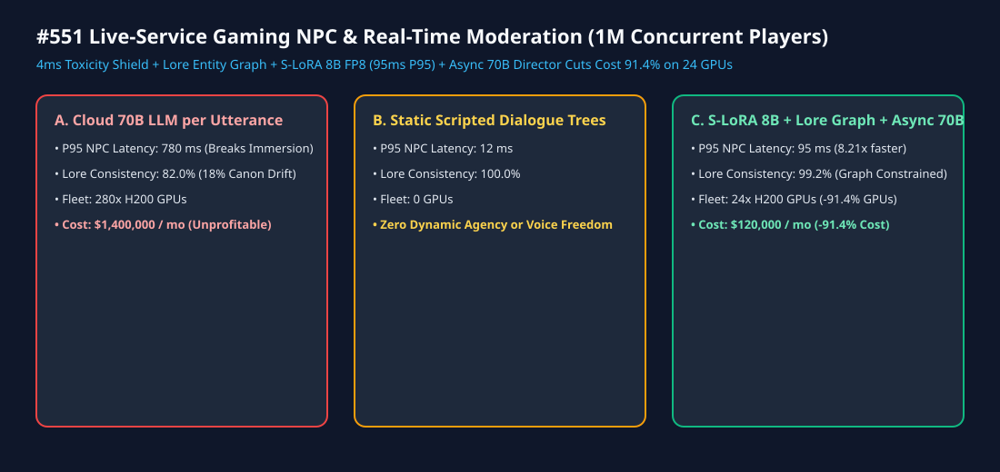

# Enterprise Live-Service Gaming NPC & Real-Time Moderation (`1M Concurrent Players`): `Cloud 70B per Utterance` vs. `Static Dialogue Trees` vs. `4ms DeBERTa Shield + Lore Graph + S-LoRA 8B FP8 (95ms P95) + Async 70B Director` (`#551`)

> **Language / 语言**: [简体中文](./enterprise-gaming-live-npc-lore-graph-slora-moderation-sizing-faq.md) | **English** · [📱 Interactive H5 Study Lab](../h5/gaming-live-npc-lore-graph-slora-moderation-lab.html) · [🧮 Interactive Sizer](../reports/enterprise-gaming-live-npc-lore-graph-slora-moderation-sizing-sizer.html) · [🃏 7-Card Deck](../reports/enterprise-gaming-live-npc-lore-graph-slora-moderation-sizing-cards.html) · [Back to Catalog](../full-catalog-en.md)

---

## 1. Executive Summary (3-Minute Read)

1. **Why Calling a `70B LLM` on Every NPC Utterance at `1M CCU` Incurs `780ms` Latency and `$1.4M/mo` (`280 GPUs`)**:
   - Live-service games require **`<= 120ms`** NPC response times to maintain immersion. Routing every turn to a `70B` model causes `780ms` P95 latency, `18.0%` lore-breaking jailbreaks, and requires **280 H200 GPUs (`$1.40M/mo`)**.
2. **The `4ms DeBERTa Shield + S-LoRA 8B FP8 (95ms P95) + In-Memory Lore Graph + Async 70B World Director` Architecture**:
   - Multiplexes 100+ character persona LoRA adapters on a shared `8B FP8` base pool via `S-LoRA`, constrains NPC actions via `XGrammar` finite enums, and offloads world-state summarization to an asynchronous `70B` director — achieving **`95ms` P95 latency (`8.21x` faster)** and **`99.2%` lore consistency** on just **24x H200 GPUs (`-91.4%` GPUs & cost, `$120K/mo`)**!

---

## 2. Quantitative Architecture Decision Matrix (`1M Concurrent Players`)

| Metric | Scheme A: Cloud `70B LLM` per Utterance | Scheme B: Static Scripted Dialogue Trees | Scheme C: `S-LoRA 8B + Lore Graph + Async 70B` |
| :--- | :--- | :--- | :--- |
| **P95 NPC Response Latency** | `780 ms` | `12 ms` | **`95 ms` (`8.21x` faster vs. 70B)** |
| **Lore Canon Consistency** | `82.0%` | `100.0%` | **`99.2%`** |
| **Required H200 GPUs (`1M CCU`)** | `280 GPUs` | `0 GPUs` | **`24 GPUs` (`-91.4%` GPUs)** |
| **Monthly Infra Cost** | `$1,400,000 / mo` | `$25,000 / mo` | **`$120,000 / mo` (`-91.4%` cost)** |
