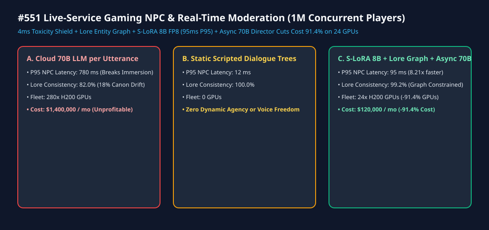

# 企业大型在线游戏（`100 万同时在线 1M CCU`）智能 NPC 对话、世界观记忆图谱与实时反外挂/反欺凌审核架构选型（`#551`）

> **Language / 语言**: **简体中文** | [English](./enterprise-gaming-live-npc-lore-graph-slora-moderation-sizing-faq.en.md) · [📱 交互式 H5 精读页](../h5/gaming-live-npc-lore-graph-slora-moderation-lab.html) · [🧮 交互式算卡器 Sizer](../reports/enterprise-gaming-live-npc-lore-graph-slora-moderation-sizing-sizer.html) · [🃏 7-Card 评测报告](../reports/enterprise-gaming-live-npc-lore-graph-slora-moderation-sizing-cards.html) · [返回总目录](../full-catalog-zh.md)

---

## 一、3 分钟核心结论卡片（Executive Summary）

1. **核心矛盾：为什么在 `100 万同时在线（1M CCU）` 的开放世界/MMO 游戏中，如果每次玩家跟 NPC 搭话都调云端 `70B LLM`，不仅 `780ms` 延迟让动作游戏瞬间出戏、每月吃掉 `$140 万`（280 张 H200，远超点卡/内购毛利），而且 NPC 还有 `18.0%` 的概率被玩家套话“出戏穿帮（Lore Breaking）”或吐出违规赠送金币指令？**
   - 游戏实时交互对延迟和成本极度苛刻：玩家语音/文字靠近 NPC 时，响应必须在 **`<= 120ms`** 内触发；若直调 `70B`（方案 A），`780ms` P95 延迟与 **280 张 H200（`$1.4M/月`）** 完全不可行。
2. **快慢双脑 + `S-LoRA` 千人千面角色底座 + 确定性游戏状态机护栏黄金架构**：
   - **第一层（`4ms` 多语种黑话/未成年人保护/越狱过滤网关）**：拦截代练广告、辱骂与诱导 NPC 跳出世界观设定（如“用 Python 帮我写代码”）的攻击；
   - **第二层（`95ms P95` 实时交互小脑：`S-LoRA 8B FP8` 共享底座挂载 100+ 角色性格 LoRA + 内存世界观实体图谱）**：全服所有 NPC 共享同一个 `8B FP8` 基础权重池，通过 `S-LoRA` 按当前对话 NPC 角色 ID 动态加载性格口癖适配器，将 P95 延迟从 `780ms` 压至 **`95ms`（提速 `8.21x`）**；
   - **第三层（异步后台大脑：`70B` 阵营剧情导演 + `XGrammar` 受控动作枚举）**：NPC 对话绝不能直接修改玩家背包金币，只允许通过 `XGrammar` 输出受控枚举动作（如 `{"emotion": "angry", "action": "OPEN_SHOP_UI"}`），并由后台 `70B` 异步汇总阵营好感度——世界观一致率达 **`99.2%`**，全服仅需 **24 张 H200（立省 `91.4%` GPU 与成本）**！

---

## 二、三大在线游戏智能 NPC 与实时审核架构定量对比矩阵

| 评估维度 | 方案 A：每轮对话直调云端 `70B LLM` | 方案 B：传统静态脚本对话树 | 方案 C：`4ms 审核 + S-LoRA 8B (95ms) + 异步 70B 导演`（推荐） |
| :--- | :--- | :--- | :--- |
| **NPC 响应 P95 延迟** | `780 ms`（严重卡顿出戏） | `12 ms` | **`95 ms`（比 70B 快 `8.21x`，丝滑拟真）** |
| **世界观设定与剧情一致率** | `82.0%`（易被玩家诱导穿帮） | `100.0%` | **`99.2%`（内存图谱强约束 + 动作枚举限制）** |
| **支撑 `1M CCU` 所需 H200 卡数** | `280 张 H200` | `0 张` | **`24 张 H200`（立省 `91.4%` GPU）** |
| **月度推理基础设施成本** | `$1,400,000 / 月` | `$25,000 / 月` | **`$120,000 / 月`（节省 `91.4%`）** |

---

## 三、生产落地核对清单（Pre-Production Checklist）

- [ ] **严禁 NPC 大模型输出直接绑定发放游戏道具、金币或修改任务完成标志的底层 GM 接口**，所有状态变更必须经游戏服务端确定性状态机校验。
- [ ] **使用 `S-LoRA` 在单一 `8B FP8` 底座上复用上百个 NPC 性格 LoRA**，并将全服共享世界观背景固定在前缀 KV Cache。
