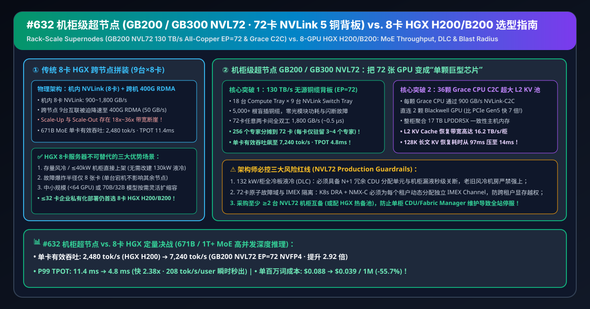

# Rack-Scale Supernodes (`NVIDIA GB200 / GB300 NVL72` · `72-GPU NVLink 5 Copper Backplane 130 TB/s` · `Grace C2C`) vs. 8-GPU `HGX H200 / B200`: Frontier MoE (`EP=72` All-Copper), `120kW+` Cold-Plate DLC, `IMEX` Fault Blast Radius & Token TCO Selection Guide (`#632`)

> **Language / 语言**: [简体中文](./enterprise-gb200-nvl72-supernode-vs-hgx-moe-ep72-sizing-faq.md) | **English** · [📱 Interactive H5 Study Lab (with NVL72 vs. HGX Topology + EP=72 Sizer)](../h5/gb200-nvl72-supernode-vs-hgx-moe-ep72-lab.html) · [🧮 Interactive Sizer](../reports/enterprise-gb200-nvl72-supernode-vs-hgx-moe-ep72-sizing-sizer.html) · [🃏 7-Card Visual Report](../reports/enterprise-gb200-nvl72-supernode-vs-hgx-moe-ep72-sizing-cards.html) · [Back to Catalog](../full-catalog-en.md)

---

## 1. 3-Minute Executive Summary

1. **Bottom-Line Recommendation**:
   - Standard `8-GPU HGX` servers restrict the `NVLink` Scale-Up domain to `8 GPUs`; scaling `671B–1T+ MoE` across multiple 8-GPU nodes drops bandwidth from `900–1,800 GB/s` intra-node NVLink down to `50 GB/s` 400G RDMA (`18×–36×` cliff).
   - **`NVIDIA GB200 / GB300 NVL72`** unites **`72 Blackwell GPUs`** across 18 compute trays and 9 NVLink switch trays over **5,000+ passive blind-mate copper cables** into a single **`130 TB/s` (`1,800 GB/s/GPU` bidirectional @ `~0.5 μs`) Scale-Up domain**, paired with **`36 Grace CPUs` (`17 TB LPDDR5X`) over `900 GB/s NVLink-C2C`**.
   - Running `DeepSeek 671B / 1T+ MoE` with **`EP=72 + NVFP4`** inside `NVL72` places only `4` routed experts (`~5.2 GB`) on each GPU and executes `All-to-All` entirely over the `1,800 GB/s` copper backplane (`<12 μs/layer`), cutting `P99 TPOT` from `11.4 ms` (2-node HGX H200) to **`4.8 ms` (`208.3 tok/s/user`, `2.38×` faster)**, boosting per-GPU throughput from `2,480` to **`7,240 tok/s/GPU` (`2.92×` higher)**, and lowering unit cost from `$0.088` to **`$0.039 / 1M tokens` (`-55.7%`)**!

---

## 2. Quantitative Comparison Matrix (`671B MoE` High-Throughput Serving)

| Metric | Option A: `2× 8-GPU HGX H200` (`FP8 · 400G RDMA`) | Option B: `1× 8-GPU HGX B200` (`NVFP4 · NVLink 5`) | Option C: `GB200 NVL72` Rack Supernode (`EP=72 Copper + Grace C2C`) 🏆 |
| :--- | :--- | :--- | :--- |
| **Scale-Up Domain & Bandwidth** | `8 GPUs` (`900 GB/s`) | `8 GPUs` (`1,800 GB/s`) | **`72 GPUs` (`1,800 GB/s` all-copper, `130 TB/s` rack total ✓)** |
| **CPU↔GPU KV Offload Bus (`128K` Restore)** | `PCIe Gen5` (`64 GB/s` · `97 ms`) | `PCIe Gen5/6` (`64–128 GB/s`) | **`NVLink-C2C` (`900 GB/s` · `14 ms` `128K` KV restore ✓)** |
| **`671B MoE` `P99 TPOT`** | `11.4 ms` (`87.7 tok/s`) | `7.6 ms` (`131.6 tok/s`) | **`4.8 ms` (`208.3 tok/s/user`, `2.38×` faster ✓)** |
| **Compliant Goodput per GPU** | `2,480 tok/s/GPU` | `4,650 tok/s/GPU` | **`7,240 tok/s/GPU` (`2.92×` higher ✓)** |
| **Cost per 1M Compliant Tokens** | `$0.088 / 1M` | `$0.056 / 1M` | **`$0.039 / 1M` (`-55.7%` unit cost ✓)** |

---

## 3. Pre-Production Checklist for `NVL72` Supernodes

- [ ] **1. `132 kW/Rack` Cold-Plate DLC & Dual-Rack Redundancy**: Provision `N+1` CDU manifolds and deploy `>=2` NVL72 racks (or an HGX fallback pool) to survive rack-wide maintenance domains.
- [ ] **2. Enforce `K8s DRA + IMEX Channel` Isolation**: Isolate multi-tenant workloads across dedicated `/dev/nvidia-caps-imex-channels/channelN` instances.
- [ ] **3. Configure `17 TB` Grace `LPDDR5X` as L1.5 KV Cache over `900 GB/s NVLink-C2C`**.
