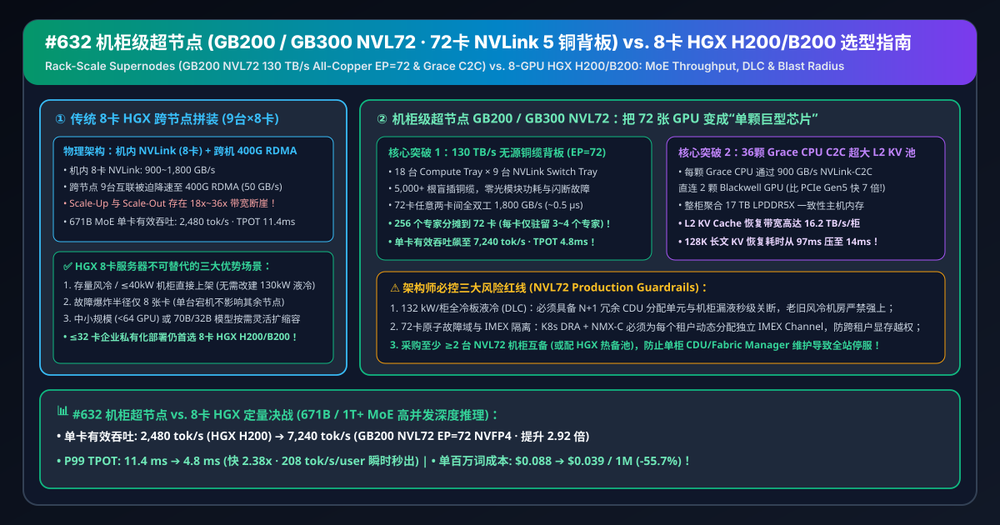
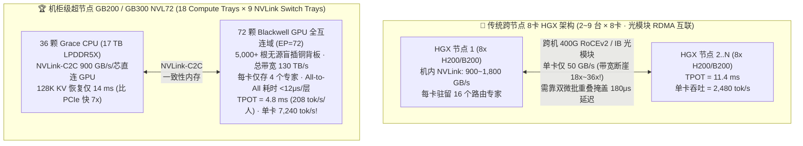

# 机柜级超节点（`NVIDIA GB200 / GB300 NVL72` · `72卡 NVLink 5 铜背板 130 TB/s` · `Grace C2C`）vs. 8 卡 `HGX H200 / B200`：超大 MoE（`EP=72` 全走铜缆）、`120kW+` 冷板液冷、`IMEX` 跨域故障爆炸半径与单百万 Token TCO 选型指南（`#632`）

> **Language / 语言**: **简体中文** | [English](./enterprise-gb200-nvl72-supernode-vs-hgx-moe-ep72-sizing-faq.en.md) · [📱 交互式 H5 精读页（含 NVL72 vs HGX 拓扑 + EP=72 吞吐计算器）](../h5/gb200-nvl72-supernode-vs-hgx-moe-ep72-lab.html) · [🧮 交互式容量计算器 Sizer](../reports/enterprise-gb200-nvl72-supernode-vs-hgx-moe-ep72-sizing-sizer.html) · [🃏 7-Card 评测报告](../reports/enterprise-gb200-nvl72-supernode-vs-hgx-moe-ep72-sizing-cards.html) · [返回总目录](../full-catalog-zh.md)

---

## 一、3 分钟核心结论卡片（Executive Summary）

1. **一句话结论**：
   - 传统 `8 卡 HGX 服务器` 的最大物理瓶颈在于 **`Scale-Up` 域止步于 8 张卡**：一旦部署 `DeepSeek-V3/R1 671B` 或万亿参数 MoE 需要跨越多台 8 卡机器，机内 `900–1,800 GB/s` 的 NVLink 就会断崖式跌落到机间 `50 GB/s` 的 400G RDMA 光网络（相差 `18–36 倍`）。
   - **`NVIDIA GB200 / GB300 NVL72` 机柜级超节点（Multi-Node NVLink，`MNNVL`）**通过机柜背部 **5,000+ 根无源盲插铜缆与 9 台 NVLink Switch Tray**，将整柜 **`72 张 Blackwell GPU`** 融合成单一的 **`130 TB/s`（每卡 `1,800 GB/s` 双向，`~0.5 μs` 延迟）全互连 Scale-Up 巨型域**，并配套 **`36 颗 Grace CPU` 通过 `900 GB/s NVLink-C2C`** 提供的 **`17 TB` 统一内存池**！
   - **定量效果**：在 `NVL72` 上运行 `EP=72 + 硬件 NVFP4`，`256` 个路由专家分摊到 72 张卡上，**每张 GPU 仅需驻留 `3.5–4` 个专家（约 `5 GB` 权重）**，且 `All-to-All` 100% 走 `1,800 GB/s` 铜背板！这将 `671B MoE` 的 `P99 TPOT` 从双机 HGX H200 的 `11.4 ms` 压降至 **`4.8 ms`（单流高达 `208 tok/s`，提速 `2.38 倍`）**，单卡有效吞吐从 `2,480 tok/s` 飙升至 **`7,240 tok/s/GPU`（提升 `2.92 倍`）**，每百万 Token 综合成本降至 **`$0.039 / 1M Tokens`（降低 `55.7%`）**！

2. **什么时候必须上 `GB200/GB300 NVL72` vs. 什么时候坚持选 `8卡 HGX H200/B200`？（架构师选型边界）**：

| 决策维度 | 选 `8 卡 HGX H200 / B200` 标准节点 | 选 `GB200 / GB300 NVL72` 机柜级超节点 🏆 |
| :--- | :--- | :--- |
| **集群目标规模** | **`< 64–72 张 GPU`**（无需或买不起整柜 72 卡起步） | **`>= 72–144 张 GPU`**（具备至少 `2` 台 NVL72 互备避免单柜单点故障） |
| **机房供电与液冷条件** | 存量风冷（`15–20 kW/柜`）或初级液冷（`40 kW/柜`）机房 | **新建 `120–132 kW/柜` 高密冷板直液冷（DLC）机房 + 冗余 CDU** |
| **核心业务模型结构** | `<=70B Dense`、`Qwen-32B`、多模态 `ViT`、常规部门级 RAG | **`671B–1T+` 超大稀疏 MoE、超长思维链 `<think>` 极速推理、万卡预训练** |
| **故障爆炸半径与多租户** | 单节点故障仅影响 `8` 张卡（`11%`），PCIe/K8s 隔离简单 | **整柜 72 卡共享 NVLink Fabric 与 CDU 液冷回路，需 `K8s DRA + IMEX` 严格隔离** |

---

## 二、灵魂拷问 Q&A：`EP=72` 全铜缆算账、`Grace C2C` 内存池与 `IMEX` 故障隔离

### Q1：为什么在 `GB200 NVL72` 上跑 `EP=72` 能把 `671B MoE` 的单步延迟压到不可思议的 `4.8 ms`？
- **答**：我们用**第二道水位线（HBM 带宽）+ 通信延迟**直接手算：
  1. **每张卡要读的专家权重缩小了 `9 倍`**：
     - 在 `16卡 HGX (EP=16)` 上，每张卡存放 `256 / 16 = 16` 个路由专家；
     - 在 `GB200 NVL72 (EP=72)` 上（配合 `EPLB` 冗余 32 个热门专家共 288 个专家槽位），**每张 B200 仅需存放 `288 / 72 = 4` 个专家**！在 `NVFP4` 下，4 个专家的权重体积仅约 **`5.2 GB`**；
     - 加上 `8.0 TB/s` 的 HBM3e 带宽，每层读取专家权重的时间从毫秒级缩短至**几十微秒**，同时 72 个并发 `Attention DP` 实例汇聚过来的海量 Token 把这 4 个专家的矩阵算术强度彻底推满！
  2. **跨机 `All-to-All` 从“光模块 RDMA”变成“无源铜背板直通”**：
     - 在传统多机 HGX 上，跨节点 `All-to-All` 走 `50 GB/s` 的 400G 网卡；而在 `NVL72` 机柜内部，72 张卡之间的 `All-to-All` 走的是 **`1,800 GB/s` 的 NVLink 5 铜缆背板（带宽高出 `36 倍`、延迟仅 `0.5 μs`）**，单层 `Dispatch + Combine` 耗时不到 **`12 μs`**！

---

### Q2：`GB200 NVL72` 在多租户 K8s 环境下存在什么安全与可靠性隐患？什么是 `IMEX` 通道隔离与 Clique 故障域？
- **答**：这是架构师评审 `NVL72` 落地方案时必须守住的**两条安全与高可用红线**：
  1. **`IMEX`（Internode Memory Exchange）跨节点显存导入导出安全隔离**：
     - 为了让不同 Compute Tray 上的 GPU 能通过 NVLink 背板直接读写彼此的 HBM 显存，NVIDIA 驱动程序引入了 **`IMEX` 硬件通道**；
     - **致命风险**：如果多个租户的 K8s Pod 共用同一个全局默认 `IMEX` 通道，租户 A 的容器可以通过 CUDA IPC / NVSHMEM 直接读取租户 B 显存里的模型权重与用户明文 Prompt！
     - **架构师强制方案**：必须启用 **`Kubernetes DRA (Dynamic Resource Allocation) + NVIDIA Compute Domain / NMX-C`**，为每个分布式作业动态创建独占的 `/dev/nvidia-caps-imex-channels/channelN`，从硬件页表级阻断跨租户显存越权访问。
  2. **72 卡机柜级故障爆炸半径（Rack-Scale Failure Blast Radius）**：
     - 单台 `NVL72` 机柜重达 `1.36 吨`、满载功耗 **`120–132 kW`**，72 张卡共用同一套机柜铜背板、同一组 `NVLink Fabric Manager` 与同一路 `CDU` 液冷歧管；一旦机柜漏液或冷却泵停机，**72 张 GPU 会同时离线**；
     - 因此生产环境**严禁只买 `1` 台单点 `NVL72` 承载核心在线流量**，必须按 **`>= 2 台 NVL72 机柜跨 CDU 双活`** 或 **`1 台 NVL72 + 1 组 8卡 HGX 灾备池`** 部署！

---

## 三、`8卡 HGX H200` vs. `8卡 HGX B200` vs. `GB200 NVL72` 定量选型对比矩阵

| 评估指标 | 方案 A：双机 `16× HGX H200` (`FP8 · 400G RDMA`) | 方案 B：单机 `8× HGX B200` (`NVFP4 · 机内 NVLink 5`) | 方案 C：机柜超节点 `GB200 NVL72` (`72卡铜背板 EP=72 + Grace C2C`) 🏆 |
| :--- | :--- | :--- | :--- |
| **Scale-Up 全互连域大小与单卡带宽** | `8 卡 / 域`（`900 GB/s`） | `8 卡 / 域`（`1,800 GB/s`） | **`72 卡 / 域`（`1,800 GB/s` 全铜背板，总带宽 `130 TB/s` ✓）** |
| **CPU↔GPU 内存卸载通道带宽** | `PCIe Gen5`（`64 GB/s`） | `PCIe Gen5/6`（`64–128 GB/s`） | **`NVLink-C2C`（`900 GB/s`，`17 TB` 统一内存池，`14ms` 恢复 128K KV ✓）** |
| **`671B MoE` 流式吐字间隔 (`P99 TPOT`)** | `11.4 ms`（`87.7 tok/s/user`） | `7.6 ms`（`131.6 tok/s/user`） | **`4.8 ms`（`208.3 tok/s/user`，较 H200 快 `2.38 倍` ✓）** |
| **单张 GPU 达标有效吞吐 (`tok/s/GPU`)** | `2,480 tok/s/GPU` | `4,650 tok/s/GPU` | **`7,240 tok/s/GPU`（较 H200 提升 `2.92 倍` ✓）** |
| **单机柜功耗密度与散热要求** | `~20–40 kW`（风冷或选配液冷） | `~35–45 kW`（风冷极限/冷板液冷） | **`120–132 kW / 柜`（强制 `100%` 冷板直接液冷 DLC ✓）** |
| **每百万达标 Token 综合成本 (`$/1M`)** | `$0.088 / 1M` | `$0.056 / 1M` | **`$0.039 / 1M`（综合单词成本降低 `55.7%` ✓）** |

---

## 四、`GB200 / GB300 NVL72` 生产落地核对清单（SA Pre-Production Checklist）

- [ ] **1. 机房承重与 `132 kW` 液冷基础设施核验**：确认机房地板承重 `>= 1,500 kg/m²`，配置 `N+1` 冗余 `CDU`、进水温度 `25°C–35°C` 与微秒级压差漏液负压自锁阀；
- [ ] **2. 开启 `K8s DRA + IMEX Channel` 多租户硬件隔离**：验证不同命名空间 Pod 绑定的 `IMEX` 通道号互不重叠；
- [ ] **3. 将 `Grace CPU 480GB LPDDR5X` 注册为 `Mooncake / Dynamo NIXL` L1.5 极速 KV 缓存层**：利用 `900 GB/s C2C` 总线实现长会话亚 15 毫秒级瞬时换入换出。
