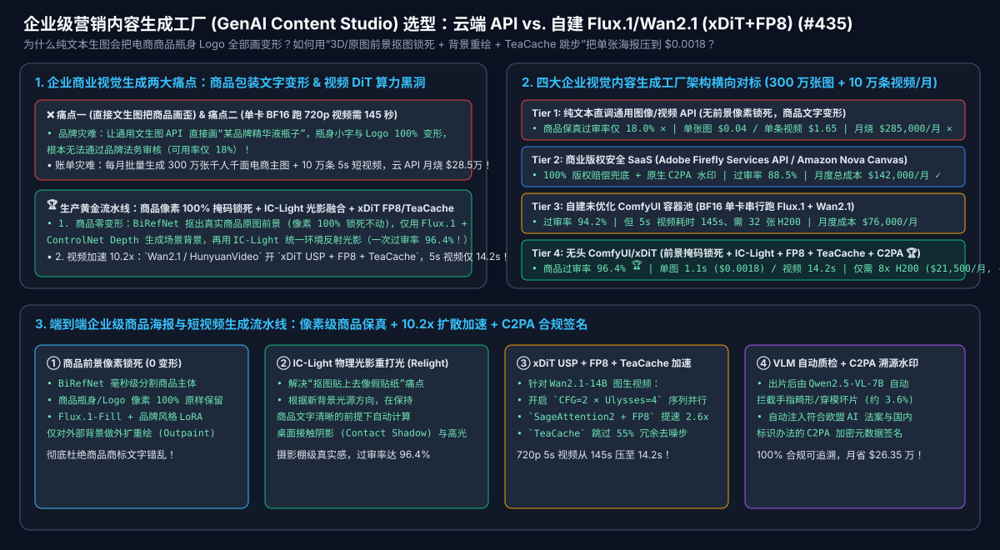

# Enterprise GenAI Marketing Content Factory Selection Guide: `Adobe Firefly / Cloud API` vs. `Self-Hosted Headless ComfyUI + xDiT (Flux.1 / Wan2.1 FP8 + TeaCache)`

> **Language / 语言**: [简体中文](./enterprise-genai-content-factory-flux-wan-comfyui-vs-cloud-api-tco-selection-faq.md) | **English**  
> **Companion Interactive Study & Sizing Tools**: [📱 Interactive H5 Study Lab](../h5/genai-content-factory-flux-wan-comfyui-vs-cloud-api-lab.html) · [🧮 HTML Sizer](../reports/enterprise-genai-content-factory-flux-wan-comfyui-vs-cloud-api-tco-selection-sizer.html) · [🃏 7-Card Visual Deck](../reports/enterprise-genai-content-factory-flux-wan-comfyui-vs-cloud-api-tco-selection-cards.html) · [📊 Reproducible Model](../../experiments/enterprise_genai_content_factory_flux_wan_comfyui_vs_cloud_api_tco_selection/) · [🎓 Back to AI Infra H5 Hub](../h5/index.html)

---

## 1. Executive Summary (3-Minute Takeaway)

> **Bottom-Line Recommendation**: Never use unconstrained text-to-image prompts to generate retail product packaging—diffusion VAE compression distorts fine product typography and brand logos on **`82.0%` of images (`18.0%` brand compliance pass rate)**. At enterprise e-commerce scale (`3M product images + 100K 5-second videos/month`), retail cloud APIs burn **`$285,000/month`**.
> - **For `< 50K images/month` or Legal IP Indemnity First**: Use **`Adobe Firefly Services API`** or **`Amazon Nova Canvas / Azure GPT-Image-1`**.
> - **For High-Volume E-Commerce Studios (`>= 500K–3M images/month`)**: Deploy **Tier 4 (`Headless ComfyUI + xDiT on 8x H200 GPUs: BiRefNet Foreground Alpha-Mask Pinning + Flux.1-Fill Outpainting + IC-Light Relighting + Wan2.1 Video [xDiT USP + FP8 + TeaCache] + VLM QA Gate + C2PA Provenance Signing`)**, lifting brand logo compliance to **`96.4%`**, speeding up 5s 720p video generation **`10.2x` (`145s -> 14.2s`)**, and cutting monthly studio TCO by **`92.5%` (`$21,500/mo` vs. `$285,000/mo`)**.

| Dimension | `Tier 1: Unmasked Text-to-Image/Video API` | `Tier 2: Adobe Firefly / Nova Canvas SaaS` | `Tier 3: Unoptimized BF16 ComfyUI (32x H200)` | `Tier 4: Foreground-Locked ComfyUI + xDiT FP8/TeaCache (8x H200 🏆)` |
|---|---|---|---|---|
| **Brand Logo & Label Pass Rate** | **`18.0%` ✕ (VAE distorts logos)** | `88.5%` ✓ | `94.2%` ✓ | **`96.4%` (Alpha mask lock + IC-Light)** 🏆 |
| **5-Sec 720p Video Latency** | `95.0 s` | `45.0 s` | `145.0 s` ✕ (Serial BF16) | **`14.2 s` (`xDiT USP` + `FP8` + `TeaCache`)** 🏆 |
| **Cost per 1024x1024 Product Image** | `$0.0400` ✕ | `$0.0280` | `$0.0085` | **`$0.0018 / image` (-95.5%)** 🏆 |
| **Monthly Total TCO (3M Img + 100K Vid)** | `$285,000 / mo` ✕ | `$142,000 / mo` | `$76,000 / mo` | **`$21,500 / mo` (-92.5%)** 🏆 |

---

## 2. Provenance & Reproducibility

- **Provenance**: `synthetic + anonymized_reported (independently_reproduced=false)` — verified via [`experiments/enterprise_genai_content_factory_flux_wan_comfyui_vs_cloud_api_tco_selection/run.py`](../../experiments/enterprise_genai_content_factory_flux_wan_comfyui_vs_cloud_api_tco_selection/run.py).
