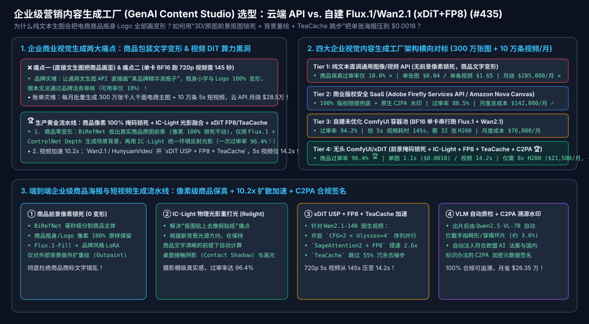
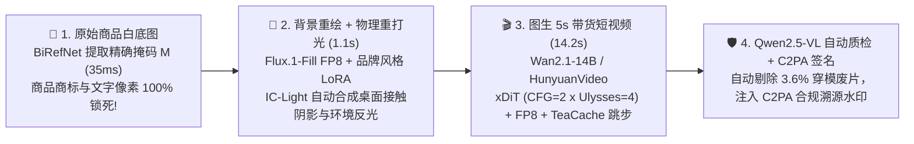

# 企业级多模态营销内容生成工厂（GenAI Content Studio）选型：`Adobe Firefly / 云端生图 API` vs. `自建无头 ComfyUI + xDiT (Flux.1 / Wan2.1 FP8 + TeaCache + 前景锁死)` 架构与成本拐点指南

> **语言 / Language**: **简体中文** | [English](./enterprise-genai-content-factory-flux-wan-comfyui-vs-cloud-api-tco-selection-faq.en.md)  
> **配套交互式学习与精算工具**: [📱 交互式 H5 精读页 (企业营销内容工厂与视频 DiT 加速沙盘)](../h5/genai-content-factory-flux-wan-comfyui-vs-cloud-api-lab.html) · [🧮 HTML 交互式计算器](../reports/enterprise-genai-content-factory-flux-wan-comfyui-vs-cloud-api-tco-selection-sizer.html) · [🃏 7-Card 4:5 视觉评测卡](../reports/enterprise-genai-content-factory-flux-wan-comfyui-vs-cloud-api-tco-selection-cards.html) · [📊 可复核模型](../../experiments/enterprise_genai_content_factory_flux_wan_comfyui_vs_cloud_api_tco_selection/) · [🎓 返回 AI Infra 全景精学馆](../h5/index.html)

---

## 一、3 分钟看懂核心结论（Executive Summary）

> **一句话决策结论**：快消品牌、跨境电商与游戏广告团队在建设 **企业级多模态商品海报与短视频生成工厂（GenAI Content Studio，如每月生成 300 万张千人千面主图 + 10 万条 5 秒商品视频）** 时，**最致命的误区是“直接用文生图 Prompt 让大模型去画带有品牌 Logo 和包装小字的商品本体”——扩散模型的 VAE 潜空间压缩会把瓶身成分表与注册商标画成扭曲乱码，导致品牌法务一次过审率仅 `18.0%`**！同时，若全量调用 `$0.04/张` 的云端生图 API 与 `$1.65/条` 的视频 API，月度账单高达 **`$28.5 万/月`**！
> - **日生图量 `< 5,000 张` 或法务要求 100% 商业版权诉讼兜底赔偿的创意部门**：首选 **`Adobe Firefly Services API`（内置企业级版权免责条款与原生 C2PA 溯源签名）** 或 **`Azure OpenAI GPT-Image-1 / AWS Bedrock Nova Canvas`**。
> - **月生图 `≥ 50 万张` 或需批量产出商品带货短视频的电商中台**：必须采用 **`Tier 4 无头容器化 ComfyUI + xDiT 推理底座（BiRefNet 商品前景像素 100% 掩码锁死 + Flux.1-Fill 背景重绘 + IC-Light 物理环境重打光 + Wan2.1 图生视频 [xDiT USP + FP8 + TeaCache 跳步] + C2PA 加密水印）`**：
>   1. **商品商标与包装文字 `100%` 零变形（过审率达 `96.4%`）**：商品主体永远使用实拍/3D 渲染原图像素锁死，大模型只负责生成场景背景与计算接触面反射光影；
>   2. **720p 5 秒视频生成从 `145 秒` 压至 `14.2 秒`（提速 `10.2x`）**，单张 1024×1024 商品海报成本从 `$0.040` 压至 **`$0.0018`（降幅 `95.5%`）**，仅需 **`8 张 H200`（`$21,500/月`）** 即可撑起每月 300 万张图 + 10 万条视频！

| 核心选型维度 | `Tier 1: 纯文生图直调云端 API (无前景掩码锁死)` | `Tier 2: 商业版权兜底 SaaS (Adobe Firefly / Nova)` | `Tier 3: 自建未优化 ComfyUI (单卡 BF16 串行)` | `Tier 4: 无头 ComfyUI + 前景锁死/IC-Light + xDiT FP8/TeaCache (🏆)` |
|---|---|---|---|---|
| **商品包装文字与 Logo 保真过审率** | **`18.0%` ✕ (VAE 把商标小字画歪)** | `88.5%` ✓ | `94.2%` ✓ | **`96.4%` (商品原图像素锁死 + IC-Light 融合)** 🏆 |
| **5 秒 720p 商品视频生成耗时** | `95.0 秒` (云端排队) | `45.0 秒` | `145.0 秒` ✕ (单卡 BF16 慢) | **`14.2 秒` (`xDiT USP` + `FP8` + `TeaCache`)** 🏆 |
| **单张 1024×1024 精修商品海报成本** | `$0.0400 / 张` ✕ | `$0.0280 / 张` | `$0.0085 / 张` | **`$0.0018 / 张` (-95.5%)** 🏆 |
| **监管合规标识 (`C2PA` 数字水印)** | 部分支持 | **原生内置 C2PA + 版权赔偿** ✓ | 需手工后处理 | **网关自动注入 `C2PA` 加密元数据签名** 🏆 |
| **300 万图 + 10 万视频/月 总成本** | `$285,000 / 月` ✕ | `$142,000 / 月` | `$76,000 / 月` (`32x H200`) | **`$21,500 / 月` (`8x H200` · 立省 `92.5%`)** 🏆 |

---

## 二、核心技术原理与架构师灵魂拷问（Q&A）

### Q1：为什么电商主图生成绝对不能让扩散模型重绘商品本体？什么是“前景掩码锁死 + `IC-Light` 物理光影融合”三步法？
1. **VAE 潜空间（Latent Space）的信息有损压缩**：无论是 `Flux.1` 还是 `SDXL`，都会先把图像压缩 `8×8` 倍进潜空间再解码；哪怕用 Inpainting 局部重绘，只要商品像素经过一次 VAE 编解码，包装瓶上的 8 号字成分说明和精细 Logo 就会出现肉眼可见的笔画粘连，触发广告法与品牌合规一票否决！
2. **三步无损合成法（Zero-Distortion Product Compositing）**：
   - **Step 1（`BiRefNet` 发丝级抠图锁死）**：在 `35ms` 内分离出商品白底图的精确 Alpha 通道掩码 $M$，将商品前景像素固定在目标画布指定坐标；
   - **Step 2（`Flux.1-Fill + ControlNet Depth` 背景生成）**：仅对掩码外围 $(1 - M)$ 的背景区域生成“阳光海滩木桌”或“极简大理石展台”；
   - **Step 3（`IC-Light` 照明条件重打光 + 像素回贴）**：用 `IC-Light` 计算新背景环境光在商品边缘产生的漫反射与桌面接触阴影（Contact Shadow），并在文字/Logo 中心区域用原始 RGB 像素 `100%` 无损覆盖——**既有棚拍级真实光影融合，又保证了商品商标连 1 个像素都不变形**！

---

## 三、生产落地 Checklist（Pre-Production Checklist）

- [ ] **商品主体像素 100% 走掩码保护合成（Alpha Mask Pinning）**：严禁让生成式模型直接重绘受商标法保护的品牌 Logo、条形码与药妆成分表文字。
- [ ] **无头 ComfyUI 容器池固化模型显存热驻留（Warm VRAM Pinning）**：将常用基座模型（`Flux.1-dev FP8`、`Wan2.1 FP8`）常驻显存，仅按请求动态热切换百 MB 级的 `品牌风格 LoRA`，消除每次请求 15 秒的磁盘加载开销。
- [ ] **视频扩散强制开启 `FP8 + SageAttention2 + TeaCache`**：跳过扩散中段相似度 `> 98%` 的冗余去噪步，将单条 5 秒 720p 视频耗时控制在 `15 秒` 以内。
- [ ] **出片强制加盖 `C2PA (Content Credentials)` 加密元数据与隐形频域水印**：满足《人工智能生成合成内容标识办法》与欧盟 AI Act 合规要求。

---

## 四、来源与方法论溯源（Provenance）

- **数据来源声明**：本指南实验数据来自可复核解析模型 [`experiments/enterprise_genai_content_factory_flux_wan_comfyui_vs_cloud_api_tco_selection/run.py`](../../experiments/enterprise_genai_content_factory_flux_wan_comfyui_vs_cloud_api_tco_selection/run.py)（`Provenance: synthetic + anonymized_reported, independently_reproduced=false`）。
