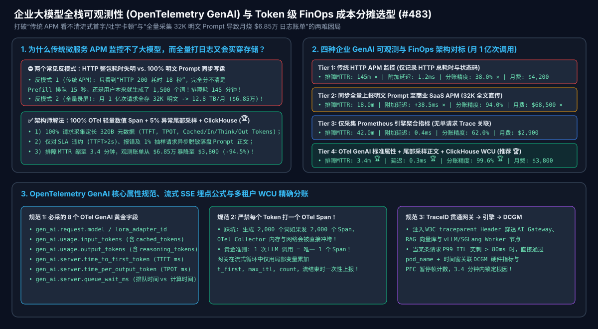

# Enterprise GenAI Full-Stack Observability (`OpenTelemetry GenAI Semantic Conventions`, `ClickHouse` & `WCU` Token FinOps) Selection Guide (#483)

> **Executive Summary**:
> At **100 Million LLM requests/month**, legacy **HTTP APM tools** record only total response duration (blinding SREs to `queue_wait_ms`, `TTFT`, `TPOT`, `max_itl_ms`, and cached vs. thinking tokens, resulting in **`145-minute` MTTR** and `38%` chargeback accuracy). Conversely, logging **100% of unredacted `32K` prompts synchronously to commercial SaaS APMs** adds `38.5ms` gateway latency and inflates observability bills to **`$68,500/month`**. For **Cloud & AI Solution Architects**, the production architecture combines **100% `OpenTelemetry GenAI` Fixed-Size Metadata Spans (`320B/req`) + 5% Asynchronous Tail-Sampled Redacted Payloads + `ClickHouse` Columnar Storage & `WCU` Chargeback**. This cuts root-cause `MTTR` to **`3.4 minutes`**, keeps gateway overhead at **`0.3ms`**, achieves **`99.6%` multi-tenant FinOps attribution accuracy**, and slashes observability cost by **94.5% (`$3,800/mo`)**.
>
> **⚡ Interactive H5 Study Lab**: [**Open the GenAI Observability (OpenTelemetry GenAI) & Token FinOps Sizer (`docs/h5/genai-observability-otel-token-finops-lab.html`)**](../h5/genai-observability-otel-token-finops-lab.html)

---

## 1. Core Q&A: Streaming SSE Telemetry Without Per-Token Span Storms

### Q1: Why must streaming SSE telemetry emit exactly 1 Span per request rather than 1 Span per token?
- Emitting a span per token generates 150B+ spans/month at 100M requests, overwhelming collectors. Instead, accumulate `t_first_token`, `max_itl_ms`, `cached_tokens`, `reasoning_tokens`, and `output_tokens` in gateway memory and emit **one `320-byte` `gen_ai.*` span** on stream completion (`stream_options: {"include_usage": true}`).

---

## 2. Quantitative Decision Matrix (`100M Requests/Month`)

| GenAI Observability & FinOps Stack | Root-Cause `MTTR` (min) | Gateway Overhead (ms) | Chargeback Accuracy (%) | Monthly Observability Bill ($/mo) |
| :--- | :--- | :--- | :--- | :--- |
| **Tier 1: Legacy HTTP APM Only (Total HTTP Duration Only)** | `145.0 min` ✕ | `1.2 ms` | `38.0%` ✕ | `$4,200` |
| **Tier 2: Sync Full-Prompt Logging to Commercial SaaS APM** | `18.0 min` | `+38.5 ms` ✕ | `94.0%` | `$68,500` ✕ |
| **Tier 3: Prometheus Engine Histograms Only (No Request Trace)** | `42.0 min` | `0.4 ms` | `62.0%` | `$2,900` |
| **Tier 4: `OTel GenAI` 100% Metadata + 5% Tail Payloads + `ClickHouse` 🏆** | **`3.4 min` (-97.7% 🏆)** | **`0.3 ms` 🏆** | **`99.6%` 🏆** | **`$3,800` (-94.5% 🏆)** |
