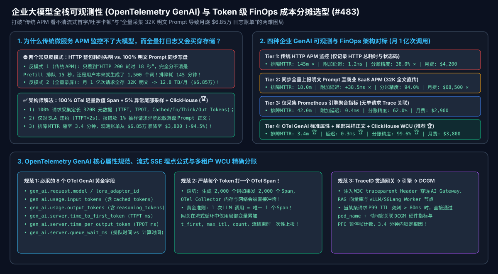
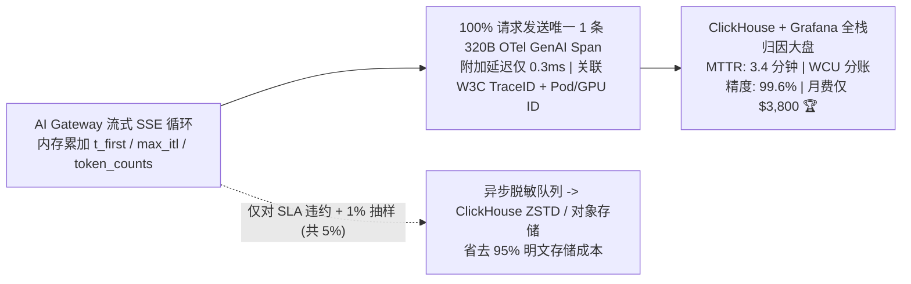

# 企业大模型全栈可观测性（`OpenTelemetry GenAI`）与 Token 级 FinOps 成本分摊选型指南 (#483)

> **核心观点（Executive Summary）**：
> 在企业大模型平台月调用量突破 **1 亿次（`100M Requests/mo`）** 后，运维与 FinOps 团队往往掉进两个极端陷阱：要么沿用 **传统 HTTP 微服务 APM**（只看得到“HTTP 200 耗时 18 秒”，完全分不清是排队慢、Prefill 慢，还是用户本来就生成了 1,500 个词，导致排障 `MTTR` 高达 **`145 分钟`** 且分账精度仅 `38%`）；要么开启 **全量同步明文 Prompt 录屏上报至商业 SaaS APM**（月增 `12.8 TB` 日志流量，不仅拖慢网关 `38.5ms`，更制造出每月 **`$68,500` 的天价监控账单** 与 PII 隐私泄露风险）！作为 **Cloud & AI Solution Architect**，生产级可观测底座必须采用 **`OpenTelemetry GenAI Semantic Conventions`（100% 采集 `320B` 定长数值 Span）+ 异常尾部采样脱敏落盘正文（`5% Tail-Sampling`）+ `ClickHouse` 列式存储与 `WCU` 加权成本归因**：将排障 `MTTR` 从 `145 分钟` 压缩至 **`3.4 分钟`**，网关附加延迟仅 **`0.3ms`**，多租户分账准确度达 **`99.6%`**，并将月度监控账单从 `$6.85万` 压降至 **`$3,800`（立省 94.5%）**！
>
> **⚡ 配套交互式 H5 精读沙盘**：[**打开 GenAI 全栈可观测性 (OpenTelemetry GenAI) 与日志成本/WCU 分账计算器 (`docs/h5/genai-observability-otel-token-finops-lab.html`)**](../h5/genai-observability-otel-token-finops-lab.html)

---

## 一、 灵魂拷问：为什么传统 APM 对流式 SSE 大模型是“瞎子”？为什么绝不能每个 Token 发一个 Span？

### Q1：一条耗时 18 秒的流式请求被投诉“很卡”，传统 APM 为什么束手无策？OTel GenAI Span 必须采哪 8 个黄金字段？
1. **传统 APM 的盲区**：
   - 在 SSE 流式响应中，网关在第 `0.3s` 就返回了 `HTTP 200 OK` 响应头，随后持续推送 18 秒的数据块；传统 APM 要么只记了 `0.3s`，要么只记了总长 `18.0s`。
2. **每个 LLM 请求唯一 1 个定长 Span（约 `320 Bytes`），强制记录以下 8 个数值属性**：
   - `gen_ai.system` / `gen_ai.request.model` / `gen_ai.lora.adapter_id`（模型与微调租户标识）；
   - `gen_ai.usage.input_tokens` 与 `gen_ai.usage.input_cached_tokens`（区分全价 Prefill 与 1 折缓存命中！）；
   - `gen_ai.usage.output_tokens` 与 `gen_ai.usage.reasoning_tokens`（区分可见回答与 `<think>` 思考草稿消耗！）；
   - `gen_ai.server.queue_wait_ms`（在 `vLLM/SGLang` waiting 队列里等了多久？）；
   - `gen_ai.server.time_to_first_token_ms`（`TTFT`：排队 + 真实 Prefill 耗时）；
   - `gen_ai.server.time_per_output_token_ms` 与 `max_inter_token_latency_ms`（平均 `TPOT` 与最大吐字卡顿 `Max ITL`！）。
   - **排障秒级定界**：看一眼这 8 个数字，3 秒内就能断定是 **“网关前 RAG 慢”**、**“KV 池满导致 `queue_wait_ms` 排队慢”**、**“长文未命中缓存导致 Prefill 慢”**，还是 **“中途混入大块 Prefill 导致 `max_itl_ms` 吐字卡顿”**！

### Q2：为什么严禁为每个生成的 Token 发送一个 OTel Span / Event？怎样在不买穿存储的前提下保留排障现场？
- **Per-Token Span 的流量风暴**：如果一条请求生成 `1,500` 个 Token 就产生 `1,500` 个 Span，月 1 亿次调用会产生 **1,500 亿个 Span**，直接把 OTel Collector 与后端存储彻底打挂！
- **架构师标准做法（“100% 数值指标 + 5% 尾部采样脱敏正文”）**：
  - AI Gateway 在流式转发循环中 **仅用内存寄存器累加时间戳**（计算 `TTFT`、`mean_TPOT`、`p99_ITL`），在流式结束（`[DONE]`）时发出 **唯一 1 条 `320 Bytes` 的 OTel Span**；
  - 至于庞大的 `32K` 明文 Prompt 与 Response 文本：仅当请求发生 **SLA 违约（如 `TTFT > 2.0s` 或 `HTTP 429/500`）** 或命中 **1% 随机抽样** 时，才通过异步 Kafka 队列经 PII 脱敏后写入廉价对象存储 / ClickHouse ZSTD 压缩表！

---

## 二、 四种企业 GenAI 可观测与 FinOps 架构选型决策矩阵（`1 亿次调用/月`）

| GenAI 可观测与 FinOps 架构档位（`100M Reqs/mo`） | 根因定位 `MTTR` (分钟) | 网关遥测附加延迟 (ms) | 多租户成本分账精度 (%) | 月度可观测平台账单 ($/mo) |
| :--- | :--- | :--- | :--- | :--- |
| **Tier 1: 传统 HTTP APM 监控（仅记录 HTTP 总耗时与状态码）** | `145.0 分钟` ✕ | `1.2 ms` | `38.0%`（按请求次数平摊 ✕） | `$4,200` |
| **Tier 2: 同步全量上报 32K 明文 Prompt 至商业 SaaS APM** | `18.0 分钟` | `+38.5 ms` ✕ | `94.0%` | `$68,500`（天价存储 ✕） |
| **Tier 3: 仅采集 Prometheus 引擎聚合直方图（无单请求 Trace）** | `42.0 分钟` | `0.4 ms` | `62.0%` | `$2,900` |
| **Tier 4: `OTel GenAI` 100% 数值 Span + 5% 尾部采样 + `ClickHouse WCU`（推荐 🏆）** | **`3.4 分钟` (-97.7% 🏆)** | **`0.3 ms` 🏆** | **`99.6%` 🏆** | **`$3,800` (-94.5% 🏆)** |

---

## 三、 生产落地核对清单（SA Production Checklist）

- [ ] **全面对齐 `OpenTelemetry GenAI Semantic Conventions`**：网关与 Agent 框架统一输出标准 `gen_ai.*` 属性，禁止各团队自造私有日志字段导致无法跨组件聚合。
- [ ] **在流式 SSE 尾包强制开启 `stream_options: {"include_usage": true}`**：确保流式模式下 `vLLM / SGLang` 在最后一个 chunk 精确返回 `prompt_tokens`、`cached_tokens`、`reasoning_tokens` 与 `completion_tokens`，杜绝网关用本地分词器重复分词浪费 CPU。
- [ ] **按 `WCU`（加权计算单元）而非原始 Token 数向部门出账**：在 ClickHouse 账单视图中按 $\text{WCU} = 0.1 T_{\text{cache}} + 1.0 T_{\text{in}} + 3.5 T_{\text{think}} + 4.0 T_{\text{out}}$ 核算各业务线真实 GPU 占用。

---

## 四、 延伸阅读与配套工具

- **交互式 H5 精学沙盘**：[docs/h5/genai-observability-otel-token-finops-lab.html](../h5/genai-observability-otel-token-finops-lab.html)
- **7-Card 4:5 视觉评测卡片**：[docs/reports/enterprise-genai-observability-opentelemetry-token-finops-telemetry-selection-cards.html](../reports/enterprise-genai-observability-opentelemetry-token-finops-telemetry-selection-cards.html)
- **交互式 Sizer 测算器**：[docs/reports/enterprise-genai-observability-opentelemetry-token-finops-telemetry-selection-sizer.html](../reports/enterprise-genai-observability-opentelemetry-token-finops-telemetry-selection-sizer.html)
- **可复现实验模型**：[`experiments/enterprise_genai_observability_opentelemetry_token_finops_telemetry_selection/run.py`](../../experiments/enterprise_genai_observability_opentelemetry_token_finops_telemetry_selection/run.py)
