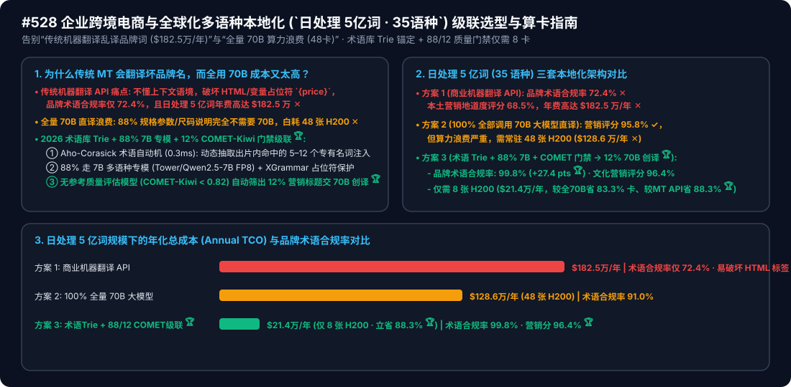

# Enterprise Global Localization & Cross-Border E-Commerce AI (`500M Words/Day · 35 Languages`) Selection Guide: Legacy MT vs. `100% 70B` vs. `Glossary Trie + 88/12 COMET-Gated Cascade` (#528)

> **Executive Summary**:
> Translating **`500M words/day` across `35` languages** via legacy commercial NMT APIs costs **`$1.83M/yr`** while corrupting brand terms and HTML/JSON placeholders (`72.4%` compliance ✕). Conversely, routing 100% of product specs through a `70B LLM` requires **`48x H200 GPUs` (`$1.29M/yr` ✕)**. Combining **`0.3ms` Aho-Corasick Glossary Trie Injection + `88%` 7B Specialist (`Tower/Qwen2.5-7B`) + `COMET-Kiwi` Quality Estimation Gate Routing `12%` to `70B` Cultural Transcreation 🏆**:
> 1. **Reaches `99.8%` Brand Glossary & Tag Compliance 🏆** and **`96.4%` cultural marketing quality**;
> 2. **Cuts Fleet Size by `83.3%` (`48 -> 8x H200 GPUs`)** and saves **`88.3%` annual TCO (`$214,000/yr` vs. `$1.83M/yr` commercial MT API 🏆)**!
>
> **⚡ Interactive H5 Study Lab**: [**Open Global Localization 500M-Word/Day AI Cascade Sizer (`docs/h5/global-localization-glossary-trie-slm-llm-cascade-lab.html`)**](../h5/global-localization-glossary-trie-slm-llm-cascade-lab.html)

---

## 1. Quantitative Decision Matrix (`500M Words/Day · 35 Languages`)

| Localization Architecture | Brand Glossary Compliance | Cultural Marketing Score | Required `H200` GPUs | Annual TCO |
| :--- | :--- | :--- | :--- | :--- |
| **Legacy Baseline: Commercial Neural MT API** | `72.4%` ✕ | `68.5%` ✕ | `0 GPUs` | `$1,825,000 / yr` ✕ |
| **Anti-Pattern: `100% Flagship 70B LLM`** | `91.0%` | `95.8%` ✓ | `48 GPUs` ✕ | `$1,286,000 / yr` ✕ |
| **Optimal: `Glossary Trie + 88% 7B + COMET -> 12% 70B` 🏆** | **`99.8% (+27.4 pts)` 🏆** | **`96.4%` 🏆** | **`8 GPUs (-83.3%)` 🏆** | **`$214,000 (-88.3%)` 🏆** |

---

## 2. Companion Links

- **Interactive H5 Study Lab**: [docs/h5/global-localization-glossary-trie-slm-llm-cascade-lab.html](../h5/global-localization-glossary-trie-slm-llm-cascade-lab.html)
- **7-Card 4:5 Visual Report**: [docs/reports/enterprise-global-localization-glossary-trie-slm-llm-cascade-sizing-selection-cards.html](../reports/enterprise-global-localization-glossary-trie-slm-llm-cascade-sizing-selection-cards.html)
- **HTML Sizer**: [docs/reports/enterprise-global-localization-glossary-trie-slm-llm-cascade-sizing-selection-sizer.html](../reports/enterprise-global-localization-glossary-trie-slm-llm-cascade-sizing-selection-sizer.html)
- **Reproducible Model**: [`experiments/enterprise_global_localization_glossary_trie_slm_llm_cascade_sizing_selection/run.py`](../../experiments/enterprise_global_localization_glossary_trie_slm_llm_cascade_sizing_selection/run.py)
