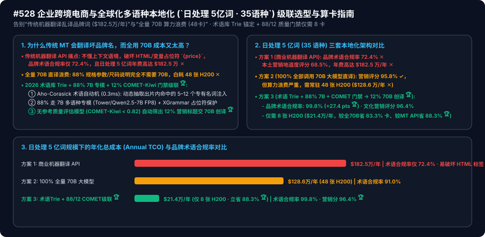

# 企业跨境电商与全球化多语种实时本地化（`Global Localization · 日处理 5 亿词 · 35 语种`）架构选型：传统机器翻译 API vs. 全量 70B 直译 vs. `品牌术语库 Trie 锚定 + 88% 7B 专模 + 12% COMET-Kiwi 质量门禁触发 70B 文化创译` 算卡指南 (#528)

> **核心观点（Executive Summary）**：
> 在跨境电商、游戏出海与跨国 SaaS 平台（**日处理 `5 亿词`，覆盖 `35` 种语言**）中，传统机器翻译 API（NMT）经常翻译坏品牌专有名词、破坏 HTML/JSON 占位符（术语合规率仅 `72.4%`），且年费高达 **`$182.5 万/年` ✕**；而若将所有商品规格表全部塞给 `70B` 旗舰大模型翻译，又需要常驻 **`48 张 H200`（年费 `$128.6 万` ✕）**。本专题给出 **“术语自动机锚定 + 88/12 无参考质量评估门禁级联”** 黄金架构：
> 1. **`0.3ms` Aho-Corasick 品牌术语自动机动态注入**：无需把 5 万条全量术语表塞进 Prompt，而是在 `0.3ms` 内扫描待译源文本，精准抽出其中出现的 `5–12` 个品牌/型号词条注入后缀，结合 `XGrammar` 正则保护将术语与标签合规率推至 **`99.8%` 🏆**；
> 2. **`88%` 走 `7B` 翻译专模 + `12%` 经 `COMET-Kiwi` 自动送 `70B` 文化创译**：常规参数页与客服问答由 `Tower-7B / Qwen2.5-7B FP8` 极速翻译；由轻量无参考质量评分模型 **`COMET-Kiwi (QE)`** 在 `3ms` 内打分，仅将得分 `<0.82` 或包含本土双关语的 `12%` 营销标题送入 `70B` 精修，将所需 H200 从 `48 张` 暴降至 **`8 张`（较全 70B 立省 `83.3%` GPU，较商业 MT API 净省 `88.3%` / `$161.1 万/年` 🏆）**！
>
> **⚡ 配套交互式 H5 精读沙盘**：[**打开全球化多语种本地化 (Glossary Trie + COMET 级联) 算卡计算器 (`docs/h5/global-localization-glossary-trie-slm-llm-cascade-lab.html`)**](../h5/global-localization-glossary-trie-slm-llm-cascade-lab.html)

---

## 一、 日处理 5 亿词（35 语种）三套本地化架构选型决策矩阵

| 多语种本地化架构方案（`5 亿词/天`） | 品牌术语/占位符合规率 | 本土营销文化评分 | 所需 `H200` 卡数 | 年化总成本 (`TCO`) |
| :--- | :--- | :--- | :--- | :--- |
| **传统基线：商业机器翻译 API (`Generic NMT API`)** | `72.4%` ✕ | `68.5%` ✕ | `0 张 (纯API)` | `$1,825,000 / 年` ✕ |
| **反模式：100% 全量调用 `70B` 旗舰大模型** | `91.0%` | `95.8%` ✓ | `48 张 H200` ✕ | `$1,286,000 / 年` ✕ |
| **最佳方案：`术语Trie + 88% 7B + COMET门禁 -> 12% 70B` 🏆** | **`99.8% (+27.4 pts)` 🏆** | **`96.4%` 🏆** | **`8 张 H200 (-83.3%)` 🏆** | **`$214,000 (-88.3%)` 🏆** |

---

## 二、 延伸阅读与配套工具

- **交互式 H5 精学沙盘**：[docs/h5/global-localization-glossary-trie-slm-llm-cascade-lab.html](../h5/global-localization-glossary-trie-slm-llm-cascade-lab.html)
- **7-Card 4:5 视觉评测卡片**：[docs/reports/enterprise-global-localization-glossary-trie-slm-llm-cascade-sizing-selection-cards.html](../reports/enterprise-global-localization-glossary-trie-slm-llm-cascade-sizing-selection-cards.html)
- **交互式 Sizer 测算器**：[docs/reports/enterprise-global-localization-glossary-trie-slm-llm-cascade-sizing-selection-sizer.html](../reports/enterprise-global-localization-glossary-trie-slm-llm-cascade-sizing-selection-sizer.html)
- **可复现实验模型**：[`experiments/enterprise_global_localization_glossary_trie_slm_llm_cascade_sizing_selection/run.py`](../../experiments/enterprise_global_localization_glossary_trie_slm_llm_cascade_sizing_selection/run.py)
